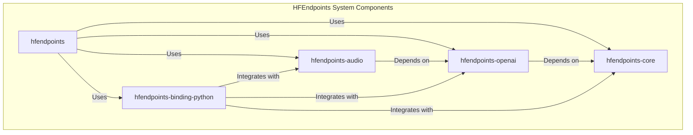
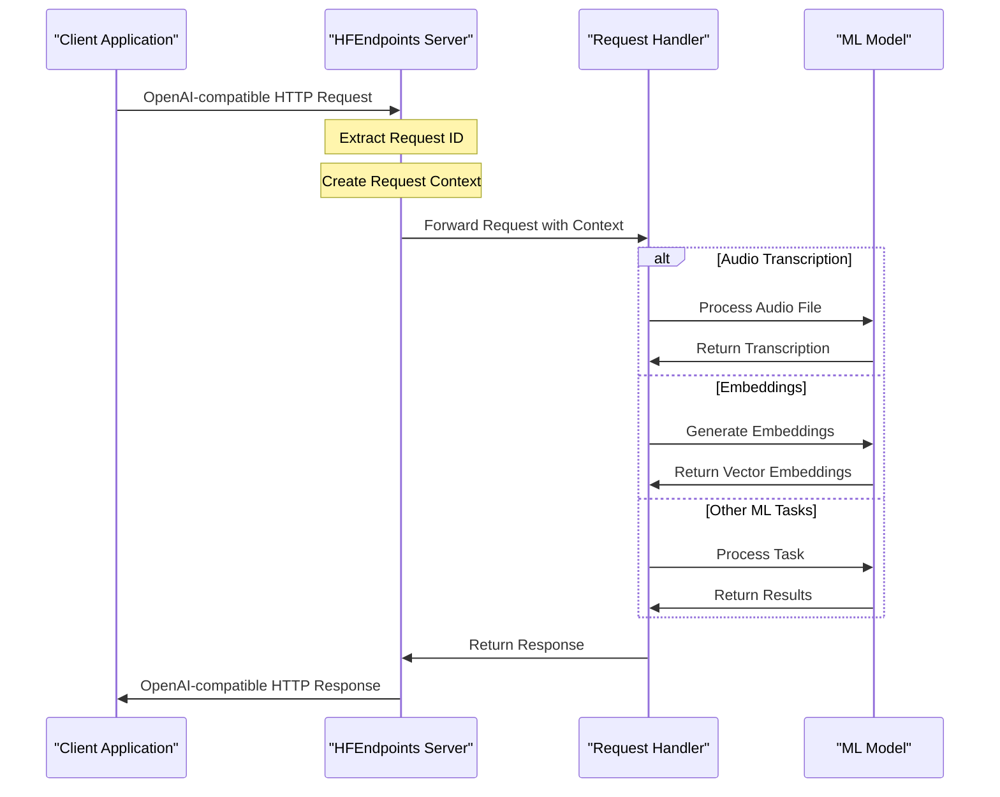
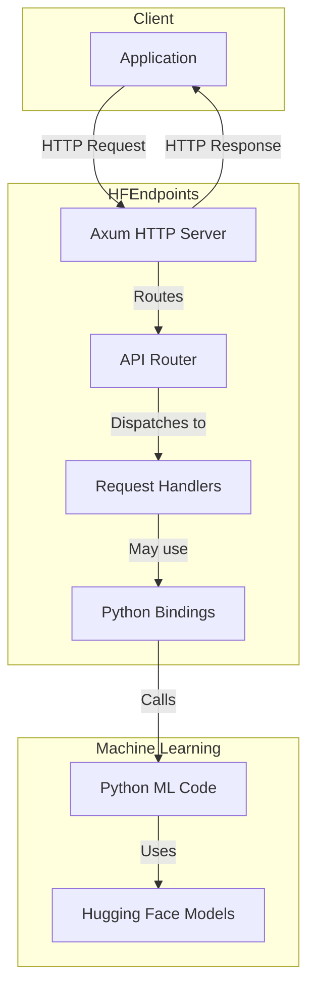
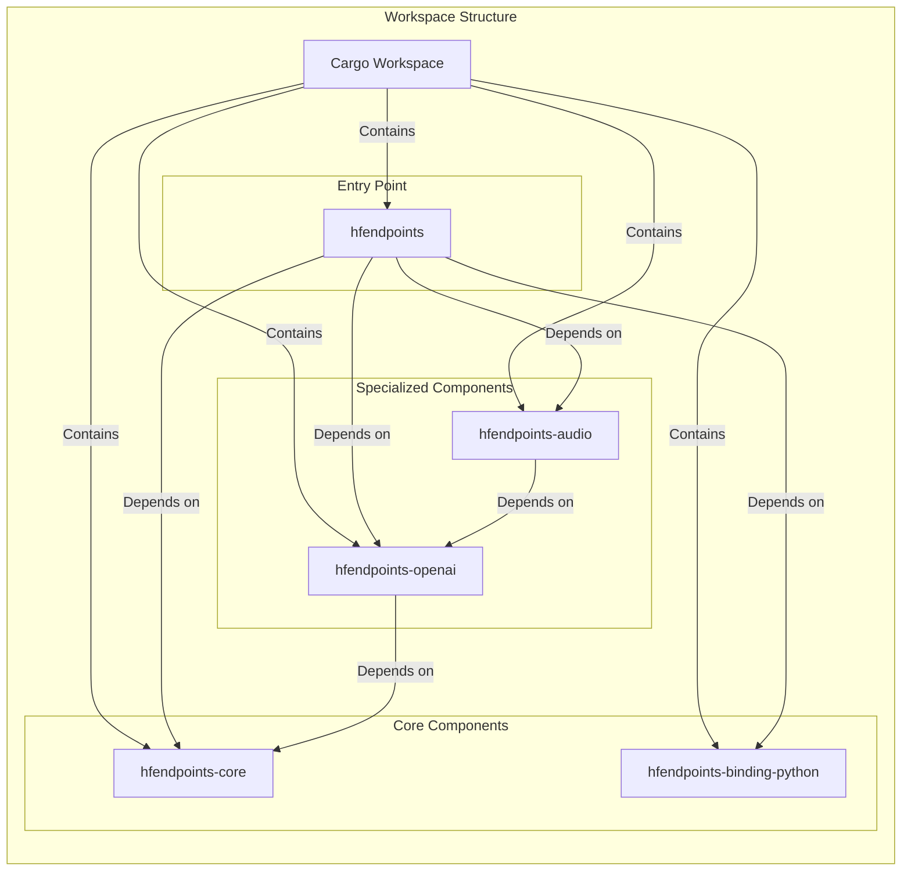

<!-- source: DeepWiki mcp.deepwiki.com · repo huggingface/hfendpoints · page 1 Overview · fetched 2026-10-26 -->

# Overview

Relevant source files

The following files were used as context for generating this wiki page:

- [Cargo.toml](Cargo.toml)
- [hfendpoints-openai/Cargo.toml](hfendpoints-openai/Cargo.toml)
- [hfendpoints/Cargo.toml](hfendpoints/Cargo.toml)

## Purpose and Scope

HFEndpoints is a framework for creating OpenAI-compatible API endpoints for Hugging Face models. It allows developers to serve machine learning models using interfaces that conform to the OpenAI API specification, making it easy to integrate Hugging Face models with existing applications that use the OpenAI SDK. This framework is written primarily in Rust with Python bindings, enabling high-performance inference while maintaining ease of use.

This overview introduces the HFEndpoints repository structure, its core components, and its high-level architecture. For more detailed information about the system architecture, see [Architecture Overview](#1.1).

## System Architecture

HFEndpoints follows a modular architecture, composed of several specialized crates that work together to provide OpenAI-compatible endpoints.

Sources: [Cargo.toml:3-8](), [hfendpoints/Cargo.toml:10-14]()

## Core Components

HFEndpoints consists of the following primary components:

### 1. Core Library (hfendpoints-core)

This is the foundation of the HFEndpoints framework, providing essential abstractions and protocols such as:
- Handler Protocol - Defines how requests are processed
- Endpoint Trait - Specifies interfaces that servers must implement
- Request context and tracking mechanisms

### 2. OpenAI-Compatible API (hfendpoints-openai)

Implements an HTTP server that presents API endpoints compatible with the OpenAI API specification. Built on Axum (a Rust web framework), it handles request routing, serialization/deserialization, and protocol-specific concerns.

### 3. Audio Processing (hfendpoints-audio)

Specializes in audio-related tasks like transcription, built on top of the OpenAI-compatible API framework.

### 4. Python Bindings (hfendpoints-binding-python)

Enables integration with Python code, allowing:
- Implementation of handlers in Python
- Use of Python-based machine learning libraries
- Seamless integration with the Hugging Face ecosystem

### 5. Main Package (hfendpoints)

Acts as the entry point and integration layer, bringing together all components into a cohesive whole. It's configured as a dynamic library that can be loaded by Python applications.

Sources: [Cargo.toml:3-8](), [hfendpoints/Cargo.toml:10-14](), [hfendpoints/Cargo.toml:20-29]()

## Request Processing Flow

The following diagram illustrates how requests flow through the HFEndpoints system:

Sources: [hfendpoints-openai/Cargo.toml:7-9](), [hfendpoints-openai/Cargo.toml:18-23]()

## Component Interactions and Data Flow

Sources: [hfendpoints-openai/Cargo.toml:7-9](), [hfendpoints-openai/Cargo.toml:10-14]()

## Features and Capabilities

HFEndpoints provides several key capabilities:

| Feature | Description |
|---------|-------------|
| OpenAI API Compatibility | Drop-in replacement for OpenAI API endpoints with compatible request/response formats |
| Audio Transcription | Process and transcribe audio files using Hugging Face models |
| Embeddings | Generate vector embeddings for text using compatible models |
| Python Integration | Seamless integration with Python ML ecosystems |
| High Performance | Rust-based server with optimized request handling |
| Configurable | Flexible configuration options for deployment scenarios |

Sources: [hfendpoints-openai/Cargo.toml:7-23](), [hfendpoints/Cargo.toml:20-29]()

## Code Organization

The HFEndpoints codebase is organized as a Rust workspace with several specialized crates:

Sources: [Cargo.toml:1-8](), [hfendpoints/Cargo.toml:10-14]()

## Feature Flags

HFEndpoints uses feature flags to enable optional components, particularly for Python integration:

| Feature | Description | Enabled Components |
|---------|-------------|-------------------|
| `python` | Enables Python integration | PyO3, Python bindings for all components |

The Python feature enables comprehensive integration with Python applications, allowing models to be implemented and used from Python code while benefiting from the performance of the Rust-based server.

Sources: [hfendpoints/Cargo.toml:20-29](), [hfendpoints-openai/Cargo.toml:31-34]()

## Getting Started

For information on how to get started with HFEndpoints, including installation, configuration, and basic usage, see [Getting Started](#1.2).

## Related Documentation

- For detailed information about the core components, see [Core Components](#2)
- For information about OpenAI-compatible endpoints, see [OpenAI-Compatible Endpoints](#3)
- For details about Python integration, see [Python Integration](#4)
- For deployment and testing information, see [Deployment and Testing](#5)

---

