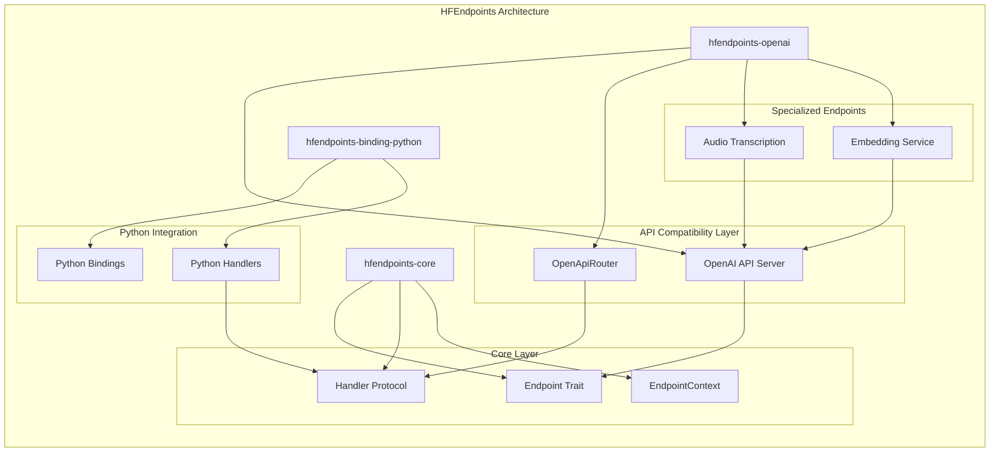
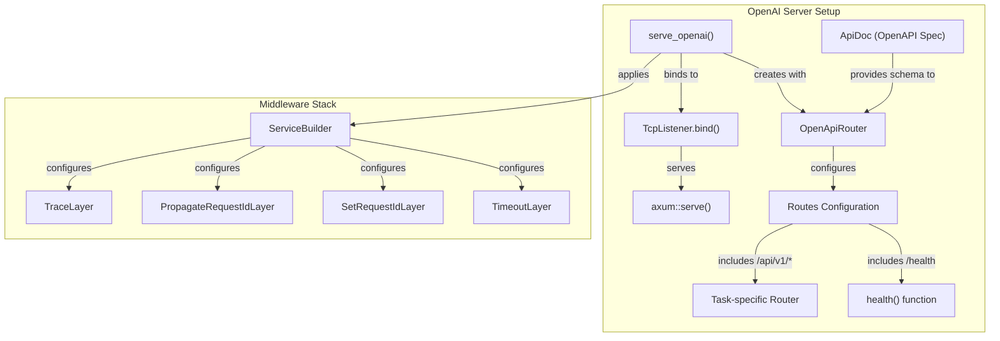
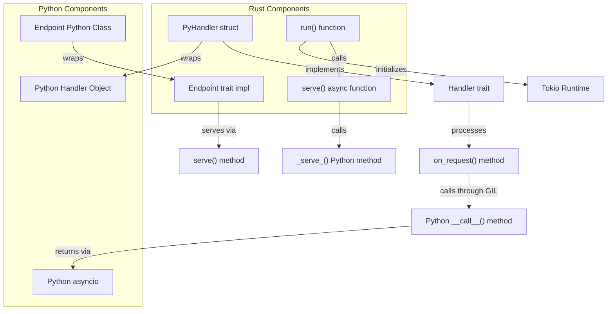
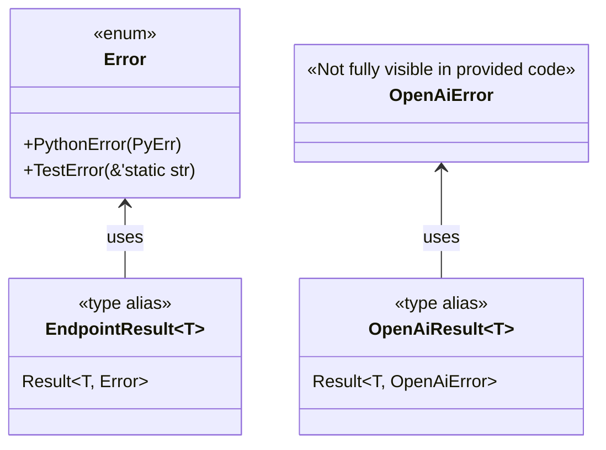
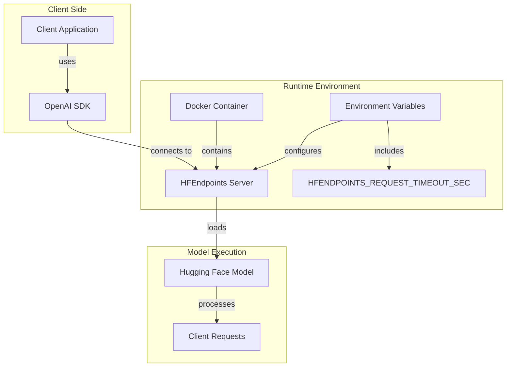
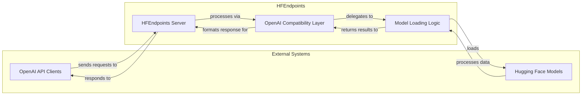

<!-- source: DeepWiki mcp.deepwiki.com · repo huggingface/hfendpoints · page 1.1 Architecture Overview · fetched 2026-10-26 -->

# Architecture Overview

<details>
<summary>Relevant source files</summary>

The following files were used as context for generating this wiki page:

- [Cargo.toml](Cargo.toml)
- [hfendpoints-core/src/lib.rs](hfendpoints-core/src/lib.rs)
- [hfendpoints-openai/src/lib.rs](hfendpoints-openai/src/lib.rs)

</details>


This document provides a high-level view of the HFEndpoints system architecture, explaining how the different components interact with each other to deliver OpenAI-compatible endpoints for Hugging Face models. For more information about getting started with HFEndpoints, see [Getting Started](#1.2). For details about specific components, see [Core Components](#2).

## System Purpose and Key Components

HFEndpoints is a framework that enables serving Hugging Face models through OpenAI-compatible APIs. The system is built on a modular architecture with a clear separation of concerns:



Sources: [hfendpoints-core/src/lib.rs:1-12](), [hfendpoints-openai/src/lib.rs:18-26](), [Cargo.toml:1-9]()

## Crate Organization

The HFEndpoints system is organized into a set of Rust crates, each with a specific responsibility:

| Crate | Purpose |
|-------|---------|
| `hfendpoints-core` | Core traits and interfaces |
| `hfendpoints-openai` | OpenAI API compatibility layer |
| `hfendpoints-audio` | Audio processing functionality |
| `hfendpoints-binding-python` | Python language bindings |
| `hfendpoints` | Main entry point |

Sources: [Cargo.toml:1-9]()

## Request Processing Flow

The following diagram illustrates how requests flow through the HFEndpoints system:

```mermaid
sequenceDiagram
    participant Client as "Client Application"
    participant Server as "Axum HTTP Server"
    participant Router as "OpenApiRouter"
    participant Handler as "Handler Implementation"
    participant Model as "ML Model"
    
    Client->>Server: HTTP Request
    note over Server: Extract Request ID
    Server->>Server: Create Context with Request ID
    note over Server: Applied via tower::ServiceBuilder
    
    Server->>Router: Forward Request with Context
    Router->>Handler: Schedule Request Processing
    
    alt Audio Transcription
        Handler->>Model: Process Audio File
        Model->>Handler: Return Transcription
    else Embeddings
        Handler->>Model: Generate Embeddings
        Model->>Handler: Return Vector Embeddings
    end
    
    Handler->>Router: Return Response
    Router->>Server: Format Response
    Server->>Client: HTTP Response
```



Sources: [hfendpoints-openai/src/lib.rs:55-92](), [hfendpoints-core/src/lib.rs:6-8]()

## Core Components and Their Relationships

The core components of HFEndpoints are defined by traits and interfaces that enable modularity and extensibility:

```mermaid
classDiagram
    class Endpoint {
        <<trait>>
        +serve(config) Result~()~
    }
    
    class Handler {
        <<trait>>
        +Request type
        +Response type
        +on_request(request) Result~Response~
    }
    
    class EndpointContext {
        +request_id: String
    }
    
    class OpenApiRouter {
        +with_openapi(api) -> OpenApiRouter
        +routes() -> Router
    }
    
    class serve_openai {
        +async fn(interface, task_router) -> Result
    }
    
    class PyHandler {
        +inner: PyObject
        +on_request(request) Result~Response~
    }
    
    Endpoint <|-- "OpenAI Compatible Endpoint"
    Handler <|-- PyHandler
    "OpenAI Compatible Endpoint" -- EndpointContext : uses
    serve_openai -- OpenApiRouter : configures
    Handler -- "wait_for_requests()" : processes via
    PyHandler -- "Python Handler Object" : delegates to
```

Sources: [hfendpoints-core/src/lib.rs:5-8](), [hfendpoints-openai/src/lib.rs:55-92](), [hfendpoints-openai/src/lib.rs:123-173]()

## OpenAI API Compatibility

The OpenAI compatibility layer is built around the `serve_openai` function, which sets up an HTTP server with OpenAI-compatible routes:



Sources: [hfendpoints-openai/src/lib.rs:55-92]()

## Python Integration

HFEndpoints provides Python integration through Rust bindings, allowing handlers to be implemented in Python:



Sources: [hfendpoints-openai/src/lib.rs:94-304](), [hfendpoints-openai/src/lib.rs:123-173](), [hfendpoints-openai/src/lib.rs:192-241]()

## Server Configuration and Request Handling

The `serve_openai` function configures the server with several middleware layers for request handling:

| Middleware | Purpose |
|------------|---------|
| `TraceLayer` | Provides request tracing |
| `SetRequestIdLayer` | Sets a unique request ID for each request |
| `PropagateRequestIdLayer` | Propagates the request ID through headers |
| `TimeoutLayer` | Enforces request timeouts |

The server routes requests to the appropriate handler based on the URL path. The default routes include:

- `/health` - Health check endpoint
- `/api/v1/*` - API endpoints (audio, embeddings, etc.)
- `/docs` - API documentation

Sources: [hfendpoints-openai/src/lib.rs:55-92]()

## Error Handling

The system defines a custom `Error` type in the core crate, which is used throughout the codebase for consistent error handling:



Sources: [hfendpoints-core/src/lib.rs:15-28](), [hfendpoints-openai/src/lib.rs:25-27]()

## Deployment Architecture

The HFEndpoints system can be deployed as a standalone service or embedded within other applications. When deployed as a service, it typically runs in a Docker container with configuration provided through environment variables:



Sources: [hfendpoints-openai/src/lib.rs:64-69]()

## Integration with Other Systems

HFEndpoints is designed to integrate with the broader Hugging Face ecosystem, providing a bridge between the OpenAI API and Hugging Face models:



## Summary

The HFEndpoints architecture is designed around a set of modular components that work together to provide OpenAI-compatible endpoints for Hugging Face models. The system is built on Rust for performance and safety, with Python bindings for easy integration with the Python ecosystem. The architecture provides flexibility and extensibility, allowing for different types of models and endpoints to be supported.

---

