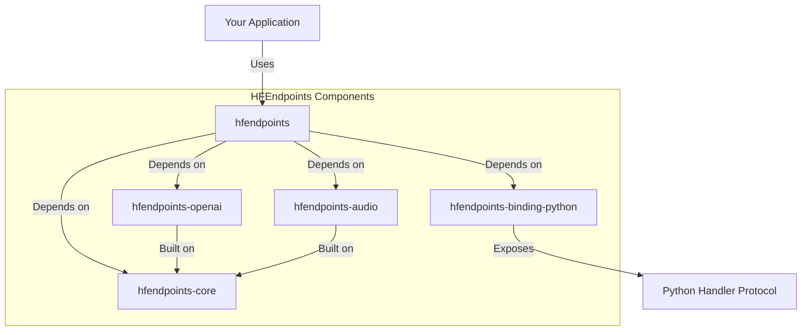
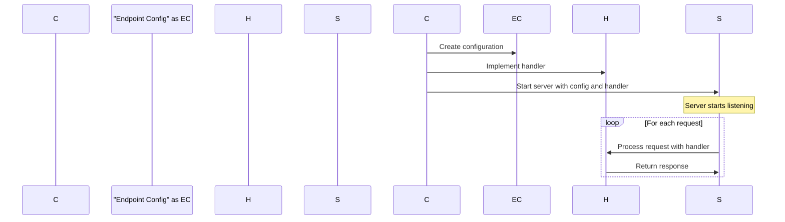
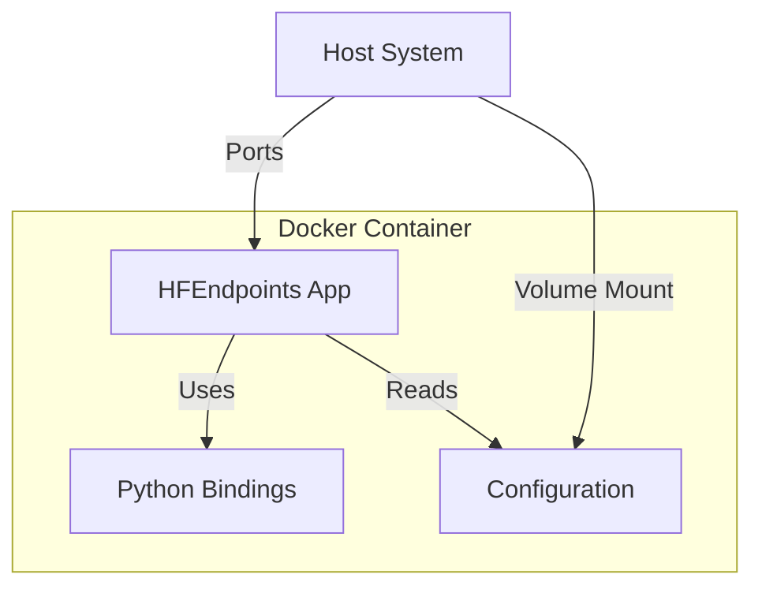

<!-- source: DeepWiki mcp.deepwiki.com · repo huggingface/hfendpoints · page 1.2 Getting Started · fetched 2026-10-26 -->

# Getting Started

<details>
<summary>Relevant source files</summary>

The following files were used as context for generating this wiki page:

- [.dockerignore](.dockerignore)
- [Cargo.toml](Cargo.toml)
- [Dockerfile](Dockerfile)
- [hfendpoints/bindings/python/hfendpoints/__init__.py](hfendpoints/bindings/python/hfendpoints/__init__.py)

</details>


This guide will walk you through setting up and using HFEndpoints to create OpenAI-compatible API servers for Hugging Face models. We'll cover installation, basic configuration, and running your first endpoint. For detailed information about the system architecture, see [Architecture Overview](#1.1).

## Prerequisites

Before getting started with HFEndpoints, ensure you have the following:

- Python 3.8 or newer
- Rust toolchain (for building from source)
- Docker (optional, for containerized deployment)

## Installation

HFEndpoints can be installed using pip or built from source. Choose the method that best suits your needs.

### Installing via pip

```bash
pip install hfendpoints
```

### Building from source

To build from source, clone the repository and use Maturin to build the package:

```bash
git clone https://github.com/huggingface/hfendpoints
cd hfendpoints
pip install maturin
cd hfendpoints
maturin build --release
pip install target/wheels/hfendpoints-*.whl
```

Sources: [Dockerfile:1-5](), [Cargo.toml:1-8]()

## System Components

HFEndpoints consists of several components working together to provide OpenAI-compatible endpoints:



Sources: [Cargo.toml:1-8]()

## Creating Your First Endpoint

Setting up an HFEndpoints server involves defining a configuration and implementing a handler for your model.

### Basic Configuration

The first step is to create an `EndpointConfig` that defines how your endpoint will be set up:

```python
from hfendpoints import EndpointConfig

config = EndpointConfig(
    model_id_or_path="your-model-id",
    port=8000,
    interface="0.0.0.0"
)
```

The `EndpointConfig` specifies:
- The model to use
- Network interface and port to bind to
- Other optional configurations like authentication

Sources: [hfendpoints/bindings/python/hfendpoints/__init__.py:6]()

### Implementing a Handler

Handlers process incoming requests and return appropriate responses. Implement the `Handler` protocol to create your own:

```mermaid
classDiagram
    class "Handler[Request, Response]" {
        <<Protocol>>
        +__init__(model_id_or_path: str)
        +__call__(request: Request, ctx) -> Response
    }
    
    class "YourHandler" {
        +__init__(model_id_or_path: str)
        +__call__(request: Request, ctx) -> Response
    }
    
    "Handler[Request, Response]" <|.. "YourHandler" : implements
```

A simple handler implementation might look like this:

```python
from hfendpoints import Handler

class MyHandler(Handler):
    def __init__(self, model_id_or_path: str):
        # Initialize your model here
        self.model_id = model_id_or_path
        
    def __call__(self, request, ctx):
        # Process the request and generate a response
        return {"response": "Hello from " + self.model_id}
```

Sources: [hfendpoints/bindings/python/hfendpoints/__init__.py:14-19]()

## Running Your Endpoint

The way you run your endpoint depends on which compatible API you're implementing. Here's a general sequence for launching an endpoint:



For specialized endpoints like OpenAI-compatible ones, you would use the appropriate module. For details on creating specific endpoint types, see:

- [OpenAI-Compatible Endpoints](#3)
- [Audio Transcription](#3.2)
- [Embeddings](#3.3)

## Containerization

HFEndpoints can be containerized using Docker, which simplifies deployment and ensures consistency:



A basic Dockerfile would look like the provided example:

Sources: [Dockerfile:1-5](), [.dockerignore:1-10]()

## Next Steps

Now that you have a basic understanding of HFEndpoints, you can:

1. Learn how to implement more complex handlers in Python - see [Python Handler Implementation](#4.2)
2. Explore example implementations - see [Examples](#4.3)
3. Configure and deploy your endpoints to production - see [Configuration and Deployment](#5.3)

You're now ready to start building OpenAI-compatible endpoints for Hugging Face models!

---

