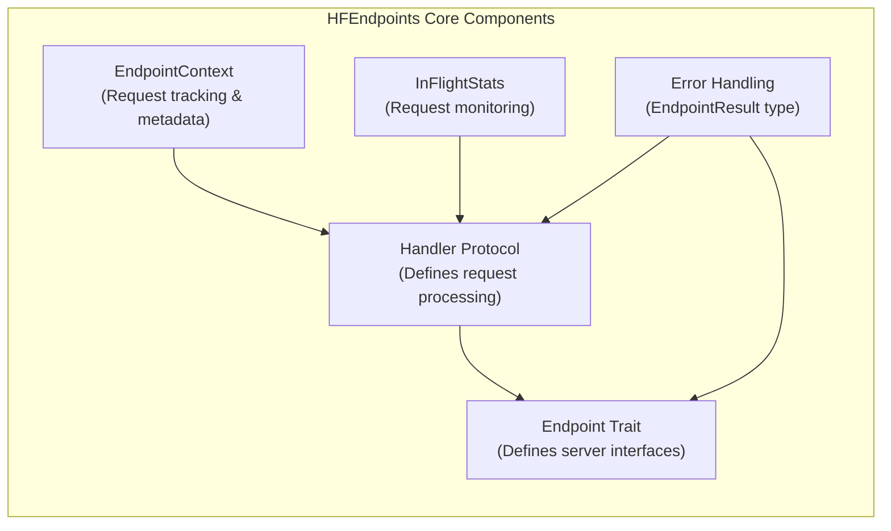
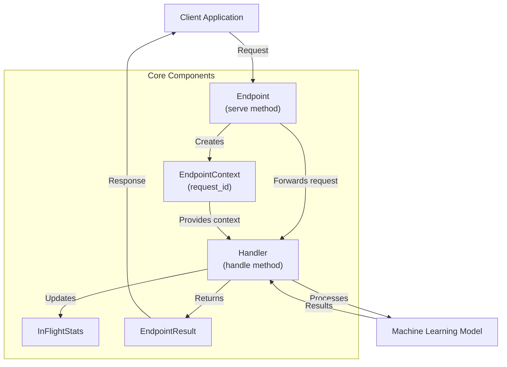
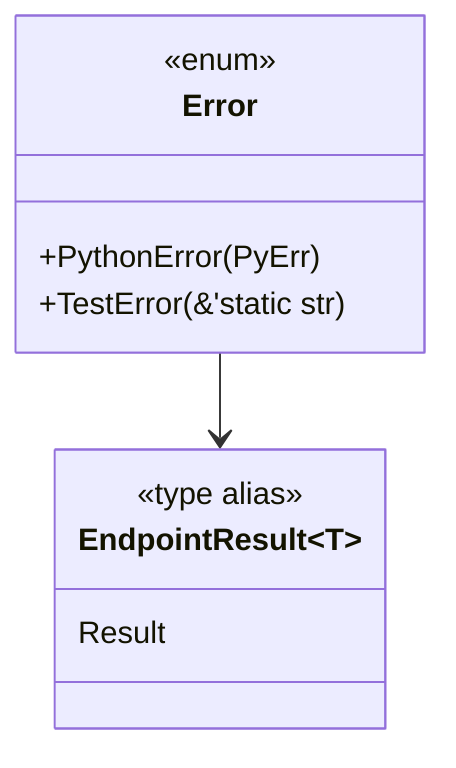
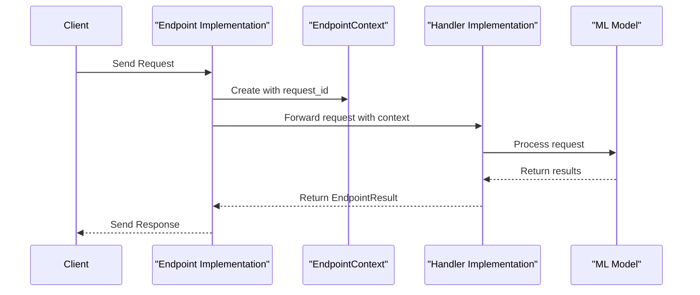
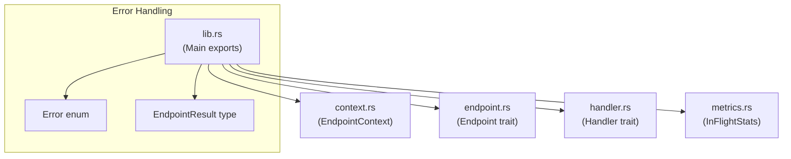

<!-- source: DeepWiki mcp.deepwiki.com · repo huggingface/hfendpoints · page 2 Core Components · fetched 2026-10-26 -->

# Core Components

<details>
<summary>Relevant source files</summary>

The following files were used as context for generating this wiki page:

- [hfendpoints-core/Cargo.toml](hfendpoints-core/Cargo.toml)
- [hfendpoints-core/src/endpoint.rs](hfendpoints-core/src/endpoint.rs)
- [hfendpoints-core/src/lib.rs](hfendpoints-core/src/lib.rs)

</details>


The Core Components of HFEndpoints provide the foundational structures and interfaces that support the entire system. These components define how endpoints are created, how requests are processed, and how context is maintained throughout request handling. This page describes the key abstractions that form the backbone of the HFEndpoints architecture.

For specific implementation details of the Handler Protocol, see [Handler Protocol](#2.1). For detailed information about the Endpoint Trait, see [Endpoint Trait](#2.2). For in-depth coverage of context management, see [Context and Request ID](#2.3).

## Component Architecture

The core components of HFEndpoints consist of several key abstractions that work together to provide a flexible and extensible system for handling requests to machine learning endpoints.



Sources: [hfendpoints-core/src/lib.rs:1-10](), [hfendpoints-core/src/endpoint.rs:1-7]()

## Component Relationships

The following diagram illustrates how the core components interact with each other and with the rest of the system:



Sources: [hfendpoints-core/src/lib.rs:6-9](), [hfendpoints-core/src/endpoint.rs:4-6]()

## Core Traits and Interfaces

### Endpoint Trait

The `Endpoint` trait defines the server interface for handling requests. It provides a `serve` method that binds to a specified address and listens for incoming requests.

```rust
pub trait Endpoint<A> {
    fn serve(&self, binding: A) -> impl Future<Output=Result<(), Error>> + Send;
}
```

This trait is the entry point for all endpoint implementations and is responsible for setting up the server and routing requests to the appropriate handlers.

Sources: [hfendpoints-core/src/endpoint.rs:1-7]()

### Handler Protocol

The Handler protocol defines how requests are processed within the system. It provides a standardized interface for implementing request handlers that can be plugged into the endpoint system.

The core exports the `Handler` trait and a `wait_for_requests` function that facilitates handler management.

Sources: [hfendpoints-core/src/lib.rs:8]()

### Request Context

The `EndpointContext` provides tracking and metadata for each request. It maintains information such as the request ID throughout the request's lifecycle, enabling proper monitoring and debugging.

Sources: [hfendpoints-core/src/lib.rs:6]()

### Metrics

The core system includes metrics tracking through the `InFlightStats` component, which monitors in-flight requests and provides statistics on system performance.

Sources: [hfendpoints-core/src/lib.rs:9]()

## Error Handling

HFEndpoints uses a consistent error handling approach with a central `Error` enum and an `EndpointResult<T>` type alias.



The error system accommodates Python integration errors when the `python` feature is enabled, and provides a clean way to propagate errors throughout the system.

Sources: [hfendpoints-core/src/lib.rs:16-28]()

## Request Processing Flow

The following sequence diagram illustrates how a request flows through the core components:



Sources: [hfendpoints-core/src/lib.rs:6-9](), [hfendpoints-core/src/endpoint.rs:4-6]()

## Feature Configuration

Core components support optional features through feature flags:

| Feature | Description | Dependencies |
|---------|-------------|--------------|
| `python` | Enables Python integration | pyo3, hfendpoints-binding-python |
| `default` | Base functionality | None |

When the `python` feature is enabled, additional error handling for Python integration is available.

Sources: [hfendpoints-core/Cargo.toml:14-16]()

## Code Organization

The core components are organized as follows:



This modular organization allows for clean separation of concerns while maintaining clear relationships between components.

Sources: [hfendpoints-core/src/lib.rs:1-4]()

## Summary

The Core Components of HFEndpoints provide the essential building blocks that enable the creation of OpenAI-compatible endpoints for Hugging Face models. By defining standard interfaces for endpoints and handlers, providing context tracking, and offering consistent error handling, these components create a flexible and extensible framework that supports various specialized endpoints and integration options.

---

