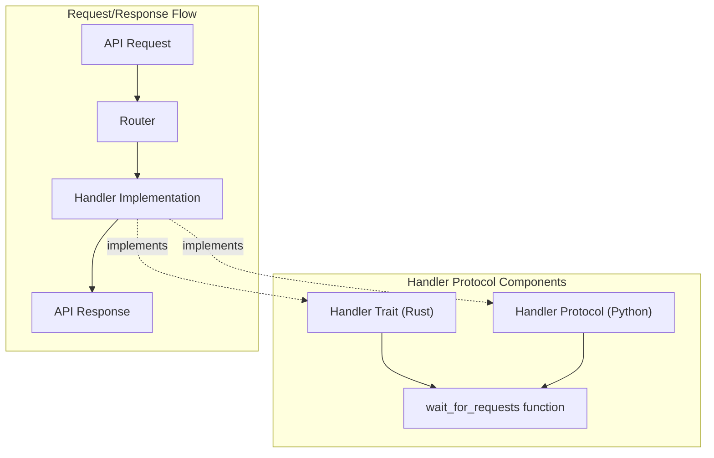
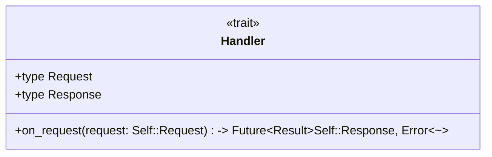
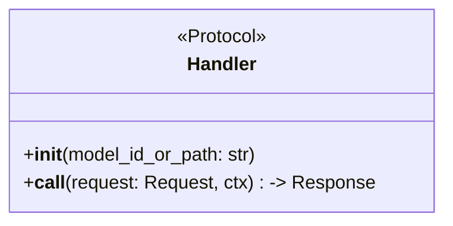
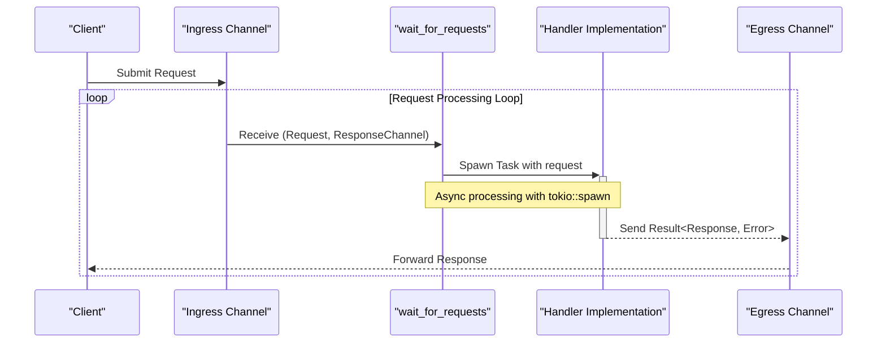
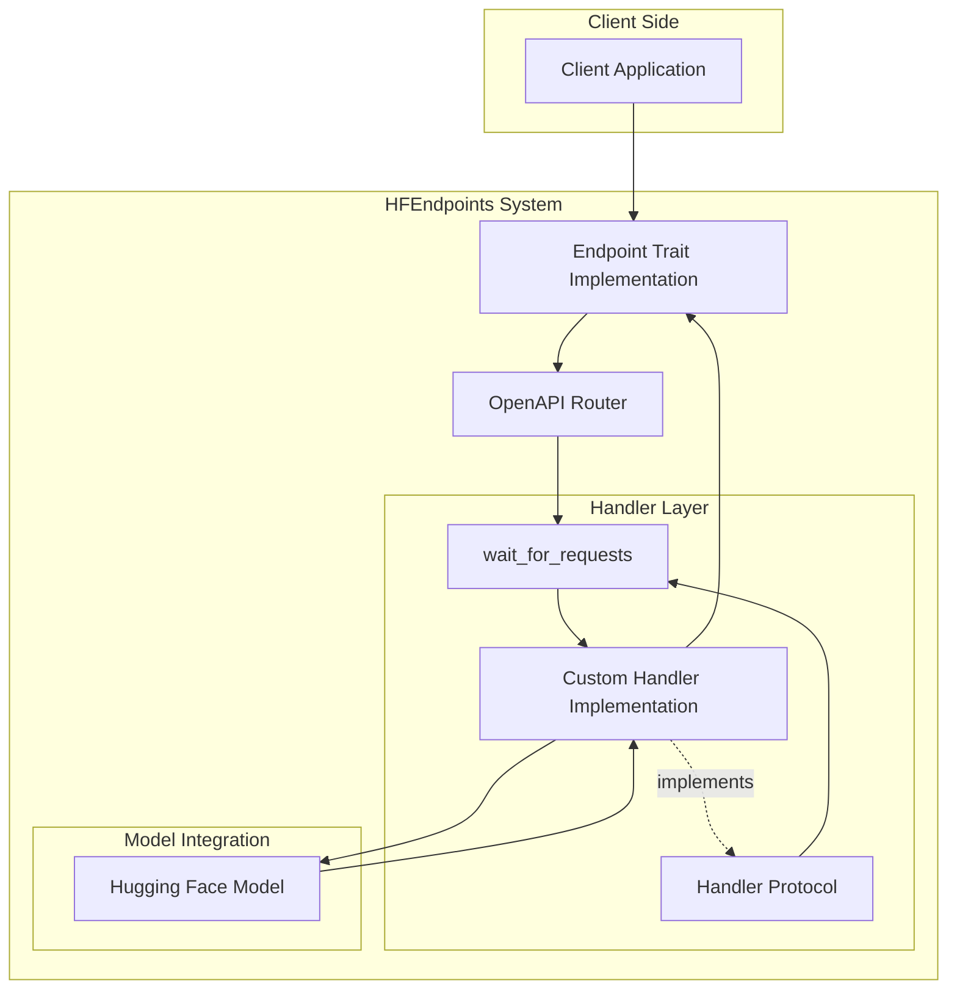

<!-- source: DeepWiki mcp.deepwiki.com · repo huggingface/hfendpoints · page 2.1 Handler Protocol · fetched 2026-10-26 -->

# Handler Protocol

<details>
<summary>Relevant source files</summary>

The following files were used as context for generating this wiki page:

- [hfendpoints-core/src/handler.rs](hfendpoints-core/src/handler.rs)
- [hfendpoints/bindings/python/hfendpoints/__init__.py](hfendpoints/bindings/python/hfendpoints/__init__.py)

</details>


The Handler Protocol is a core abstraction that defines how requests are processed in the HFEndpoints system. This protocol establishes a standardized interface for handling various types of requests (such as audio transcription, embeddings generation, etc.) and producing corresponding responses. For information about the server interfaces that use these handlers, see [Endpoint Trait](#2.2).

## Core Concept

The Handler Protocol serves as the bridge between incoming API requests and the underlying machine learning models. It abstracts the request-processing logic, allowing for a clean separation between API routing and the actual processing of requests.



Sources: [hfendpoints-core/src/handler.rs:7-29](), [hfendpoints/bindings/python/hfendpoints/__init__.py:14-19]()

## Handler Interface

The Handler protocol is implemented in both Rust and Python, providing flexibility for developers to choose their preferred language for implementation.

### Rust Handler Trait

In Rust, the Handler is defined as a trait in the core library:



The Handler trait requires implementors to:
1. Define two associated types: `Request` and `Response`
2. Implement the `on_request` method that takes a request and returns a `Future` that resolves to a `Result` containing either a response or an error

Sources: [hfendpoints-core/src/handler.rs:7-29]()

### Python Handler Protocol

In Python, the Handler is defined as a Protocol using Python's typing system:



The Python Handler Protocol requires:
1. Initialization with a model ID or path
2. Implementation of the `__call__` method that takes a request and context, returning a response

Sources: [hfendpoints/bindings/python/hfendpoints/__init__.py:14-19]()

## Request Processing Flow

The Handler Protocol includes a mechanism for processing requests asynchronously. The `wait_for_requests` function sets up a loop that continuously waits for incoming requests, dispatches them to the appropriate handler, and returns the responses.



The key steps in this flow are:
1. Requests are received through an unbounded channel along with a sender for responses
2. Each request is processed in a separate asynchronous task
3. The response is sent back through the provided channel
4. The loop continues to process new requests until the ingress channel is closed

Sources: [hfendpoints-core/src/handler.rs:31-58]()

## Implementation Requirements

To create a custom handler, you need to implement the Handler protocol in either Rust or Python:

### Rust Implementation Pattern

```
struct MyHandler {
    // Handler state
}

impl Handler for MyHandler {
    type Request = CustomRequest;
    type Response = CustomResponse;
    
    fn on_request(&self, request: Self::Request) -> impl Future<Output=Result<Self::Response, Error>> + Send {
        async move {
            // Process request and return response
        }
    }
}
```

### Python Implementation Pattern

```python
class MyHandler:
    def __init__(self, model_id_or_path: str):
        # Initialize handler with model
        pass
        
    def __call__(self, request, ctx):
        # Process request and return response
        return response
```

## Integration with System Components

The Handler Protocol integrates with other components of the HFEndpoints system to form a complete request processing pipeline:



The Handler Protocol serves as a crucial intermediary layer that:
1. Receives requests from the routing layer
2. Processes them using the appropriate model or business logic
3. Returns standardized responses back to the endpoint for delivery to clients

Sources: [hfendpoints-core/src/handler.rs:7-58](), [hfendpoints/bindings/python/hfendpoints/__init__.py:14-19]()

## Concurrency and Performance

The Handler Protocol is designed for concurrent processing of requests. Key features include:

1. **Asynchronous Processing**: Handlers process requests asynchronously, allowing for efficient resource utilization
2. **Task Spawning**: Each request is processed in a separate task, preventing blocking of the main processing loop
3. **Channel-Based Communication**: Unbounded channels are used for communication between components, facilitating asynchronous operation

Sources: [hfendpoints-core/src/handler.rs:31-58]()

## Summary

The Handler Protocol is a fundamental abstraction in HFEndpoints that:
- Defines a standard interface for processing requests
- Provides implementations in both Rust and Python
- Enables asynchronous processing of requests
- Integrates with other system components to form a complete request processing pipeline

By implementing this protocol, developers can create custom handlers for various types of machine learning tasks while maintaining compatibility with the HFEndpoints system.

---

