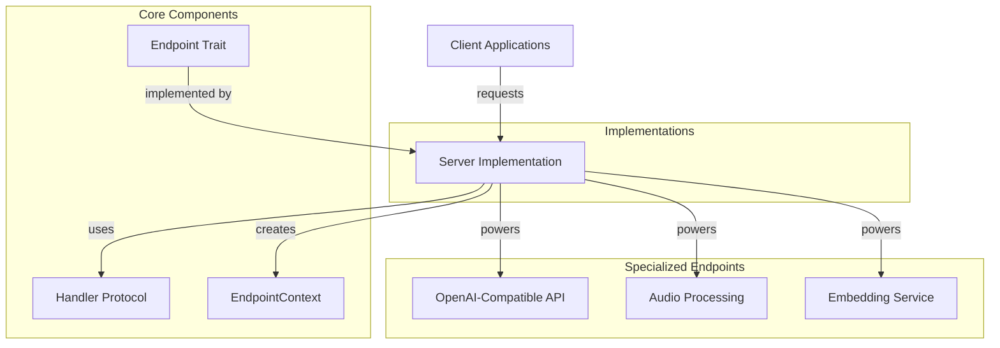
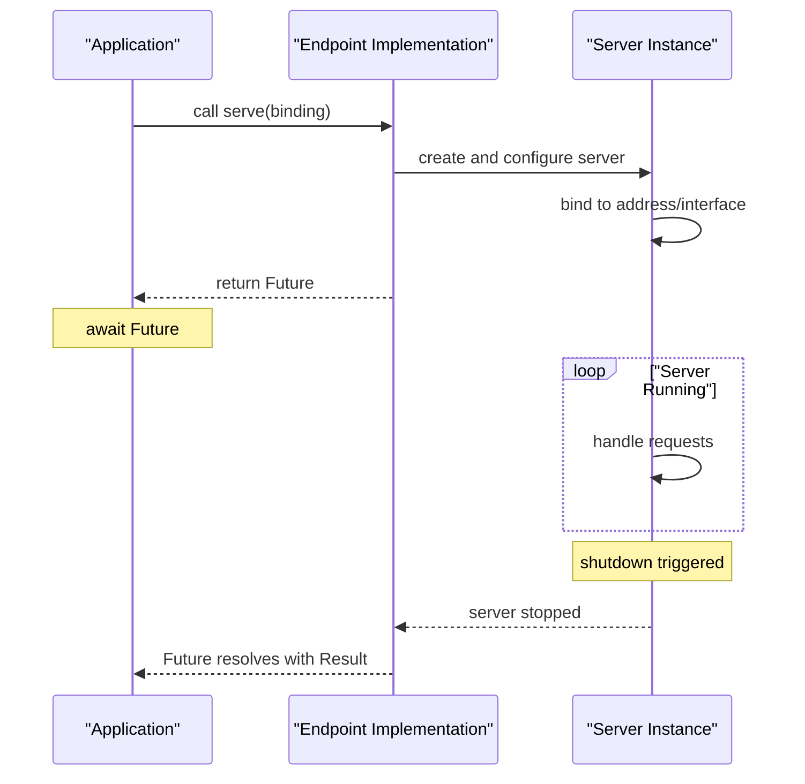
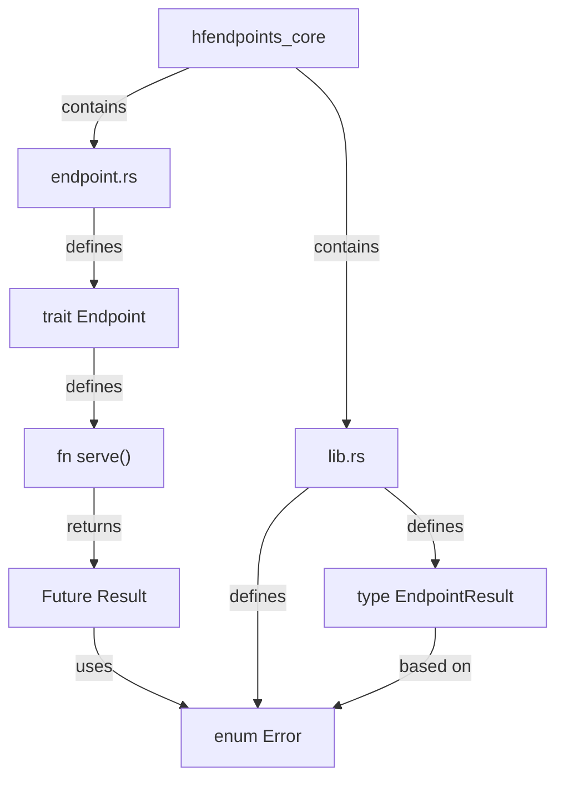

<!-- source: DeepWiki mcp.deepwiki.com · repo huggingface/hfendpoints · page 2.2 Endpoint Trait · fetched 2026-10-26 -->

# Endpoint Trait

<details>
<summary>Relevant source files</summary>

The following files were used as context for generating this wiki page:

- [hfendpoints-core/Cargo.toml](hfendpoints-core/Cargo.toml)
- [hfendpoints-core/src/endpoint.rs](hfendpoints-core/src/endpoint.rs)
- [hfendpoints-core/src/lib.rs](hfendpoints-core/src/lib.rs)

</details>


## Introduction

The Endpoint trait is a fundamental abstraction in the HFEndpoints system that defines an interface for server implementations. This trait provides a consistent way to start and manage server instances that handle API requests, regardless of the specific server implementation.

For information about how requests are processed once they reach an endpoint, see [Handler Protocol](#2.1).

Sources: [hfendpoints-core/src/endpoint.rs](), [hfendpoints-core/src/lib.rs:7]()

## Trait Definition

The Endpoint trait is defined in the `hfendpoints-core` crate and is designed to be generic over a binding type parameter `A`:

```rust
pub trait Endpoint<A> {
    fn serve(&self, binding: A) -> impl Future<Output=Result<(), Error>> + Send;
}
```

Key components of this trait:

- **Generic Parameter**: `A` represents the binding configuration (e.g., network interface and port)
- **`serve` Method**: The single method that takes a binding parameter and starts a server
- **Return Type**: Returns a `Future` that resolves to a `Result<(), Error>`
- **Thread Safety**: The returned `Future` implements `Send`, allowing it to be moved between threads

Sources: [hfendpoints-core/src/endpoint.rs:4-6]()

## Error Handling

The `Error` type used in the `serve` method is defined in the core crate:

```rust
#[derive(Debug, Error)]
pub enum Error {
    #[cfg(feature = "python")]
    #[error("Caught error while executing Python code: {0}")]
    PythonError(#[from] PyErr),

    #[error("{0}")]
    TestError(&'static str),
}
```

The core crate also provides a type alias `EndpointResult<T>` as a convenience for functions that need to return results with the core error type:

```rust
pub type EndpointResult<T> = Result<T, Error>;
```

Sources: [hfendpoints-core/src/lib.rs:16-28]()

## Position in System Architecture

The Endpoint trait is one of the three core components of the HFEndpoints system:

1. **Endpoint Trait**: Defines server interfaces
2. **Handler Protocol**: Defines request processing 
3. **Context and Request ID**: Provides request tracking

Together, these components form the foundation for the specialized endpoints that provide OpenAI-compatible APIs.

Endpoint Trait in System Architecture


Sources: [hfendpoints-core/src/lib.rs:1-8]()

## Endpoint Lifecycle

The `serve` method is responsible for the entire lifecycle of a server instance:

Endpoint Serve Method Lifecycle


Sources: [hfendpoints-core/src/endpoint.rs:4-6]()

## Code Structure

The Endpoint trait is part of the core module hierarchy within the HFEndpoints codebase:

Endpoint Trait Code Structure


Sources: [hfendpoints-core/src/lib.rs:1-8](), [hfendpoints-core/src/endpoint.rs:1-6]()

## Implementation Responsibility

Any struct implementing the Endpoint trait must provide a `serve` method that:

1. Takes a binding configuration
2. Sets up a server bound to the specified interface
3. Returns a future that completes when the server terminates
4. Ensures proper error handling and propagation

The generic nature of the trait allows it to be implemented for various server technologies while maintaining a consistent interface for the rest of the system.

Sources: [hfendpoints-core/src/endpoint.rs:4-6]()

---

