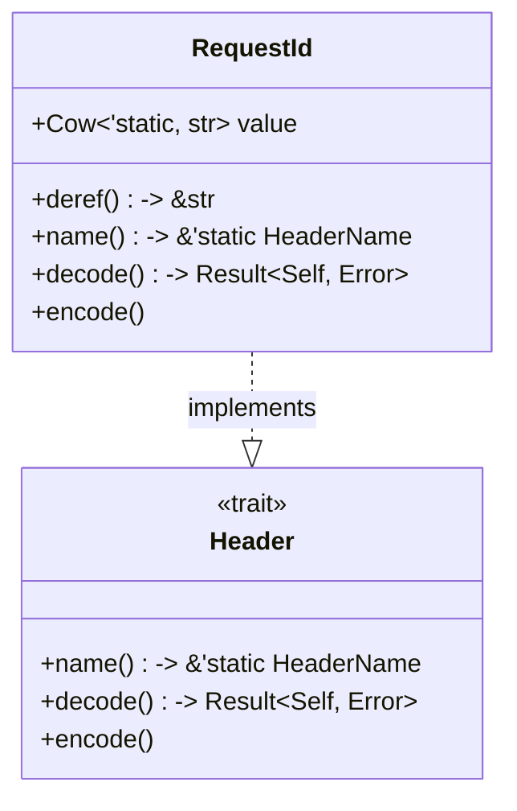
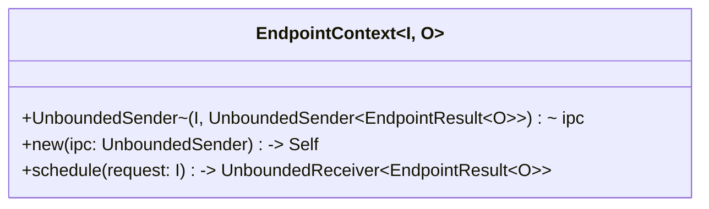
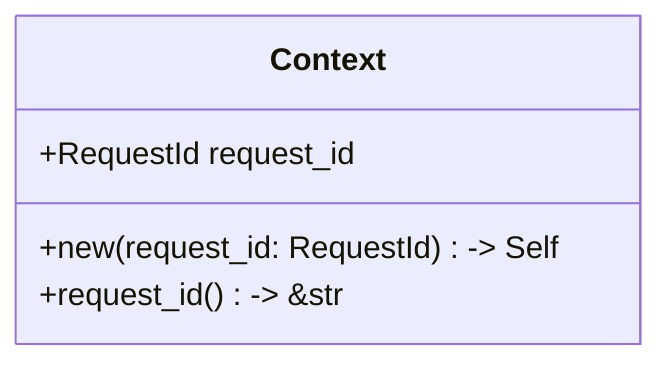
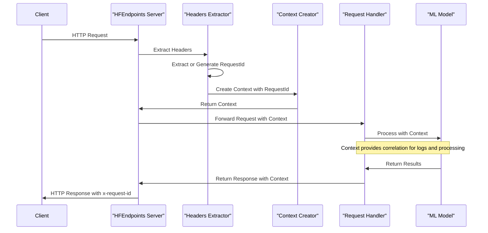
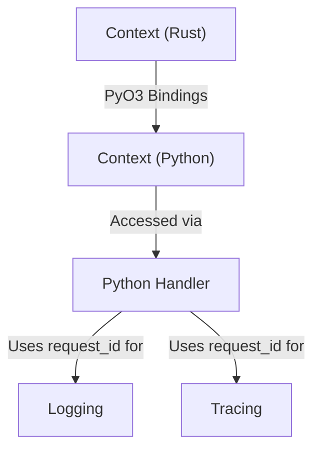

<!-- source: DeepWiki mcp.deepwiki.com · repo huggingface/hfendpoints · page 2.3 Context and Request ID · fetched 2026-10-26 -->

# Context and Request ID

<details>
<summary>Relevant source files</summary>

The following files were used as context for generating this wiki page:

- [hfendpoints-core/src/context.rs](hfendpoints-core/src/context.rs)
- [hfendpoints-openai/src/context.rs](hfendpoints-openai/src/context.rs)
- [hfendpoints-openai/src/headers.rs](hfendpoints-openai/src/headers.rs)
- [hfendpoints/bindings/python/hfendpoints/openai/__init__.py](hfendpoints/bindings/python/hfendpoints/openai/__init__.py)

</details>


This page describes how request context and request IDs are used for request tracking throughout the HFEndpoints system. Request context provides a way to maintain state and propagate metadata across the request lifecycle, while request IDs enable correlation and tracing of individual requests as they flow through the system.

For information about the handler protocol that uses this context, see [Handler Protocol](#2.1).

## Request ID Implementation

The RequestId type represents a unique identifier for each request processed by the system. It's implemented as a wrapper around a string value that can be encoded to and decoded from HTTP headers.



The RequestId is extracted from the `x-request-id` HTTP header, providing a mechanism to correlate requests across components and in logs. It implements:
- The `Header` trait for HTTP header interactions
- `Deref` to provide direct access to the string value
- Error handling for malformed header values

Sources: [hfendpoints-openai/src/headers.rs:7-50]()

## Context Types

HFEndpoints utilizes two complementary context types:

### EndpointContext

`EndpointContext<I, O>` provides the infrastructure for handling requests and responses within endpoints:



The EndpointContext:
- Takes generic input (I) and output (O) types
- Contains an IPC (Inter-Process Communication) channel
- Provides a `schedule` method to enqueue requests for processing
- Returns a receiver channel for obtaining the result

Sources: [hfendpoints-core/src/context.rs:1-55]()

### Request Context

The `Context` type encapsulates information specific to a single request:



The request Context:
- Holds the RequestId for the current request
- Is passed to handlers during request processing
- Provides access to the request ID for logging and correlation

Sources: [hfendpoints-openai/src/context.rs:1-32]()

## Request Flow and Context Propagation

The following diagram illustrates how Context and RequestId flow through the system:



The request flow process:
1. Server receives a request and extracts the `x-request-id` header
2. If no header is present, a unique ID is generated
3. A Context object is created containing this RequestId
4. The request is scheduled for processing along with its Context
5. Handlers access the Context to get the request ID for logging
6. The response includes the same request ID in its headers

This approach allows tracing a request through logs and across system components.

Sources: [hfendpoints-openai/src/headers.rs:7-50](), [hfendpoints-openai/src/context.rs:1-32]()

## Python Integration

The Context system is available to Python code through bindings:



In Python handlers, the request ID can be accessed through the `request_id` property of the Context object:

```python
def process_request(context, request):
    # Access the request ID
    request_id = context.request_id
    
    # Use it for logging
    logger.info(f"Processing request {request_id}")
    
    # Process the request...
    
    return result
```

Sources: [hfendpoints-openai/src/context.rs:20-32](), [hfendpoints/bindings/python/hfendpoints/openai/__init__.py:1-2]()

## Best Practices

When working with Context and RequestId:

1. **Always propagate the context** through all processing stages
2. **Include the request ID in logs** to enable request tracing
3. **Generate unique IDs** when clients don't provide them
4. **Pass IDs between systems** when making calls to other services
5. **Use structured logging** with the request ID as a field

## Related Pages

- For details on how handlers use this context, see [Handler Protocol](#2.1)
- For information about the server interfaces, see [Endpoint Trait](#2.2)
- For examples of contexts in Python handlers, see [Python Handler Implementation](#4.2)

---

