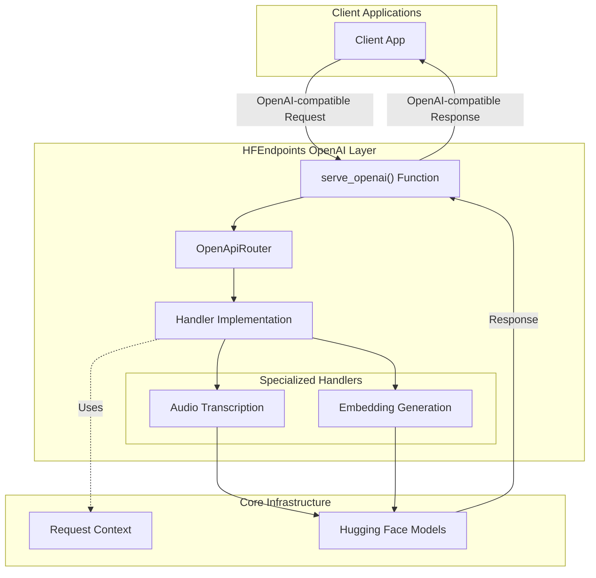
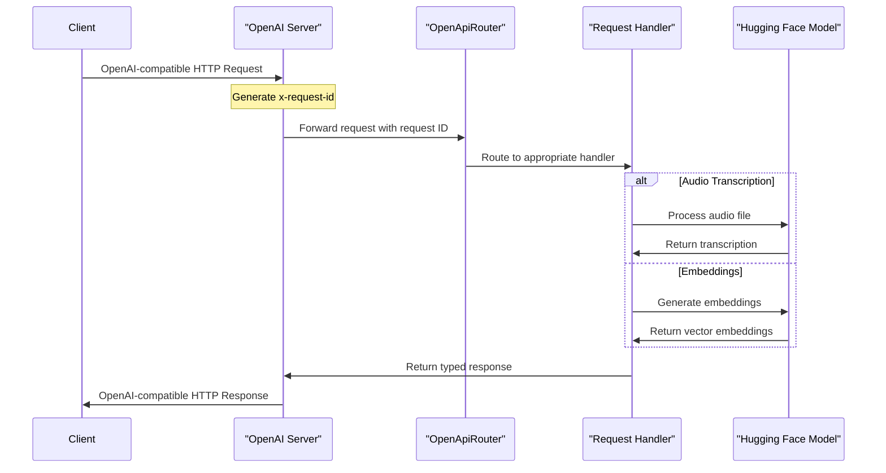
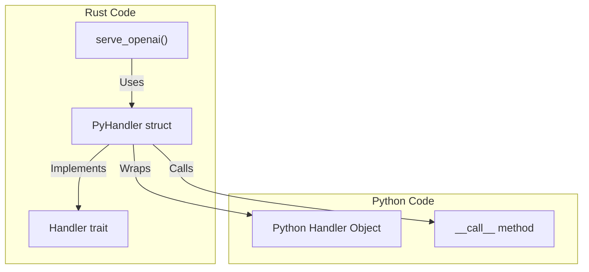
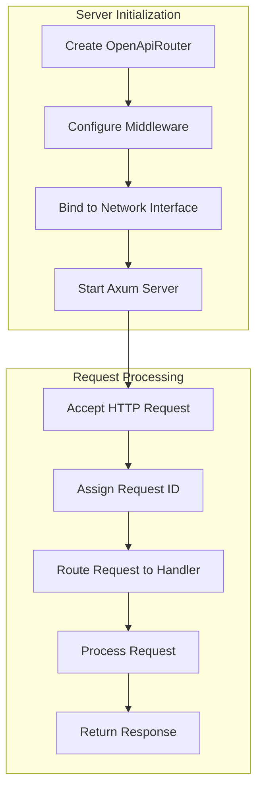

<!-- source: DeepWiki mcp.deepwiki.com · repo huggingface/hfendpoints · page 3 OpenAI-Compatible Endpoints · fetched 2026-10-26 -->

# OpenAI-Compatible Endpoints

<details>
<summary>Relevant source files</summary>

The following files were used as context for generating this wiki page:

- [hfendpoints-openai/Cargo.toml](hfendpoints-openai/Cargo.toml)
- [hfendpoints-openai/src/lib.rs](hfendpoints-openai/src/lib.rs)

</details>


## Purpose and Scope

This document describes the OpenAI-compatible endpoints system within HFEndpoints. This subsystem provides API endpoints that conform to OpenAI's API specifications, allowing Hugging Face models to be accessed using the same interface conventions as OpenAI services. This enables seamless integration with tools and applications already designed to work with OpenAI APIs.

For information about specific endpoint types like audio transcription or embeddings, see [Audio Transcription](#3.2) and [Embeddings](#3.3). For details on server configuration, see [Server Setup](#3.1).

## Architecture Overview

The OpenAI-compatible endpoints system provides a layer that adapts Hugging Face models to match OpenAI's API specifications. It handles translating incoming OpenAI-formatted requests, processing them with appropriate models, and returning OpenAI-compatible responses.



Sources: [hfendpoints-openai/src/lib.rs:54-92]()

## Key Components

The OpenAI compatibility layer consists of several key components:

1. **Server Core** - The `serve_openai` function that configures and starts an HTTP server
2. **Request Handling** - Handlers that process OpenAI-compatible requests
3. **Response Formatting** - Logic to format responses according to OpenAI specifications
4. **Python Integration** - Bindings that allow the system to be used from Python

### Server Core

The server is implemented using the Axum web framework with OpenAPI documentation support through Utoipa. It includes:

- Request ID generation and propagation
- Timeout handling
- Tracing for observability
- Health check endpoint

```mermaid
classDiagram
    class "serve_openai()" {
        +async function
        +Sets up middleware
        +Configures routes
        +Starts TCP listener
    }
    
    class "OpenApiRouter" {
        +Routes requests to handlers
        +Provides OpenAPI documentation
    }
    
    class "ApiDoc" {
        +OpenAPI schema definition
    }
    
    class "Middleware Layers" {
        +TraceLayer
        +SetRequestIdLayer
        +PropagateRequestIdLayer
        +TimeoutLayer
    }
    
    "serve_openai()" --> "OpenApiRouter"
    "serve_openai()" --> "Middleware Layers"
    "OpenApiRouter" --> "ApiDoc"
```

Sources: [hfendpoints-openai/src/lib.rs:54-92]()

### Request Handling Flow

The system processes requests through a structured flow that ensures proper context management and error handling:



Sources: [hfendpoints-openai/src/lib.rs:29-92]()

## Python Integration

The OpenAI compatibility layer includes comprehensive Python bindings, allowing developers to implement handlers in Python while maintaining the performance benefits of the Rust-based server.

### Python Handler Implementation

The system includes a `PyHandler` struct that wraps Python handler objects, enabling Python code to process requests:



The handler mechanism uses Tokio for asynchronous processing and integrates with Python's asyncio event loop, allowing seamless asynchronous operation between Rust and Python.

Sources: [hfendpoints-openai/src/lib.rs:94-304]()

### Endpoint Trait Implementation

Python endpoints are exposed through implementation of the `Endpoint` trait, which handles server initialization and request processing:

```mermaid
classDiagram
    class "PyEndpoint" {
        -Arc~PyHandler~ handler
        +new(PyObject) PyEndpoint
        +_serve_(String, u16) PyResult
    }
    
    class "Endpoint" {
        <<trait>>
        +serve((String, u16)) Result
    }
    
    class "Python Handler" {
        +__call__(Request, Context) Response
    }
    
    "PyEndpoint" --|> "Endpoint"
    "PyEndpoint" o-- "Python Handler"
```

Sources: [hfendpoints-openai/src/lib.rs:176-243]()

## Request and Response Handling

Requests are processed with consistent error handling and context management through the `Context` type, which carries request-specific information like request IDs.

### Request Context

Each request is associated with a `Context` object that contains:

- Request ID for tracking and correlation
- Execution context for the request

This context is propagated throughout the request lifecycle, ensuring proper tracing and error reporting.

```
RequestWithContext<I> = (I, Context)
```

Sources: [hfendpoints-openai/src/lib.rs:24-27]()

### Error Handling

The system uses a consistent error type (`OpenAiError`) for handling and reporting errors in a format compatible with OpenAI's error responses.

Sources: [hfendpoints-openai/src/lib.rs:3-4](), [hfendpoints-openai/src/lib.rs:26]()

## Configuration and Environment Variables

The server can be configured through environment variables:

| Environment Variable | Description | Default |
|---------------------|-------------|---------|
| `HFENDPOINTS_REQUEST_TIMEOUT_SEC` | Request timeout in seconds | 120 |

Sources: [hfendpoints-openai/src/lib.rs:64-69]()

## Server Startup

Starting an OpenAI-compatible server requires:

1. Creating a router with the desired endpoint handlers
2. Calling the `serve_openai` function with network interface details and the router
3. For Python integration, using the provided `run` function



Sources: [hfendpoints-openai/src/lib.rs:54-92]()

## Available Endpoints

The OpenAI compatibility layer includes support for:

- **Health Check** - Basic server health monitoring
- **Audio Transcription** - Converting audio to text
- **Embeddings Generation** - Creating vector embeddings from text input

Each endpoint follows OpenAI's API specifications for request and response formats.

Sources: [hfendpoints-openai/src/lib.rs:18-22](), [hfendpoints-openai/src/lib.rs:29-43]()

---

