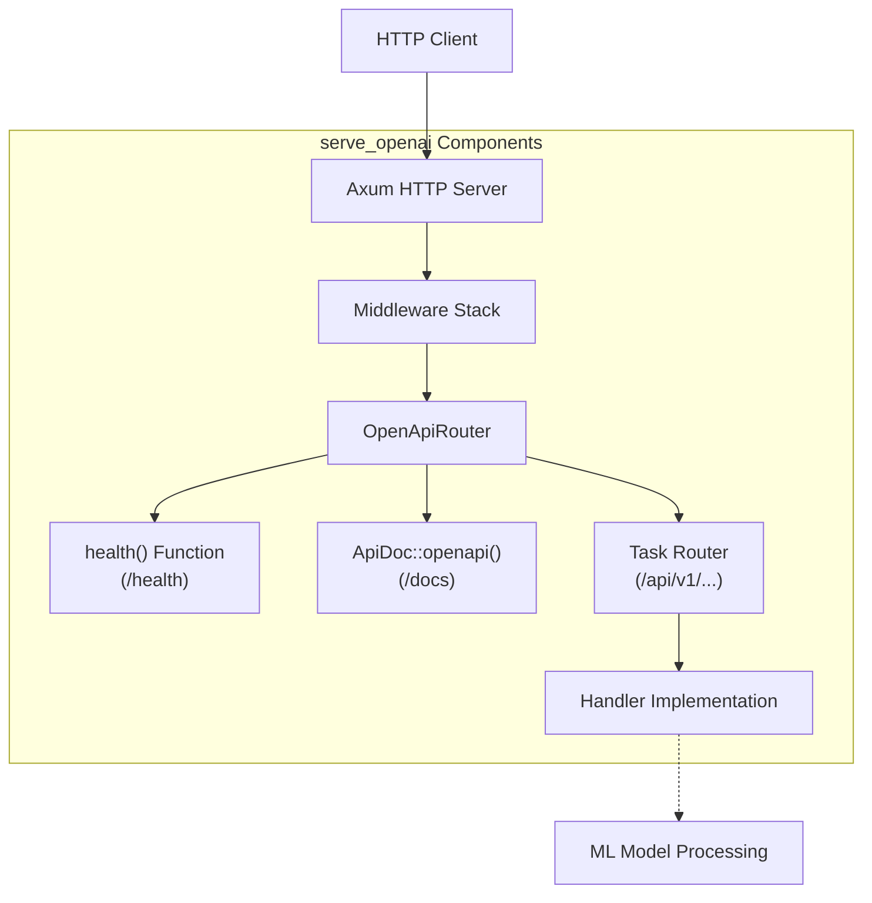
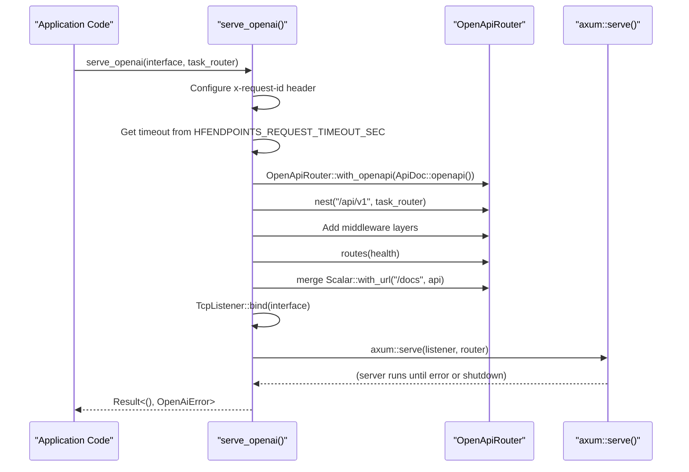
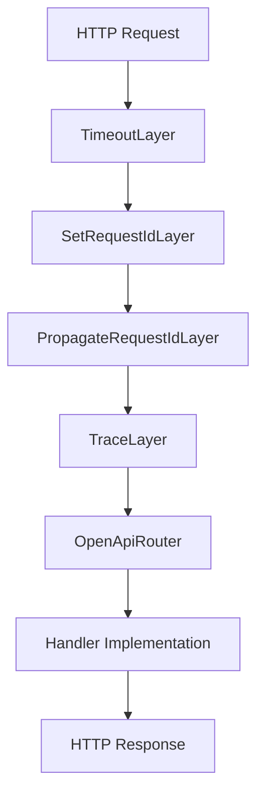
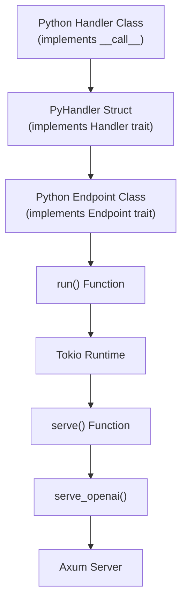
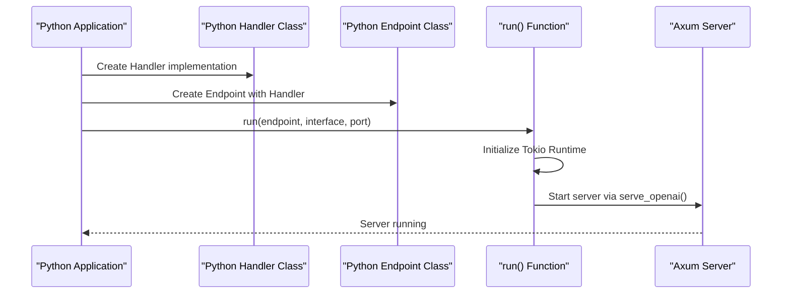

<!-- source: DeepWiki mcp.deepwiki.com · repo huggingface/hfendpoints · page 3.1 Server Setup · fetched 2026-10-26 -->

# Server Setup

Relevant source files

The following files were used as context for generating this wiki page:

- [hfendpoints-openai/src/lib.rs](hfendpoints-openai/src/lib.rs)

This document explains how the OpenAI-compatible server in HFEndpoints is configured and initialized. It covers server architecture, initialization process, middleware configuration, and Python integration. For information about specific endpoint implementations, see [Audio Transcription](#3.2) and [Embeddings](#3.3).

## Server Architecture

The HFEndpoints OpenAI-compatible server is built on the Axum web framework and exposes an HTTP interface that mimics the OpenAI API. It's initialized through the `serve_openai` function which configures all necessary components.

### Core Server Components

The server exposes:
- Health check endpoint at `/health` implemented by the `health()` function
- OpenAPI documentation at `/docs` generated from `ApiDoc::openapi()`
- API endpoints nested under `/api/v1/` handled by the provided task router

Sources: [hfendpoints-openai/src/lib.rs:40-43](), [hfendpoints-openai/src/lib.rs:45-53](), [hfendpoints-openai/src/lib.rs:72-74]()

## Server Initialization Process

The server is initialized and started using the `serve_openai` function, which takes two key parameters:
- `interface`: A network address implementing `ToSocketAddrs` (e.g., `"127.0.0.1:8000"`)
- `task_router`: An `OpenApiRouter` containing the API endpoint handlers

### Initialization Sequence

Sources: [hfendpoints-openai/src/lib.rs:56-92]()

## Middleware Configuration

The server employs a stack of middleware components for request processing:

### Middleware Stack

The middleware stack consists of:

1. **TimeoutLayer**: Sets a maximum duration for request processing, configurable via the `HFENDPOINTS_REQUEST_TIMEOUT_SEC` environment variable (default: 120 seconds)
2. **SetRequestIdLayer**: Generates a unique UUID for each request as the `x-request-id` header
3. **PropagateRequestIdLayer**: Ensures the request ID is propagated throughout the request lifecycle
4. **TraceLayer**: Provides logging and tracing of requests and responses

Sources: [hfendpoints-openai/src/lib.rs:74-82]()

## Python Integration

HFEndpoints provides Python bindings that allow creating and running OpenAI-compatible endpoints directly from Python code:

### Python-Rust Integration Architecture

The Python integration is implemented through:

1. `PyHandler`: A Rust struct that wraps a Python handler and implements the `Handler` trait
2. Python endpoint classes generated via the `impl_pyendpoint` macro to implement the `Endpoint` trait
3. `run` function that initializes the Tokio runtime and runs a Python endpoint

Sources: [hfendpoints-openai/src/lib.rs:107-174](), [hfendpoints-openai/src/lib.rs:176-243](), [hfendpoints-openai/src/lib.rs:266-287]()

### Python Usage Flow

This integration allows Python code to implement handlers and endpoints that work seamlessly with the Rust-based server, while leveraging Python's ecosystem for machine learning tasks.

Sources: [hfendpoints-openai/src/lib.rs:249-264](), [hfendpoints-openai/src/lib.rs:266-287]()

## Environment Variables

The server behavior can be configured through environment variables:

| Variable | Description | Default |
|----------|-------------|---------|
| `HFENDPOINTS_REQUEST_TIMEOUT_SEC` | Maximum duration (in seconds) for processing a request | 120 |

Sources: [hfendpoints-openai/src/lib.rs:65-69]()

## Error Handling

The `serve_openai` function returns a `Result<(), OpenAiError>`, allowing callers to handle any errors that occur during server initialization or operation. This includes errors binding to the network interface or issues with the Axum server.

Sources: [hfendpoints-openai/src/lib.rs:56](), [hfendpoints-openai/src/lib.rs:89-91]()

---

