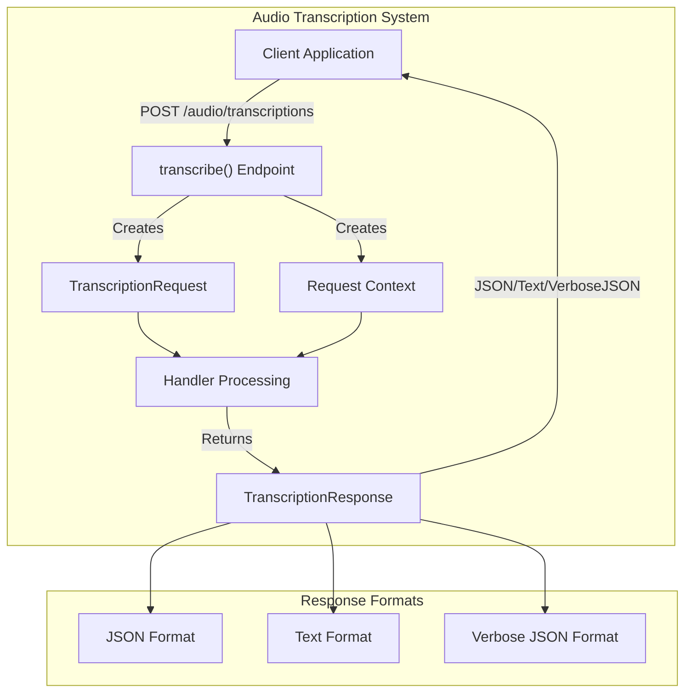
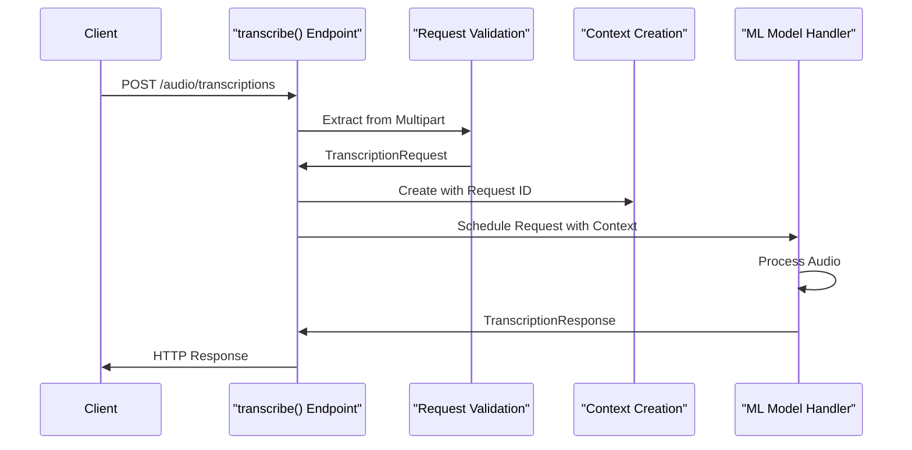
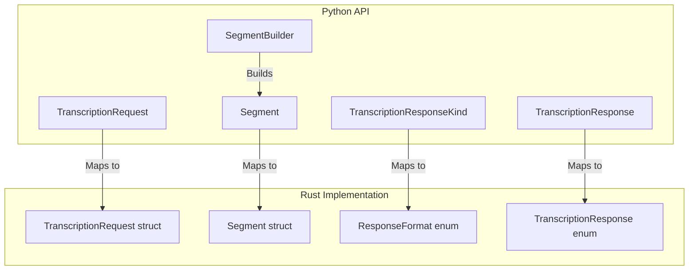
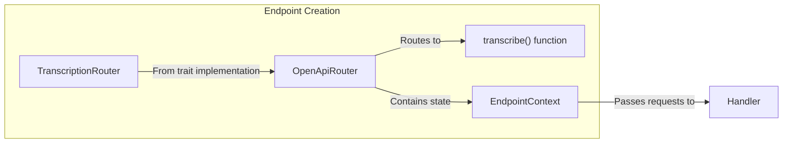
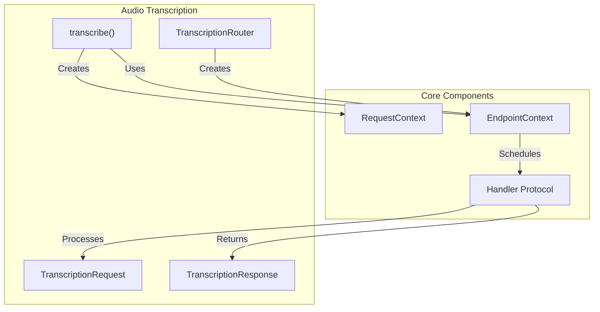

<!-- source: DeepWiki mcp.deepwiki.com · repo huggingface/hfendpoints · page 3.2 Audio Transcription · fetched 2026-10-26 -->

# Audio Transcription

<details>
<summary>Relevant source files</summary>

The following files were used as context for generating this wiki page:

- [hfendpoints-openai/src/audio/transcription.rs](hfendpoints-openai/src/audio/transcription.rs)
- [hfendpoints/bindings/python/hfendpoints/openai/audio/__init__.py](hfendpoints/bindings/python/hfendpoints/openai/audio/__init__.py)

</details>


This page documents the audio transcription capabilities of HFEndpoints, which provides OpenAI-compatible endpoints for transcribing audio files into text. The system supports various audio formats and offers flexible response formats for different use cases.

For information about embedding generation, see [Embeddings](#3.3). For details on server setup, see [Server Setup](#3.1).

## Overview

The Audio Transcription system in HFEndpoints implements an OpenAI-compatible API endpoint for transcribing audio files into text. It supports various input formats, response formats, and parameters to customize the transcription process.



Sources: [hfendpoints-openai/src/audio/transcription.rs:392-411](). [hfendpoints-openai/src/audio/transcription.rs:244-264]()

## Request Handling

The audio transcription system processes HTTP requests via a multipart form submission. The endpoint is available at `/audio/transcriptions` and follows the OpenAI API specification.

### Request Parameters

| Parameter | Type | Required | Default | Description |
|-----------|------|----------|---------|-------------|
| file | Binary file | Yes | - | Audio file to transcribe (flac, mp3, mp4, mpeg, mpga, m4a, ogg, wav, webm) |
| language | String | No | "en" | Language of the audio in ISO-639-1 format |
| model | String | No | - | Not used, included for OpenAI compatibility |
| prompt | String | No | - | Optional text to guide the model's style or continue a previous segment |
| temperature | Float | No | 0.0 | Sampling temperature between 0 and 1 |
| response_format | String | No | "json" | Output format: "json", "text", or "verbose_json" |

Sources: [hfendpoints-openai/src/audio/transcription.rs:269-292](). [hfendpoints-openai/src/audio/transcription.rs:297-304]().

### Request Processing Flow



Sources: [hfendpoints-openai/src/audio/transcription.rs:392-411](). [hfendpoints-openai/src/audio/transcription.rs:347-378]().

## Response Formats

The API supports three response formats, controlled by the `response_format` parameter:

### 1. JSON (Default)

Returns a simple JSON object with the transcribed text:

```json
{
  "text": "The transcribed audio content goes here."
}
```

### 2. Text

Returns the transcribed text directly, without any JSON wrapping.

### 3. Verbose JSON

Returns a detailed JSON object with additional information:

```json
{
  "text": "The transcribed audio content goes here.",
  "duration": 10.5,
  "language": "en",
  "segments": [
    {
      "id": 1,
      "start": 0.0,
      "end": 2.5,
      "seek": 0,
      "temperature": 0.0,
      "text": "The transcribed",
      "tokens": [1, 2, 3],
      "avg_logprob": -0.5,
      "compression_ratio": 1.2,
      "no_speech_prob": 0.1
    },
    ...
  ]
}
```

Sources: [hfendpoints-openai/src/audio/transcription.rs:166-187](). [hfendpoints-openai/src/audio/transcription.rs:229-252]().

## Key Components

### Segment

The `Segment` struct represents a single segment of transcribed audio with detailed metadata:

```mermaid
classDiagram
    class "Segment" {
        +id: u16
        +start: f32
        +end: f32
        +seek: u16
        +temperature: f32
        +text: String
        +tokens: Vec<u32>
        +avg_logprob: f32
        +compression_ratio: f32
        +no_speech_prob: f32
    }
    
    class "SegmentBuilder" {
        +id(u16): SegmentBuilder
        +start(f32): SegmentBuilder
        +end(f32): SegmentBuilder
        +seek(u16): SegmentBuilder
        +temperature(f32): SegmentBuilder
        +text(String): SegmentBuilder
        +tokens(Vec<u32>): SegmentBuilder
        +avg_logprob(f32): SegmentBuilder
        +compression_ratio(f32): SegmentBuilder
        +no_speech_prob(f32): SegmentBuilder
        +build(): Segment
    }
    
    "SegmentBuilder" --> "Segment" : builds
```

Sources: [hfendpoints-openai/src/audio/transcription.rs:26-59](). [hfendpoints-openai/src/audio/transcription.rs:61-159]().

### TranscriptionRequest

The `TranscriptionRequest` struct encapsulates all parameters needed for audio transcription:

```mermaid
classDiagram
    class "TranscriptionRequest" {
        +file: Bytes
        +content_type: String
        +language: String
        +prompt: Option<String>
        +temperature: f32
        +response_format: ResponseFormat
        +validate(): Result
        +try_from_multipart(): Result
    }
    
    class "ResponseFormat" {
        <<enumeration>>
        Json
        Text
        VerboseJson
    }
    
    "TranscriptionRequest" --> "ResponseFormat" : uses
```

Sources: [hfendpoints-openai/src/audio/transcription.rs:297-379](). [hfendpoints-openai/src/audio/transcription.rs:227-242]().

### TranscriptionResponse

The `TranscriptionResponse` enum represents the different possible formats of the response:

```mermaid
classDiagram
    class "TranscriptionResponse" {
        <<enumeration>>
        Json(Transcription)
        Text(String)
        VerboseJson(VerboseTranscription)
        into_response(): Response
    }
    
    class "Transcription" {
        +text: String
    }
    
    class "VerboseTranscription" {
        +text: String
        +duration: f32
        +language: String
        +segments: Vec<Segment>
    }
    
    "TranscriptionResponse" --> "Transcription" : contains
    "TranscriptionResponse" --> "VerboseTranscription" : contains
    "VerboseTranscription" --> "Segment" : contains
```

Sources: [hfendpoints-openai/src/audio/transcription.rs:166-187](). [hfendpoints-openai/src/audio/transcription.rs:244-264]().

## Streaming Support

The system also supports streaming transcription responses through `StreamEvent` types:

```mermaid
classDiagram
    class "StreamEvent" {
        <<enumeration>>
        Delta(Delta)
        Done(Done)
    }
    
    class "Delta" {
        +delta: String
    }
    
    class "Done" {
        +text: String
    }
    
    "StreamEvent" --> "Delta" : contains
    "StreamEvent" --> "Done" : contains
```

Delta events are emitted incrementally as the transcription progresses, and a final Done event is sent when the transcription is complete.

Sources: [hfendpoints-openai/src/audio/transcription.rs:189-225]().

## Python Integration

The system includes Python bindings that make it easy to use the audio transcription functionality from Python code:



The Python API provides a builder pattern for creating `Segment` objects:

```python
segment = SegmentBuilder()
    .id(1)
    .start(0.0)
    .end(2.5)
    .text("Hello world")
    .tokens([1, 2, 3])
    .build()
```

Sources: [hfendpoints/bindings/python/hfendpoints/openai/audio/__init__.py:14-90](). [hfendpoints-openai/src/audio/transcription.rs:432-562]().

## Endpoint Configuration

The `TranscriptionRouter` struct provides a factory for building the OpenAI-compatible transcription endpoint:



The router is configured with a maximum body limit of 200MB to accommodate large audio files, matching OpenAI's limit.

Sources: [hfendpoints-openai/src/audio/transcription.rs:416-430]().

## Integration with Core Components

The audio transcription system integrates with the core HFEndpoints components:



Sources: [hfendpoints-openai/src/audio/transcription.rs:392-411](). [hfendpoints-openai/src/audio/transcription.rs:416-430]().

## Error Handling

The transcription system uses `OpenAiResult` and `OpenAiError` types for error handling, providing appropriate error responses for different failure scenarios:

- Validation errors for missing or invalid parameters
- No response errors when the handler fails to respond
- Format conversion errors when parsing numbers or other data types

Sources: [hfendpoints-openai/src/audio/transcription.rs:305-344]().

---

