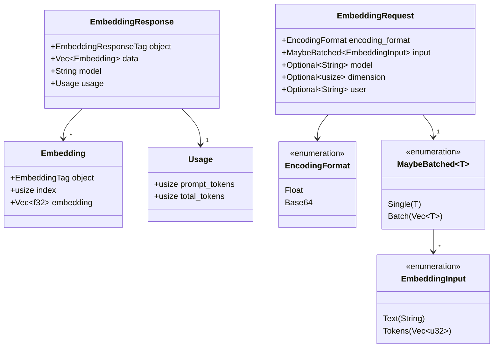
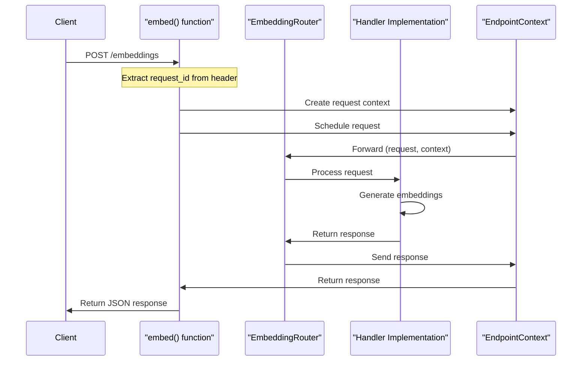
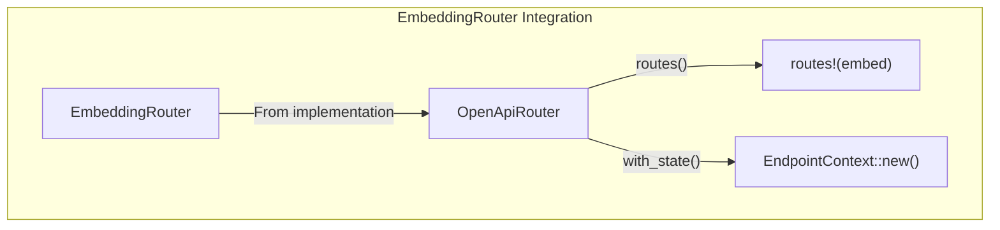
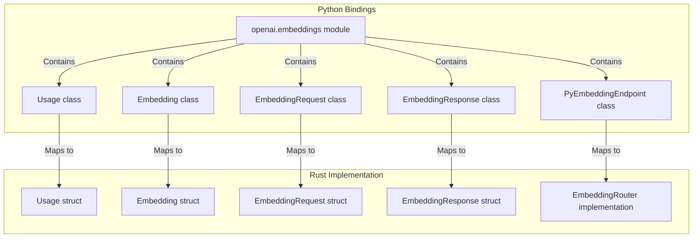

<!-- source: DeepWiki mcp.deepwiki.com · repo huggingface/hfendpoints · page 3.3 Embeddings · fetched 2026-10-26 -->

# Embeddings

<details>
<summary>Relevant source files</summary>

The following files were used as context for generating this wiki page:

- [hfendpoints-openai/src/embeddings/mod.rs](hfendpoints-openai/src/embeddings/mod.rs)

</details>


This document describes the embeddings generation functionality in HFEndpoints, which provides an OpenAI-compatible API for generating vector representations of text or tokens. These vector representations (embeddings) can be easily consumed by machine learning models and algorithms for tasks such as semantic search, clustering, or classification.

## Overview

The embeddings endpoint allows clients to request vector representations of provided text inputs. This implementation follows the OpenAI API specification, making it compatible with existing OpenAI API clients.


Sources: [hfendpoints-openai/src/embeddings/mod.rs:150-175]()

## API Specification

The embeddings functionality is exposed through a REST API endpoint that follows the OpenAI API specification.

### Endpoint

```
POST /embeddings
```

The endpoint is defined as an Axum route with documentation via Utoipa annotations, providing OpenAPI compatibility.

### Request Format

Requests to the embeddings endpoint should be in JSON format with the following structure:

```json
{
  "input": "Your text to embed" or ["multiple", "inputs", "as", "batch"],
  "model": "model-name",
  "encoding_format": "float",
  "dimension": 1536, 
  "user": "optional-user-id"
}
```

The key parameters include:

| Parameter | Type | Required | Description |
|-----------|------|----------|-------------|
| `input` | String, Tokens, or Batch | Yes | Text or tokens to embed |
| `model` | String | No | Model identifier |
| `encoding_format` | String | No | "float" (default) or "base64" |
| `dimension` | Integer | No | Output dimension (model-specific) |
| `user` | String | No | User identifier for monitoring |

Sources: [hfendpoints-openai/src/embeddings/mod.rs:138-146]()

### Response Format

The API returns a JSON response with the following structure:

```json
{
  "object": "list",
  "data": [
    {
      "object": "embedding",
      "index": 0,
      "embedding": [0.1, 0.2, 0.3, ...]
    }
  ],
  "model": "model-name",
  "usage": {
    "prompt_tokens": 5,
    "total_tokens": 5
  }
}
```

Sources: [hfendpoints-openai/src/embeddings/mod.rs:87-93](), [hfendpoints-openai/src/embeddings/mod.rs:44-48]()

## Core Data Structures

The embeddings functionality is built around these key data structures:



Sources: [hfendpoints-openai/src/embeddings/mod.rs:26-146]()

### Key Components

1. **EmbeddingRequest**: Represents a client request for embeddings. Can handle both single inputs and batched inputs through the `MaybeBatched` enum.

2. **EmbeddingInput**: Represents the input to embed, which can be either text (as a String) or tokens (as a Vec<u32>).

3. **EmbeddingResponse**: Contains the embedding vectors along with metadata about the model and token usage.

4. **Embedding**: Represents a single embedding vector with an index and the actual vector values.

5. **Usage**: Contains token usage information for billing and monitoring purposes.

6. **EncodingFormat**: Specifies how the embeddings should be encoded in the response (either as floating-point values or base64-encoded).

## Request Processing Flow



Sources: [hfendpoints-openai/src/embeddings/mod.rs:159-175]()

The request processing flow follows these steps:

1. The client sends a POST request to the `/embeddings` endpoint with a JSON payload and request ID header.
2. The `embed` function extracts the request ID and creates a request context.
3. The request is scheduled for processing by the appropriate handler through the `EndpointContext`.
4. The handler processes the request, generating embeddings for the provided input.
5. The response is sent back through the channel to the waiting `embed` function.
6. The `embed` function converts the response to JSON and returns it to the client.

## Router Implementation

The `EmbeddingRouter` struct is used to build an OpenAPI-compatible router for the embeddings endpoint:



Sources: [hfendpoints-openai/src/embeddings/mod.rs:180-193]()

## Python Integration

The embeddings functionality is also exposed to Python through PyO3 bindings, allowing it to be used directly from Python code.



Sources: [hfendpoints-openai/src/embeddings/mod.rs:195-323]()

The Python bindings provide:

1. Python classes that map to the Rust structs used for embeddings
2. Methods for creating and manipulating embedding requests and responses
3. A Python-friendly endpoint implementation for generating embeddings

This allows for seamless integration with Python-based ML workflows and applications.

## Testing

The embeddings functionality includes comprehensive tests to ensure correct behavior:

1. **Successful embedding generation**: Tests that the endpoint properly handles valid requests and returns expected responses.
2. **Error handling**: Tests for various error conditions, such as missing request IDs, invalid request bodies, and handler errors.
3. **Timeout handling**: Tests that the system handles timeouts appropriately.

Sources: [hfendpoints-openai/src/embeddings/mod.rs:326-513]()

## Usage Examples

Here's an example of how to use the embeddings endpoint with a Python client:

```python
import openai

# Configure client to use your HFEndpoints server
client = openai.OpenAI(
    base_url="http://your-hfendpoints-server:8000/v1",
    api_key="your-api-key"  # May not be required depending on your setup
)

# Generate embeddings for a single text input
response = client.embeddings.create(
    model="your-model-name",
    input="Your text to embed"
)

# Access the generated embedding
embedding = response.data[0].embedding
print(f"Generated embedding with {len(embedding)} dimensions")

# Generate embeddings for multiple texts
batch_response = client.embeddings.create(
    model="your-model-name",
    input=["First text", "Second text", "Third text"]
)

# Access the batch results
for i, data in enumerate(batch_response.data):
    print(f"Embedding {i} has {len(data.embedding)} dimensions")
```

---

