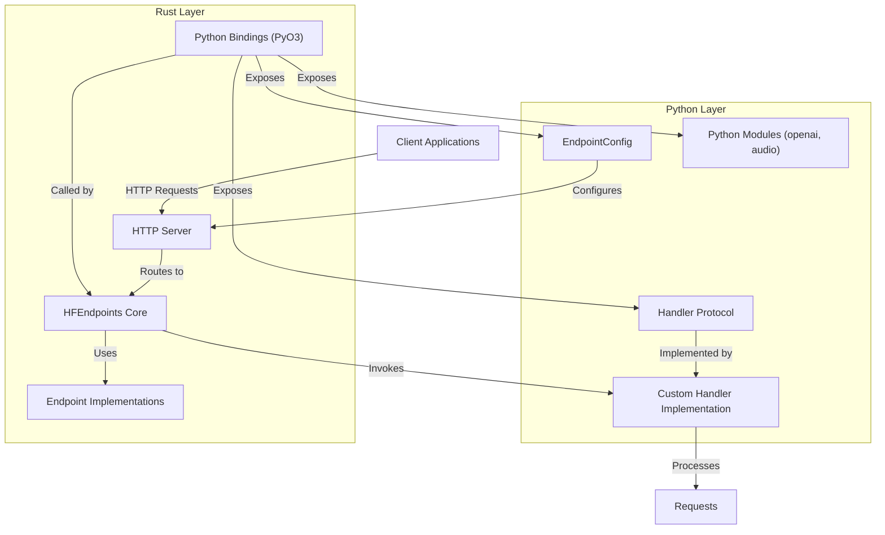
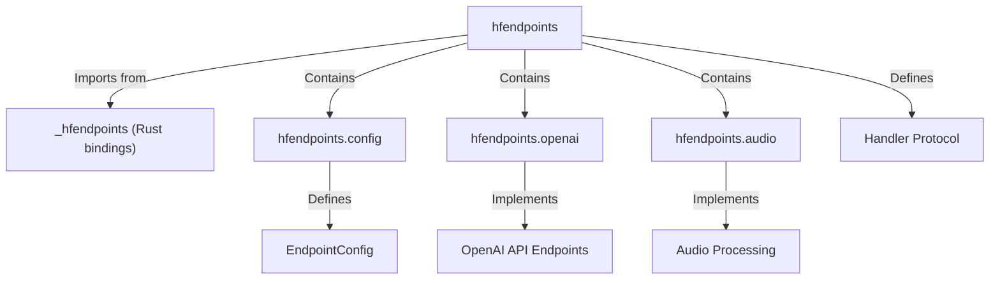
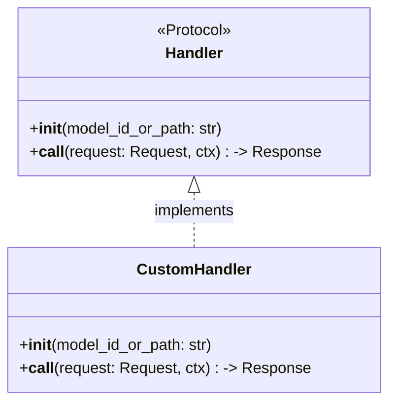
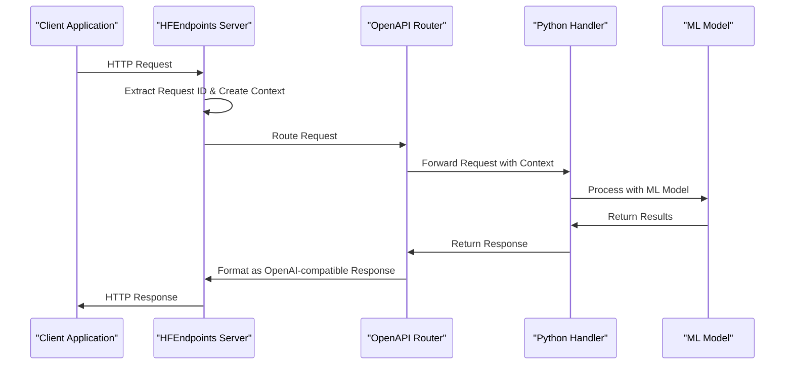
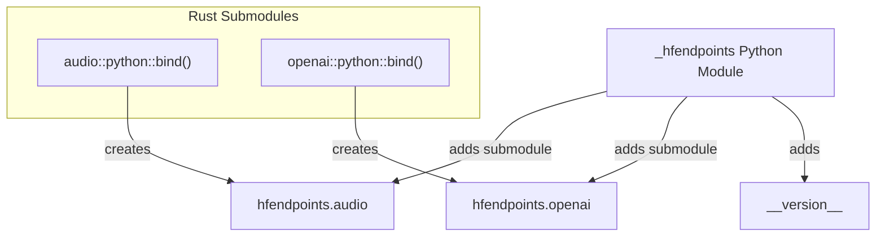

<!-- source: DeepWiki mcp.deepwiki.com · repo huggingface/hfendpoints · page 4 Python Integration · fetched 2026-10-26 -->

# Python Integration

<details>
<summary>Relevant source files</summary>

The following files were used as context for generating this wiki page:

- [hfendpoints/bindings/python/hfendpoints/__init__.py](hfendpoints/bindings/python/hfendpoints/__init__.py)
- [hfendpoints/src/lib.rs](hfendpoints/src/lib.rs)

</details>


This section explains how HFEndpoints can be used from Python. While HFEndpoints is primarily implemented in Rust, it provides comprehensive Python bindings that make its functionality accessible to Python developers. This integration allows you to create OpenAI-compatible endpoints for Hugging Face models using Python code.

For details about the OpenAI API compatibility layer, see [OpenAI-Compatible Endpoints](#3). For deployment and testing information, see [Deployment and Testing](#5).

## Architecture Overview

The Python integration bridges the high-performance Rust implementation with the flexibility of Python through a carefully designed architecture:



Sources:
- [hfendpoints/src/lib.rs:1-26]()
- [hfendpoints/bindings/python/hfendpoints/__init__.py:1-20]()

## Module Structure

The Python package is organized as follows:



The Python modules directly reflect the structure of the underlying Rust crates, with the `_hfendpoints` module serving as the bridge between Python and Rust code.

Sources:
- [hfendpoints/src/lib.rs:17-21]()
- [hfendpoints/bindings/python/hfendpoints/__init__.py:1-20]()

## Handler Protocol

The central component of the Python integration is the `Handler` protocol, which defines the interface that Python code must implement to process requests:



The `Handler` protocol is defined using Python's runtime-checkable Protocol feature, which enables structural typing:

```python
@runtime_checkable
class Handler(Protocol[Request, Response]):
    def __init__(self, model_id_or_path: str): ...
    def __call__(self, request: Request, ctx) -> Response: ...
```

This protocol allows you to create custom handlers for different types of requests and responses, such as audio transcription or embeddings generation.

Sources:
- [hfendpoints/bindings/python/hfendpoints/__init__.py:14-19]()

## Request Processing Flow

When a request is processed by an HFEndpoints server, it follows this flow:



This architecture allows Python handlers to focus on ML model interactions while the Rust server handles HTTP communication, request routing, and response formatting.

Sources:
- [hfendpoints/bindings/python/hfendpoints/__init__.py:14-19]()
- [hfendpoints/src/lib.rs:10-25]()

## Configuration

The Python integration provides the `EndpointConfig` class to configure endpoint behavior, imported from the `config` module:

```python
from .config import EndpointConfig, ensure_supported_architectures
```

The `ensure_supported_architectures` function is also provided to verify that the current system architecture is supported by HFEndpoints.

Sources:
- [hfendpoints/bindings/python/hfendpoints/__init__.py:6]()

## Integration with Rust

The Python integration is built using PyO3, a Rust library for creating Python extensions. The Rust code in `lib.rs` defines the Python module structure:



The Rust code creates the Python module hierarchy and exposes the necessary functionality to Python:

```rust
#[pymodule]
pub fn _hfendpoints(py: Python, m: Bound<'_, PyModule>) -> PyResult<()> {
    // ...
    let pymodule_hfendpoints = ImportablePyModuleBuilder::from(m)
        .defaults()?
        .add_submodule(&audio::python::bind(py, &format!("{name}.audio"))?)?
        .add_submodule(&openai::python::bind(py, &format!("{name}.openai"))?)?
        .finish();
    
    pymodule_hfendpoints.add("__version__", __VERSION__)?;
    Ok(())
}
```

Sources:
- [hfendpoints/src/lib.rs:10-25]()

## Type System

The Python bindings use TypeVar to define generic types for requests and responses:

```python
Request = TypeVar("Request", infer_variance=True)
Response = TypeVar("Response", infer_variance=True)
```

These type variables ensure type safety when working with the `Handler` protocol in Python, allowing for different request and response types depending on the specific endpoint implementation.

Sources:
- [hfendpoints/bindings/python/hfendpoints/__init__.py:10-11]()

## Versioning

The Python package includes version information accessible through the `VERSION` variable:

```python
from packaging.version import Version
from hfendpoints._hfendpoints import __version__

VERSION = Version(__version__)
```

This allows Python code to check the version of the HFEndpoints package being used.

Sources:
- [hfendpoints/bindings/python/hfendpoints/__init__.py:3-8]()
- [hfendpoints/src/lib.rs:8]()

## Next Steps

For more detailed information about specific aspects of the Python integration, refer to:

- [Python Bindings](#4.1) for detailed information on how the Rust code is exposed to Python
- [Python Handler Implementation](#4.2) for a comprehensive guide on implementing handlers in Python
- [Examples](#4.3) for example code for common use cases

---

