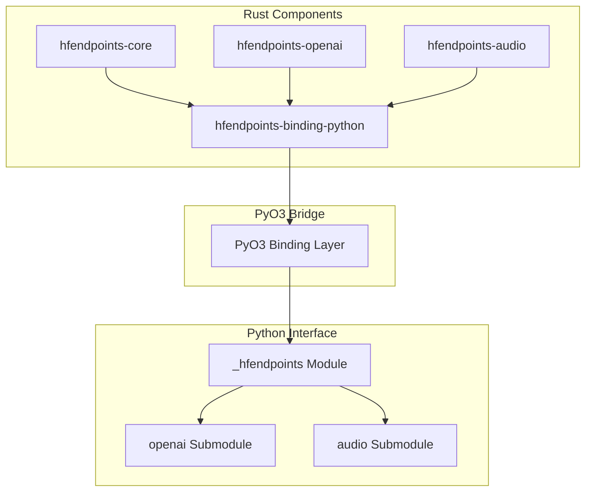
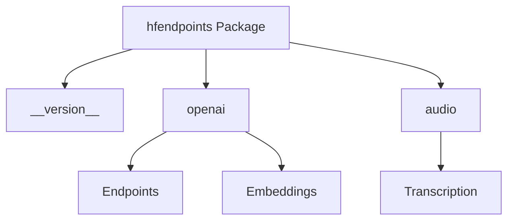
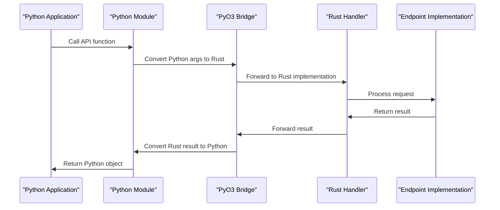
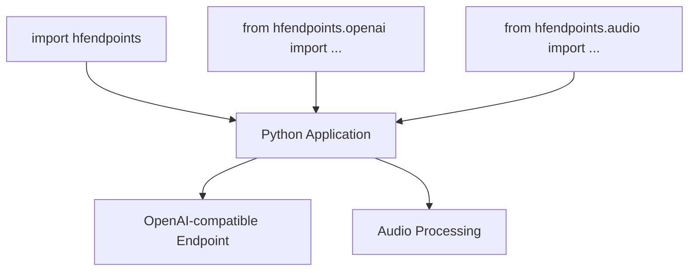

<!-- source: DeepWiki mcp.deepwiki.com · repo huggingface/hfendpoints · page 4.1 Python Bindings · fetched 2026-10-26 -->

# Python Bindings

Relevant source files

The following files were used as context for generating this wiki page:

- [hfendpoints/src/lib.rs](hfendpoints/src/lib.rs)

## Purpose and Scope

This document details how the Rust code in HFEndpoints is exposed to Python, enabling Python applications to interact with the HFEndpoints system. The Python bindings create a bridge between the high-performance Rust core and the Python ecosystem, allowing developers to leverage HFEndpoints' OpenAI-compatible API from Python applications.

For implementing handlers in Python, see [Python Handler Implementation](#4.2).
For example usage of the Python bindings, see [Examples](#4.3).

## Architecture Overview

The Python bindings are implemented using PyO3, a Rust library that facilitates creating Python extensions. The architecture creates a bidirectional bridge between Rust and Python components.

Sources: [hfendpoints/src/lib.rs:1-26]()

## Module Structure

The Python module structure mirrors the organization of the Rust crates, providing a clean and intuitive API for Python users.

The module structure is defined in the Rust code and exposes the core functionalities of HFEndpoints to Python.

Sources: [hfendpoints/src/lib.rs:10-25]()

## Implementation Details

The Python bindings are implemented in the Rust codebase using the PyO3 framework. The main entry point for the bindings is the `_hfendpoints` Python module, defined in [hfendpoints/src/lib.rs:10-25]().

Key components of the implementation include:

1. The `#[pymodule]` macro, which defines a Python-importable module
2. The `ImportablePyModuleBuilder`, which constructs and configures the module
3. Submodule binding functions that expose specific functionality

The implementation initializes logging via `tracing_subscriber` and adds the various submodules to the main module structure. It also sets the `__version__` attribute based on the Cargo package version.

Sources: [hfendpoints/src/lib.rs:10-25]()

## Module Composition

The main Python module is composed of several components:

| Module Component | Purpose | Source |
|------------------|---------|--------|
| `_hfendpoints` | Main module entry point | [hfendpoints/src/lib.rs:10-25]() |
| `openai` | OpenAI-compatible API functionality | [hfendpoints/src/lib.rs:20]() |
| `audio` | Audio processing capabilities | [hfendpoints/src/lib.rs:19]() |
| `__version__` | Version information | [hfendpoints/src/lib.rs:8, 23]() |

These components are organized to provide a Pythonic API that reflects the underlying Rust implementation.

Sources: [hfendpoints/src/lib.rs:8-25]()

## Request Flow

When using the Python bindings, requests flow through several layers of the system:

This flow ensures that Python applications can seamlessly interact with the high-performance Rust implementation.

Sources: [hfendpoints/src/lib.rs:10-25]()

## Module Import Structure

The Python bindings create a module structure that can be imported and used in Python applications:

This structure allows Python developers to import and use specific functionality from the HFEndpoints package according to their needs.

Sources: [hfendpoints/src/lib.rs:10-25]()

## Related Pages

- For information on implementing handlers in Python, see [Python Handler Implementation](#4.2)
- For usage examples, see [Examples](#4.3)
- For details about OpenAI-compatible endpoints, see [OpenAI-Compatible Endpoints](#3)

---

