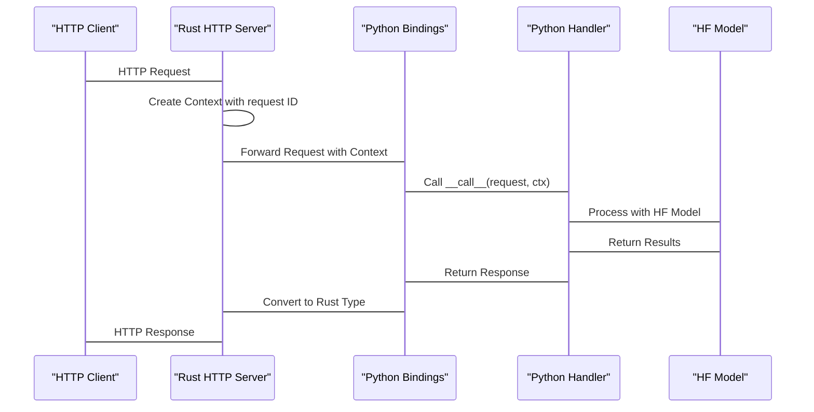

<!-- source: DeepWiki mcp.deepwiki.com · repo huggingface/hfendpoints · page 4.2 Python Handler Implementation · fetched 2026-10-26 -->

# Python Handler Implementation

<details>
<summary>Relevant source files</summary>

The following files were used as context for generating this wiki page:

- [hfendpoints-openai/src/lib.rs](hfendpoints-openai/src/lib.rs)
- [hfendpoints/bindings/python/hfendpoints/__init__.py](hfendpoints/bindings/python/hfendpoints/__init__.py)

</details>


This document explains how to implement handlers in Python for the HFEndpoints system. Python handlers are the core components that process requests in HFEndpoints, enabling you to use Hugging Face models behind OpenAI-compatible APIs. For information about the Python bindings that make this possible, see [Python Bindings](#4.1).

## The Handler Protocol

At the core of Python integration in HFEndpoints is the `Handler` protocol defined in Python. This protocol specifies the methods that a Python handler must implement to be used by the system.

```mermaid
classDiagram
    class "Handler[Request, Response]" {
        <<Protocol>>
        +__init__(model_id_or_path: str)
        +__call__(request: Request, ctx) -> Response
    }
```

The protocol has two generic type parameters:
- `Request`: The type of the incoming request object
- `Response`: The type of the response to be returned

Sources: [hfendpoints/bindings/python/hfendpoints/__init__.py:10-19]()

### Required Methods

Python handlers must implement two key methods:

1. `__init__(self, model_id_or_path: str)`: Constructor that initializes the handler with a model identifier or path
2. `__call__(self, request: Request, ctx) -> Response`: Method that processes a request in the given context and returns a response

The `__call__` method makes handler instances callable, allowing them to be invoked directly as functions with the request and context as arguments.

## How Python Handlers Interact with the Rust System

The HFEndpoints system is primarily written in Rust, with Python bindings that allow you to implement handlers in Python. Here's how the components interact:



Behind the scenes, when a request comes in:

1. The Rust server creates a context with a unique request ID
2. The request and context are forwarded to a `PyHandler` struct that wraps your Python handler
3. The `PyHandler` invokes your Python handler's `__call__` method
4. Your handler processes the request and returns a response
5. The response is converted back to a Rust type and sent to the client

Sources: [hfendpoints-openai/src/lib.rs:107-173]()

## Implementing a Python Handler

To implement a handler in Python, you need to create a class that conforms to the `Handler` protocol.

### Basic Structure

```python
from hfendpoints import Handler

class MyHandler(Handler):
    def __init__(self, model_id_or_path: str):
        # Initialize your model here
        pass
        
    def __call__(self, request, ctx):
        # Process the request using your model
        # Return the response
        pass
```

### Handler Initialization

The `__init__` method is called when your handler is created. This is where you should load your model and any other resources needed for processing requests.

Key practices for initialization:
- Load the model from the provided path or identifier
- Initialize any tokenizers, processors, or other components
- Set up any state that will be shared across requests

### Request Processing

The `__call__` method is called for each incoming request. It should:
1. Extract the necessary information from the request
2. Process the request using your model
3. Return a response in the expected format

Note that `ctx` is a `Context` object that contains information about the request, including a unique request ID that can be used for tracing.

## The PyHandler Bridge

The connection between Python and Rust is implemented by the `PyHandler` struct in Rust, which wraps your Python handler instance.

```mermaid
flowchart TB
    subgraph "Rust Side"
        "Handler" --> "on_request(request, ctx)"
        "PyHandler" -->|"implements"| "Handler"
    end
    
    subgraph "Python Side"
        "PyHandler.inner" -->|"calls"| "YourHandler.__call__"
        "YourHandler" -->|"implements"| "Handler Protocol"
    end
    
    "on_request(request, ctx)" -->|"invokes"| "PyHandler.inner"
```

The `PyHandler` struct is defined using a macro in Rust that generates the boilerplate code for bridging between Rust and Python. When a request comes in:

1. The `on_request` method of `PyHandler` is called
2. It uses the Python GIL to call your Python handler's `__call__` method
3. It converts the Python coroutine to a Rust future using Tokio
4. It extracts the response from the Python object and returns it as a Rust type

Sources: [hfendpoints-openai/src/lib.rs:116-173]()

## Examples

### Basic Text Embedding Handler

Here's a simple example of a handler that generates embeddings for text inputs:

```python
from hfendpoints import Handler
from transformers import AutoModel, AutoTokenizer
import torch

class EmbeddingHandler(Handler):
    def __init__(self, model_id_or_path: str):
        # Load the model and tokenizer
        self.model = AutoModel.from_pretrained(model_id_or_path)
        self.tokenizer = AutoTokenizer.from_pretrained(model_id_or_path)
    
    def __call__(self, request, ctx):
        # Process the request
        inputs = self.tokenizer(request.input, return_tensors="pt")
        with torch.no_grad():
            outputs = self.model(**inputs)
        
        # Return the response in the expected format
        embeddings = outputs.last_hidden_state[:, 0].numpy().tolist()
        return {
            "data": [
                {
                    "embedding": embeddings[0],
                    "index": 0,
                    "object": "embedding"
                }
            ],
            "model": self.model.config.name_or_path,
            "object": "list",
            "usage": {
                "prompt_tokens": len(inputs.input_ids[0]),
                "total_tokens": len(inputs.input_ids[0])
            }
        }
```

### Audio Transcription Handler

Here's an example of a more complex handler for audio transcription:

```python
from hfendpoints import Handler
from transformers import AutoProcessor, AutoModelForSpeechSeq2Seq
import torch
import tempfile
import os

class TranscriptionHandler(Handler):
    def __init__(self, model_id_or_path: str):
        # Load the model and processor
        self.model = AutoModelForSpeechSeq2Seq.from_pretrained(model_id_or_path)
        self.processor = AutoProcessor.from_pretrained(model_id_or_path)
        self.device = "cuda" if torch.cuda.is_available() else "cpu"
        self.model.to(self.device)
    
    def __call__(self, request, ctx):
        # Save the audio bytes to a temporary file
        with tempfile.NamedTemporaryFile(delete=False, suffix=".wav") as temp:
            temp.write(request.file)
            temp_path = temp.name
        
        try:
            # Process the audio file
            inputs = self.processor(
                audio_file=temp_path, 
                return_tensors="pt"
            ).to(self.device)
            
            with torch.no_grad():
                outputs = self.model.generate(**inputs)
            
            # Decode the outputs
            transcription = self.processor.batch_decode(
                outputs, 
                skip_special_tokens=True
            )[0]
            
            # Return the response in the expected format
            return {
                "text": transcription
            }
        finally:
            # Clean up the temporary file
            os.unlink(temp_path)
```

### Serving Your Handler

Once you've implemented your handler, you can use it with the HFEndpoints system:

```python
from hfendpoints.openai.embeddings import Endpoint
from my_module import EmbeddingHandler

# Create a handler with a model path
handler = EmbeddingHandler("sentence-transformers/all-MiniLM-L6-v2")

# Create an endpoint with the handler
endpoint = Endpoint(handler)

# Start serving the endpoint
import hfendpoints.openai
hfendpoints.openai.run(endpoint, "0.0.0.0", 8000)
```

The `run` function initializes the Tokio runtime, creates a server with your endpoint, and starts serving requests.

Sources: [hfendpoints-openai/src/lib.rs:266-287]()

## Asynchronous Handlers

The Python Handler Protocol supports both synchronous and asynchronous implementations. If your handler needs to perform asynchronous operations, you can make the `__call__` method an async function:

```python
class AsyncEmbeddingHandler(Handler):
    def __init__(self, model_id_or_path: str):
        # Initialization code...
        
    async def __call__(self, request, ctx):
        # Asynchronous processing code...
        return response
```

The Rust server will properly await your async method before continuing.

Sources: [hfendpoints-openai/src/lib.rs:143-167]()

---

