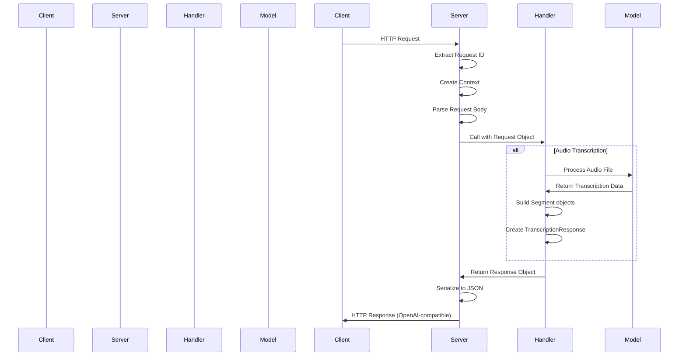
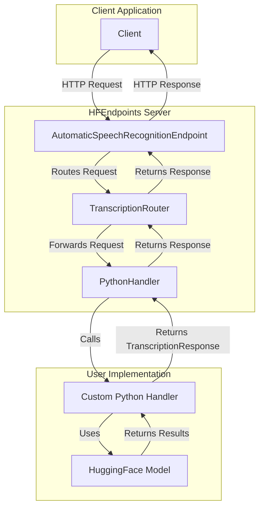
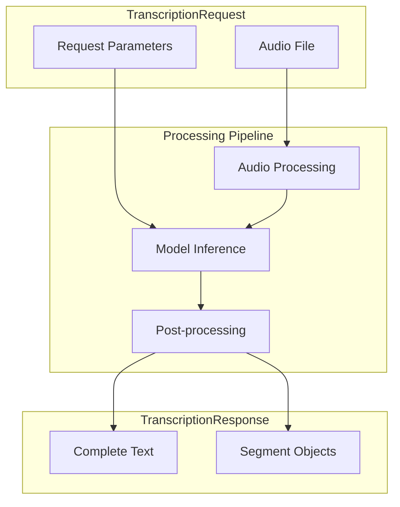

<!-- source: DeepWiki mcp.deepwiki.com · repo huggingface/hfendpoints · page 4.3 Examples · fetched 2026-10-26 -->

# Examples

<details>
<summary>Relevant source files</summary>

The following files were used as context for generating this wiki page:

- [hfendpoints-openai/src/audio/mod.rs](hfendpoints-openai/src/audio/mod.rs)
- [hfendpoints/bindings/python/hfendpoints/openai/audio/__init__.py](hfendpoints/bindings/python/hfendpoints/openai/audio/__init__.py)

</details>


This page provides practical examples of how to use HFEndpoints through its Python integration. For information about the Python binding architecture, see [Python Bindings](#4.1). For a detailed guide on implementing custom handlers in Python, see [Python Handler Implementation](#4.2).

## Overview

The examples in this document demonstrate common use cases for the HFEndpoints system, focusing on:
- Setting up OpenAI-compatible endpoint servers
- Implementing audio transcription endpoints
- Working with the audio transcription components
- Building complex handlers with custom logic

These examples aim to bridge the gap between understanding the system architecture and implementing practical applications.

## Basic Endpoint Setup

### Setting Up an Audio Transcription Endpoint

The following example shows how to set up a basic audio transcription endpoint:

```python
from hfendpoints.openai.audio import AutomaticSpeechRecognitionEndpoint
from hfendpoints.config import EndpointConfig

# Define a simple handler function
def transcription_handler(request):
    # Process the audio file from the request
    audio_data = request.file.read()
    
    # In a real implementation, you would:
    # 1. Process the audio with your model
    # 2. Create a transcription response
    
    # Return a basic transcription
    return TranscriptionResponse(
        transcription=Transcription(
            text="This is a sample transcription.",
            segments=[]
        )
    )

# Create an endpoint configuration
config = EndpointConfig(
    model_path="path/to/your/model",
    interface="0.0.0.0",
    port=8000
)

# Create and start the endpoint
endpoint = AutomaticSpeechRecognitionEndpoint(
    handler=transcription_handler,
    config=config
)
endpoint.serve()
```

Sources: [hfendpoints-openai/src/audio/mod.rs:17-24]()

## Audio Transcription Components

The following diagram illustrates the relationship between key audio transcription components:

```mermaid
classDiagram
    class "TranscriptionRequest" {
        +file
        +model
        +language
        +prompt
        +response_format
        +temperature
    }
    
    class "Segment" {
        +id
        +start
        +end
        +text
        +tokens
        +avg_logprob
        +compression_ratio
        +no_speech_prob
    }
    
    class "Transcription" {
        +text
        +segments
    }
    
    class "TranscriptionResponse" {
        +transcription
        +verbose_transcription
    }
    
    class "SegmentBuilder" {
        +build()
        +id()
        +start()
        +end()
        +text()
        +tokens()
        +avg_logprob()
        +compression_ratio()
        +no_speech_prob()
    }
    
    "TranscriptionRequest" <-- "PythonHandler"
    "PythonHandler" --> "TranscriptionResponse"
    "TranscriptionResponse" o-- "Transcription"
    "Transcription" o-- "Segment"
    "SegmentBuilder" --> "Segment"
```

Sources: [hfendpoints/bindings/python/hfendpoints/openai/audio/__init__.py:3-11](), [hfendpoints-openai/src/audio/mod.rs:31-37]()

## Working with Segments

The following example demonstrates how to use the `SegmentBuilder` to create detailed transcription segments:

```python
from hfendpoints.openai.audio import SegmentBuilder, Segment, Transcription

# Create segments using the builder pattern
segment1 = (
    SegmentBuilder()
    .id(0)
    .start(0.0)
    .end(2.5)
    .text("Hello, this is the first segment.")
    .tokens([101, 8862, 1011, 2023, 1996, 2034, 7099, 1012, 102])
    .avg_logprob(-0.35)
    .compression_ratio(1.2)
    .no_speech_prob(0.01)
    .build()
)

segment2 = (
    SegmentBuilder()
    .id(1)
    .start(2.5)
    .end(5.0)
    .text("This is the second segment of the transcription.")
    .tokens([101, 2023, 1996, 2117, 7099, 1997, 1996, 21831, 1012, 102])
    .avg_logprob(-0.42)
    .compression_ratio(1.1)
    .no_speech_prob(0.02)
    .build()
)

# Create a transcription with multiple segments
transcription = Transcription(
    text="Hello, this is the first segment. This is the second segment of the transcription.",
    segments=[segment1, segment2]
)
```

Sources: [hfendpoints/bindings/python/hfendpoints/openai/audio/__init__.py:14-90]()

## Request Processing Flow

The following diagram shows how a request is processed through the HFEndpoints system:



Sources: [hfendpoints-openai/src/audio/mod.rs:17-24]()

## Complete Audio Transcription Example

This example shows a complete implementation of an audio transcription handler:

```python
from hfendpoints.openai.audio import (
    AutomaticSpeechRecognitionEndpoint,
    TranscriptionRequest,
    TranscriptionResponse,
    Transcription,
    SegmentBuilder
)
from hfendpoints.config import EndpointConfig
import torch
from transformers import WhisperForConditionalGeneration, WhisperProcessor

class WhisperTranscriptionHandler:
    def __init__(self, model_path):
        self.processor = WhisperProcessor.from_pretrained(model_path)
        self.model = WhisperForConditionalGeneration.from_pretrained(model_path)
        if torch.cuda.is_available():
            self.model = self.model.to("cuda")
    
    def __call__(self, request: TranscriptionRequest) -> TranscriptionResponse:
        # Get parameters from request
        audio_file = request.file.read()
        language = request.language
        temperature = request.temperature or 0.0
        
        # Process audio with Whisper
        inputs = self.processor(
            audio_file, 
            return_tensors="pt", 
            sampling_rate=16000
        )
        if torch.cuda.is_available():
            inputs = inputs.to("cuda")
            
        # Generate transcription
        with torch.no_grad():
            outputs = self.model.generate(
                inputs.input_features,
                language=language,
                temperature=temperature
            )
        
        # Decode the outputs
        transcription = self.processor.batch_decode(
            outputs, 
            skip_special_tokens=True
        )[0]
        
        # Create a basic segment
        segment = (
            SegmentBuilder()
            .id(0)
            .start(0.0)
            .end(5.0)  # Placeholder duration
            .text(transcription)
            .tokens(outputs[0].tolist())
            .build()
        )
        
        # Create and return the response
        return TranscriptionResponse(
            transcription=Transcription(
                text=transcription,
                segments=[segment]
            )
        )

# Create and start the endpoint
config = EndpointConfig(
    model_path="openai/whisper-tiny",
    interface="0.0.0.0",
    port=8000
)
handler = WhisperTranscriptionHandler(config.model_path)
endpoint = AutomaticSpeechRecognitionEndpoint(handler, config)
endpoint.serve()
```

Sources: [hfendpoints/bindings/python/hfendpoints/openai/audio/__init__.py:14-90](), [hfendpoints-openai/src/audio/mod.rs:17-24]()

## Component Architecture

The following diagram shows how the Python components interact with the underlying Rust implementation:



Sources: [hfendpoints-openai/src/audio/mod.rs:17-24]()

## Advanced Configuration Example

This example demonstrates how to use advanced configuration options:

```python
from hfendpoints.openai.audio import AutomaticSpeechRecognitionEndpoint
from hfendpoints.config import EndpointConfig
import logging

# Create a more detailed endpoint configuration
config = EndpointConfig(
    model_path="openai/whisper-large-v2",
    interface="0.0.0.0",
    port=8000,
    log_level="info",
    worker_threads=4,
    max_request_size=25 * 1024 * 1024,  # 25MB
    extra_config={
        "default_language": "en",
        "allowed_languages": ["en", "fr", "es", "de"],
        "enable_translation": True
    }
)

# Set up the handler and endpoint
handler = WhisperTranscriptionHandler(config.model_path)
endpoint = AutomaticSpeechRecognitionEndpoint(
    handler=handler,
    config=config
)

# Configure logging before serving
logging.basicConfig(level=logging.INFO)
logger = logging.getLogger("whisper-endpoint")
logger.info(f"Starting endpoint with model: {config.model_path}")

# Start the endpoint
endpoint.serve()
```

Sources: [hfendpoints-openai/src/audio/mod.rs:17-24]()

## Audio Processing Data Flow

This diagram shows the data flow when processing an audio file:



Sources: [hfendpoints/bindings/python/hfendpoints/openai/audio/__init__.py:14-90](), [hfendpoints-openai/src/audio/mod.rs:9-9]()

## Error Handling Example

This example demonstrates how to implement proper error handling in a handler:

```python
from hfendpoints.openai.audio import (
    TranscriptionRequest,
    TranscriptionResponse,
    Transcription
)
from hfendpoints.errors import RequestValidationError, ModelExecutionError
import traceback

def safe_transcription_handler(request: TranscriptionRequest) -> TranscriptionResponse:
    try:
        # Validate the request
        if not request.file or request.file.size() == 0:
            raise RequestValidationError("Missing or empty audio file")
        
        # Check file format (example validation)
        file_extension = request.file.filename.split('.')[-1].lower()
        allowed_formats = ['mp3', 'wav', 'mp4', 'm4a', 'ogg', 'webm']
        if file_extension not in allowed_formats:
            raise RequestValidationError(f"Unsupported format: {file_extension}. Supported formats: {', '.join(allowed_formats)}")
        
        # Process with model (could raise various errors)
        try:
            # Model processing code...
            transcription_text = "Processed transcription"
        except Exception as e:
            raise ModelExecutionError(f"Model execution failed: {str(e)}")
        
        # Return successful response
        return TranscriptionResponse(
            transcription=Transcription(
                text=transcription_text,
                segments=[]
            )
        )
    
    except (RequestValidationError, ModelExecutionError) as e:
        # These errors will be properly formatted in the API response
        raise
    
    except Exception as e:
        # Catch-all for unexpected errors
        error_msg = f"Unexpected error: {str(e)}"
        print(f"ERROR: {error_msg}\n{traceback.format_exc()}")
        raise ModelExecutionError(error_msg)
```

Sources: [hfendpoints-openai/src/audio/mod.rs:9-9]()

---

