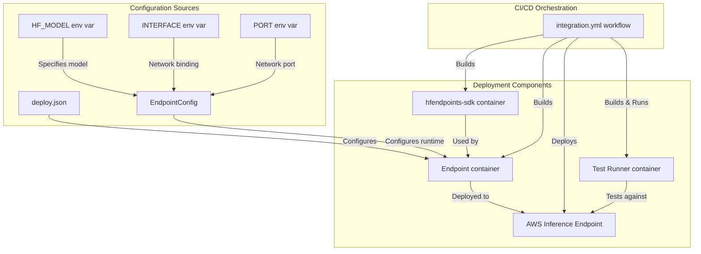
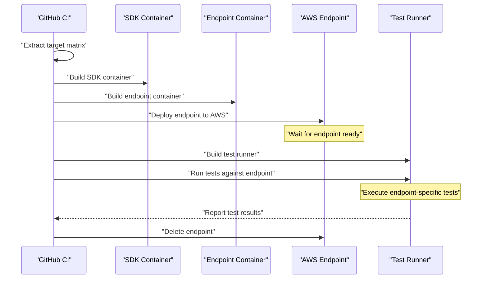
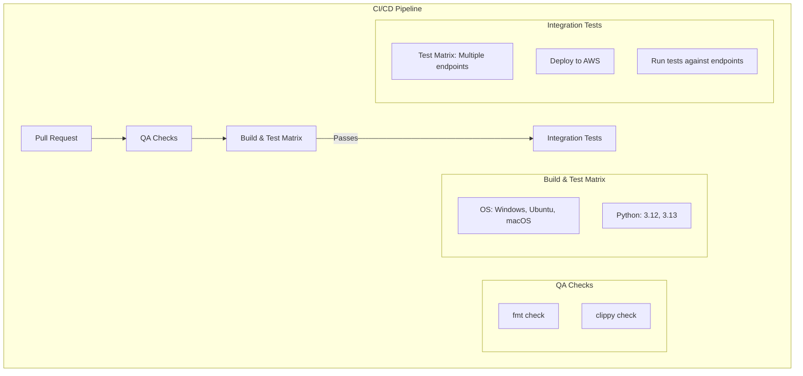

<!-- source: DeepWiki mcp.deepwiki.com · repo huggingface/hfendpoints · page 5 Deployment and Testing · fetched 2026-10-26 -->

# Deployment and Testing

<details>
<summary>Relevant source files</summary>

The following files were used as context for generating this wiki page:

- [.dockerignore](.dockerignore)
- [.github/workflows/integration.yml](.github/workflows/integration.yml)
- [.github/workflows/rust.yml](.github/workflows/rust.yml)
- [Dockerfile](Dockerfile)
- [hfendpoints/bindings/python/hfendpoints/config/__init__.py](hfendpoints/bindings/python/hfendpoints/config/__init__.py)

</details>


This document provides an overview of the deployment and testing infrastructure for HFEndpoints. It covers how endpoints are built, packaged into containers, deployed to cloud environments, and tested using integration tests. For specific implementation details of Python bindings, see [Python Integration](#4), and for details on specialized endpoints, see [OpenAI-Compatible Endpoints](#3).

## Deployment Architecture

HFEndpoints follows a container-based deployment model that enables consistent deployment across different environments. The system uses Docker containers to package both the SDK and endpoint-specific implementations.



The deployment architecture consists of the following key components:

1. **SDK Container**: The base container that includes the HFEndpoints SDK. This is built from the repository code.
2. **Endpoint Container**: A specialized container that extends the SDK and implements endpoint-specific functionality.
3. **AWS Inference Endpoint**: The deployed endpoint running on AWS infrastructure.
4. **Test Runner**: Container built specifically to test an endpoint implementation.

Sources: [.github/workflows/integration.yml:126-132](), [.github/workflows/integration.yml:134-145](), [Dockerfile:1-5]()

## Integration Testing Workflow

The integration testing workflow automates the process of building, deploying, and testing endpoints. This ensures that all components work together correctly in a production-like environment.



Integration tests for HFEndpoints are defined in a repository matrix and run as part of the CI/CD pipeline. The workflow:

1. Builds the SDK container using the current codebase
2. Builds endpoint-specific containers with the newly built SDK
3. Deploys the endpoint to AWS using HF CLI
4. Builds and runs test runners specific to each endpoint
5. Reports test results and cleans up by deleting the endpoints

Sources: [.github/workflows/integration.yml:17-37](), [.github/workflows/integration.yml:147-164](), [.github/workflows/integration.yml:166-187]()

## Endpoint Configuration

Endpoints are configured through a combination of environment variables, configuration files, and HF CLI parameters.

### EndpointConfig

The `EndpointConfig` class serves as the central point for endpoint configuration:

```mermaid
classDiagram
    class EndpointConfig {
        +bool is_debug
        +str interface
        +int port
        +str model_id
        +Path repository
        +from_env() EndpointConfig
    }
    
    class "Environment Variables" {
        INTERFACE
        PORT
        HF_MODEL
        MODEL_ID
    }
    
    "Environment Variables" --> EndpointConfig: Configures
```

Key configuration parameters include:

| Parameter | Environment Variable | Default | Description |
|-----------|---------------------|---------|-------------|
| interface | INTERFACE | "0.0.0.0" | Network interface to bind the endpoint server |
| port | PORT | 8000 | Port to listen for incoming requests |
| model_id | HF_MODEL | "unknown" | Hugging Face model ID to be served |
| repository | MODEL_ID or HF_MODEL | "/repository" | Local path where model artifacts are stored |

Sources: [hfendpoints/bindings/python/hfendpoints/config/__init__.py:12-45]()

### Deployment Configuration

The deployment configuration is defined in a `deploy.json` file within the endpoint repository's `.hfjobs` folder. This file specifies:

- Instance type (e.g., CPU, GPU)
- Instance size
- Model to be deployed
- Additional deployment parameters

Sources: [.github/workflows/integration.yml:97-102](), [.github/workflows/integration.yml:149-151]()

## CI/CD Pipeline

HFEndpoints implements a comprehensive CI/CD pipeline to ensure code quality and integration testing.



The CI/CD pipeline consists of two main workflows:

1. **Rust Workflow**: Handles code quality and basic testing
   - Code formatting checks
   - Clippy linting
   - Build and test on multiple platforms and Python versions

2. **Integration Workflow**: Tests endpoint deployment and functionality
   - Builds containers
   - Deploys to AWS
   - Runs integration tests
   - Cleans up resources

Sources: [.github/workflows/rust.yml:17-97](), [.github/workflows/integration.yml:1-192]()

## Docker Container Setup

Docker containers are a key part of the deployment strategy. The base Dockerfile uses maturin to build the Python package with Rust extensions.

Key points about the Docker setup:

- Uses maturin for building Python bindings with Rust
- Builds the package with `--release` and `--features python` flags
- Follows standard Docker best practices with appropriate .dockerignore settings

Sources: [Dockerfile:1-5](), [.dockerignore:1-10]()

## Testing Endpoints

The testing approach for endpoints involves:

1. **Unit Tests**: Run as part of the core Rust workflow
2. **Integration Tests**: Deployed to actual cloud infrastructure to verify end-to-end functionality
3. **Platform Compatibility**: Testing across Windows, Ubuntu, and macOS
4. **Python Version Compatibility**: Testing with Python 3.12 and 3.13

Each endpoint repository contains a `.hfjobs` folder with a `Dockerfile` for building a test runner container and a `deploy.json` file with deployment configuration.

Sources: [.github/workflows/rust.yml:80-96](), [.github/workflows/integration.yml:166-187]()

## Deployment Process

To deploy an endpoint:

1. Create a repository with a Dockerfile that uses the HFEndpoints SDK
2. Add a `.hfjobs` folder with deployment configuration
3. Add test runners in the `.hfjobs` folder
4. Use the Hugging Face CLI to deploy the endpoint

The deployment can also be automated using the integration workflow, which handles the building, deployment, and testing of endpoints.

Sources: [.github/workflows/integration.yml:147-164]()

---

