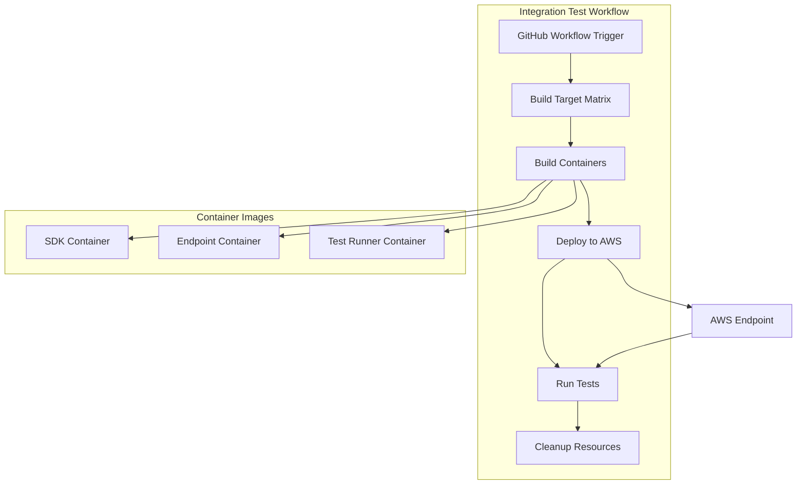
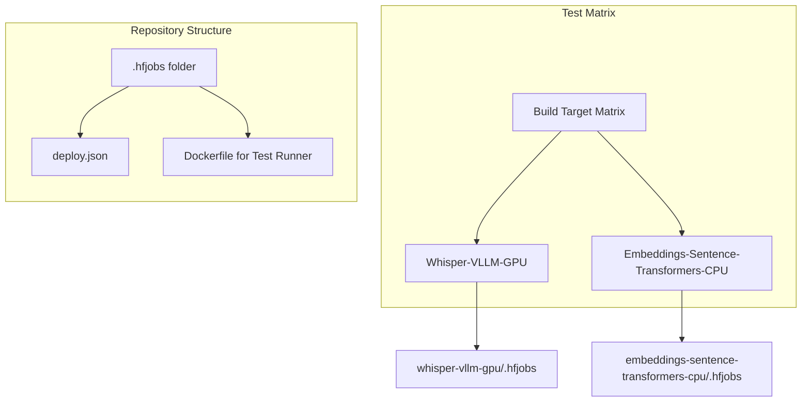
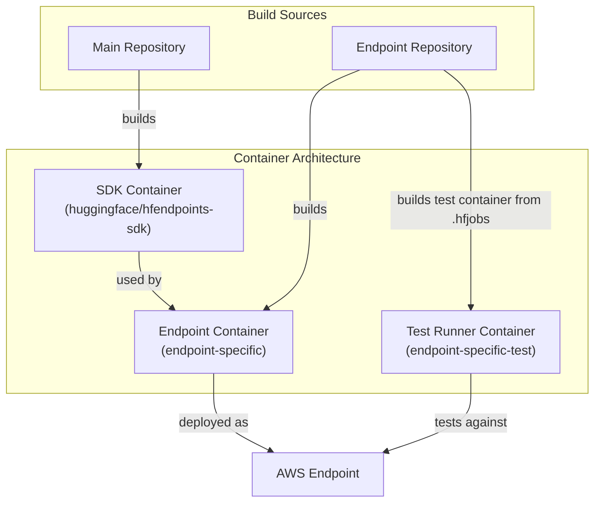
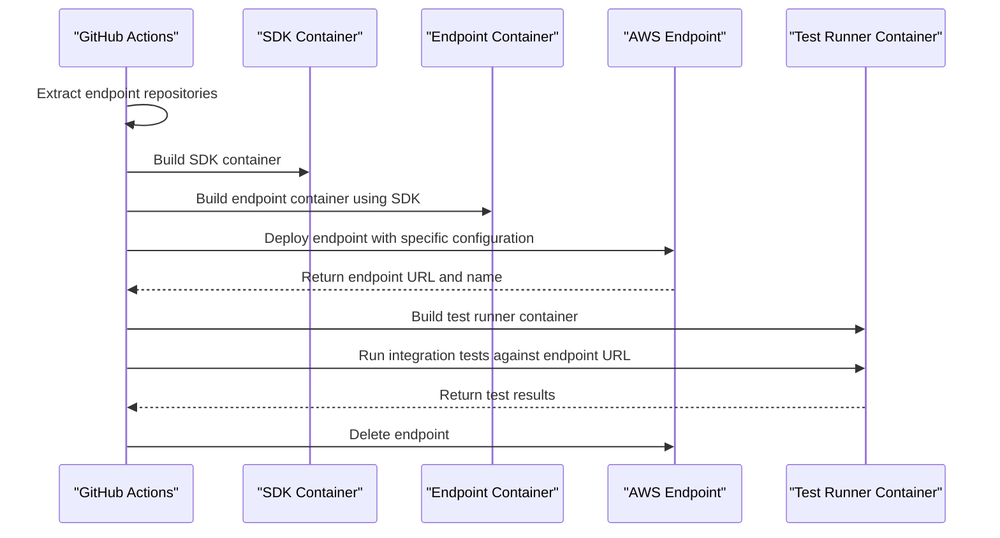
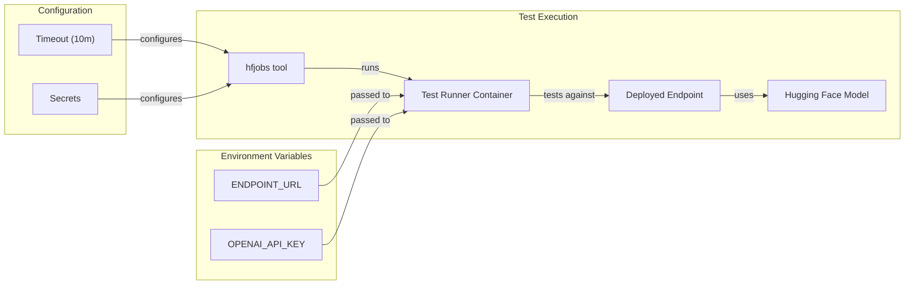
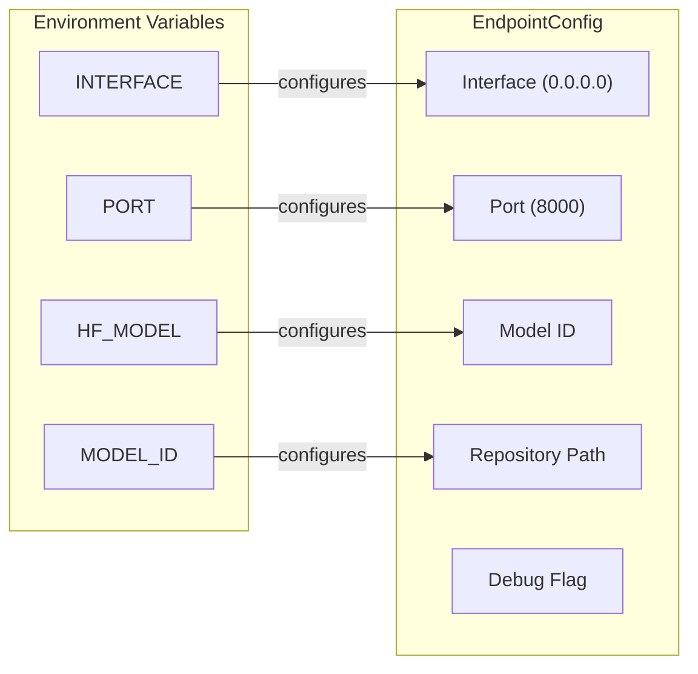
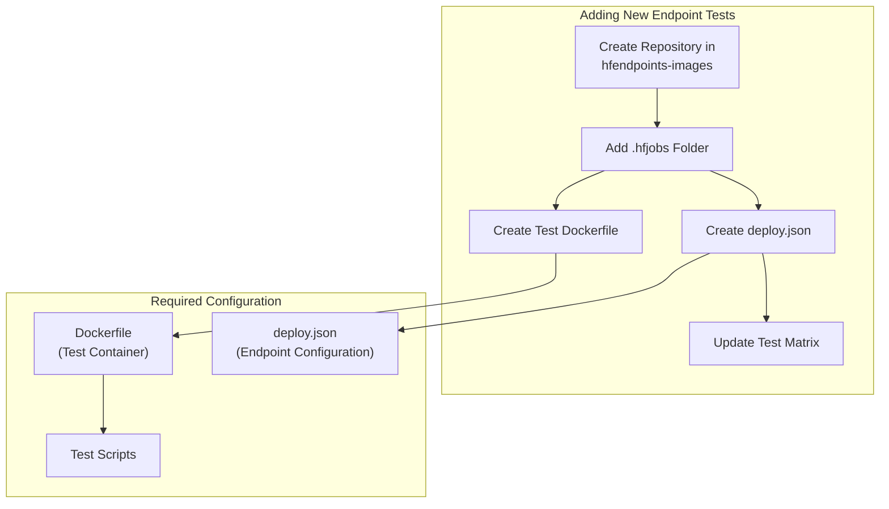

<!-- source: DeepWiki mcp.deepwiki.com · repo huggingface/hfendpoints · page 5.1 Integration Tests · fetched 2026-10-26 -->

# Integration Tests

Relevant source files

The following files were used as context for generating this wiki page:

- [.github/workflows/integration.yml](.github/workflows/integration.yml)
- [.github/workflows/rust.yml](.github/workflows/rust.yml)
- [hfendpoints/bindings/python/hfendpoints/config/__init__.py](hfendpoints/bindings/python/hfendpoints/config/__init__.py)

This document describes the integration testing framework for the HFEndpoints project. Integration tests verify that various HFEndpoints configurations work correctly in real-world deployment scenarios, particularly testing OpenAI-compatible endpoints against Hugging Face models.

For information about Docker configuration, see [Docker Containers](#5.2). For deployment configuration details, see [Configuration and Deployment](#5.3).

## Overview of the Integration Testing Framework

The HFEndpoints integration tests use a GitHub Actions workflow to deploy and test endpoint configurations. These tests validate end-to-end functionality by:

1. Building container images for the SDK and endpoints
2. Deploying endpoints to AWS
3. Running test suites against the deployed endpoints
4. Cleaning up resources after testing

Sources: [.github/workflows/integration.yml:1-192]()

## Test Matrix Configuration

The integration tests use a matrix-based approach to test multiple endpoint configurations. Currently, the tests cover:

- Whisper VLLm GPU endpoint (for audio transcription)
- Embeddings sentence transformers CPU endpoint

The matrix is defined in the workflow and can be extended to include additional endpoint types.

Sources: [.github/workflows/integration.yml:18-36]()

## Container Architecture

The integration tests use three distinct container types:

1. **SDK Container**: Contains the HFEndpoints SDK code
2. **Endpoint Container**: Specific endpoint implementation (e.g., Whisper, Embeddings)
3. **Test Runner Container**: Contains tests to run against the deployed endpoint

The SDK container is built from the main repository, while the endpoint and test runner containers are built from endpoint-specific repositories.

Sources: [.github/workflows/integration.yml:126-177]()

## Deployment and Test Process

### Deployment Flow

The integration test workflow follows these steps:

1. **Repository Setup**: Fetch endpoint specifications from the appropriate repository
2. **Build Containers**: Build SDK, endpoint, and test runner containers
3. **Deploy Endpoint**: Create an AWS endpoint using the endpoint container
4. **Run Tests**: Execute tests from the test runner container against the deployed endpoint
5. **Cleanup**: Delete the endpoint after tests complete

Sources: [.github/workflows/integration.yml:146-191]()

### Configuration via deploy.json

Each endpoint repository contains a `.hfjobs/deploy.json` file that specifies:

- Instance type (CPU/GPU)
- Instance size
- Model to use
- Additional endpoint-specific configuration

This configuration file is used to properly deploy the endpoint in AWS.

| Configuration Field | Description | Example |
|---------------------|-------------|---------|
| instance_type | Type of AWS instance (CPU/GPU) | gpu |
| instance_size | Size of AWS instance | xlarge |
| model | Hugging Face model ID to use | openai/whisper-large-v3 |
| description | Description of the endpoint | Whisper transcription endpoint |
| id | Unique identifier for the endpoint | whisper-vllm |

Sources: [.github/workflows/integration.yml:96-102](), [.github/workflows/integration.yml:146-164]()

## Test Execution

The integration tests use the `hfjobs` tool to run test containers against the deployed endpoints. The test runner container contains all necessary test code and dependencies.

Sources: [.github/workflows/integration.yml:179-187]()

## Environment Configuration

Endpoints are configured through environment variables that are set during deployment:

Sources: [hfendpoints/bindings/python/hfendpoints/config/__init__.py:1-60]()

## Adding New Integration Tests

To add a new endpoint type to the integration test suite:

1. Create a new repository in the `hfendpoints-images` organization
2. Add a `.hfjobs` folder with:
   - `deploy.json` for endpoint configuration
   - `Dockerfile` for the test runner container
3. Update the `HFENDPOINTS_ENDPOINT_REPOSITORIES` variable in the integration workflow

The integration tests will then automatically include the new endpoint type in the test matrix.

Sources: [.github/workflows/integration.yml:24-36]()

## Relationship to Other CI/CD Processes

The integration tests complement other CI/CD processes in the repository:

| CI Process | Purpose | When Executed |
|------------|---------|---------------|
| Integration Tests | Test deployed endpoints on AWS | On merge group or manual trigger |
| Rust CI | Code quality and unit tests | On push, pull request, or merge group |
| Docker CI | Build and publish Docker images | Part of integration tests |

Integration tests focus on real-world deployment scenarios, while the Rust CI workflow ensures code quality and correctness at the unit level.

Sources: [.github/workflows/integration.yml:1-10](), [.github/workflows/rust.yml:1-96]()

---

