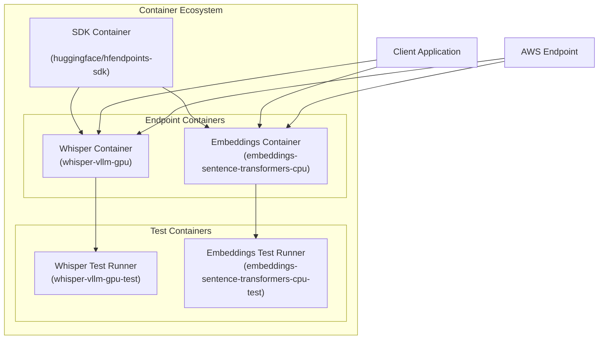
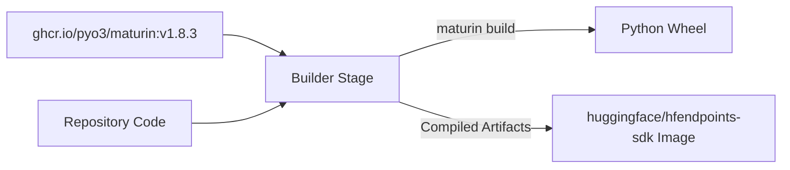
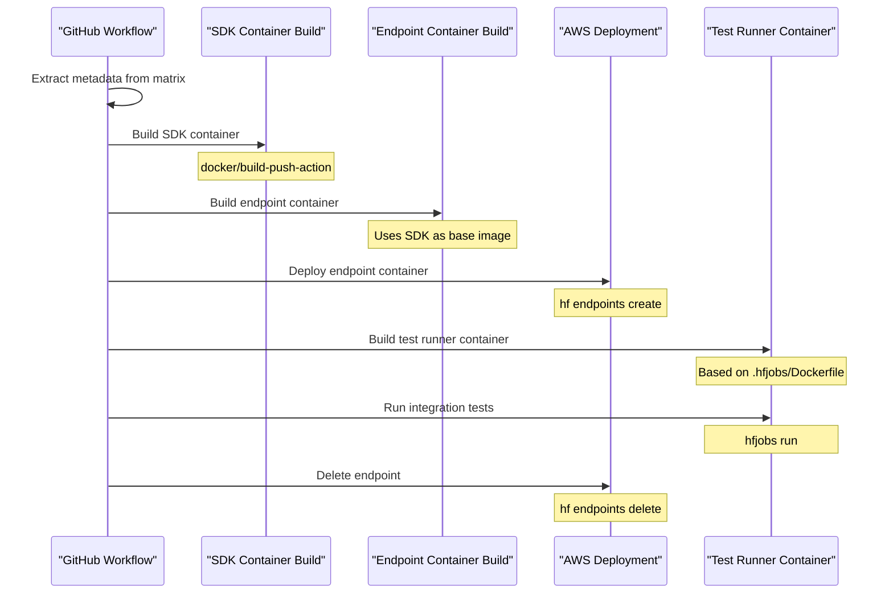
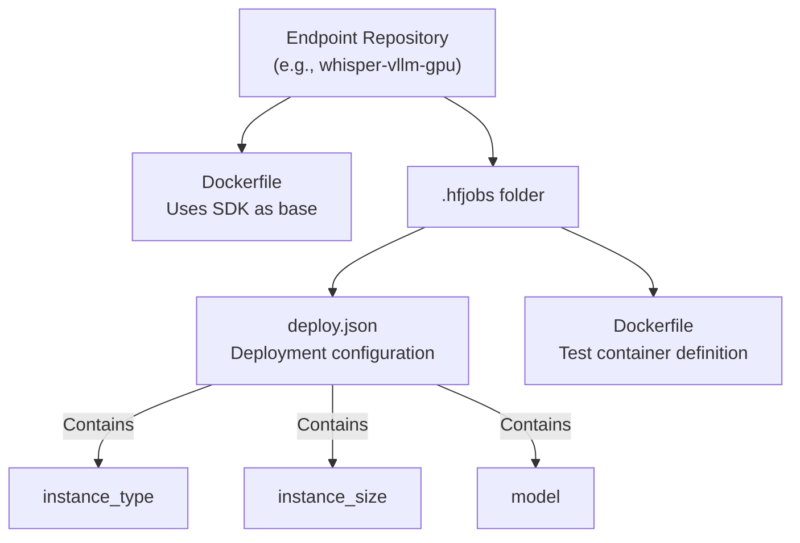

<!-- source: DeepWiki mcp.deepwiki.com · repo huggingface/hfendpoints · page 5.2 Docker Containers · fetched 2026-10-26 -->

# Docker Containers

Relevant source files

The following files were used as context for generating this wiki page:

- [.dockerignore](.dockerignore)
- [.github/workflows/integration.yml](.github/workflows/integration.yml)
- [.github/workflows/rust.yml](.github/workflows/rust.yml)
- [Dockerfile](Dockerfile)
- [hfendpoints/bindings/python/hfendpoints/config/__init__.py](hfendpoints/bindings/python/hfendpoints/config/__init__.py)

## Purpose and Scope

This document details the Docker container infrastructure used in the HFEndpoints project, explaining how containers are built, configured, and utilized in both development and deployment workflows. It covers the container types, build processes, CI/CD integration, and configuration options.

For information about integration testing with these containers, see [Integration Tests](#5.1). For deployment configuration details, see [Configuration and Deployment](#5.3).

## Container Types and Roles

HFEndpoints utilizes three primary types of Docker containers, each serving a specific purpose within the development and deployment process.

### SDK Container

The SDK container serves as the base image containing the compiled HFEndpoints core code with Python bindings. It is built using the main `Dockerfile` in the repository root and produces the `huggingface/hfendpoints-sdk` image.

### Endpoint Containers

Endpoint containers are specialized images that extend the SDK container. They include model-specific code and dependencies required to run particular types of endpoints, such as audio transcription or embedding generation. These containers are named according to their functionality and hardware target (e.g., `whisper-vllm-gpu`, `embeddings-sentence-transformers-cpu`).

### Test Runner Containers

Test runner containers are used for automated testing of deployed endpoints. They contain test scripts and dependencies specific to each endpoint type and are built from Dockerfiles in the `.hfjobs` folder of each endpoint repository.

Sources: [.github/workflows/integration.yml:126-132](), [.github/workflows/integration.yml:134-145](), [.github/workflows/integration.yml:166-178]()

## Core Container Build Process

The HFEndpoints container build process utilizes Maturin to compile the Rust code with Python bindings.

The main `Dockerfile` uses a single-stage build process:

1. Starts with a Maturin base image (`ghcr.io/pyo3/maturin:v1.8.3`)
2. Copies the repository code into the container
3. Builds the Rust code with Python bindings using Maturin
4. Outputs compiled artifacts to `/opt/hfendpoints/dist`

The `.dockerignore` file excludes development artifacts and IDE configuration files to keep the images lean.

Sources: [Dockerfile:1-5](), [.dockerignore:1-10]()

## Environment Configuration

Endpoint containers are configured through environment variables, which are parsed by the `EndpointConfig` class:

| Environment Variable | Description                                | Default Value |
|----------------------|--------------------------------------------|---------------|
| `INTERFACE`          | Network interface to listen on             | "0.0.0.0"     |
| `PORT`               | Port to listen on                          | 8000          |
| `HF_MODEL`           | Hugging Face model ID                      | "unknown"     |
| `MODEL_ID`           | Path to model repository                   | "/repository" |

The `EndpointConfig` class in the Python bindings retrieves these values from the environment:

Sources: [hfendpoints/bindings/python/hfendpoints/config/__init__.py:33-45]()

## CI/CD Integration

Docker containers play a central role in the CI/CD pipeline for integration testing and deployment. The `integration.yml` workflow handles building and testing containers in a continuous integration context.

The workflow follows these steps:

1. Builds a matrix of target repositories based on the `HFENDPOINTS_ENDPOINT_REPOSITORIES` environment variable
2. For each repository:
   - Builds the SDK container tagged with the commit ID
   - Builds the endpoint container using the SDK as base
   - Pushes the endpoint container to Docker Hub
   - Deploys the endpoint container to AWS
   - Builds a test runner container
   - Runs integration tests against the deployed endpoint
   - Cleans up by deleting the endpoint

Sources: [.github/workflows/integration.yml:126-132](), [.github/workflows/integration.yml:134-145](), [.github/workflows/integration.yml:146-165](), [.github/workflows/integration.yml:166-178](), [.github/workflows/integration.yml:179-187]()

## Endpoint Repository Structure

Each endpoint repository follows a consistent structure to support containerization:

Key components:
- `Dockerfile`: Defines how to build the endpoint container using the SDK as base
- `.hfjobs/`: Directory containing test and deployment configurations
  - `deploy.json`: Configuration for AWS deployment (instance type, size, model)
  - `Dockerfile`: Definition for the test runner container

The CI/CD workflow extracts deployment parameters from `deploy.json` to automate the entire testing process.

Sources: [.github/workflows/integration.yml:96-102](), [.github/workflows/integration.yml:104-112](), [.github/workflows/integration.yml:149-151]()

## Cross-Platform Building and Testing

For local development, the repository provides CI workflows that test the codebase across multiple operating systems and Python versions, ensuring Docker containers can be built correctly regardless of the development environment:

| Operating System | Python Versions |
|------------------|-----------------|
| Windows          | 3.12, 3.13      |
| Ubuntu           | 3.12, 3.13      |
| macOS            | 3.12, 3.13      |

These tests run outside of Docker to ensure the code compiles and tests pass on all supported platforms before being containerized.

Sources: [.github/workflows/rust.yml:80-96]()

## Best Practices

When working with Docker containers in HFEndpoints:

1. Use the `.dockerignore` file to exclude development artifacts
2. Keep endpoint-specific Dockerfiles minimal by leveraging the SDK base image
3. Store test logic in a separate test container for clean separation of concerns
4. Use environment variables for configuration to make containers more portable
5. Follow the established directory structure with `.hfjobs` for test and deployment configuration

---

