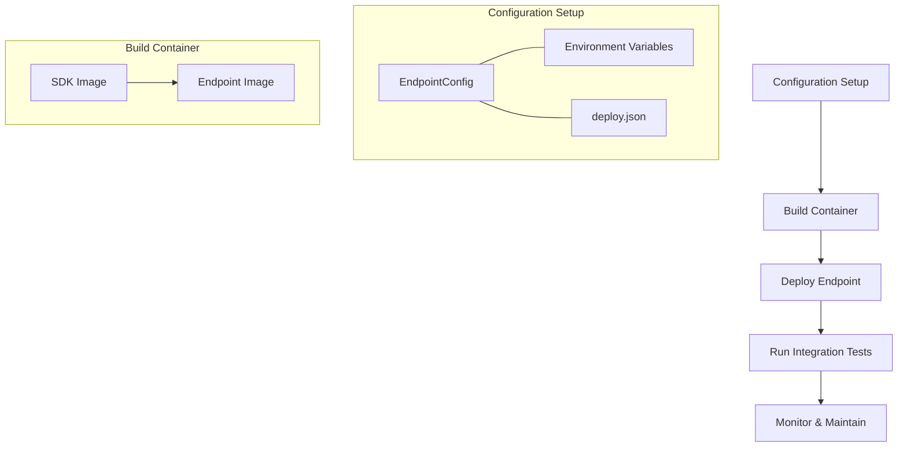
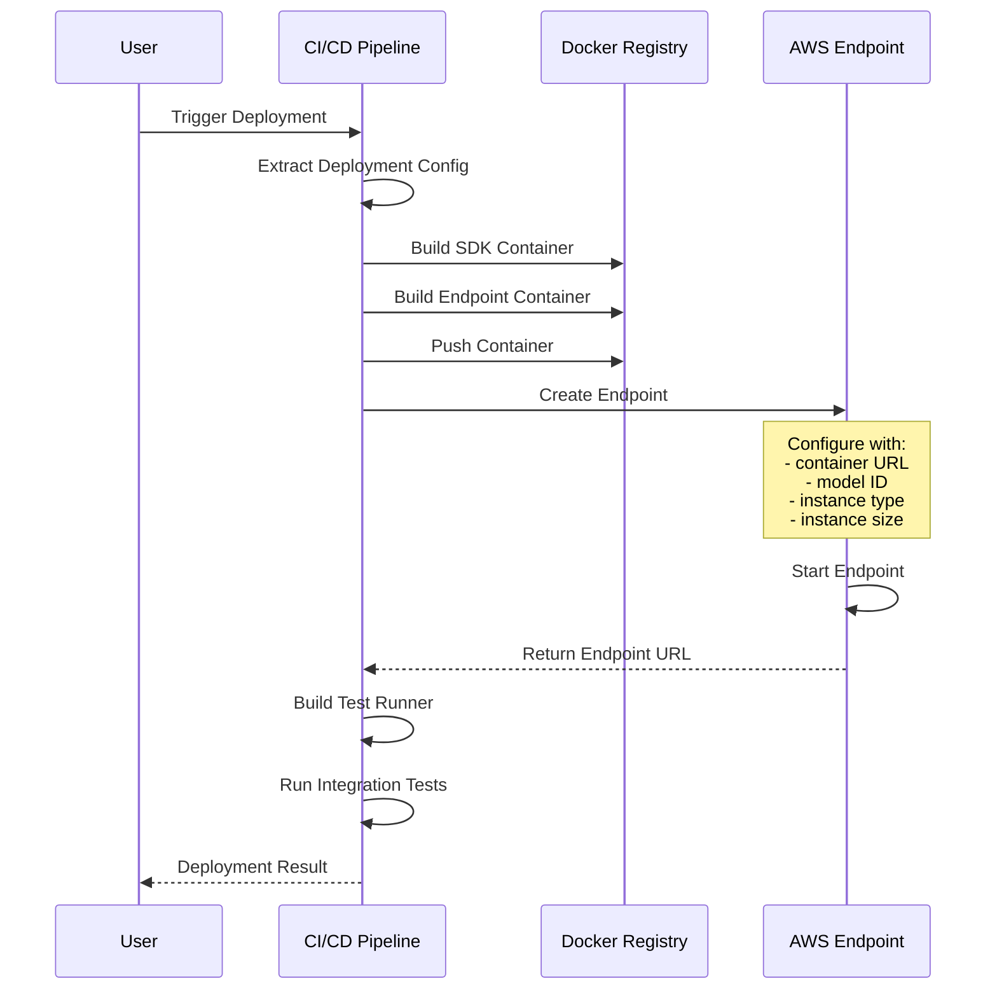
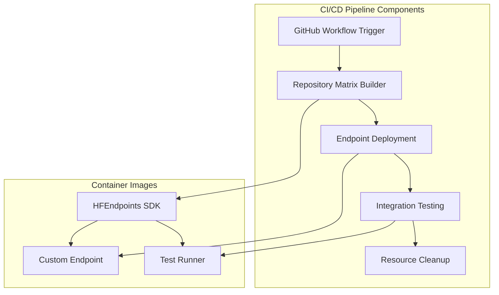

<!-- source: DeepWiki mcp.deepwiki.com · repo huggingface/hfendpoints · page 5.3 Configuration and Deployment · fetched 2026-10-26 -->

# Configuration and Deployment

<details>
<summary>Relevant source files</summary>

The following files were used as context for generating this wiki page:

- [.github/workflows/integration.yml](.github/workflows/integration.yml)
- [.github/workflows/rust.yml](.github/workflows/rust.yml)
- [hfendpoints/bindings/python/hfendpoints/config/__init__.py](hfendpoints/bindings/python/hfendpoints/config/__init__.py)

</details>


This document provides a detailed guide on configuring and deploying HFEndpoints, which allows you to serve Hugging Face models through OpenAI-compatible API endpoints. It covers the configuration parameters, deployment options, and infrastructure setup required to get your endpoints up and running in various environments.

For information about testing deployed endpoints, see [Integration Tests](#5.1). For details on Docker container setup, see [Docker Containers](#5.2).

## Configuration Options

HFEndpoints provides several configuration options that control how endpoints operate, including network settings, model paths, and runtime behavior.

### EndpointConfig Class

The core configuration is handled through the `EndpointConfig` class, which defines the essential parameters for running an endpoint:

```mermaid
classDiagram
    class "EndpointConfig" {
        +bool is_debug
        +str interface
        +int port
        +str model_id
        +Path repository
        +from_env() EndpointConfig
    }
```

These parameters control:
- `is_debug`: Whether the endpoint runs in debug mode
- `interface`: The network interface to listen on (e.g., "0.0.0.0")
- `port`: The port number for accepting connections
- `model_id`: The Hugging Face model identifier
- `repository`: Local path where model artifacts are stored

Sources: [hfendpoints/bindings/python/hfendpoints/config/__init__.py:12-45]()

### Environment Variables

The `EndpointConfig.from_env()` method parses environment variables to populate configuration values:

| Environment Variable | Description | Default Value |
|----------------------|-------------|---------------|
| `INTERFACE`          | Network interface | "0.0.0.0" |
| `PORT`               | Listening port | 8000 |
| `HF_MODEL`           | Hugging Face model ID | "unknown" |
| `MODEL_ID`           | Local model repository path | "/repository" |

The `is_debug` flag is automatically set to `True` when `MODEL_ID` is not the default "/repository", indicating a local development environment.

Sources: [hfendpoints/bindings/python/hfendpoints/config/__init__.py:33-45]()

### Model Compatibility Validation

HFEndpoints includes utilities to validate that a model's architecture is compatible with the endpoint's capabilities:

```python
ensure_supported_architectures(config, ["SupportedArch1", "SupportedArch2"])
```

This function verifies that the model architecture is supported by the endpoint, throwing an `UnsupportedModelArchitecture` exception if not.

Sources: [hfendpoints/bindings/python/hfendpoints/config/__init__.py:48-60]()

## Deployment Workflow

HFEndpoints supports various deployment scenarios, from local development to production cloud environments.

### Deployment Process



Sources: [.github/workflows/integration.yml:126-145]()

### Deployment Configuration with deploy.json

For automated deployments, HFEndpoints uses a `deploy.json` file in the `.hfjobs` folder to specify deployment parameters:

```mermaid
classDiagram
    class "deploy.json" {
        +str instance_type
        +str instance_size
        +str model
        +str description
        +str id
    }
```

This configuration file defines:
- `instance_type`: The type of compute instance (e.g., "gpu")
- `instance_size`: The size of the compute instance (e.g., "medium")
- `model`: The model ID to deploy
- `description`: A human-readable description of the endpoint
- `id`: A unique identifier for the deployment

Sources: [.github/workflows/integration.yml:149-186]()

## Cloud Deployment

HFEndpoints can be deployed to cloud providers, with built-in support for AWS Endpoints.

### AWS Deployment Process



Sources: [.github/workflows/integration.yml:146-191]()

### AWS Deployment Command

The HF CLI is used to create and manage endpoints on AWS:

```
hf endpoints create \
  --wait \
  --output json \
  --provider aws \
  --region us-east-1 \
  --container custom \
  --container-url <container-url> \
  --model <model-id> \
  --instance-type <instance-type> \
  --instance-size <instance-size>
```

This command deploys a custom container to AWS, configures it with the specified model and instance parameters, and waits for the deployment to complete.

Sources: [.github/workflows/integration.yml:152-161]()

## CI/CD Integration

HFEndpoints includes CI/CD workflows for automated testing and deployment.

### Integration Workflow Components



The CI/CD pipeline consists of several key components:
1. Repository matrix builder to determine which endpoints to deploy
2. SDK container build for the core functionality
3. Endpoint container build for specific model deployments
4. Test runner container build for integration testing
5. AWS endpoint deployment and cleanup

Sources: [.github/workflows/integration.yml:18-191]()

### Cross-Platform Compatibility

HFEndpoints is designed to work across multiple operating systems and Python versions, with CI tests ensuring compatibility:

| OS | Python Versions |
|----|----------------|
| Windows | 3.12, 3.13 |
| Ubuntu | 3.12, 3.13 |
| macOS | 3.12, 3.13 |

For local development and deployment, the codebase is tested on these platforms to ensure consistent behavior.

Sources: [.github/workflows/rust.yml:80-96]()

## Example Deployment Setup

Here's a complete example of configuring and deploying an HFEndpoints service:

1. Create a `deploy.json` configuration file:
```json
{
  "instance_type": "gpu",
  "instance_size": "medium",
  "model": "openai/whisper-small",
  "description": "Whisper speech-to-text API endpoint",
  "id": "whisper-vllm-gpu"
}
```

2. Create a Dockerfile that uses the HFEndpoints SDK:
```Dockerfile
FROM huggingface/hfendpoints-sdk:latest

# Configure the endpoint
ENV INTERFACE="0.0.0.0"
ENV PORT=8000
ENV HF_MODEL="openai/whisper-small"

# Add any custom dependencies
RUN pip install --no-cache-dir transformers accelerate

# Expose the port and run the endpoint
EXPOSE 8000
CMD ["python", "-m", "hfendpoints"]
```

3. Deploy using the HF CLI:
```bash
hf endpoints create \
  --provider aws \
  --region us-east-1 \
  --container custom \
  --container-url your-registry/whisper-endpoint:latest \
  --model openai/whisper-small \
  --instance-type gpu \
  --instance-size medium
```

Sources: [.github/workflows/integration.yml:152-164]()

## Best Practices

When configuring and deploying HFEndpoints, consider the following best practices:

1. **Environment-specific configuration:** Use environment variables to configure endpoints differently across environments.

2. **Model validation:** Always validate model compatibility using the `ensure_supported_architectures` function.

3. **Resource cleanup:** Implement proper cleanup procedures to avoid unnecessary cloud resources remaining active.

4. **Testing:** Create dedicated test runners for each endpoint to verify functionality.

5. **Monitoring:** Set up monitoring and logging to track endpoint performance and usage.

Sources: [.github/workflows/integration.yml:189-191](), [hfendpoints/bindings/python/hfendpoints/config/__init__.py:48-60]()