# Page: Overview

# Overview

<details>
<summary>Relevant source files</summary>

The following files were used as context for generating this wiki page:

- [Cargo.toml](Cargo.toml)
- [hfendpoints-openai/Cargo.toml](hfendpoints-openai/Cargo.toml)
- [hfendpoints/Cargo.toml](hfendpoints/Cargo.toml)

</details>


## Purpose and Scope

HFEndpoints is a framework for creating OpenAI-compatible API endpoints for Hugging Face models. It allows developers to serve machine learning models using interfaces that conform to the OpenAI API specification, making it easy to integrate Hugging Face models with existing applications that use the OpenAI SDK. This framework is written primarily in Rust with Python bindings, enabling high-performance inference while maintaining ease of use.

This overview introduces the HFEndpoints repository structure, its core components, and its high-level architecture. For more detailed information about the system architecture, see [Architecture Overview](#1.1).

## System Architecture

HFEndpoints follows a modular architecture, composed of several specialized crates that work together to provide OpenAI-compatible endpoints.

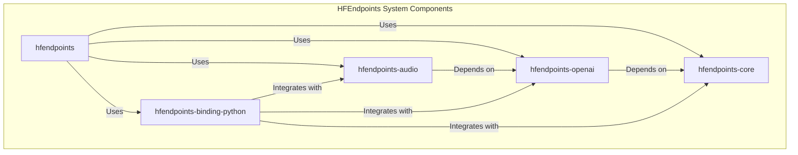

Sources: [Cargo.toml:3-8](), [hfendpoints/Cargo.toml:10-14]()

## Core Components

HFEndpoints consists of the following primary components:

### 1. Core Library (hfendpoints-core)

This is the foundation of the HFEndpoints framework, providing essential abstractions and protocols such as:
- Handler Protocol - Defines how requests are processed
- Endpoint Trait - Specifies interfaces that servers must implement
- Request context and tracking mechanisms

### 2. OpenAI-Compatible API (hfendpoints-openai)

Implements an HTTP server that presents API endpoints compatible with the OpenAI API specification. Built on Axum (a Rust web framework), it handles request routing, serialization/deserialization, and protocol-specific concerns.

### 3. Audio Processing (hfendpoints-audio)

Specializes in audio-related tasks like transcription, built on top of the OpenAI-compatible API framework.

### 4. Python Bindings (hfendpoints-binding-python)

Enables integration with Python code, allowing:
- Implementation of handlers in Python
- Use of Python-based machine learning libraries
- Seamless integration with the Hugging Face ecosystem

### 5. Main Package (hfendpoints)

Acts as the entry point and integration layer, bringing together all components into a cohesive whole. It's configured as a dynamic library that can be loaded by Python applications.

Sources: [Cargo.toml:3-8](), [hfendpoints/Cargo.toml:10-14](), [hfendpoints/Cargo.toml:20-29]()

## Request Processing Flow

The following diagram illustrates how requests flow through the HFEndpoints system:

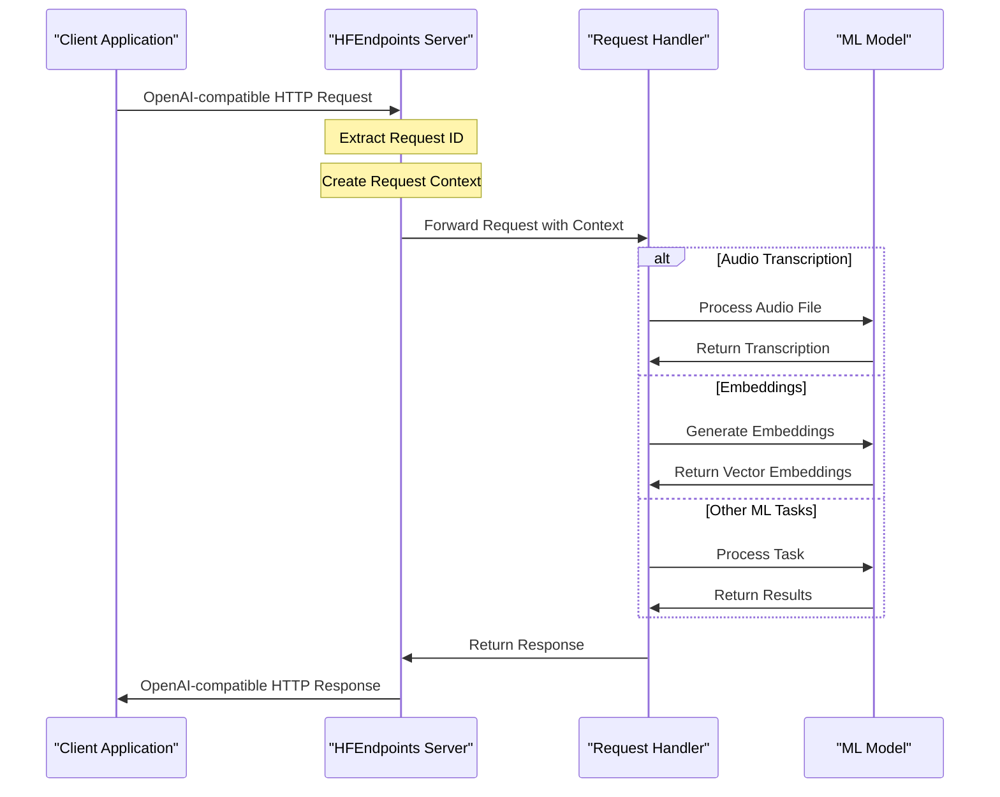

Sources: [hfendpoints-openai/Cargo.toml:7-9](), [hfendpoints-openai/Cargo.toml:18-23]()

## Component Interactions and Data Flow

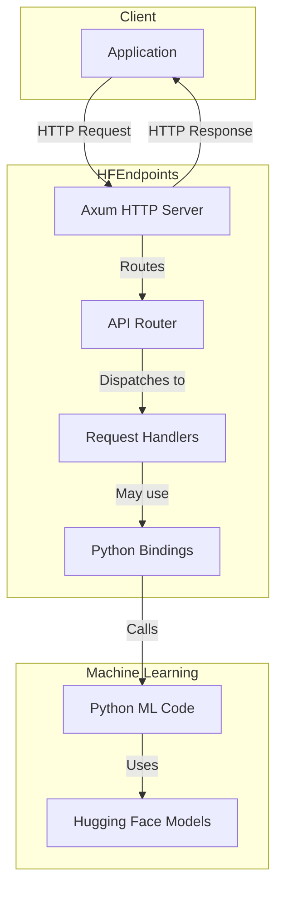

Sources: [hfendpoints-openai/Cargo.toml:7-9](), [hfendpoints-openai/Cargo.toml:10-14]()

## Features and Capabilities

HFEndpoints provides several key capabilities:

| Feature | Description |
|---------|-------------|
| OpenAI API Compatibility | Drop-in replacement for OpenAI API endpoints with compatible request/response formats |
| Audio Transcription | Process and transcribe audio files using Hugging Face models |
| Embeddings | Generate vector embeddings for text using compatible models |
| Python Integration | Seamless integration with Python ML ecosystems |
| High Performance | Rust-based server with optimized request handling |
| Configurable | Flexible configuration options for deployment scenarios |

Sources: [hfendpoints-openai/Cargo.toml:7-23](), [hfendpoints/Cargo.toml:20-29]()

## Code Organization

The HFEndpoints codebase is organized as a Rust workspace with several specialized crates:

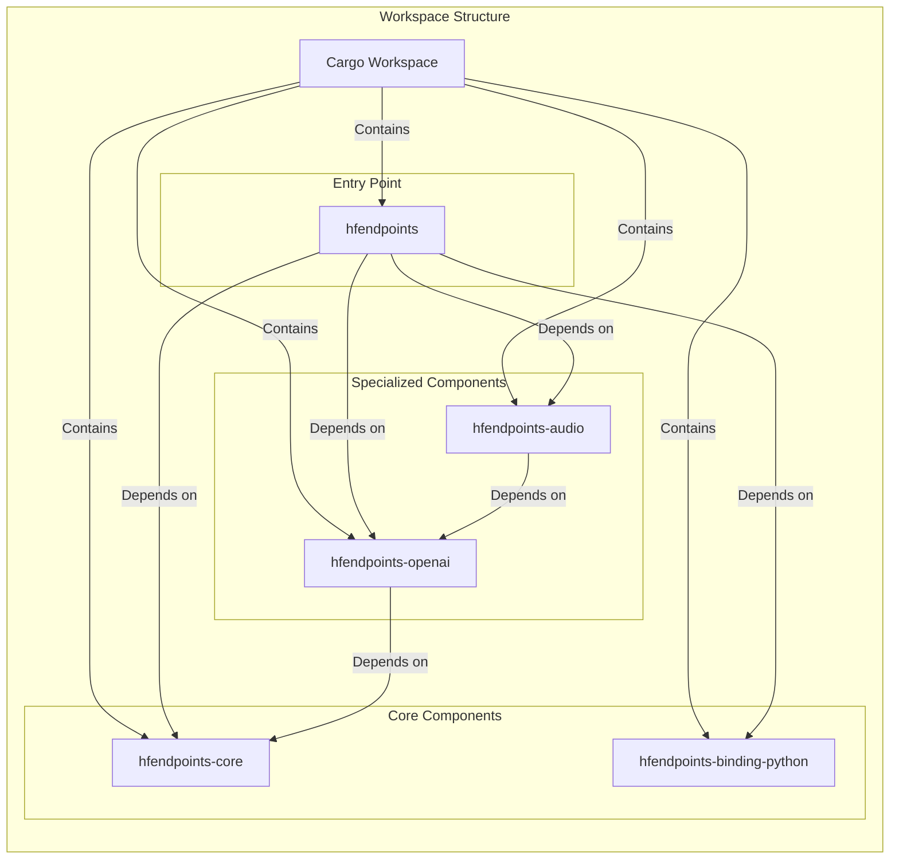

Sources: [Cargo.toml:1-8](), [hfendpoints/Cargo.toml:10-14]()

## Feature Flags

HFEndpoints uses feature flags to enable optional components, particularly for Python integration:

| Feature | Description | Enabled Components |
|---------|-------------|-------------------|
| `python` | Enables Python integration | PyO3, Python bindings for all components |

The Python feature enables comprehensive integration with Python applications, allowing models to be implemented and used from Python code while benefiting from the performance of the Rust-based server.

Sources: [hfendpoints/Cargo.toml:20-29](), [hfendpoints-openai/Cargo.toml:31-34]()

## Getting Started

For information on how to get started with HFEndpoints, including installation, configuration, and basic usage, see [Getting Started](#1.2).

## Related Documentation

- For detailed information about the core components, see [Core Components](#2)
- For information about OpenAI-compatible endpoints, see [OpenAI-Compatible Endpoints](#3)
- For details about Python integration, see [Python Integration](#4)
- For deployment and testing information, see [Deployment and Testing](#5)

---

# Page: Architecture Overview

# Architecture Overview

<details>
<summary>Relevant source files</summary>

The following files were used as context for generating this wiki page:

- [Cargo.toml](Cargo.toml)
- [hfendpoints-core/src/lib.rs](hfendpoints-core/src/lib.rs)
- [hfendpoints-openai/src/lib.rs](hfendpoints-openai/src/lib.rs)

</details>


This document provides a high-level view of the HFEndpoints system architecture, explaining how the different components interact with each other to deliver OpenAI-compatible endpoints for Hugging Face models. For more information about getting started with HFEndpoints, see [Getting Started](#1.2). For details about specific components, see [Core Components](#2).

## System Purpose and Key Components

HFEndpoints is a framework that enables serving Hugging Face models through OpenAI-compatible APIs. The system is built on a modular architecture with a clear separation of concerns:

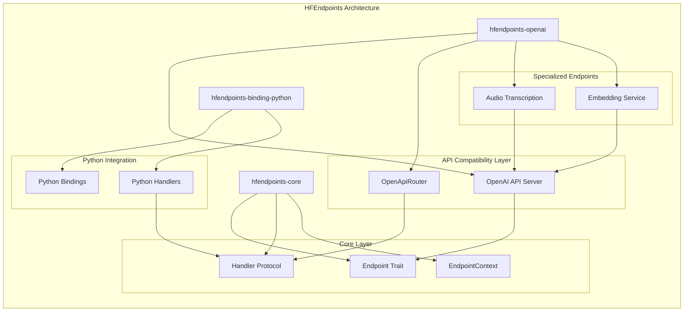

Sources: [hfendpoints-core/src/lib.rs:1-12](), [hfendpoints-openai/src/lib.rs:18-26](), [Cargo.toml:1-9]()

## Crate Organization

The HFEndpoints system is organized into a set of Rust crates, each with a specific responsibility:

| Crate | Purpose |
|-------|---------|
| `hfendpoints-core` | Core traits and interfaces |
| `hfendpoints-openai` | OpenAI API compatibility layer |
| `hfendpoints-audio` | Audio processing functionality |
| `hfendpoints-binding-python` | Python language bindings |
| `hfendpoints` | Main entry point |

Sources: [Cargo.toml:1-9]()

## Request Processing Flow

The following diagram illustrates how requests flow through the HFEndpoints system:

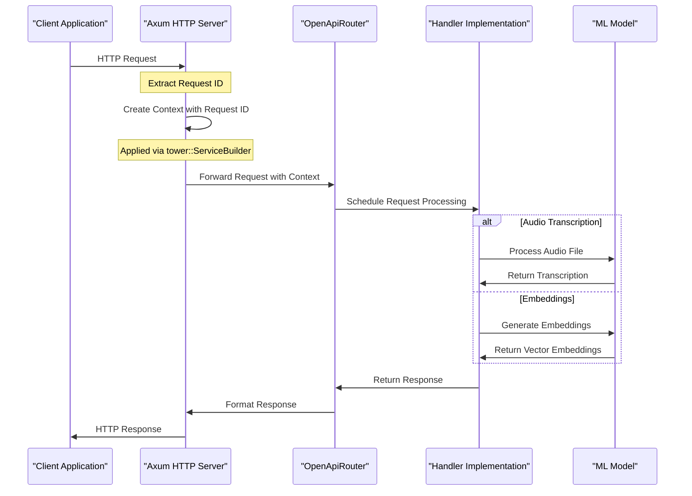

Sources: [hfendpoints-openai/src/lib.rs:55-92](), [hfendpoints-core/src/lib.rs:6-8]()

## Core Components and Their Relationships

The core components of HFEndpoints are defined by traits and interfaces that enable modularity and extensibility:

```mermaid
classDiagram
    class Endpoint {
        <<trait>>
        +serve(config) Result~()~
    }
    
    class Handler {
        <<trait>>
        +Request type
        +Response type
        +on_request(request) Result~Response~
    }
    
    class EndpointContext {
        +request_id: String
    }
    
    class OpenApiRouter {
        +with_openapi(api) -> OpenApiRouter
        +routes() -> Router
    }
    
    class serve_openai {
        +async fn(interface, task_router) -> Result
    }
    
    class PyHandler {
        +inner: PyObject
        +on_request(request) Result~Response~
    }
    
    Endpoint <|-- "OpenAI Compatible Endpoint"
    Handler <|-- PyHandler
    "OpenAI Compatible Endpoint" -- EndpointContext : uses
    serve_openai -- OpenApiRouter : configures
    Handler -- "wait_for_requests()" : processes via
    PyHandler -- "Python Handler Object" : delegates to
```

Sources: [hfendpoints-core/src/lib.rs:5-8](), [hfendpoints-openai/src/lib.rs:55-92](), [hfendpoints-openai/src/lib.rs:123-173]()

## OpenAI API Compatibility

The OpenAI compatibility layer is built around the `serve_openai` function, which sets up an HTTP server with OpenAI-compatible routes:

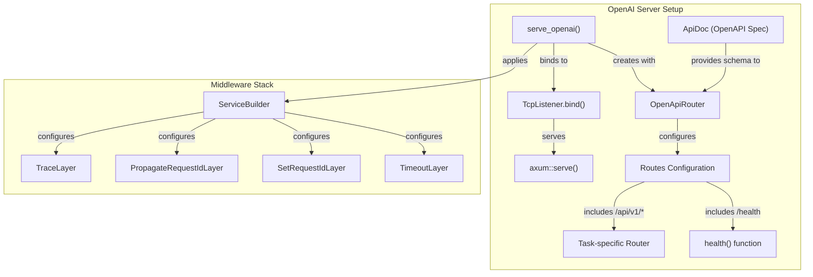

Sources: [hfendpoints-openai/src/lib.rs:55-92]()

## Python Integration

HFEndpoints provides Python integration through Rust bindings, allowing handlers to be implemented in Python:

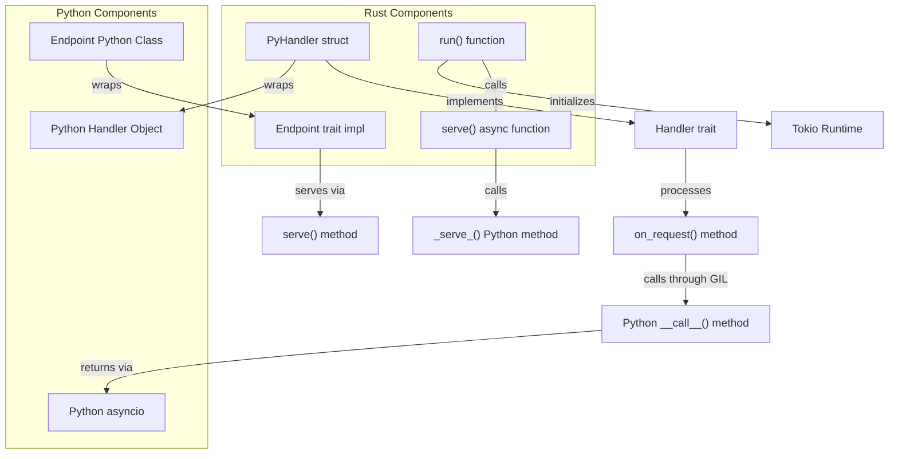

Sources: [hfendpoints-openai/src/lib.rs:94-304](), [hfendpoints-openai/src/lib.rs:123-173](), [hfendpoints-openai/src/lib.rs:192-241]()

## Server Configuration and Request Handling

The `serve_openai` function configures the server with several middleware layers for request handling:

| Middleware | Purpose |
|------------|---------|
| `TraceLayer` | Provides request tracing |
| `SetRequestIdLayer` | Sets a unique request ID for each request |
| `PropagateRequestIdLayer` | Propagates the request ID through headers |
| `TimeoutLayer` | Enforces request timeouts |

The server routes requests to the appropriate handler based on the URL path. The default routes include:

- `/health` - Health check endpoint
- `/api/v1/*` - API endpoints (audio, embeddings, etc.)
- `/docs` - API documentation

Sources: [hfendpoints-openai/src/lib.rs:55-92]()

## Error Handling

The system defines a custom `Error` type in the core crate, which is used throughout the codebase for consistent error handling:

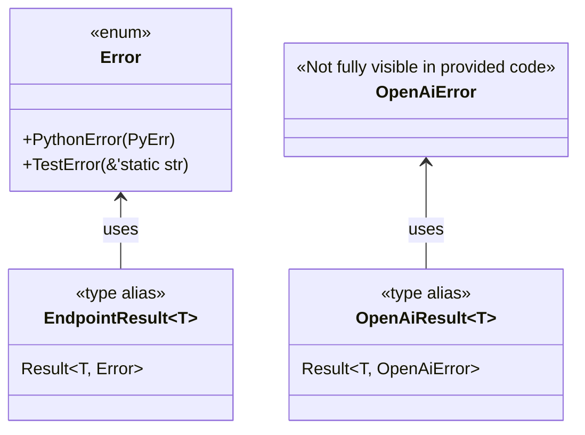

Sources: [hfendpoints-core/src/lib.rs:15-28](), [hfendpoints-openai/src/lib.rs:25-27]()

## Deployment Architecture

The HFEndpoints system can be deployed as a standalone service or embedded within other applications. When deployed as a service, it typically runs in a Docker container with configuration provided through environment variables:

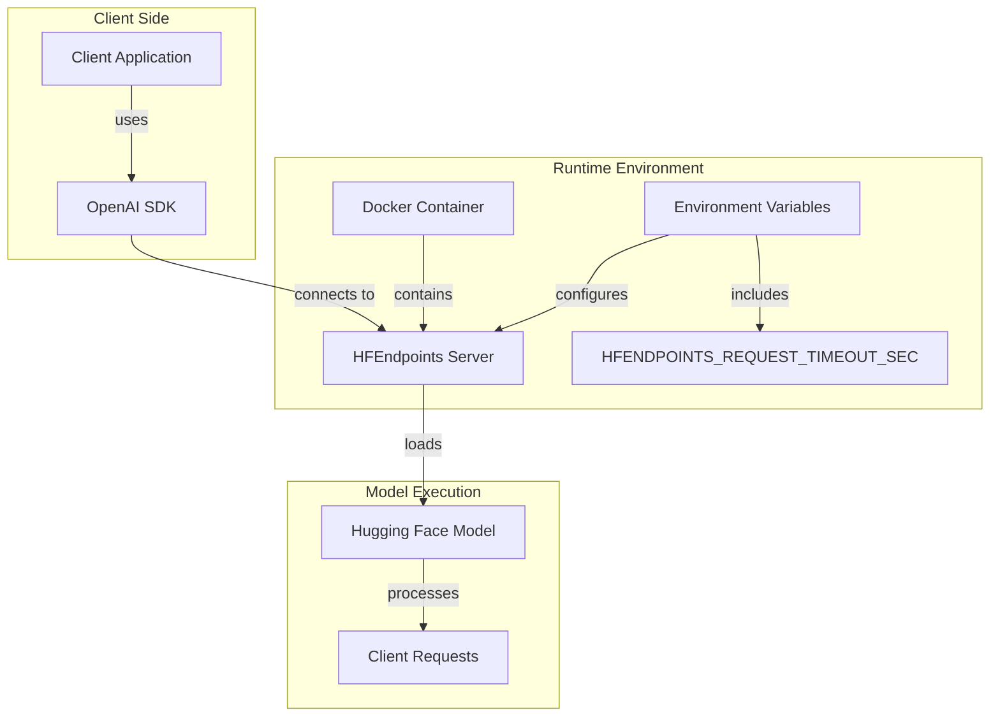

Sources: [hfendpoints-openai/src/lib.rs:64-69]()

## Integration with Other Systems

HFEndpoints is designed to integrate with the broader Hugging Face ecosystem, providing a bridge between the OpenAI API and Hugging Face models:

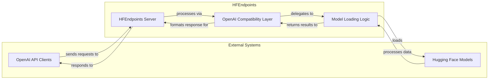

## Summary

The HFEndpoints architecture is designed around a set of modular components that work together to provide OpenAI-compatible endpoints for Hugging Face models. The system is built on Rust for performance and safety, with Python bindings for easy integration with the Python ecosystem. The architecture provides flexibility and extensibility, allowing for different types of models and endpoints to be supported.

---

# Page: Getting Started

# Getting Started

<details>
<summary>Relevant source files</summary>

The following files were used as context for generating this wiki page:

- [.dockerignore](.dockerignore)
- [Cargo.toml](Cargo.toml)
- [Dockerfile](Dockerfile)
- [hfendpoints/bindings/python/hfendpoints/__init__.py](hfendpoints/bindings/python/hfendpoints/__init__.py)

</details>


This guide will walk you through setting up and using HFEndpoints to create OpenAI-compatible API servers for Hugging Face models. We'll cover installation, basic configuration, and running your first endpoint. For detailed information about the system architecture, see [Architecture Overview](#1.1).

## Prerequisites

Before getting started with HFEndpoints, ensure you have the following:

- Python 3.8 or newer
- Rust toolchain (for building from source)
- Docker (optional, for containerized deployment)

## Installation

HFEndpoints can be installed using pip or built from source. Choose the method that best suits your needs.

### Installing via pip

```bash
pip install hfendpoints
```

### Building from source

To build from source, clone the repository and use Maturin to build the package:

```bash
git clone https://github.com/huggingface/hfendpoints
cd hfendpoints
pip install maturin
cd hfendpoints
maturin build --release
pip install target/wheels/hfendpoints-*.whl
```

Sources: [Dockerfile:1-5](), [Cargo.toml:1-8]()

## System Components

HFEndpoints consists of several components working together to provide OpenAI-compatible endpoints:

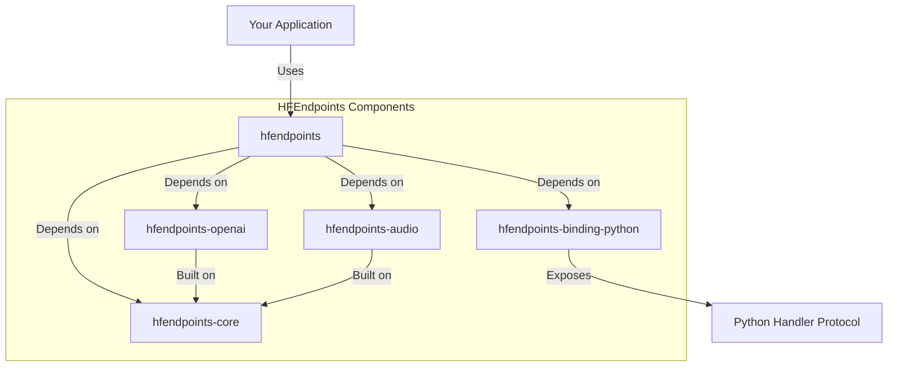

Sources: [Cargo.toml:1-8]()

## Creating Your First Endpoint

Setting up an HFEndpoints server involves defining a configuration and implementing a handler for your model.

### Basic Configuration

The first step is to create an `EndpointConfig` that defines how your endpoint will be set up:

```python
from hfendpoints import EndpointConfig

config = EndpointConfig(
    model_id_or_path="your-model-id",
    port=8000,
    interface="0.0.0.0"
)
```

The `EndpointConfig` specifies:
- The model to use
- Network interface and port to bind to
- Other optional configurations like authentication

Sources: [hfendpoints/bindings/python/hfendpoints/__init__.py:6]()

### Implementing a Handler

Handlers process incoming requests and return appropriate responses. Implement the `Handler` protocol to create your own:

```mermaid
classDiagram
    class "Handler[Request, Response]" {
        <<Protocol>>
        +__init__(model_id_or_path: str)
        +__call__(request: Request, ctx) -> Response
    }
    
    class "YourHandler" {
        +__init__(model_id_or_path: str)
        +__call__(request: Request, ctx) -> Response
    }
    
    "Handler[Request, Response]" <|.. "YourHandler" : implements
```

A simple handler implementation might look like this:

```python
from hfendpoints import Handler

class MyHandler(Handler):
    def __init__(self, model_id_or_path: str):
        # Initialize your model here
        self.model_id = model_id_or_path
        
    def __call__(self, request, ctx):
        # Process the request and generate a response
        return {"response": "Hello from " + self.model_id}
```

Sources: [hfendpoints/bindings/python/hfendpoints/__init__.py:14-19]()

## Running Your Endpoint

The way you run your endpoint depends on which compatible API you're implementing. Here's a general sequence for launching an endpoint:

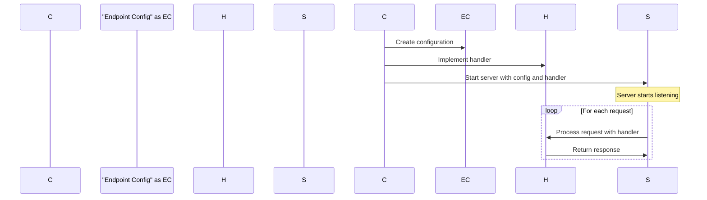

For specialized endpoints like OpenAI-compatible ones, you would use the appropriate module. For details on creating specific endpoint types, see:

- [OpenAI-Compatible Endpoints](#3)
- [Audio Transcription](#3.2)
- [Embeddings](#3.3)

## Containerization

HFEndpoints can be containerized using Docker, which simplifies deployment and ensures consistency:

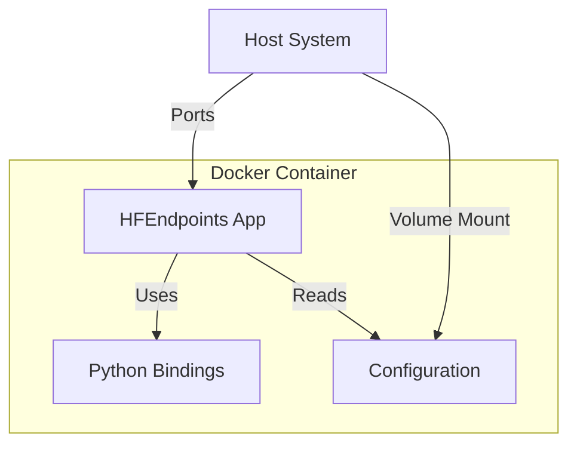

A basic Dockerfile would look like the provided example:

Sources: [Dockerfile:1-5](), [.dockerignore:1-10]()

## Next Steps

Now that you have a basic understanding of HFEndpoints, you can:

1. Learn how to implement more complex handlers in Python - see [Python Handler Implementation](#4.2)
2. Explore example implementations - see [Examples](#4.3)
3. Configure and deploy your endpoints to production - see [Configuration and Deployment](#5.3)

You're now ready to start building OpenAI-compatible endpoints for Hugging Face models!

---

# Page: Core Components

# Core Components

<details>
<summary>Relevant source files</summary>

The following files were used as context for generating this wiki page:

- [hfendpoints-core/Cargo.toml](hfendpoints-core/Cargo.toml)
- [hfendpoints-core/src/endpoint.rs](hfendpoints-core/src/endpoint.rs)
- [hfendpoints-core/src/lib.rs](hfendpoints-core/src/lib.rs)

</details>


The Core Components of HFEndpoints provide the foundational structures and interfaces that support the entire system. These components define how endpoints are created, how requests are processed, and how context is maintained throughout request handling. This page describes the key abstractions that form the backbone of the HFEndpoints architecture.

For specific implementation details of the Handler Protocol, see [Handler Protocol](#2.1). For detailed information about the Endpoint Trait, see [Endpoint Trait](#2.2). For in-depth coverage of context management, see [Context and Request ID](#2.3).

## Component Architecture

The core components of HFEndpoints consist of several key abstractions that work together to provide a flexible and extensible system for handling requests to machine learning endpoints.

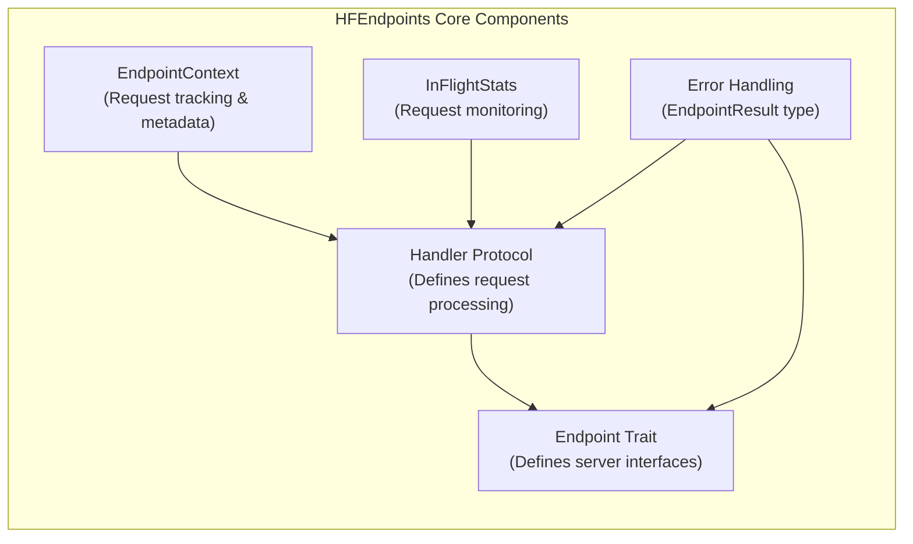

Sources: [hfendpoints-core/src/lib.rs:1-10](), [hfendpoints-core/src/endpoint.rs:1-7]()

## Component Relationships

The following diagram illustrates how the core components interact with each other and with the rest of the system:

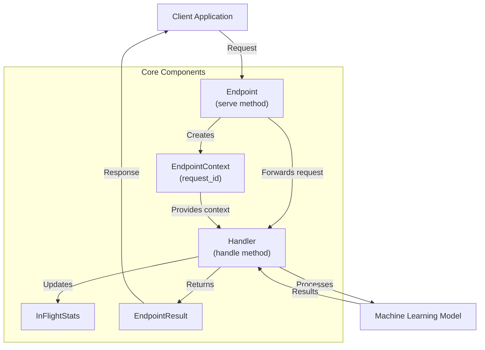

Sources: [hfendpoints-core/src/lib.rs:6-9](), [hfendpoints-core/src/endpoint.rs:4-6]()

## Core Traits and Interfaces

### Endpoint Trait

The `Endpoint` trait defines the server interface for handling requests. It provides a `serve` method that binds to a specified address and listens for incoming requests.

```rust
pub trait Endpoint<A> {
    fn serve(&self, binding: A) -> impl Future<Output=Result<(), Error>> + Send;
}
```

This trait is the entry point for all endpoint implementations and is responsible for setting up the server and routing requests to the appropriate handlers.

Sources: [hfendpoints-core/src/endpoint.rs:1-7]()

### Handler Protocol

The Handler protocol defines how requests are processed within the system. It provides a standardized interface for implementing request handlers that can be plugged into the endpoint system.

The core exports the `Handler` trait and a `wait_for_requests` function that facilitates handler management.

Sources: [hfendpoints-core/src/lib.rs:8]()

### Request Context

The `EndpointContext` provides tracking and metadata for each request. It maintains information such as the request ID throughout the request's lifecycle, enabling proper monitoring and debugging.

Sources: [hfendpoints-core/src/lib.rs:6]()

### Metrics

The core system includes metrics tracking through the `InFlightStats` component, which monitors in-flight requests and provides statistics on system performance.

Sources: [hfendpoints-core/src/lib.rs:9]()

## Error Handling

HFEndpoints uses a consistent error handling approach with a central `Error` enum and an `EndpointResult<T>` type alias.

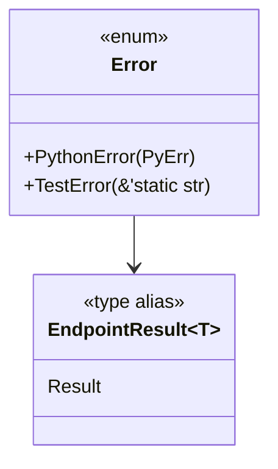

The error system accommodates Python integration errors when the `python` feature is enabled, and provides a clean way to propagate errors throughout the system.

Sources: [hfendpoints-core/src/lib.rs:16-28]()

## Request Processing Flow

The following sequence diagram illustrates how a request flows through the core components:

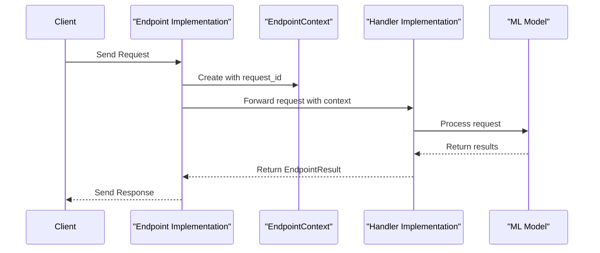

Sources: [hfendpoints-core/src/lib.rs:6-9](), [hfendpoints-core/src/endpoint.rs:4-6]()

## Feature Configuration

Core components support optional features through feature flags:

| Feature | Description | Dependencies |
|---------|-------------|--------------|
| `python` | Enables Python integration | pyo3, hfendpoints-binding-python |
| `default` | Base functionality | None |

When the `python` feature is enabled, additional error handling for Python integration is available.

Sources: [hfendpoints-core/Cargo.toml:14-16]()

## Code Organization

The core components are organized as follows:

```mermaid
graph TD
    lib["lib.rs<br>(Main exports)"] --> context["context.rs<br>(EndpointContext)"]
    lib --> endpoint["endpoint.rs<br>(Endpoint trait)"]
    lib --> handler["handler.rs<br>(Handler trait)"]
    lib --> metrics["metrics.rs<br>(InFlightStats)"]
    
    subgraph "Error Handling"
        lib --> Error["Error enum"]
        lib --> EndpointResult["EndpointResult type"]
    end
```

This modular organization allows for clean separation of concerns while maintaining clear relationships between components.

Sources: [hfendpoints-core/src/lib.rs:1-4]()

## Summary

The Core Components of HFEndpoints provide the essential building blocks that enable the creation of OpenAI-compatible endpoints for Hugging Face models. By defining standard interfaces for endpoints and handlers, providing context tracking, and offering consistent error handling, these components create a flexible and extensible framework that supports various specialized endpoints and integration options.

---

# Page: Handler Protocol

# Handler Protocol

<details>
<summary>Relevant source files</summary>

The following files were used as context for generating this wiki page:

- [hfendpoints-core/src/handler.rs](hfendpoints-core/src/handler.rs)
- [hfendpoints/bindings/python/hfendpoints/__init__.py](hfendpoints/bindings/python/hfendpoints/__init__.py)

</details>


The Handler Protocol is a core abstraction that defines how requests are processed in the HFEndpoints system. This protocol establishes a standardized interface for handling various types of requests (such as audio transcription, embeddings generation, etc.) and producing corresponding responses. For information about the server interfaces that use these handlers, see [Endpoint Trait](#2.2).

## Core Concept

The Handler Protocol serves as the bridge between incoming API requests and the underlying machine learning models. It abstracts the request-processing logic, allowing for a clean separation between API routing and the actual processing of requests.

```mermaid
flowchart TB
    subgraph "Handler Protocol Components"
        direction TB
        RustHandler["Handler Trait (Rust)"]
        PyHandler["Handler Protocol (Python)"]
        RequestProcessing["wait_for_requests function"]
        
        RustHandler --> RequestProcessing
        PyHandler --> RequestProcessing
    end
    
    subgraph "Request/Response Flow"
        API["API Request"] --> Router["Router"]
        Router --> HandlerImpl["Handler Implementation"]
        HandlerImpl --> Response["API Response"]
    end
    
    HandlerImpl -.implements.-> RustHandler
    HandlerImpl -.implements.-> PyHandler
```

Sources: [hfendpoints-core/src/handler.rs:7-29](), [hfendpoints/bindings/python/hfendpoints/__init__.py:14-19]()

## Handler Interface

The Handler protocol is implemented in both Rust and Python, providing flexibility for developers to choose their preferred language for implementation.

### Rust Handler Trait

In Rust, the Handler is defined as a trait in the core library:

```mermaid
classDiagram
    class Handler {
        <<trait>>
        +type Request
        +type Response
        +on_request(request: Self::Request) -> Future~Result~Self::Response, Error~~~
    }
```

The Handler trait requires implementors to:
1. Define two associated types: `Request` and `Response`
2. Implement the `on_request` method that takes a request and returns a `Future` that resolves to a `Result` containing either a response or an error

Sources: [hfendpoints-core/src/handler.rs:7-29]()

### Python Handler Protocol

In Python, the Handler is defined as a Protocol using Python's typing system:

```mermaid
classDiagram
    class Handler {
        <<Protocol>>
        +__init__(model_id_or_path: str)
        +__call__(request: Request, ctx) -> Response
    }
```

The Python Handler Protocol requires:
1. Initialization with a model ID or path
2. Implementation of the `__call__` method that takes a request and context, returning a response

Sources: [hfendpoints/bindings/python/hfendpoints/__init__.py:14-19]()

## Request Processing Flow

The Handler Protocol includes a mechanism for processing requests asynchronously. The `wait_for_requests` function sets up a loop that continuously waits for incoming requests, dispatches them to the appropriate handler, and returns the responses.

```mermaid
sequenceDiagram
    participant Client as "Client"
    participant Ingress as "Ingress Channel"
    participant WFR as "wait_for_requests"
    participant Handler as "Handler Implementation"
    participant Egress as "Egress Channel"
    
    Client->>Ingress: Submit Request
    
    loop Request Processing Loop
        Ingress->>WFR: Receive (Request, ResponseChannel)
        
        WFR->>+Handler: Spawn Task with request
        Note over WFR,Handler: Async processing with tokio::spawn
        
        Handler-->>-Egress: Send Result<Response, Error>
        Egress-->>Client: Forward Response
    end
```

The key steps in this flow are:
1. Requests are received through an unbounded channel along with a sender for responses
2. Each request is processed in a separate asynchronous task
3. The response is sent back through the provided channel
4. The loop continues to process new requests until the ingress channel is closed

Sources: [hfendpoints-core/src/handler.rs:31-58]()

## Implementation Requirements

To create a custom handler, you need to implement the Handler protocol in either Rust or Python:

### Rust Implementation Pattern

```
struct MyHandler {
    // Handler state
}

impl Handler for MyHandler {
    type Request = CustomRequest;
    type Response = CustomResponse;
    
    fn on_request(&self, request: Self::Request) -> impl Future<Output=Result<Self::Response, Error>> + Send {
        async move {
            // Process request and return response
        }
    }
}
```

### Python Implementation Pattern

```python
class MyHandler:
    def __init__(self, model_id_or_path: str):
        # Initialize handler with model
        pass
        
    def __call__(self, request, ctx):
        # Process request and return response
        return response
```

## Integration with System Components

The Handler Protocol integrates with other components of the HFEndpoints system to form a complete request processing pipeline:

```mermaid
flowchart TB
    subgraph "Client Side"
        Client["Client Application"]
    end
    
    subgraph "HFEndpoints System"
        Endpoint["Endpoint Trait Implementation"]
        Router["OpenAPI Router"]
        
        subgraph "Handler Layer"
            HandlerProto["Handler Protocol"]
            Dispatcher["wait_for_requests"]
            CustomHandler["Custom Handler Implementation"]
            
            HandlerProto --> Dispatcher
            CustomHandler -.implements.-> HandlerProto
            Dispatcher --> CustomHandler
        end
        
        subgraph "Model Integration"
            HFModel["Hugging Face Model"]
        end
        
        Client --> Endpoint
        Endpoint --> Router
        Router --> Dispatcher
        CustomHandler --> HFModel
        HFModel --> CustomHandler
    end
    
    CustomHandler --> Endpoint
```

The Handler Protocol serves as a crucial intermediary layer that:
1. Receives requests from the routing layer
2. Processes them using the appropriate model or business logic
3. Returns standardized responses back to the endpoint for delivery to clients

Sources: [hfendpoints-core/src/handler.rs:7-58](), [hfendpoints/bindings/python/hfendpoints/__init__.py:14-19]()

## Concurrency and Performance

The Handler Protocol is designed for concurrent processing of requests. Key features include:

1. **Asynchronous Processing**: Handlers process requests asynchronously, allowing for efficient resource utilization
2. **Task Spawning**: Each request is processed in a separate task, preventing blocking of the main processing loop
3. **Channel-Based Communication**: Unbounded channels are used for communication between components, facilitating asynchronous operation

Sources: [hfendpoints-core/src/handler.rs:31-58]()

## Summary

The Handler Protocol is a fundamental abstraction in HFEndpoints that:
- Defines a standard interface for processing requests
- Provides implementations in both Rust and Python
- Enables asynchronous processing of requests
- Integrates with other system components to form a complete request processing pipeline

By implementing this protocol, developers can create custom handlers for various types of machine learning tasks while maintaining compatibility with the HFEndpoints system.

---

# Page: Endpoint Trait

# Endpoint Trait

<details>
<summary>Relevant source files</summary>

The following files were used as context for generating this wiki page:

- [hfendpoints-core/Cargo.toml](hfendpoints-core/Cargo.toml)
- [hfendpoints-core/src/endpoint.rs](hfendpoints-core/src/endpoint.rs)
- [hfendpoints-core/src/lib.rs](hfendpoints-core/src/lib.rs)

</details>


## Introduction

The Endpoint trait is a fundamental abstraction in the HFEndpoints system that defines an interface for server implementations. This trait provides a consistent way to start and manage server instances that handle API requests, regardless of the specific server implementation.

For information about how requests are processed once they reach an endpoint, see [Handler Protocol](#2.1).

Sources: [hfendpoints-core/src/endpoint.rs](), [hfendpoints-core/src/lib.rs:7]()

## Trait Definition

The Endpoint trait is defined in the `hfendpoints-core` crate and is designed to be generic over a binding type parameter `A`:

```rust
pub trait Endpoint<A> {
    fn serve(&self, binding: A) -> impl Future<Output=Result<(), Error>> + Send;
}
```

Key components of this trait:

- **Generic Parameter**: `A` represents the binding configuration (e.g., network interface and port)
- **`serve` Method**: The single method that takes a binding parameter and starts a server
- **Return Type**: Returns a `Future` that resolves to a `Result<(), Error>`
- **Thread Safety**: The returned `Future` implements `Send`, allowing it to be moved between threads

Sources: [hfendpoints-core/src/endpoint.rs:4-6]()

## Error Handling

The `Error` type used in the `serve` method is defined in the core crate:

```rust
#[derive(Debug, Error)]
pub enum Error {
    #[cfg(feature = "python")]
    #[error("Caught error while executing Python code: {0}")]
    PythonError(#[from] PyErr),

    #[error("{0}")]
    TestError(&'static str),
}
```

The core crate also provides a type alias `EndpointResult<T>` as a convenience for functions that need to return results with the core error type:

```rust
pub type EndpointResult<T> = Result<T, Error>;
```

Sources: [hfendpoints-core/src/lib.rs:16-28]()

## Position in System Architecture

The Endpoint trait is one of the three core components of the HFEndpoints system:

1. **Endpoint Trait**: Defines server interfaces
2. **Handler Protocol**: Defines request processing 
3. **Context and Request ID**: Provides request tracking

Together, these components form the foundation for the specialized endpoints that provide OpenAI-compatible APIs.

Endpoint Trait in System Architecture
```mermaid
graph TB
    subgraph "Core Components"
        Endpoint["Endpoint Trait"]
        Handler["Handler Protocol"]
        Context["EndpointContext"]
    end
    
    subgraph "Implementations"
        ServerImpl["Server Implementation"]
        
        Endpoint -->|"implemented by"| ServerImpl
        ServerImpl -->|"uses"| Handler
        ServerImpl -->|"creates"| Context
    end
    
    subgraph "Specialized Endpoints"
        OpenAI["OpenAI-Compatible API"]
        Audio["Audio Processing"]
        Embedding["Embedding Service"]
        
        ServerImpl -->|"powers"| OpenAI
        ServerImpl -->|"powers"| Audio
        ServerImpl -->|"powers"| Embedding
    end
    
    Client["Client Applications"] -->|"requests"| ServerImpl
```

Sources: [hfendpoints-core/src/lib.rs:1-8]()

## Endpoint Lifecycle

The `serve` method is responsible for the entire lifecycle of a server instance:

Endpoint Serve Method Lifecycle
```mermaid
sequenceDiagram
    participant App as "Application"
    participant EP as "Endpoint Implementation"
    participant Server as "Server Instance"
    
    App->>EP: call serve(binding)
    EP->>Server: create and configure server
    Server->>Server: bind to address/interface
    EP-->>App: return Future
    
    Note over App: await Future
    
    loop "Server Running"
        Server->>Server: handle requests
    end
    
    Note over Server: shutdown triggered
    
    Server-->>EP: server stopped
    EP-->>App: Future resolves with Result
```

Sources: [hfendpoints-core/src/endpoint.rs:4-6]()

## Code Structure

The Endpoint trait is part of the core module hierarchy within the HFEndpoints codebase:

Endpoint Trait Code Structure
```mermaid
graph TB
    CoreLib["hfendpoints_core"]
    EndpointMod["endpoint.rs"]
    LibMod["lib.rs"]
    
    EndpointTrait["trait Endpoint"]
    ServeMethod["fn serve()"]
    FutureReturn["Future Result"]
    
    ErrorEnum["enum Error"]
    ResultAlias["type EndpointResult"]
    
    CoreLib -->|"contains"| EndpointMod
    CoreLib -->|"contains"| LibMod
    
    EndpointMod -->|"defines"| EndpointTrait
    EndpointTrait -->|"defines"| ServeMethod
    ServeMethod -->|"returns"| FutureReturn
    
    LibMod -->|"defines"| ErrorEnum
    LibMod -->|"defines"| ResultAlias
    FutureReturn -->|"uses"| ErrorEnum
    ResultAlias -->|"based on"| ErrorEnum
```

Sources: [hfendpoints-core/src/lib.rs:1-8](), [hfendpoints-core/src/endpoint.rs:1-6]()

## Implementation Responsibility

Any struct implementing the Endpoint trait must provide a `serve` method that:

1. Takes a binding configuration
2. Sets up a server bound to the specified interface
3. Returns a future that completes when the server terminates
4. Ensures proper error handling and propagation

The generic nature of the trait allows it to be implemented for various server technologies while maintaining a consistent interface for the rest of the system.

Sources: [hfendpoints-core/src/endpoint.rs:4-6]()

---

# Page: Context and Request ID

# Context and Request ID

<details>
<summary>Relevant source files</summary>

The following files were used as context for generating this wiki page:

- [hfendpoints-core/src/context.rs](hfendpoints-core/src/context.rs)
- [hfendpoints-openai/src/context.rs](hfendpoints-openai/src/context.rs)
- [hfendpoints-openai/src/headers.rs](hfendpoints-openai/src/headers.rs)
- [hfendpoints/bindings/python/hfendpoints/openai/__init__.py](hfendpoints/bindings/python/hfendpoints/openai/__init__.py)

</details>


This page describes how request context and request IDs are used for request tracking throughout the HFEndpoints system. Request context provides a way to maintain state and propagate metadata across the request lifecycle, while request IDs enable correlation and tracing of individual requests as they flow through the system.

For information about the handler protocol that uses this context, see [Handler Protocol](#2.1).

## Request ID Implementation

The RequestId type represents a unique identifier for each request processed by the system. It's implemented as a wrapper around a string value that can be encoded to and decoded from HTTP headers.

```mermaid
classDiagram
    class RequestId {
        +Cow~'static, str~ value
        +deref() -> &str
        +name() -> &'static HeaderName
        +decode() -> Result~Self, Error~
        +encode()
    }
    
    class Header {
        <<trait>>
        +name() -> &'static HeaderName
        +decode() -> Result~Self, Error~
        +encode()
    }
    
    RequestId ..|> Header : implements
```

The RequestId is extracted from the `x-request-id` HTTP header, providing a mechanism to correlate requests across components and in logs. It implements:
- The `Header` trait for HTTP header interactions
- `Deref` to provide direct access to the string value
- Error handling for malformed header values

Sources: [hfendpoints-openai/src/headers.rs:7-50]()

## Context Types

HFEndpoints utilizes two complementary context types:

### EndpointContext

`EndpointContext<I, O>` provides the infrastructure for handling requests and responses within endpoints:

```mermaid
classDiagram
    class EndpointContext~I, O~ {
        +UnboundedSender~(I, UnboundedSender~EndpointResult~O~~)~ ipc
        +new(ipc: UnboundedSender) -> Self
        +schedule(request: I) -> UnboundedReceiver~EndpointResult~O~~
    }
```

The EndpointContext:
- Takes generic input (I) and output (O) types
- Contains an IPC (Inter-Process Communication) channel
- Provides a `schedule` method to enqueue requests for processing
- Returns a receiver channel for obtaining the result

Sources: [hfendpoints-core/src/context.rs:1-55]()

### Request Context

The `Context` type encapsulates information specific to a single request:

```mermaid
classDiagram
    class Context {
        +RequestId request_id
        +new(request_id: RequestId) -> Self
        +request_id() -> &str
    }
```

The request Context:
- Holds the RequestId for the current request
- Is passed to handlers during request processing
- Provides access to the request ID for logging and correlation

Sources: [hfendpoints-openai/src/context.rs:1-32]()

## Request Flow and Context Propagation

The following diagram illustrates how Context and RequestId flow through the system:

```mermaid
sequenceDiagram
    participant Client
    participant Server as "HFEndpoints Server"
    participant HeaderExtractor as "Headers Extractor"
    participant ContextCreator as "Context Creator"
    participant Handler as "Request Handler"
    participant Model as "ML Model"

    Client->>Server: HTTP Request
    Server->>HeaderExtractor: Extract Headers
    HeaderExtractor->>HeaderExtractor: Extract or Generate RequestId
    HeaderExtractor->>ContextCreator: Create Context with RequestId
    ContextCreator->>Server: Return Context
    Server->>Handler: Forward Request with Context
    
    Handler->>Model: Process with Context
    Note over Handler,Model: Context provides correlation for logs and processing
    
    Model->>Handler: Return Results
    Handler->>Server: Return Response with Context
    Server->>Client: HTTP Response with x-request-id
```

The request flow process:
1. Server receives a request and extracts the `x-request-id` header
2. If no header is present, a unique ID is generated
3. A Context object is created containing this RequestId
4. The request is scheduled for processing along with its Context
5. Handlers access the Context to get the request ID for logging
6. The response includes the same request ID in its headers

This approach allows tracing a request through logs and across system components.

Sources: [hfendpoints-openai/src/headers.rs:7-50](), [hfendpoints-openai/src/context.rs:1-32]()

## Python Integration

The Context system is available to Python code through bindings:

```mermaid
graph TD
    RustContext["Context (Rust)"] -->|"PyO3 Bindings"| PythonContext["Context (Python)"]
    PythonContext -->|"Accessed via"| PythonHandler["Python Handler"]
    PythonHandler -->|"Uses request_id for"| Logging["Logging"]
    PythonHandler -->|"Uses request_id for"| Tracing["Tracing"]
```

In Python handlers, the request ID can be accessed through the `request_id` property of the Context object:

```python
def process_request(context, request):
    # Access the request ID
    request_id = context.request_id
    
    # Use it for logging
    logger.info(f"Processing request {request_id}")
    
    # Process the request...
    
    return result
```

Sources: [hfendpoints-openai/src/context.rs:20-32](), [hfendpoints/bindings/python/hfendpoints/openai/__init__.py:1-2]()

## Best Practices

When working with Context and RequestId:

1. **Always propagate the context** through all processing stages
2. **Include the request ID in logs** to enable request tracing
3. **Generate unique IDs** when clients don't provide them
4. **Pass IDs between systems** when making calls to other services
5. **Use structured logging** with the request ID as a field

## Related Pages

- For details on how handlers use this context, see [Handler Protocol](#2.1)
- For information about the server interfaces, see [Endpoint Trait](#2.2)
- For examples of contexts in Python handlers, see [Python Handler Implementation](#4.2)

---

# Page: OpenAI-Compatible Endpoints

# OpenAI-Compatible Endpoints

<details>
<summary>Relevant source files</summary>

The following files were used as context for generating this wiki page:

- [hfendpoints-openai/Cargo.toml](hfendpoints-openai/Cargo.toml)
- [hfendpoints-openai/src/lib.rs](hfendpoints-openai/src/lib.rs)

</details>


## Purpose and Scope

This document describes the OpenAI-compatible endpoints system within HFEndpoints. This subsystem provides API endpoints that conform to OpenAI's API specifications, allowing Hugging Face models to be accessed using the same interface conventions as OpenAI services. This enables seamless integration with tools and applications already designed to work with OpenAI APIs.

For information about specific endpoint types like audio transcription or embeddings, see [Audio Transcription](#3.2) and [Embeddings](#3.3). For details on server configuration, see [Server Setup](#3.1).

## Architecture Overview

The OpenAI-compatible endpoints system provides a layer that adapts Hugging Face models to match OpenAI's API specifications. It handles translating incoming OpenAI-formatted requests, processing them with appropriate models, and returning OpenAI-compatible responses.

```mermaid
flowchart TB
    subgraph "Client Applications"
        Client["Client App"]
    end
    
    subgraph "HFEndpoints OpenAI Layer"
        OpenAIServer["serve_openai() Function"]
        OpenAPIRouter["OpenApiRouter"]
        RequestHandler["Handler Implementation"]
        
        subgraph "Specialized Handlers"
            AudioHandler["Audio Transcription"]
            EmbeddingHandler["Embedding Generation"]
        end
    end
    
    subgraph "Core Infrastructure"
        Context["Request Context"]
        HFModels["Hugging Face Models"]
    end
    
    Client -->|"OpenAI-compatible Request"| OpenAIServer
    OpenAIServer --> OpenAPIRouter
    OpenAPIRouter --> RequestHandler
    RequestHandler --> AudioHandler
    RequestHandler --> EmbeddingHandler
    RequestHandler -.->|"Uses"| Context
    AudioHandler --> HFModels
    EmbeddingHandler --> HFModels
    HFModels -->|"Response"| OpenAIServer
    OpenAIServer -->|"OpenAI-compatible Response"| Client
```

Sources: [hfendpoints-openai/src/lib.rs:54-92]()

## Key Components

The OpenAI compatibility layer consists of several key components:

1. **Server Core** - The `serve_openai` function that configures and starts an HTTP server
2. **Request Handling** - Handlers that process OpenAI-compatible requests
3. **Response Formatting** - Logic to format responses according to OpenAI specifications
4. **Python Integration** - Bindings that allow the system to be used from Python

### Server Core

The server is implemented using the Axum web framework with OpenAPI documentation support through Utoipa. It includes:

- Request ID generation and propagation
- Timeout handling
- Tracing for observability
- Health check endpoint

```mermaid
classDiagram
    class "serve_openai()" {
        +async function
        +Sets up middleware
        +Configures routes
        +Starts TCP listener
    }
    
    class "OpenApiRouter" {
        +Routes requests to handlers
        +Provides OpenAPI documentation
    }
    
    class "ApiDoc" {
        +OpenAPI schema definition
    }
    
    class "Middleware Layers" {
        +TraceLayer
        +SetRequestIdLayer
        +PropagateRequestIdLayer
        +TimeoutLayer
    }
    
    "serve_openai()" --> "OpenApiRouter"
    "serve_openai()" --> "Middleware Layers"
    "OpenApiRouter" --> "ApiDoc"
```

Sources: [hfendpoints-openai/src/lib.rs:54-92]()

### Request Handling Flow

The system processes requests through a structured flow that ensures proper context management and error handling:

```mermaid
sequenceDiagram
    participant Client
    participant Server as "OpenAI Server"
    participant Router as "OpenApiRouter"
    participant Handler as "Request Handler"
    participant Model as "Hugging Face Model"
    
    Client->>Server: OpenAI-compatible HTTP Request
    Note over Server: Generate x-request-id
    Server->>Router: Forward request with request ID
    Router->>Handler: Route to appropriate handler
    
    alt Audio Transcription
        Handler->>Model: Process audio file
        Model->>Handler: Return transcription
    else Embeddings
        Handler->>Model: Generate embeddings
        Model->>Handler: Return vector embeddings
    end
    
    Handler->>Server: Return typed response
    Server->>Client: OpenAI-compatible HTTP Response
```

Sources: [hfendpoints-openai/src/lib.rs:29-92]()

## Python Integration

The OpenAI compatibility layer includes comprehensive Python bindings, allowing developers to implement handlers in Python while maintaining the performance benefits of the Rust-based server.

### Python Handler Implementation

The system includes a `PyHandler` struct that wraps Python handler objects, enabling Python code to process requests:

```mermaid
flowchart TD
    subgraph "Rust Code"
        PyHandler["PyHandler struct"]
        HandlerTrait["Handler trait"]
        ServeFunction["serve_openai()"]
    end
    
    subgraph "Python Code"
        PythonHandler["Python Handler Object"]
        CallMethod["__call__ method"]
    end
    
    PyHandler -->|"Implements"| HandlerTrait
    PyHandler -->|"Wraps"| PythonHandler
    ServeFunction -->|"Uses"| PyHandler
    PyHandler -->|"Calls"| CallMethod
```

The handler mechanism uses Tokio for asynchronous processing and integrates with Python's asyncio event loop, allowing seamless asynchronous operation between Rust and Python.

Sources: [hfendpoints-openai/src/lib.rs:94-304]()

### Endpoint Trait Implementation

Python endpoints are exposed through implementation of the `Endpoint` trait, which handles server initialization and request processing:

```mermaid
classDiagram
    class "PyEndpoint" {
        -Arc~PyHandler~ handler
        +new(PyObject) PyEndpoint
        +_serve_(String, u16) PyResult
    }
    
    class "Endpoint" {
        <<trait>>
        +serve((String, u16)) Result
    }
    
    class "Python Handler" {
        +__call__(Request, Context) Response
    }
    
    "PyEndpoint" --|> "Endpoint"
    "PyEndpoint" o-- "Python Handler"
```

Sources: [hfendpoints-openai/src/lib.rs:176-243]()

## Request and Response Handling

Requests are processed with consistent error handling and context management through the `Context` type, which carries request-specific information like request IDs.

### Request Context

Each request is associated with a `Context` object that contains:

- Request ID for tracking and correlation
- Execution context for the request

This context is propagated throughout the request lifecycle, ensuring proper tracing and error reporting.

```
RequestWithContext<I> = (I, Context)
```

Sources: [hfendpoints-openai/src/lib.rs:24-27]()

### Error Handling

The system uses a consistent error type (`OpenAiError`) for handling and reporting errors in a format compatible with OpenAI's error responses.

Sources: [hfendpoints-openai/src/lib.rs:3-4](), [hfendpoints-openai/src/lib.rs:26]()

## Configuration and Environment Variables

The server can be configured through environment variables:

| Environment Variable | Description | Default |
|---------------------|-------------|---------|
| `HFENDPOINTS_REQUEST_TIMEOUT_SEC` | Request timeout in seconds | 120 |

Sources: [hfendpoints-openai/src/lib.rs:64-69]()

## Server Startup

Starting an OpenAI-compatible server requires:

1. Creating a router with the desired endpoint handlers
2. Calling the `serve_openai` function with network interface details and the router
3. For Python integration, using the provided `run` function

```mermaid
flowchart TB
    subgraph "Server Initialization"
        CreateRouter["Create OpenApiRouter"]
        ConfigureMiddleware["Configure Middleware"]
        BindNetwork["Bind to Network Interface"]
        StartServer["Start Axum Server"]
    end
    
    subgraph "Request Processing"
        AcceptRequest["Accept HTTP Request"]
        AssignRequestId["Assign Request ID"]
        RouteRequest["Route Request to Handler"]
        ProcessRequest["Process Request"]
        ReturnResponse["Return Response"]
    end
    
    CreateRouter --> ConfigureMiddleware
    ConfigureMiddleware --> BindNetwork
    BindNetwork --> StartServer
    StartServer --> AcceptRequest
    AcceptRequest --> AssignRequestId
    AssignRequestId --> RouteRequest
    RouteRequest --> ProcessRequest
    ProcessRequest --> ReturnResponse
```

Sources: [hfendpoints-openai/src/lib.rs:54-92]()

## Available Endpoints

The OpenAI compatibility layer includes support for:

- **Health Check** - Basic server health monitoring
- **Audio Transcription** - Converting audio to text
- **Embeddings Generation** - Creating vector embeddings from text input

Each endpoint follows OpenAI's API specifications for request and response formats.

Sources: [hfendpoints-openai/src/lib.rs:18-22](), [hfendpoints-openai/src/lib.rs:29-43]()

---

# Page: Server Setup

# Server Setup

<details>
<summary>Relevant source files</summary>

The following files were used as context for generating this wiki page:

- [hfendpoints-openai/src/lib.rs](hfendpoints-openai/src/lib.rs)

</details>


This document explains how the OpenAI-compatible server in HFEndpoints is configured and initialized. It covers server architecture, initialization process, middleware configuration, and Python integration. For information about specific endpoint implementations, see [Audio Transcription](#3.2) and [Embeddings](#3.3).

## Server Architecture

The HFEndpoints OpenAI-compatible server is built on the Axum web framework and exposes an HTTP interface that mimics the OpenAI API. It's initialized through the `serve_openai` function which configures all necessary components.

### Core Server Components

```mermaid
flowchart TB
    Client["HTTP Client"] --> Server["Axum HTTP Server"]
    
    subgraph "serve_openai Components"
        Server --> Middleware["Middleware Stack"]
        Middleware --> Router["OpenApiRouter"]
        
        Router --> Health["health() Function\n(/health)"]
        Router --> Docs["ApiDoc::openapi()\n(/docs)"]
        Router --> APIRoutes["Task Router\n(/api/v1/...)"]
        
        APIRoutes --> TaskHandlers["Handler Implementation"]
    end
    
    TaskHandlers -.-> ModelProcessing["ML Model Processing"]
```

The server exposes:
- Health check endpoint at `/health` implemented by the `health()` function
- OpenAPI documentation at `/docs` generated from `ApiDoc::openapi()`
- API endpoints nested under `/api/v1/` handled by the provided task router

Sources: [hfendpoints-openai/src/lib.rs:40-43](), [hfendpoints-openai/src/lib.rs:45-53](), [hfendpoints-openai/src/lib.rs:72-74]()

## Server Initialization Process

The server is initialized and started using the `serve_openai` function, which takes two key parameters:
- `interface`: A network address implementing `ToSocketAddrs` (e.g., `"127.0.0.1:8000"`)
- `task_router`: An `OpenApiRouter` containing the API endpoint handlers

### Initialization Sequence

```mermaid
sequenceDiagram
    participant Caller as "Application Code"
    participant ServeOpenAI as "serve_openai()"
    participant Router as "OpenApiRouter"
    participant AxumServer as "axum::serve()"
    
    Caller->>ServeOpenAI: serve_openai(interface, task_router)
    
    ServeOpenAI->>ServeOpenAI: Configure x-request-id header
    ServeOpenAI->>ServeOpenAI: Get timeout from HFENDPOINTS_REQUEST_TIMEOUT_SEC
    
    ServeOpenAI->>Router: OpenApiRouter::with_openapi(ApiDoc::openapi())
    ServeOpenAI->>Router: nest("/api/v1", task_router)
    ServeOpenAI->>Router: Add middleware layers
    ServeOpenAI->>Router: routes(health)
    ServeOpenAI->>Router: merge Scalar::with_url("/docs", api)
    
    ServeOpenAI->>ServeOpenAI: TcpListener::bind(interface)
    ServeOpenAI->>AxumServer: axum::serve(listener, router)
    
    AxumServer-->>ServeOpenAI: (server runs until error or shutdown)
    ServeOpenAI-->>Caller: Result<(), OpenAiError>
```

Sources: [hfendpoints-openai/src/lib.rs:56-92]()

## Middleware Configuration

The server employs a stack of middleware components for request processing:

### Middleware Stack

```mermaid
flowchart TB
    Request["HTTP Request"] --> M1["TimeoutLayer"]
    M1 --> M2["SetRequestIdLayer"]
    M2 --> M3["PropagateRequestIdLayer"]
    M3 --> M4["TraceLayer"]
    M4 --> Router["OpenApiRouter"]
    Router --> Handler["Handler Implementation"]
    Handler --> Response["HTTP Response"]
```

The middleware stack consists of:

1. **TimeoutLayer**: Sets a maximum duration for request processing, configurable via the `HFENDPOINTS_REQUEST_TIMEOUT_SEC` environment variable (default: 120 seconds)
2. **SetRequestIdLayer**: Generates a unique UUID for each request as the `x-request-id` header
3. **PropagateRequestIdLayer**: Ensures the request ID is propagated throughout the request lifecycle
4. **TraceLayer**: Provides logging and tracing of requests and responses

Sources: [hfendpoints-openai/src/lib.rs:74-82]()

## Python Integration

HFEndpoints provides Python bindings that allow creating and running OpenAI-compatible endpoints directly from Python code:

### Python-Rust Integration Architecture

```mermaid
flowchart TB
    PythonHandler["Python Handler Class\n(implements __call__)"] --> PyHandler["PyHandler Struct\n(implements Handler trait)"]
    PyHandler --> PyEndpoint["Python Endpoint Class\n(implements Endpoint trait)"]
    PyEndpoint --> RunFunc["run() Function"]
    RunFunc --> TokioRT["Tokio Runtime"]
    TokioRT --> ServeFunc["serve() Function"]
    ServeFunc --> ServeOpenAI["serve_openai()"]
    ServeOpenAI --> AxumServer["Axum Server"]
```

The Python integration is implemented through:

1. `PyHandler`: A Rust struct that wraps a Python handler and implements the `Handler` trait
2. Python endpoint classes generated via the `impl_pyendpoint` macro to implement the `Endpoint` trait
3. `run` function that initializes the Tokio runtime and runs a Python endpoint

Sources: [hfendpoints-openai/src/lib.rs:107-174](), [hfendpoints-openai/src/lib.rs:176-243](), [hfendpoints-openai/src/lib.rs:266-287]()

### Python Usage Flow

```mermaid
sequenceDiagram
    participant PyCode as "Python Application"
    participant PyHandler as "Python Handler Class"
    participant PyEndpoint as "Python Endpoint Class"
    participant RunFunc as "run() Function"
    participant AxumServer as "Axum Server"
    
    PyCode->>PyHandler: Create Handler implementation
    PyCode->>PyEndpoint: Create Endpoint with Handler
    PyCode->>RunFunc: run(endpoint, interface, port)
    
    RunFunc->>RunFunc: Initialize Tokio Runtime
    RunFunc->>AxumServer: Start server via serve_openai()
    
    AxumServer-->>PyCode: Server running
```

This integration allows Python code to implement handlers and endpoints that work seamlessly with the Rust-based server, while leveraging Python's ecosystem for machine learning tasks.

Sources: [hfendpoints-openai/src/lib.rs:249-264](), [hfendpoints-openai/src/lib.rs:266-287]()

## Environment Variables

The server behavior can be configured through environment variables:

| Variable | Description | Default |
|----------|-------------|---------|
| `HFENDPOINTS_REQUEST_TIMEOUT_SEC` | Maximum duration (in seconds) for processing a request | 120 |

Sources: [hfendpoints-openai/src/lib.rs:65-69]()

## Error Handling

The `serve_openai` function returns a `Result<(), OpenAiError>`, allowing callers to handle any errors that occur during server initialization or operation. This includes errors binding to the network interface or issues with the Axum server.

Sources: [hfendpoints-openai/src/lib.rs:56](), [hfendpoints-openai/src/lib.rs:89-91]()

---

# Page: Audio Transcription

# Audio Transcription

<details>
<summary>Relevant source files</summary>

The following files were used as context for generating this wiki page:

- [hfendpoints-openai/src/audio/transcription.rs](hfendpoints-openai/src/audio/transcription.rs)
- [hfendpoints/bindings/python/hfendpoints/openai/audio/__init__.py](hfendpoints/bindings/python/hfendpoints/openai/audio/__init__.py)

</details>


This page documents the audio transcription capabilities of HFEndpoints, which provides OpenAI-compatible endpoints for transcribing audio files into text. The system supports various audio formats and offers flexible response formats for different use cases.

For information about embedding generation, see [Embeddings](#3.3). For details on server setup, see [Server Setup](#3.1).

## Overview

The Audio Transcription system in HFEndpoints implements an OpenAI-compatible API endpoint for transcribing audio files into text. It supports various input formats, response formats, and parameters to customize the transcription process.

```mermaid
flowchart TB
    subgraph "Audio Transcription System"
        direction TB
        Client["Client Application"] -->|"POST /audio/transcriptions"| TranscribeEndpoint["transcribe() Endpoint"]
        TranscribeEndpoint -->|"Creates"| Request["TranscriptionRequest"]
        TranscribeEndpoint -->|"Creates"| Context["Request Context"]
        Request --> Handler["Handler Processing"]
        Context --> Handler
        Handler -->|"Returns"| Response["TranscriptionResponse"]
        Response -->|"JSON/Text/VerboseJSON"| Client
    end
    
    subgraph "Response Formats"
        Json["JSON Format"]
        Text["Text Format"]
        VerboseJson["Verbose JSON Format"]
    end
    
    Response --> Json
    Response --> Text
    Response --> VerboseJson
```

Sources: [hfendpoints-openai/src/audio/transcription.rs:392-411](). [hfendpoints-openai/src/audio/transcription.rs:244-264]()

## Request Handling

The audio transcription system processes HTTP requests via a multipart form submission. The endpoint is available at `/audio/transcriptions` and follows the OpenAI API specification.

### Request Parameters

| Parameter | Type | Required | Default | Description |
|-----------|------|----------|---------|-------------|
| file | Binary file | Yes | - | Audio file to transcribe (flac, mp3, mp4, mpeg, mpga, m4a, ogg, wav, webm) |
| language | String | No | "en" | Language of the audio in ISO-639-1 format |
| model | String | No | - | Not used, included for OpenAI compatibility |
| prompt | String | No | - | Optional text to guide the model's style or continue a previous segment |
| temperature | Float | No | 0.0 | Sampling temperature between 0 and 1 |
| response_format | String | No | "json" | Output format: "json", "text", or "verbose_json" |

Sources: [hfendpoints-openai/src/audio/transcription.rs:269-292](). [hfendpoints-openai/src/audio/transcription.rs:297-304]().

### Request Processing Flow

```mermaid
sequenceDiagram
    participant Client
    participant TranscribeEndpoint as "transcribe() Endpoint"
    participant Validation as "Request Validation"
    participant Context as "Context Creation"
    participant Handler as "ML Model Handler"
    
    Client->>TranscribeEndpoint: POST /audio/transcriptions
    TranscribeEndpoint->>Validation: Extract from Multipart
    Validation->>TranscribeEndpoint: TranscriptionRequest
    TranscribeEndpoint->>Context: Create with Request ID
    TranscribeEndpoint->>Handler: Schedule Request with Context
    Handler->>Handler: Process Audio
    Handler->>TranscribeEndpoint: TranscriptionResponse
    TranscribeEndpoint->>Client: HTTP Response
```

Sources: [hfendpoints-openai/src/audio/transcription.rs:392-411](). [hfendpoints-openai/src/audio/transcription.rs:347-378]().

## Response Formats

The API supports three response formats, controlled by the `response_format` parameter:

### 1. JSON (Default)

Returns a simple JSON object with the transcribed text:

```json
{
  "text": "The transcribed audio content goes here."
}
```

### 2. Text

Returns the transcribed text directly, without any JSON wrapping.

### 3. Verbose JSON

Returns a detailed JSON object with additional information:

```json
{
  "text": "The transcribed audio content goes here.",
  "duration": 10.5,
  "language": "en",
  "segments": [
    {
      "id": 1,
      "start": 0.0,
      "end": 2.5,
      "seek": 0,
      "temperature": 0.0,
      "text": "The transcribed",
      "tokens": [1, 2, 3],
      "avg_logprob": -0.5,
      "compression_ratio": 1.2,
      "no_speech_prob": 0.1
    },
    ...
  ]
}
```

Sources: [hfendpoints-openai/src/audio/transcription.rs:166-187](). [hfendpoints-openai/src/audio/transcription.rs:229-252]().

## Key Components

### Segment

The `Segment` struct represents a single segment of transcribed audio with detailed metadata:

```mermaid
classDiagram
    class "Segment" {
        +id: u16
        +start: f32
        +end: f32
        +seek: u16
        +temperature: f32
        +text: String
        +tokens: Vec<u32>
        +avg_logprob: f32
        +compression_ratio: f32
        +no_speech_prob: f32
    }
    
    class "SegmentBuilder" {
        +id(u16): SegmentBuilder
        +start(f32): SegmentBuilder
        +end(f32): SegmentBuilder
        +seek(u16): SegmentBuilder
        +temperature(f32): SegmentBuilder
        +text(String): SegmentBuilder
        +tokens(Vec<u32>): SegmentBuilder
        +avg_logprob(f32): SegmentBuilder
        +compression_ratio(f32): SegmentBuilder
        +no_speech_prob(f32): SegmentBuilder
        +build(): Segment
    }
    
    "SegmentBuilder" --> "Segment" : builds
```

Sources: [hfendpoints-openai/src/audio/transcription.rs:26-59](). [hfendpoints-openai/src/audio/transcription.rs:61-159]().

### TranscriptionRequest

The `TranscriptionRequest` struct encapsulates all parameters needed for audio transcription:

```mermaid
classDiagram
    class "TranscriptionRequest" {
        +file: Bytes
        +content_type: String
        +language: String
        +prompt: Option<String>
        +temperature: f32
        +response_format: ResponseFormat
        +validate(): Result
        +try_from_multipart(): Result
    }
    
    class "ResponseFormat" {
        <<enumeration>>
        Json
        Text
        VerboseJson
    }
    
    "TranscriptionRequest" --> "ResponseFormat" : uses
```

Sources: [hfendpoints-openai/src/audio/transcription.rs:297-379](). [hfendpoints-openai/src/audio/transcription.rs:227-242]().

### TranscriptionResponse

The `TranscriptionResponse` enum represents the different possible formats of the response:

```mermaid
classDiagram
    class "TranscriptionResponse" {
        <<enumeration>>
        Json(Transcription)
        Text(String)
        VerboseJson(VerboseTranscription)
        into_response(): Response
    }
    
    class "Transcription" {
        +text: String
    }
    
    class "VerboseTranscription" {
        +text: String
        +duration: f32
        +language: String
        +segments: Vec<Segment>
    }
    
    "TranscriptionResponse" --> "Transcription" : contains
    "TranscriptionResponse" --> "VerboseTranscription" : contains
    "VerboseTranscription" --> "Segment" : contains
```

Sources: [hfendpoints-openai/src/audio/transcription.rs:166-187](). [hfendpoints-openai/src/audio/transcription.rs:244-264]().

## Streaming Support

The system also supports streaming transcription responses through `StreamEvent` types:

```mermaid
classDiagram
    class "StreamEvent" {
        <<enumeration>>
        Delta(Delta)
        Done(Done)
    }
    
    class "Delta" {
        +delta: String
    }
    
    class "Done" {
        +text: String
    }
    
    "StreamEvent" --> "Delta" : contains
    "StreamEvent" --> "Done" : contains
```

Delta events are emitted incrementally as the transcription progresses, and a final Done event is sent when the transcription is complete.

Sources: [hfendpoints-openai/src/audio/transcription.rs:189-225]().

## Python Integration

The system includes Python bindings that make it easy to use the audio transcription functionality from Python code:

```mermaid
flowchart TB
    subgraph "Python API"
        PyTranscriptionRequest["TranscriptionRequest"]
        PySegment["Segment"]
        PySegmentBuilder["SegmentBuilder"]
        PyResponseKind["TranscriptionResponseKind"]
        PyTranscriptionResponse["TranscriptionResponse"]
    end
    
    subgraph "Rust Implementation"
        RustTranscriptionRequest["TranscriptionRequest struct"]
        RustSegment["Segment struct"]
        RustResponseFormat["ResponseFormat enum"]
        RustTranscriptionResponse["TranscriptionResponse enum"]
    end
    
    PyTranscriptionRequest -->|"Maps to"| RustTranscriptionRequest
    PySegment -->|"Maps to"| RustSegment
    PySegmentBuilder -->|"Builds"| PySegment
    PyResponseKind -->|"Maps to"| RustResponseFormat
    PyTranscriptionResponse -->|"Maps to"| RustTranscriptionResponse
```

The Python API provides a builder pattern for creating `Segment` objects:

```python
segment = SegmentBuilder()
    .id(1)
    .start(0.0)
    .end(2.5)
    .text("Hello world")
    .tokens([1, 2, 3])
    .build()
```

Sources: [hfendpoints/bindings/python/hfendpoints/openai/audio/__init__.py:14-90](). [hfendpoints-openai/src/audio/transcription.rs:432-562]().

## Endpoint Configuration

The `TranscriptionRouter` struct provides a factory for building the OpenAI-compatible transcription endpoint:

```mermaid
flowchart LR
    subgraph "Endpoint Creation"
        TR["TranscriptionRouter"]
        OAR["OpenApiRouter"]
        TS["transcribe() function"]
        EC["EndpointContext"]
    end
    
    TR -->|"From trait implementation"| OAR
    OAR -->|"Routes to"| TS
    OAR -->|"Contains state"| EC
    EC -->|"Passes requests to"| Handler["Handler"]
```

The router is configured with a maximum body limit of 200MB to accommodate large audio files, matching OpenAI's limit.

Sources: [hfendpoints-openai/src/audio/transcription.rs:416-430]().

## Integration with Core Components

The audio transcription system integrates with the core HFEndpoints components:

```mermaid
flowchart TB
    subgraph "Core Components"
        Context["RequestContext"]
        EndpointContext["EndpointContext"]
        Handler["Handler Protocol"]
    end
    
    subgraph "Audio Transcription"
        TranscribeFunction["transcribe()"]
        TranscriptionRequest["TranscriptionRequest"]
        TranscriptionResponse["TranscriptionResponse"]
        TranscriptionRouter["TranscriptionRouter"]
    end
    
    TranscribeFunction -->|"Creates"| Context
    TranscribeFunction -->|"Uses"| EndpointContext
    TranscriptionRouter -->|"Creates"| EndpointContext
    EndpointContext -->|"Schedules"| Handler
    Handler -->|"Processes"| TranscriptionRequest
    Handler -->|"Returns"| TranscriptionResponse
```

Sources: [hfendpoints-openai/src/audio/transcription.rs:392-411](). [hfendpoints-openai/src/audio/transcription.rs:416-430]().

## Error Handling

The transcription system uses `OpenAiResult` and `OpenAiError` types for error handling, providing appropriate error responses for different failure scenarios:

- Validation errors for missing or invalid parameters
- No response errors when the handler fails to respond
- Format conversion errors when parsing numbers or other data types

Sources: [hfendpoints-openai/src/audio/transcription.rs:305-344]().

---

# Page: Embeddings

# Embeddings

<details>
<summary>Relevant source files</summary>

The following files were used as context for generating this wiki page:

- [hfendpoints-openai/src/embeddings/mod.rs](hfendpoints-openai/src/embeddings/mod.rs)

</details>


This document describes the embeddings generation functionality in HFEndpoints, which provides an OpenAI-compatible API for generating vector representations of text or tokens. These vector representations (embeddings) can be easily consumed by machine learning models and algorithms for tasks such as semantic search, clustering, or classification.

## Overview

The embeddings endpoint allows clients to request vector representations of provided text inputs. This implementation follows the OpenAI API specification, making it compatible with existing OpenAI API clients.

```mermaid
flowchart LR
    Client["Client Application"] -->|"POST /embeddings"| Server["HFEndpoints Server"]
    Server -->|"Schedule Request"| Handler["Embedding Handler"]
    Handler -->|"Process Request"| Model["Embedding Model"]
    Model -->|"Generate Vectors"| Handler
    Handler -->|"Format Response"| Server
    Server -->|"JSON Response"| Client
```

Sources: [hfendpoints-openai/src/embeddings/mod.rs:150-175]()

## API Specification

The embeddings functionality is exposed through a REST API endpoint that follows the OpenAI API specification.

### Endpoint

```
POST /embeddings
```

The endpoint is defined as an Axum route with documentation via Utoipa annotations, providing OpenAPI compatibility.

### Request Format

Requests to the embeddings endpoint should be in JSON format with the following structure:

```json
{
  "input": "Your text to embed" or ["multiple", "inputs", "as", "batch"],
  "model": "model-name",
  "encoding_format": "float",
  "dimension": 1536, 
  "user": "optional-user-id"
}
```

The key parameters include:

| Parameter | Type | Required | Description |
|-----------|------|----------|-------------|
| `input` | String, Tokens, or Batch | Yes | Text or tokens to embed |
| `model` | String | No | Model identifier |
| `encoding_format` | String | No | "float" (default) or "base64" |
| `dimension` | Integer | No | Output dimension (model-specific) |
| `user` | String | No | User identifier for monitoring |

Sources: [hfendpoints-openai/src/embeddings/mod.rs:138-146]()

### Response Format

The API returns a JSON response with the following structure:

```json
{
  "object": "list",
  "data": [
    {
      "object": "embedding",
      "index": 0,
      "embedding": [0.1, 0.2, 0.3, ...]
    }
  ],
  "model": "model-name",
  "usage": {
    "prompt_tokens": 5,
    "total_tokens": 5
  }
}
```

Sources: [hfendpoints-openai/src/embeddings/mod.rs:87-93](), [hfendpoints-openai/src/embeddings/mod.rs:44-48]()

## Core Data Structures

The embeddings functionality is built around these key data structures:

```mermaid
classDiagram
    class EmbeddingRequest {
        +EncodingFormat encoding_format
        +MaybeBatched~EmbeddingInput~ input
        +Optional~String~ model
        +Optional~usize~ dimension
        +Optional~String~ user
    }
    
    class EmbeddingResponse {
        +EmbeddingResponseTag object
        +Vec~Embedding~ data
        +String model
        +Usage usage
    }
    
    class Embedding {
        +EmbeddingTag object
        +usize index
        +Vec~f32~ embedding
    }
    
    class Usage {
        +usize prompt_tokens
        +usize total_tokens
    }
    
    class EncodingFormat {
        <<enumeration>>
        Float
        Base64
    }
    
    class MaybeBatched~T~ {
        <<enumeration>>
        Single(T)
        Batch(Vec~T~)
    }
    
    class EmbeddingInput {
        <<enumeration>>
        Text(String)
        Tokens(Vec~u32~)
    }
    
    EmbeddingRequest --> EncodingFormat
    EmbeddingRequest --> "1" MaybeBatched
    MaybeBatched --> "*" EmbeddingInput
    EmbeddingResponse --> "*" Embedding
    EmbeddingResponse --> "1" Usage
```

Sources: [hfendpoints-openai/src/embeddings/mod.rs:26-146]()

### Key Components

1. **EmbeddingRequest**: Represents a client request for embeddings. Can handle both single inputs and batched inputs through the `MaybeBatched` enum.

2. **EmbeddingInput**: Represents the input to embed, which can be either text (as a String) or tokens (as a Vec<u32>).

3. **EmbeddingResponse**: Contains the embedding vectors along with metadata about the model and token usage.

4. **Embedding**: Represents a single embedding vector with an index and the actual vector values.

5. **Usage**: Contains token usage information for billing and monitoring purposes.

6. **EncodingFormat**: Specifies how the embeddings should be encoded in the response (either as floating-point values or base64-encoded).

## Request Processing Flow

```mermaid
sequenceDiagram
    participant Client
    participant EmbedFunction as "embed() function"
    participant Router as "EmbeddingRouter"
    participant Handler as "Handler Implementation"
    participant Context as "EndpointContext"
    
    Client->>EmbedFunction: POST /embeddings
    Note over EmbedFunction: Extract request_id from header
    EmbedFunction->>Context: Create request context
    EmbedFunction->>Context: Schedule request
    Context->>Router: Forward (request, context)
    Router->>Handler: Process request
    Handler->>Handler: Generate embeddings
    Handler->>Router: Return response
    Router->>Context: Send response
    Context->>EmbedFunction: Return response
    EmbedFunction->>Client: Return JSON response
```

Sources: [hfendpoints-openai/src/embeddings/mod.rs:159-175]()

The request processing flow follows these steps:

1. The client sends a POST request to the `/embeddings` endpoint with a JSON payload and request ID header.
2. The `embed` function extracts the request ID and creates a request context.
3. The request is scheduled for processing by the appropriate handler through the `EndpointContext`.
4. The handler processes the request, generating embeddings for the provided input.
5. The response is sent back through the channel to the waiting `embed` function.
6. The `embed` function converts the response to JSON and returns it to the client.

## Router Implementation

The `EmbeddingRouter` struct is used to build an OpenAPI-compatible router for the embeddings endpoint:

```mermaid
flowchart TD
    subgraph "EmbeddingRouter Integration"
        EmbeddingRouter["EmbeddingRouter"]
        OpenApiRouter["OpenApiRouter"]
        RouteRegistration["routes!(embed)"]
        ContextCreation["EndpointContext::new()"]
        
        EmbeddingRouter -->|"From implementation"| OpenApiRouter
        OpenApiRouter -->|"routes()"| RouteRegistration
        OpenApiRouter -->|"with_state()"| ContextCreation
    end
```

Sources: [hfendpoints-openai/src/embeddings/mod.rs:180-193]()

## Python Integration

The embeddings functionality is also exposed to Python through PyO3 bindings, allowing it to be used directly from Python code.

```mermaid
flowchart TD
    subgraph "Python Bindings"
        PyModule["openai.embeddings module"]
        PyClass1["Usage class"]
        PyClass2["Embedding class"]
        PyClass3["EmbeddingRequest class"]
        PyClass4["EmbeddingResponse class"]
        PyClass5["PyEmbeddingEndpoint class"]
        
        PyModule -->|"Contains"| PyClass1
        PyModule -->|"Contains"| PyClass2
        PyModule -->|"Contains"| PyClass3
        PyModule -->|"Contains"| PyClass4
        PyModule -->|"Contains"| PyClass5
    end
    
    subgraph "Rust Implementation"
        RustStruct1["Usage struct"]
        RustStruct2["Embedding struct"]
        RustStruct3["EmbeddingRequest struct"]
        RustStruct4["EmbeddingResponse struct"]
        RustImpl["EmbeddingRouter implementation"]
    end
    
    PyClass1 -->|"Maps to"| RustStruct1
    PyClass2 -->|"Maps to"| RustStruct2
    PyClass3 -->|"Maps to"| RustStruct3
    PyClass4 -->|"Maps to"| RustStruct4
    PyClass5 -->|"Maps to"| RustImpl
```

Sources: [hfendpoints-openai/src/embeddings/mod.rs:195-323]()

The Python bindings provide:

1. Python classes that map to the Rust structs used for embeddings
2. Methods for creating and manipulating embedding requests and responses
3. A Python-friendly endpoint implementation for generating embeddings

This allows for seamless integration with Python-based ML workflows and applications.

## Testing

The embeddings functionality includes comprehensive tests to ensure correct behavior:

1. **Successful embedding generation**: Tests that the endpoint properly handles valid requests and returns expected responses.
2. **Error handling**: Tests for various error conditions, such as missing request IDs, invalid request bodies, and handler errors.
3. **Timeout handling**: Tests that the system handles timeouts appropriately.

Sources: [hfendpoints-openai/src/embeddings/mod.rs:326-513]()

## Usage Examples

Here's an example of how to use the embeddings endpoint with a Python client:

```python
import openai

# Configure client to use your HFEndpoints server
client = openai.OpenAI(
    base_url="http://your-hfendpoints-server:8000/v1",
    api_key="your-api-key"  # May not be required depending on your setup
)

# Generate embeddings for a single text input
response = client.embeddings.create(
    model="your-model-name",
    input="Your text to embed"
)

# Access the generated embedding
embedding = response.data[0].embedding
print(f"Generated embedding with {len(embedding)} dimensions")

# Generate embeddings for multiple texts
batch_response = client.embeddings.create(
    model="your-model-name",
    input=["First text", "Second text", "Third text"]
)

# Access the batch results
for i, data in enumerate(batch_response.data):
    print(f"Embedding {i} has {len(data.embedding)} dimensions")
```

---

# Page: Python Integration

# Python Integration

<details>
<summary>Relevant source files</summary>

The following files were used as context for generating this wiki page:

- [hfendpoints/bindings/python/hfendpoints/__init__.py](hfendpoints/bindings/python/hfendpoints/__init__.py)
- [hfendpoints/src/lib.rs](hfendpoints/src/lib.rs)

</details>


This section explains how HFEndpoints can be used from Python. While HFEndpoints is primarily implemented in Rust, it provides comprehensive Python bindings that make its functionality accessible to Python developers. This integration allows you to create OpenAI-compatible endpoints for Hugging Face models using Python code.

For details about the OpenAI API compatibility layer, see [OpenAI-Compatible Endpoints](#3). For deployment and testing information, see [Deployment and Testing](#5).

## Architecture Overview

The Python integration bridges the high-performance Rust implementation with the flexibility of Python through a carefully designed architecture:

```mermaid
graph TB
    subgraph "Python Layer"
        PyHandler["Handler Protocol"]
        PyConfig["EndpointConfig"]
        CustomHandler["Custom Handler Implementation"]
        PyModules["Python Modules (openai, audio)"]
    end
    
    subgraph "Rust Layer"
        RustCore["HFEndpoints Core"]
        RustBindings["Python Bindings (PyO3)"]
        RustServer["HTTP Server"]
        RustEndpoints["Endpoint Implementations"]
    end
    
    PyHandler -->|"Implemented by"| CustomHandler
    CustomHandler -->|"Processes"| Requests["Requests"]
    PyConfig -->|"Configures"| RustServer
    
    RustBindings -->|"Exposes"| PyHandler
    RustBindings -->|"Exposes"| PyConfig
    RustBindings -->|"Exposes"| PyModules
    RustBindings -->|"Called by"| RustCore
    RustServer -->|"Routes to"| RustCore
    RustCore -->|"Uses"| RustEndpoints
    RustCore -->|"Invokes"| CustomHandler
    
    Client["Client Applications"] -->|"HTTP Requests"| RustServer
```

Sources:
- [hfendpoints/src/lib.rs:1-26]()
- [hfendpoints/bindings/python/hfendpoints/__init__.py:1-20]()

## Module Structure

The Python package is organized as follows:

```mermaid
graph TB
    HFEndpoints["hfendpoints"]
    CoreModule["_hfendpoints (Rust bindings)"]
    ConfigModule["hfendpoints.config"]
    OpenAIModule["hfendpoints.openai"]
    AudioModule["hfendpoints.audio"]
    
    HFEndpoints -->|"Imports from"| CoreModule
    HFEndpoints -->|"Contains"| ConfigModule
    HFEndpoints -->|"Contains"| OpenAIModule
    HFEndpoints -->|"Contains"| AudioModule
    
    HFEndpoints -->|"Defines"| HandlerProtocol["Handler Protocol"]
    ConfigModule -->|"Defines"| EndpointConfig["EndpointConfig"]
    OpenAIModule -->|"Implements"| OpenAIEndpoints["OpenAI API Endpoints"]
    AudioModule -->|"Implements"| AudioProcessing["Audio Processing"]
```

The Python modules directly reflect the structure of the underlying Rust crates, with the `_hfendpoints` module serving as the bridge between Python and Rust code.

Sources:
- [hfendpoints/src/lib.rs:17-21]()
- [hfendpoints/bindings/python/hfendpoints/__init__.py:1-20]()

## Handler Protocol

The central component of the Python integration is the `Handler` protocol, which defines the interface that Python code must implement to process requests:

```mermaid
classDiagram
    class Handler {
        <<Protocol>>
        +__init__(model_id_or_path: str)
        +__call__(request: Request, ctx) -> Response
    }
    
    class CustomHandler {
        +__init__(model_id_or_path: str)
        +__call__(request: Request, ctx) -> Response
    }
    
    Handler <|.. CustomHandler : implements
```

The `Handler` protocol is defined using Python's runtime-checkable Protocol feature, which enables structural typing:

```python
@runtime_checkable
class Handler(Protocol[Request, Response]):
    def __init__(self, model_id_or_path: str): ...
    def __call__(self, request: Request, ctx) -> Response: ...
```

This protocol allows you to create custom handlers for different types of requests and responses, such as audio transcription or embeddings generation.

Sources:
- [hfendpoints/bindings/python/hfendpoints/__init__.py:14-19]()

## Request Processing Flow

When a request is processed by an HFEndpoints server, it follows this flow:

```mermaid
sequenceDiagram
    participant Client as "Client Application"
    participant Server as "HFEndpoints Server"
    participant Router as "OpenAPI Router"
    participant PyHandler as "Python Handler"
    participant Model as "ML Model"
    
    Client->>Server: HTTP Request
    Server->>Server: Extract Request ID & Create Context
    Server->>Router: Route Request
    Router->>PyHandler: Forward Request with Context
    
    PyHandler->>Model: Process with ML Model
    Model->>PyHandler: Return Results
    
    PyHandler->>Router: Return Response
    Router->>Server: Format as OpenAI-compatible Response
    Server->>Client: HTTP Response
```

This architecture allows Python handlers to focus on ML model interactions while the Rust server handles HTTP communication, request routing, and response formatting.

Sources:
- [hfendpoints/bindings/python/hfendpoints/__init__.py:14-19]()
- [hfendpoints/src/lib.rs:10-25]()

## Configuration

The Python integration provides the `EndpointConfig` class to configure endpoint behavior, imported from the `config` module:

```python
from .config import EndpointConfig, ensure_supported_architectures
```

The `ensure_supported_architectures` function is also provided to verify that the current system architecture is supported by HFEndpoints.

Sources:
- [hfendpoints/bindings/python/hfendpoints/__init__.py:6]()

## Integration with Rust

The Python integration is built using PyO3, a Rust library for creating Python extensions. The Rust code in `lib.rs` defines the Python module structure:

```mermaid
graph TB
    PyBinding["_hfendpoints Python Module"]
    
    subgraph "Rust Submodules"
        AudioBind["audio::python::bind()"]
        OpenAIBind["openai::python::bind()"]
    end
    
    PyBinding -->|"adds submodule"| AudioModule["hfendpoints.audio"]
    PyBinding -->|"adds submodule"| OpenAIModule["hfendpoints.openai"]
    PyBinding -->|"adds"| VersionInfo["__version__"]
    
    AudioBind -->|"creates"| AudioModule
    OpenAIBind -->|"creates"| OpenAIModule
```

The Rust code creates the Python module hierarchy and exposes the necessary functionality to Python:

```rust
#[pymodule]
pub fn _hfendpoints(py: Python, m: Bound<'_, PyModule>) -> PyResult<()> {
    // ...
    let pymodule_hfendpoints = ImportablePyModuleBuilder::from(m)
        .defaults()?
        .add_submodule(&audio::python::bind(py, &format!("{name}.audio"))?)?
        .add_submodule(&openai::python::bind(py, &format!("{name}.openai"))?)?
        .finish();
    
    pymodule_hfendpoints.add("__version__", __VERSION__)?;
    Ok(())
}
```

Sources:
- [hfendpoints/src/lib.rs:10-25]()

## Type System

The Python bindings use TypeVar to define generic types for requests and responses:

```python
Request = TypeVar("Request", infer_variance=True)
Response = TypeVar("Response", infer_variance=True)
```

These type variables ensure type safety when working with the `Handler` protocol in Python, allowing for different request and response types depending on the specific endpoint implementation.

Sources:
- [hfendpoints/bindings/python/hfendpoints/__init__.py:10-11]()

## Versioning

The Python package includes version information accessible through the `VERSION` variable:

```python
from packaging.version import Version
from hfendpoints._hfendpoints import __version__

VERSION = Version(__version__)
```

This allows Python code to check the version of the HFEndpoints package being used.

Sources:
- [hfendpoints/bindings/python/hfendpoints/__init__.py:3-8]()
- [hfendpoints/src/lib.rs:8]()

## Next Steps

For more detailed information about specific aspects of the Python integration, refer to:

- [Python Bindings](#4.1) for detailed information on how the Rust code is exposed to Python
- [Python Handler Implementation](#4.2) for a comprehensive guide on implementing handlers in Python
- [Examples](#4.3) for example code for common use cases

---

# Page: Python Bindings

# Python Bindings

<details>
<summary>Relevant source files</summary>

The following files were used as context for generating this wiki page:

- [hfendpoints/src/lib.rs](hfendpoints/src/lib.rs)

</details>


## Purpose and Scope

This document details how the Rust code in HFEndpoints is exposed to Python, enabling Python applications to interact with the HFEndpoints system. The Python bindings create a bridge between the high-performance Rust core and the Python ecosystem, allowing developers to leverage HFEndpoints' OpenAI-compatible API from Python applications.

For implementing handlers in Python, see [Python Handler Implementation](#4.2).
For example usage of the Python bindings, see [Examples](#4.3).

## Architecture Overview

The Python bindings are implemented using PyO3, a Rust library that facilitates creating Python extensions. The architecture creates a bidirectional bridge between Rust and Python components.

```mermaid
graph TB
    subgraph "Rust Components"
        HFCore["hfendpoints-core"]
        HFOpenAI["hfendpoints-openai"]
        HFAudio["hfendpoints-audio"]
        HFBindings["hfendpoints-binding-python"]
    end
    
    subgraph "PyO3 Bridge"
        PyO3["PyO3 Binding Layer"]
    end
    
    subgraph "Python Interface"
        PyModule["_hfendpoints Module"]
        PyOpenAI["openai Submodule"]
        PyAudio["audio Submodule"]
    end
    
    HFCore --> HFBindings
    HFOpenAI --> HFBindings
    HFAudio --> HFBindings
    
    HFBindings --> PyO3
    PyO3 --> PyModule
    
    PyModule --> PyOpenAI
    PyModule --> PyAudio
```

Sources: [hfendpoints/src/lib.rs:1-26]()

## Module Structure

The Python module structure mirrors the organization of the Rust crates, providing a clean and intuitive API for Python users.

```mermaid
graph TB
    PyRoot["hfendpoints Package"]
    
    PyRoot --> PyVersion["__version__"]
    PyRoot --> PyOpenAI["openai"]
    PyRoot --> PyAudio["audio"]
    
    PyOpenAI --> PyEndpoints["Endpoints"]
    PyOpenAI --> PyEmbeddings["Embeddings"]
    
    PyAudio --> PyTranscription["Transcription"]
```

The module structure is defined in the Rust code and exposes the core functionalities of HFEndpoints to Python.

Sources: [hfendpoints/src/lib.rs:10-25]()

## Implementation Details

The Python bindings are implemented in the Rust codebase using the PyO3 framework. The main entry point for the bindings is the `_hfendpoints` Python module, defined in [hfendpoints/src/lib.rs:10-25]().

Key components of the implementation include:

1. The `#[pymodule]` macro, which defines a Python-importable module
2. The `ImportablePyModuleBuilder`, which constructs and configures the module
3. Submodule binding functions that expose specific functionality

The implementation initializes logging via `tracing_subscriber` and adds the various submodules to the main module structure. It also sets the `__version__` attribute based on the Cargo package version.

Sources: [hfendpoints/src/lib.rs:10-25]()

## Module Composition

The main Python module is composed of several components:

| Module Component | Purpose | Source |
|------------------|---------|--------|
| `_hfendpoints` | Main module entry point | [hfendpoints/src/lib.rs:10-25]() |
| `openai` | OpenAI-compatible API functionality | [hfendpoints/src/lib.rs:20]() |
| `audio` | Audio processing capabilities | [hfendpoints/src/lib.rs:19]() |
| `__version__` | Version information | [hfendpoints/src/lib.rs:8, 23]() |

These components are organized to provide a Pythonic API that reflects the underlying Rust implementation.

Sources: [hfendpoints/src/lib.rs:8-25]()

## Request Flow

When using the Python bindings, requests flow through several layers of the system:

```mermaid
sequenceDiagram
    participant PyApp as "Python Application"
    participant PyModule as "Python Module"
    participant PyO3 as "PyO3 Bridge"
    participant RustHandler as "Rust Handler"
    participant RustEndpoint as "Endpoint Implementation"
    
    PyApp->>PyModule: Call API function
    PyModule->>PyO3: Convert Python args to Rust
    PyO3->>RustHandler: Forward to Rust implementation
    RustHandler->>RustEndpoint: Process request
    RustEndpoint->>RustHandler: Return result
    RustHandler->>PyO3: Forward result
    PyO3->>PyModule: Convert Rust result to Python
    PyModule->>PyApp: Return Python object
```

This flow ensures that Python applications can seamlessly interact with the high-performance Rust implementation.

Sources: [hfendpoints/src/lib.rs:10-25]()

## Module Import Structure

The Python bindings create a module structure that can be imported and used in Python applications:

```mermaid
graph TB
    PyImport["import hfendpoints"]
    PyOpenAIImport["from hfendpoints.openai import ..."]
    PyAudioImport["from hfendpoints.audio import ..."]
    
    PyApp["Python Application"]
    
    PyImport --> PyApp
    PyOpenAIImport --> PyApp
    PyAudioImport --> PyApp
    
    PyApp --> PyOpenAIEndpoint["OpenAI-compatible Endpoint"]
    PyApp --> PyAudioProcess["Audio Processing"]
```

This structure allows Python developers to import and use specific functionality from the HFEndpoints package according to their needs.

Sources: [hfendpoints/src/lib.rs:10-25]()

## Related Pages

- For information on implementing handlers in Python, see [Python Handler Implementation](#4.2)
- For usage examples, see [Examples](#4.3)
- For details about OpenAI-compatible endpoints, see [OpenAI-Compatible Endpoints](#3)

---

# Page: Python Handler Implementation

# Python Handler Implementation

<details>
<summary>Relevant source files</summary>

The following files were used as context for generating this wiki page:

- [hfendpoints-openai/src/lib.rs](hfendpoints-openai/src/lib.rs)
- [hfendpoints/bindings/python/hfendpoints/__init__.py](hfendpoints/bindings/python/hfendpoints/__init__.py)

</details>


This document explains how to implement handlers in Python for the HFEndpoints system. Python handlers are the core components that process requests in HFEndpoints, enabling you to use Hugging Face models behind OpenAI-compatible APIs. For information about the Python bindings that make this possible, see [Python Bindings](#4.1).

## The Handler Protocol

At the core of Python integration in HFEndpoints is the `Handler` protocol defined in Python. This protocol specifies the methods that a Python handler must implement to be used by the system.

```mermaid
classDiagram
    class "Handler[Request, Response]" {
        <<Protocol>>
        +__init__(model_id_or_path: str)
        +__call__(request: Request, ctx) -> Response
    }
```

The protocol has two generic type parameters:
- `Request`: The type of the incoming request object
- `Response`: The type of the response to be returned

Sources: [hfendpoints/bindings/python/hfendpoints/__init__.py:10-19]()

### Required Methods

Python handlers must implement two key methods:

1. `__init__(self, model_id_or_path: str)`: Constructor that initializes the handler with a model identifier or path
2. `__call__(self, request: Request, ctx) -> Response`: Method that processes a request in the given context and returns a response

The `__call__` method makes handler instances callable, allowing them to be invoked directly as functions with the request and context as arguments.

## How Python Handlers Interact with the Rust System

The HFEndpoints system is primarily written in Rust, with Python bindings that allow you to implement handlers in Python. Here's how the components interact:

```mermaid
sequenceDiagram
    participant "Client" as "HTTP Client"
    participant "RustServer" as "Rust HTTP Server"
    participant "PyBinding" as "Python Bindings"
    participant "PyHandler" as "Python Handler"
    participant "Model" as "HF Model"
    
    "Client"->"RustServer": HTTP Request
    "RustServer"->"RustServer": Create Context with request ID
    "RustServer"->"PyBinding": Forward Request with Context
    "PyBinding"->"PyHandler": Call __call__(request, ctx)
    "PyHandler"->"Model": Process with HF Model
    "Model"->"PyHandler": Return Results
    "PyHandler"->"PyBinding": Return Response
    "PyBinding"->"RustServer": Convert to Rust Type
    "RustServer"->"Client": HTTP Response
```

Behind the scenes, when a request comes in:

1. The Rust server creates a context with a unique request ID
2. The request and context are forwarded to a `PyHandler` struct that wraps your Python handler
3. The `PyHandler` invokes your Python handler's `__call__` method
4. Your handler processes the request and returns a response
5. The response is converted back to a Rust type and sent to the client

Sources: [hfendpoints-openai/src/lib.rs:107-173]()

## Implementing a Python Handler

To implement a handler in Python, you need to create a class that conforms to the `Handler` protocol.

### Basic Structure

```python
from hfendpoints import Handler

class MyHandler(Handler):
    def __init__(self, model_id_or_path: str):
        # Initialize your model here
        pass
        
    def __call__(self, request, ctx):
        # Process the request using your model
        # Return the response
        pass
```

### Handler Initialization

The `__init__` method is called when your handler is created. This is where you should load your model and any other resources needed for processing requests.

Key practices for initialization:
- Load the model from the provided path or identifier
- Initialize any tokenizers, processors, or other components
- Set up any state that will be shared across requests

### Request Processing

The `__call__` method is called for each incoming request. It should:
1. Extract the necessary information from the request
2. Process the request using your model
3. Return a response in the expected format

Note that `ctx` is a `Context` object that contains information about the request, including a unique request ID that can be used for tracing.

## The PyHandler Bridge

The connection between Python and Rust is implemented by the `PyHandler` struct in Rust, which wraps your Python handler instance.

```mermaid
flowchart TB
    subgraph "Rust Side"
        "Handler" --> "on_request(request, ctx)"
        "PyHandler" -->|"implements"| "Handler"
    end
    
    subgraph "Python Side"
        "PyHandler.inner" -->|"calls"| "YourHandler.__call__"
        "YourHandler" -->|"implements"| "Handler Protocol"
    end
    
    "on_request(request, ctx)" -->|"invokes"| "PyHandler.inner"
```

The `PyHandler` struct is defined using a macro in Rust that generates the boilerplate code for bridging between Rust and Python. When a request comes in:

1. The `on_request` method of `PyHandler` is called
2. It uses the Python GIL to call your Python handler's `__call__` method
3. It converts the Python coroutine to a Rust future using Tokio
4. It extracts the response from the Python object and returns it as a Rust type

Sources: [hfendpoints-openai/src/lib.rs:116-173]()

## Examples

### Basic Text Embedding Handler

Here's a simple example of a handler that generates embeddings for text inputs:

```python
from hfendpoints import Handler
from transformers import AutoModel, AutoTokenizer
import torch

class EmbeddingHandler(Handler):
    def __init__(self, model_id_or_path: str):
        # Load the model and tokenizer
        self.model = AutoModel.from_pretrained(model_id_or_path)
        self.tokenizer = AutoTokenizer.from_pretrained(model_id_or_path)
    
    def __call__(self, request, ctx):
        # Process the request
        inputs = self.tokenizer(request.input, return_tensors="pt")
        with torch.no_grad():
            outputs = self.model(**inputs)
        
        # Return the response in the expected format
        embeddings = outputs.last_hidden_state[:, 0].numpy().tolist()
        return {
            "data": [
                {
                    "embedding": embeddings[0],
                    "index": 0,
                    "object": "embedding"
                }
            ],
            "model": self.model.config.name_or_path,
            "object": "list",
            "usage": {
                "prompt_tokens": len(inputs.input_ids[0]),
                "total_tokens": len(inputs.input_ids[0])
            }
        }
```

### Audio Transcription Handler

Here's an example of a more complex handler for audio transcription:

```python
from hfendpoints import Handler
from transformers import AutoProcessor, AutoModelForSpeechSeq2Seq
import torch
import tempfile
import os

class TranscriptionHandler(Handler):
    def __init__(self, model_id_or_path: str):
        # Load the model and processor
        self.model = AutoModelForSpeechSeq2Seq.from_pretrained(model_id_or_path)
        self.processor = AutoProcessor.from_pretrained(model_id_or_path)
        self.device = "cuda" if torch.cuda.is_available() else "cpu"
        self.model.to(self.device)
    
    def __call__(self, request, ctx):
        # Save the audio bytes to a temporary file
        with tempfile.NamedTemporaryFile(delete=False, suffix=".wav") as temp:
            temp.write(request.file)
            temp_path = temp.name
        
        try:
            # Process the audio file
            inputs = self.processor(
                audio_file=temp_path, 
                return_tensors="pt"
            ).to(self.device)
            
            with torch.no_grad():
                outputs = self.model.generate(**inputs)
            
            # Decode the outputs
            transcription = self.processor.batch_decode(
                outputs, 
                skip_special_tokens=True
            )[0]
            
            # Return the response in the expected format
            return {
                "text": transcription
            }
        finally:
            # Clean up the temporary file
            os.unlink(temp_path)
```

### Serving Your Handler

Once you've implemented your handler, you can use it with the HFEndpoints system:

```python
from hfendpoints.openai.embeddings import Endpoint
from my_module import EmbeddingHandler

# Create a handler with a model path
handler = EmbeddingHandler("sentence-transformers/all-MiniLM-L6-v2")

# Create an endpoint with the handler
endpoint = Endpoint(handler)

# Start serving the endpoint
import hfendpoints.openai
hfendpoints.openai.run(endpoint, "0.0.0.0", 8000)
```

The `run` function initializes the Tokio runtime, creates a server with your endpoint, and starts serving requests.

Sources: [hfendpoints-openai/src/lib.rs:266-287]()

## Asynchronous Handlers

The Python Handler Protocol supports both synchronous and asynchronous implementations. If your handler needs to perform asynchronous operations, you can make the `__call__` method an async function:

```python
class AsyncEmbeddingHandler(Handler):
    def __init__(self, model_id_or_path: str):
        # Initialization code...
        
    async def __call__(self, request, ctx):
        # Asynchronous processing code...
        return response
```

The Rust server will properly await your async method before continuing.

Sources: [hfendpoints-openai/src/lib.rs:143-167]()

---

# Page: Examples

# Examples

<details>
<summary>Relevant source files</summary>

The following files were used as context for generating this wiki page:

- [hfendpoints-openai/src/audio/mod.rs](hfendpoints-openai/src/audio/mod.rs)
- [hfendpoints/bindings/python/hfendpoints/openai/audio/__init__.py](hfendpoints/bindings/python/hfendpoints/openai/audio/__init__.py)

</details>


This page provides practical examples of how to use HFEndpoints through its Python integration. For information about the Python binding architecture, see [Python Bindings](#4.1). For a detailed guide on implementing custom handlers in Python, see [Python Handler Implementation](#4.2).

## Overview

The examples in this document demonstrate common use cases for the HFEndpoints system, focusing on:
- Setting up OpenAI-compatible endpoint servers
- Implementing audio transcription endpoints
- Working with the audio transcription components
- Building complex handlers with custom logic

These examples aim to bridge the gap between understanding the system architecture and implementing practical applications.

## Basic Endpoint Setup

### Setting Up an Audio Transcription Endpoint

The following example shows how to set up a basic audio transcription endpoint:

```python
from hfendpoints.openai.audio import AutomaticSpeechRecognitionEndpoint
from hfendpoints.config import EndpointConfig

# Define a simple handler function
def transcription_handler(request):
    # Process the audio file from the request
    audio_data = request.file.read()
    
    # In a real implementation, you would:
    # 1. Process the audio with your model
    # 2. Create a transcription response
    
    # Return a basic transcription
    return TranscriptionResponse(
        transcription=Transcription(
            text="This is a sample transcription.",
            segments=[]
        )
    )

# Create an endpoint configuration
config = EndpointConfig(
    model_path="path/to/your/model",
    interface="0.0.0.0",
    port=8000
)

# Create and start the endpoint
endpoint = AutomaticSpeechRecognitionEndpoint(
    handler=transcription_handler,
    config=config
)
endpoint.serve()
```

Sources: [hfendpoints-openai/src/audio/mod.rs:17-24]()

## Audio Transcription Components

The following diagram illustrates the relationship between key audio transcription components:

```mermaid
classDiagram
    class "TranscriptionRequest" {
        +file
        +model
        +language
        +prompt
        +response_format
        +temperature
    }
    
    class "Segment" {
        +id
        +start
        +end
        +text
        +tokens
        +avg_logprob
        +compression_ratio
        +no_speech_prob
    }
    
    class "Transcription" {
        +text
        +segments
    }
    
    class "TranscriptionResponse" {
        +transcription
        +verbose_transcription
    }
    
    class "SegmentBuilder" {
        +build()
        +id()
        +start()
        +end()
        +text()
        +tokens()
        +avg_logprob()
        +compression_ratio()
        +no_speech_prob()
    }
    
    "TranscriptionRequest" <-- "PythonHandler"
    "PythonHandler" --> "TranscriptionResponse"
    "TranscriptionResponse" o-- "Transcription"
    "Transcription" o-- "Segment"
    "SegmentBuilder" --> "Segment"
```

Sources: [hfendpoints/bindings/python/hfendpoints/openai/audio/__init__.py:3-11](), [hfendpoints-openai/src/audio/mod.rs:31-37]()

## Working with Segments

The following example demonstrates how to use the `SegmentBuilder` to create detailed transcription segments:

```python
from hfendpoints.openai.audio import SegmentBuilder, Segment, Transcription

# Create segments using the builder pattern
segment1 = (
    SegmentBuilder()
    .id(0)
    .start(0.0)
    .end(2.5)
    .text("Hello, this is the first segment.")
    .tokens([101, 8862, 1011, 2023, 1996, 2034, 7099, 1012, 102])
    .avg_logprob(-0.35)
    .compression_ratio(1.2)
    .no_speech_prob(0.01)
    .build()
)

segment2 = (
    SegmentBuilder()
    .id(1)
    .start(2.5)
    .end(5.0)
    .text("This is the second segment of the transcription.")
    .tokens([101, 2023, 1996, 2117, 7099, 1997, 1996, 21831, 1012, 102])
    .avg_logprob(-0.42)
    .compression_ratio(1.1)
    .no_speech_prob(0.02)
    .build()
)

# Create a transcription with multiple segments
transcription = Transcription(
    text="Hello, this is the first segment. This is the second segment of the transcription.",
    segments=[segment1, segment2]
)
```

Sources: [hfendpoints/bindings/python/hfendpoints/openai/audio/__init__.py:14-90]()

## Request Processing Flow

The following diagram shows how a request is processed through the HFEndpoints system:

```mermaid
sequenceDiagram
    participant "Client" as Client
    participant "EndpointServer" as Server
    participant "PythonHandler" as Handler
    participant "HuggingFaceModel" as Model
    
    Client->>Server: HTTP Request
    Server->>Server: Extract Request ID
    Server->>Server: Create Context
    Server->>Server: Parse Request Body
    Server->>Handler: Call with Request Object
    
    alt Audio Transcription
        Handler->>Model: Process Audio File
        Model->>Handler: Return Transcription Data
        Handler->>Handler: Build Segment objects
        Handler->>Handler: Create TranscriptionResponse
    end
    
    Handler->>Server: Return Response Object
    Server->>Server: Serialize to JSON
    Server->>Client: HTTP Response (OpenAI-compatible)
```

Sources: [hfendpoints-openai/src/audio/mod.rs:17-24]()

## Complete Audio Transcription Example

This example shows a complete implementation of an audio transcription handler:

```python
from hfendpoints.openai.audio import (
    AutomaticSpeechRecognitionEndpoint,
    TranscriptionRequest,
    TranscriptionResponse,
    Transcription,
    SegmentBuilder
)
from hfendpoints.config import EndpointConfig
import torch
from transformers import WhisperForConditionalGeneration, WhisperProcessor

class WhisperTranscriptionHandler:
    def __init__(self, model_path):
        self.processor = WhisperProcessor.from_pretrained(model_path)
        self.model = WhisperForConditionalGeneration.from_pretrained(model_path)
        if torch.cuda.is_available():
            self.model = self.model.to("cuda")
    
    def __call__(self, request: TranscriptionRequest) -> TranscriptionResponse:
        # Get parameters from request
        audio_file = request.file.read()
        language = request.language
        temperature = request.temperature or 0.0
        
        # Process audio with Whisper
        inputs = self.processor(
            audio_file, 
            return_tensors="pt", 
            sampling_rate=16000
        )
        if torch.cuda.is_available():
            inputs = inputs.to("cuda")
            
        # Generate transcription
        with torch.no_grad():
            outputs = self.model.generate(
                inputs.input_features,
                language=language,
                temperature=temperature
            )
        
        # Decode the outputs
        transcription = self.processor.batch_decode(
            outputs, 
            skip_special_tokens=True
        )[0]
        
        # Create a basic segment
        segment = (
            SegmentBuilder()
            .id(0)
            .start(0.0)
            .end(5.0)  # Placeholder duration
            .text(transcription)
            .tokens(outputs[0].tolist())
            .build()
        )
        
        # Create and return the response
        return TranscriptionResponse(
            transcription=Transcription(
                text=transcription,
                segments=[segment]
            )
        )

# Create and start the endpoint
config = EndpointConfig(
    model_path="openai/whisper-tiny",
    interface="0.0.0.0",
    port=8000
)
handler = WhisperTranscriptionHandler(config.model_path)
endpoint = AutomaticSpeechRecognitionEndpoint(handler, config)
endpoint.serve()
```

Sources: [hfendpoints/bindings/python/hfendpoints/openai/audio/__init__.py:14-90](), [hfendpoints-openai/src/audio/mod.rs:17-24]()

## Component Architecture

The following diagram shows how the Python components interact with the underlying Rust implementation:

```mermaid
graph TB
    subgraph "Client Application"
        client["Client"]
    end
    
    subgraph "HFEndpoints Server"
        endpoint["AutomaticSpeechRecognitionEndpoint"]
        router["TranscriptionRouter"]
        pyHandler["PythonHandler"]
    end
    
    subgraph "User Implementation"
        customHandler["Custom Python Handler"]
        model["HuggingFace Model"]
    end
    
    client -->|"HTTP Request"| endpoint
    endpoint -->|"Routes Request"| router
    router -->|"Forwards Request"| pyHandler
    pyHandler -->|"Calls"| customHandler
    customHandler -->|"Uses"| model
    
    model -->|"Returns Results"| customHandler
    customHandler -->|"Returns TranscriptionResponse"| pyHandler
    pyHandler -->|"Returns Response"| router
    router -->|"Returns Response"| endpoint
    endpoint -->|"HTTP Response"| client
```

Sources: [hfendpoints-openai/src/audio/mod.rs:17-24]()

## Advanced Configuration Example

This example demonstrates how to use advanced configuration options:

```python
from hfendpoints.openai.audio import AutomaticSpeechRecognitionEndpoint
from hfendpoints.config import EndpointConfig
import logging

# Create a more detailed endpoint configuration
config = EndpointConfig(
    model_path="openai/whisper-large-v2",
    interface="0.0.0.0",
    port=8000,
    log_level="info",
    worker_threads=4,
    max_request_size=25 * 1024 * 1024,  # 25MB
    extra_config={
        "default_language": "en",
        "allowed_languages": ["en", "fr", "es", "de"],
        "enable_translation": True
    }
)

# Set up the handler and endpoint
handler = WhisperTranscriptionHandler(config.model_path)
endpoint = AutomaticSpeechRecognitionEndpoint(
    handler=handler,
    config=config
)

# Configure logging before serving
logging.basicConfig(level=logging.INFO)
logger = logging.getLogger("whisper-endpoint")
logger.info(f"Starting endpoint with model: {config.model_path}")

# Start the endpoint
endpoint.serve()
```

Sources: [hfendpoints-openai/src/audio/mod.rs:17-24]()

## Audio Processing Data Flow

This diagram shows the data flow when processing an audio file:

```mermaid
flowchart TD
    subgraph "TranscriptionRequest"
        audioFile["Audio File"]
        params["Request Parameters"]
    end
    
    subgraph "Processing Pipeline"
        audioProcessing["Audio Processing"]
        modelInference["Model Inference"]
        postProcess["Post-processing"]
    end
    
    subgraph "TranscriptionResponse"
        transcriptionText["Complete Text"]
        segments["Segment Objects"]
    end
    
    audioFile --> audioProcessing
    params --> modelInference
    audioProcessing --> modelInference
    modelInference --> postProcess
    postProcess --> transcriptionText
    postProcess --> segments
```

Sources: [hfendpoints/bindings/python/hfendpoints/openai/audio/__init__.py:14-90](), [hfendpoints-openai/src/audio/mod.rs:9-9]()

## Error Handling Example

This example demonstrates how to implement proper error handling in a handler:

```python
from hfendpoints.openai.audio import (
    TranscriptionRequest,
    TranscriptionResponse,
    Transcription
)
from hfendpoints.errors import RequestValidationError, ModelExecutionError
import traceback

def safe_transcription_handler(request: TranscriptionRequest) -> TranscriptionResponse:
    try:
        # Validate the request
        if not request.file or request.file.size() == 0:
            raise RequestValidationError("Missing or empty audio file")
        
        # Check file format (example validation)
        file_extension = request.file.filename.split('.')[-1].lower()
        allowed_formats = ['mp3', 'wav', 'mp4', 'm4a', 'ogg', 'webm']
        if file_extension not in allowed_formats:
            raise RequestValidationError(f"Unsupported format: {file_extension}. Supported formats: {', '.join(allowed_formats)}")
        
        # Process with model (could raise various errors)
        try:
            # Model processing code...
            transcription_text = "Processed transcription"
        except Exception as e:
            raise ModelExecutionError(f"Model execution failed: {str(e)}")
        
        # Return successful response
        return TranscriptionResponse(
            transcription=Transcription(
                text=transcription_text,
                segments=[]
            )
        )
    
    except (RequestValidationError, ModelExecutionError) as e:
        # These errors will be properly formatted in the API response
        raise
    
    except Exception as e:
        # Catch-all for unexpected errors
        error_msg = f"Unexpected error: {str(e)}"
        print(f"ERROR: {error_msg}\n{traceback.format_exc()}")
        raise ModelExecutionError(error_msg)
```

Sources: [hfendpoints-openai/src/audio/mod.rs:9-9]()

---

# Page: Deployment and Testing

# Deployment and Testing

<details>
<summary>Relevant source files</summary>

The following files were used as context for generating this wiki page:

- [.dockerignore](.dockerignore)
- [.github/workflows/integration.yml](.github/workflows/integration.yml)
- [.github/workflows/rust.yml](.github/workflows/rust.yml)
- [Dockerfile](Dockerfile)
- [hfendpoints/bindings/python/hfendpoints/config/__init__.py](hfendpoints/bindings/python/hfendpoints/config/__init__.py)

</details>


This document provides an overview of the deployment and testing infrastructure for HFEndpoints. It covers how endpoints are built, packaged into containers, deployed to cloud environments, and tested using integration tests. For specific implementation details of Python bindings, see [Python Integration](#4), and for details on specialized endpoints, see [OpenAI-Compatible Endpoints](#3).

## Deployment Architecture

HFEndpoints follows a container-based deployment model that enables consistent deployment across different environments. The system uses Docker containers to package both the SDK and endpoint-specific implementations.

```mermaid
flowchart TD
    subgraph "Deployment Components"
        SDK["hfendpoints-sdk container"] --> |"Used by"| Endpoint["Endpoint container"]
        Endpoint --> |"Deployed to"| AwsEndpoint["AWS Inference Endpoint"]
        TestRunner["Test Runner container"] --> |"Tests against"| AwsEndpoint
    end
    
    subgraph "Configuration Sources"
        DeployJSON["deploy.json"] --> |"Configures"| Endpoint
        ModelID["HF_MODEL env var"] --> |"Specifies model"| EndpointConf["EndpointConfig"]
        InterfaceVar["INTERFACE env var"] --> |"Network binding"| EndpointConf
        PortVar["PORT env var"] --> |"Network port"| EndpointConf
        EndpointConf --> |"Configures runtime"| Endpoint
    end
    
    subgraph "CI/CD Orchestration"
        Workflow["integration.yml workflow"] --> |"Builds"| SDK
        Workflow --> |"Builds"| Endpoint
        Workflow --> |"Deploys"| AwsEndpoint
        Workflow --> |"Builds & Runs"| TestRunner
    end
```

The deployment architecture consists of the following key components:

1. **SDK Container**: The base container that includes the HFEndpoints SDK. This is built from the repository code.
2. **Endpoint Container**: A specialized container that extends the SDK and implements endpoint-specific functionality.
3. **AWS Inference Endpoint**: The deployed endpoint running on AWS infrastructure.
4. **Test Runner**: Container built specifically to test an endpoint implementation.

Sources: [.github/workflows/integration.yml:126-132](), [.github/workflows/integration.yml:134-145](), [Dockerfile:1-5]()

## Integration Testing Workflow

The integration testing workflow automates the process of building, deploying, and testing endpoints. This ensures that all components work together correctly in a production-like environment.

```mermaid
sequenceDiagram
    participant GH as "GitHub CI"
    participant SDK as "SDK Container"
    participant EP as "Endpoint Container"
    participant AWS as "AWS Endpoint"
    participant TR as "Test Runner"
    
    GH->>GH: "Extract target matrix"
    GH->>SDK: "Build SDK container"
    GH->>EP: "Build endpoint container"
    GH->>AWS: "Deploy endpoint to AWS"
    Note over AWS: "Wait for endpoint ready"
    GH->>TR: "Build test runner"
    GH->>TR: "Run tests against endpoint"
    Note over TR: "Execute endpoint-specific tests"
    TR-->>GH: "Report test results"
    GH->>AWS: "Delete endpoint"
```

Integration tests for HFEndpoints are defined in a repository matrix and run as part of the CI/CD pipeline. The workflow:

1. Builds the SDK container using the current codebase
2. Builds endpoint-specific containers with the newly built SDK
3. Deploys the endpoint to AWS using HF CLI
4. Builds and runs test runners specific to each endpoint
5. Reports test results and cleans up by deleting the endpoints

Sources: [.github/workflows/integration.yml:17-37](), [.github/workflows/integration.yml:147-164](), [.github/workflows/integration.yml:166-187]()

## Endpoint Configuration

Endpoints are configured through a combination of environment variables, configuration files, and HF CLI parameters.

### EndpointConfig

The `EndpointConfig` class serves as the central point for endpoint configuration:

```mermaid
classDiagram
    class EndpointConfig {
        +bool is_debug
        +str interface
        +int port
        +str model_id
        +Path repository
        +from_env() EndpointConfig
    }
    
    class "Environment Variables" {
        INTERFACE
        PORT
        HF_MODEL
        MODEL_ID
    }
    
    "Environment Variables" --> EndpointConfig: Configures
```

Key configuration parameters include:

| Parameter | Environment Variable | Default | Description |
|-----------|---------------------|---------|-------------|
| interface | INTERFACE | "0.0.0.0" | Network interface to bind the endpoint server |
| port | PORT | 8000 | Port to listen for incoming requests |
| model_id | HF_MODEL | "unknown" | Hugging Face model ID to be served |
| repository | MODEL_ID or HF_MODEL | "/repository" | Local path where model artifacts are stored |

Sources: [hfendpoints/bindings/python/hfendpoints/config/__init__.py:12-45]()

### Deployment Configuration

The deployment configuration is defined in a `deploy.json` file within the endpoint repository's `.hfjobs` folder. This file specifies:

- Instance type (e.g., CPU, GPU)
- Instance size
- Model to be deployed
- Additional deployment parameters

Sources: [.github/workflows/integration.yml:97-102](), [.github/workflows/integration.yml:149-151]()

## CI/CD Pipeline

HFEndpoints implements a comprehensive CI/CD pipeline to ensure code quality and integration testing.

```mermaid
flowchart TD
    subgraph "CI/CD Pipeline"
        PR["Pull Request"] --> QA["QA Checks"]
        QA --> BuildTest["Build & Test Matrix"]
        
        subgraph "QA Checks"
            Fmt["fmt check"]
            Clippy["clippy check"]
        end
        
        subgraph "Build & Test Matrix"
            OS["OS: Windows, Ubuntu, macOS"]
            Python["Python: 3.12, 3.13"]
        end
        
        BuildTest --> |"Passes"| Integration["Integration Tests"]
        
        subgraph "Integration Tests"
            Matrix["Test Matrix: Multiple endpoints"]
            Deploy["Deploy to AWS"]
            Test["Run tests against endpoints"]
        end
    end
```

The CI/CD pipeline consists of two main workflows:

1. **Rust Workflow**: Handles code quality and basic testing
   - Code formatting checks
   - Clippy linting
   - Build and test on multiple platforms and Python versions

2. **Integration Workflow**: Tests endpoint deployment and functionality
   - Builds containers
   - Deploys to AWS
   - Runs integration tests
   - Cleans up resources

Sources: [.github/workflows/rust.yml:17-97](), [.github/workflows/integration.yml:1-192]()

## Docker Container Setup

Docker containers are a key part of the deployment strategy. The base Dockerfile uses maturin to build the Python package with Rust extensions.

Key points about the Docker setup:

- Uses maturin for building Python bindings with Rust
- Builds the package with `--release` and `--features python` flags
- Follows standard Docker best practices with appropriate .dockerignore settings

Sources: [Dockerfile:1-5](), [.dockerignore:1-10]()

## Testing Endpoints

The testing approach for endpoints involves:

1. **Unit Tests**: Run as part of the core Rust workflow
2. **Integration Tests**: Deployed to actual cloud infrastructure to verify end-to-end functionality
3. **Platform Compatibility**: Testing across Windows, Ubuntu, and macOS
4. **Python Version Compatibility**: Testing with Python 3.12 and 3.13

Each endpoint repository contains a `.hfjobs` folder with a `Dockerfile` for building a test runner container and a `deploy.json` file with deployment configuration.

Sources: [.github/workflows/rust.yml:80-96](), [.github/workflows/integration.yml:166-187]()

## Deployment Process

To deploy an endpoint:

1. Create a repository with a Dockerfile that uses the HFEndpoints SDK
2. Add a `.hfjobs` folder with deployment configuration
3. Add test runners in the `.hfjobs` folder
4. Use the Hugging Face CLI to deploy the endpoint

The deployment can also be automated using the integration workflow, which handles the building, deployment, and testing of endpoints.

Sources: [.github/workflows/integration.yml:147-164]()

---

# Page: Integration Tests

# Integration Tests

<details>
<summary>Relevant source files</summary>

The following files were used as context for generating this wiki page:

- [.github/workflows/integration.yml](.github/workflows/integration.yml)
- [.github/workflows/rust.yml](.github/workflows/rust.yml)
- [hfendpoints/bindings/python/hfendpoints/config/__init__.py](hfendpoints/bindings/python/hfendpoints/config/__init__.py)

</details>


This document describes the integration testing framework for the HFEndpoints project. Integration tests verify that various HFEndpoints configurations work correctly in real-world deployment scenarios, particularly testing OpenAI-compatible endpoints against Hugging Face models.

For information about Docker configuration, see [Docker Containers](#5.2). For deployment configuration details, see [Configuration and Deployment](#5.3).

## Overview of the Integration Testing Framework

The HFEndpoints integration tests use a GitHub Actions workflow to deploy and test endpoint configurations. These tests validate end-to-end functionality by:

1. Building container images for the SDK and endpoints
2. Deploying endpoints to AWS
3. Running test suites against the deployed endpoints
4. Cleaning up resources after testing

```mermaid
flowchart TD
    subgraph "Integration Test Workflow"
        direction LR
        trigger["GitHub Workflow Trigger"] --> matrix["Build Target Matrix"]
        matrix --> build["Build Containers"]
        build --> deploy["Deploy to AWS"]
        deploy --> test["Run Tests"]
        test --> cleanup["Cleanup Resources"]
    end
    
    subgraph "Container Images"
        direction TB
        sdk["SDK Container"] 
        endpoint["Endpoint Container"]
        testRunner["Test Runner Container"]
    end
    
    build --> sdk
    build --> endpoint
    build --> testRunner
    
    deploy --> aws["AWS Endpoint"]
    aws --> test
```

Sources: [.github/workflows/integration.yml:1-192]()

## Test Matrix Configuration

The integration tests use a matrix-based approach to test multiple endpoint configurations. Currently, the tests cover:

- Whisper VLLm GPU endpoint (for audio transcription)
- Embeddings sentence transformers CPU endpoint

The matrix is defined in the workflow and can be extended to include additional endpoint types.

```mermaid
graph TB
    subgraph "Test Matrix"
        direction LR
        matrix["Build Target Matrix"] --> whisper["Whisper-VLLM-GPU"]
        matrix --> embeddings["Embeddings-Sentence-Transformers-CPU"]
    end
    
    subgraph "Repository Structure"
        direction TB
        repo[".hfjobs folder"] --> deploy["deploy.json"]
        repo --> dockerfile["Dockerfile for Test Runner"]
    end
    
    whisper --> whisperRepo["whisper-vllm-gpu/.hfjobs"]
    embeddings --> embeddingsRepo["embeddings-sentence-transformers-cpu/.hfjobs"]
```

Sources: [.github/workflows/integration.yml:18-36]()

## Container Architecture

The integration tests use three distinct container types:

1. **SDK Container**: Contains the HFEndpoints SDK code
2. **Endpoint Container**: Specific endpoint implementation (e.g., Whisper, Embeddings)
3. **Test Runner Container**: Contains tests to run against the deployed endpoint

The SDK container is built from the main repository, while the endpoint and test runner containers are built from endpoint-specific repositories.

```mermaid
flowchart TB
    subgraph "Container Architecture"
        direction TB
        sdk["SDK Container<br>(huggingface/hfendpoints-sdk)"]
        endpoint["Endpoint Container<br>(endpoint-specific)"]
        testRunner["Test Runner Container<br>(endpoint-specific-test)"]
    end
    
    sdk -->|"used by"| endpoint
    endpoint -->|"deployed as"| awsEndpoint["AWS Endpoint"]
    testRunner -->|"tests against"| awsEndpoint
    
    subgraph "Build Sources"
        direction LR
        mainRepo["Main Repository"] -->|"builds"| sdk
        endpointRepo["Endpoint Repository"] -->|"builds"| endpoint
        endpointRepo -->|"builds test container from .hfjobs"| testRunner
    end
```

Sources: [.github/workflows/integration.yml:126-177]()

## Deployment and Test Process

### Deployment Flow

The integration test workflow follows these steps:

1. **Repository Setup**: Fetch endpoint specifications from the appropriate repository
2. **Build Containers**: Build SDK, endpoint, and test runner containers
3. **Deploy Endpoint**: Create an AWS endpoint using the endpoint container
4. **Run Tests**: Execute tests from the test runner container against the deployed endpoint
5. **Cleanup**: Delete the endpoint after tests complete

```mermaid
sequenceDiagram
    participant GitHub as "GitHub Actions"
    participant SDK as "SDK Container"
    participant Endpoint as "Endpoint Container"
    participant AWS as "AWS Endpoint"
    participant TestRunner as "Test Runner Container"
    
    GitHub->>GitHub: Extract endpoint repositories
    GitHub->>SDK: Build SDK container
    GitHub->>Endpoint: Build endpoint container using SDK
    GitHub->>AWS: Deploy endpoint with specific configuration
    AWS-->>GitHub: Return endpoint URL and name
    GitHub->>TestRunner: Build test runner container
    GitHub->>TestRunner: Run integration tests against endpoint URL
    TestRunner-->>GitHub: Return test results
    GitHub->>AWS: Delete endpoint
```

Sources: [.github/workflows/integration.yml:146-191]()

### Configuration via deploy.json

Each endpoint repository contains a `.hfjobs/deploy.json` file that specifies:

- Instance type (CPU/GPU)
- Instance size
- Model to use
- Additional endpoint-specific configuration

This configuration file is used to properly deploy the endpoint in AWS.

| Configuration Field | Description | Example |
|---------------------|-------------|---------|
| instance_type | Type of AWS instance (CPU/GPU) | gpu |
| instance_size | Size of AWS instance | xlarge |
| model | Hugging Face model ID to use | openai/whisper-large-v3 |
| description | Description of the endpoint | Whisper transcription endpoint |
| id | Unique identifier for the endpoint | whisper-vllm |

Sources: [.github/workflows/integration.yml:96-102](), [.github/workflows/integration.yml:146-164]()

## Test Execution

The integration tests use the `hfjobs` tool to run test containers against the deployed endpoints. The test runner container contains all necessary test code and dependencies.

```mermaid
flowchart LR
    subgraph "Test Execution"
        direction TB
        hfjobs["hfjobs tool"] -->|"runs"| testContainer["Test Runner Container"]
        testContainer -->|"tests against"| endpoint["Deployed Endpoint"]
        endpoint -->|"uses"| model["Hugging Face Model"]
    end
    
    subgraph "Environment Variables"
        direction TB
        url["ENDPOINT_URL"] -->|"passed to"| testContainer
        apiKey["OPENAI_API_KEY"] -->|"passed to"| testContainer
    end
    
    subgraph "Configuration"
        direction TB
        timeout["Timeout (10m)"]
        secrets["Secrets"]
    end
    
    timeout -->|"configures"| hfjobs
    secrets -->|"configures"| hfjobs
```

Sources: [.github/workflows/integration.yml:179-187]()

## Environment Configuration

Endpoints are configured through environment variables that are set during deployment:

```mermaid
flowchart LR
    subgraph "EndpointConfig"
        direction TB
        interface["Interface (0.0.0.0)"]
        port["Port (8000)"]
        modelId["Model ID"]
        repository["Repository Path"]
        debug["Debug Flag"]
    end
    
    subgraph "Environment Variables"
        direction TB
        interfaceEnv["INTERFACE"]
        portEnv["PORT"]
        modelEnv["HF_MODEL"]
        repoEnv["MODEL_ID"]
    end
    
    interfaceEnv -->|"configures"| interface
    portEnv -->|"configures"| port
    modelEnv -->|"configures"| modelId
    repoEnv -->|"configures"| repository
```

Sources: [hfendpoints/bindings/python/hfendpoints/config/__init__.py:1-60]()

## Adding New Integration Tests

To add a new endpoint type to the integration test suite:

1. Create a new repository in the `hfendpoints-images` organization
2. Add a `.hfjobs` folder with:
   - `deploy.json` for endpoint configuration
   - `Dockerfile` for the test runner container
3. Update the `HFENDPOINTS_ENDPOINT_REPOSITORIES` variable in the integration workflow

The integration tests will then automatically include the new endpoint type in the test matrix.

```mermaid
flowchart TD
    subgraph "Adding New Endpoint Tests"
        direction TB
        create["Create Repository in<br>hfendpoints-images"] --> addHFJobs["Add .hfjobs Folder"]
        addHFJobs --> addDeploy["Create deploy.json"]
        addHFJobs --> addDockerfile["Create Test Dockerfile"]
        addDeploy --> updateMatrix["Update Test Matrix"]
    end
    
    subgraph "Required Configuration"
        direction LR
        deployJson["deploy.json<br>(Endpoint Configuration)"]
        testDocker["Dockerfile<br>(Test Container)"]
        tests["Test Scripts"]
    end
    
    addDeploy --> deployJson
    addDockerfile --> testDocker
    testDocker --> tests
```

Sources: [.github/workflows/integration.yml:24-36]()

## Relationship to Other CI/CD Processes

The integration tests complement other CI/CD processes in the repository:

| CI Process | Purpose | When Executed |
|------------|---------|---------------|
| Integration Tests | Test deployed endpoints on AWS | On merge group or manual trigger |
| Rust CI | Code quality and unit tests | On push, pull request, or merge group |
| Docker CI | Build and publish Docker images | Part of integration tests |

Integration tests focus on real-world deployment scenarios, while the Rust CI workflow ensures code quality and correctness at the unit level.

Sources: [.github/workflows/integration.yml:1-10](), [.github/workflows/rust.yml:1-96]()

---

# Page: Docker Containers

# Docker Containers

<details>
<summary>Relevant source files</summary>

The following files were used as context for generating this wiki page:

- [.dockerignore](.dockerignore)
- [.github/workflows/integration.yml](.github/workflows/integration.yml)
- [.github/workflows/rust.yml](.github/workflows/rust.yml)
- [Dockerfile](Dockerfile)
- [hfendpoints/bindings/python/hfendpoints/config/__init__.py](hfendpoints/bindings/python/hfendpoints/config/__init__.py)

</details>


## Purpose and Scope

This document details the Docker container infrastructure used in the HFEndpoints project, explaining how containers are built, configured, and utilized in both development and deployment workflows. It covers the container types, build processes, CI/CD integration, and configuration options.

For information about integration testing with these containers, see [Integration Tests](#5.1). For deployment configuration details, see [Configuration and Deployment](#5.3).

## Container Types and Roles

HFEndpoints utilizes three primary types of Docker containers, each serving a specific purpose within the development and deployment process.

```mermaid
flowchart TD
    subgraph "Container Ecosystem"
        SDK["SDK Container
        (huggingface/hfendpoints-sdk)"]
        
        subgraph "Endpoint Containers"
            Whisper["Whisper Container
            (whisper-vllm-gpu)"]
            Embeddings["Embeddings Container
            (embeddings-sentence-transformers-cpu)"]
        end
        
        subgraph "Test Containers"
            WhisperTest["Whisper Test Runner
            (whisper-vllm-gpu-test)"]
            EmbeddingsTest["Embeddings Test Runner
            (embeddings-sentence-transformers-cpu-test)"]
        end
    end
    
    SDK --> Whisper
    SDK --> Embeddings
    Whisper --> WhisperTest
    Embeddings --> EmbeddingsTest
    
    Client["Client Application"] --> Whisper
    Client --> Embeddings
    AWS["AWS Endpoint"] --> Whisper
    AWS --> Embeddings
```

### SDK Container

The SDK container serves as the base image containing the compiled HFEndpoints core code with Python bindings. It is built using the main `Dockerfile` in the repository root and produces the `huggingface/hfendpoints-sdk` image.

### Endpoint Containers

Endpoint containers are specialized images that extend the SDK container. They include model-specific code and dependencies required to run particular types of endpoints, such as audio transcription or embedding generation. These containers are named according to their functionality and hardware target (e.g., `whisper-vllm-gpu`, `embeddings-sentence-transformers-cpu`).

### Test Runner Containers

Test runner containers are used for automated testing of deployed endpoints. They contain test scripts and dependencies specific to each endpoint type and are built from Dockerfiles in the `.hfjobs` folder of each endpoint repository.

Sources: [.github/workflows/integration.yml:126-132](), [.github/workflows/integration.yml:134-145](), [.github/workflows/integration.yml:166-178]()

## Core Container Build Process

The HFEndpoints container build process utilizes Maturin to compile the Rust code with Python bindings.

```mermaid
flowchart LR
    MaturinBase["ghcr.io/pyo3/maturin:v1.8.3"] --> Builder["Builder Stage"]
    RepoCode["Repository Code"] --> Builder
    Builder --> |"maturin build"| PythonWheel["Python Wheel"]
    Builder --> |"Compiled Artifacts"| SDKImage["huggingface/hfendpoints-sdk Image"]
```

The main `Dockerfile` uses a single-stage build process:

1. Starts with a Maturin base image (`ghcr.io/pyo3/maturin:v1.8.3`)
2. Copies the repository code into the container
3. Builds the Rust code with Python bindings using Maturin
4. Outputs compiled artifacts to `/opt/hfendpoints/dist`

The `.dockerignore` file excludes development artifacts and IDE configuration files to keep the images lean.

Sources: [Dockerfile:1-5](), [.dockerignore:1-10]()

## Environment Configuration

Endpoint containers are configured through environment variables, which are parsed by the `EndpointConfig` class:

| Environment Variable | Description                                | Default Value |
|----------------------|--------------------------------------------|---------------|
| `INTERFACE`          | Network interface to listen on             | "0.0.0.0"     |
| `PORT`               | Port to listen on                          | 8000          |
| `HF_MODEL`           | Hugging Face model ID                      | "unknown"     |
| `MODEL_ID`           | Path to model repository                   | "/repository" |

The `EndpointConfig` class in the Python bindings retrieves these values from the environment:

Sources: [hfendpoints/bindings/python/hfendpoints/config/__init__.py:33-45]()

## CI/CD Integration

Docker containers play a central role in the CI/CD pipeline for integration testing and deployment. The `integration.yml` workflow handles building and testing containers in a continuous integration context.

```mermaid
sequenceDiagram
    participant GH as "GitHub Workflow"
    participant SDK as "SDK Container Build"
    participant Endpoint as "Endpoint Container Build"
    participant AWS as "AWS Deployment"
    participant Test as "Test Runner Container"
    
    GH->>GH: Extract metadata from matrix
    GH->>SDK: Build SDK container
    Note over SDK: docker/build-push-action
    
    GH->>Endpoint: Build endpoint container
    Note over Endpoint: Uses SDK as base image
    
    GH->>AWS: Deploy endpoint container
    Note over AWS: hf endpoints create
    
    GH->>Test: Build test runner container
    Note over Test: Based on .hfjobs/Dockerfile
    
    GH->>Test: Run integration tests
    Note over Test: hfjobs run
    
    GH->>AWS: Delete endpoint
    Note over AWS: hf endpoints delete
```

The workflow follows these steps:

1. Builds a matrix of target repositories based on the `HFENDPOINTS_ENDPOINT_REPOSITORIES` environment variable
2. For each repository:
   - Builds the SDK container tagged with the commit ID
   - Builds the endpoint container using the SDK as base
   - Pushes the endpoint container to Docker Hub
   - Deploys the endpoint container to AWS
   - Builds a test runner container
   - Runs integration tests against the deployed endpoint
   - Cleans up by deleting the endpoint

Sources: [.github/workflows/integration.yml:126-132](), [.github/workflows/integration.yml:134-145](), [.github/workflows/integration.yml:146-165](), [.github/workflows/integration.yml:166-178](), [.github/workflows/integration.yml:179-187]()

## Endpoint Repository Structure

Each endpoint repository follows a consistent structure to support containerization:

```mermaid
flowchart TD
    Repo["Endpoint Repository
    (e.g., whisper-vllm-gpu)"] --> Dockerfile["Dockerfile
    Uses SDK as base"]
    
    Repo --> HFJobsFolder[".hfjobs folder"]
    HFJobsFolder --> DeployJSON["deploy.json
    Deployment configuration"]
    HFJobsFolder --> TestDockerfile["Dockerfile
    Test container definition"]
    
    DeployJSON --> |"Contains"| InstanceType["instance_type"]
    DeployJSON --> |"Contains"| InstanceSize["instance_size"]
    DeployJSON --> |"Contains"| Model["model"]
```

Key components:
- `Dockerfile`: Defines how to build the endpoint container using the SDK as base
- `.hfjobs/`: Directory containing test and deployment configurations
  - `deploy.json`: Configuration for AWS deployment (instance type, size, model)
  - `Dockerfile`: Definition for the test runner container

The CI/CD workflow extracts deployment parameters from `deploy.json` to automate the entire testing process.

Sources: [.github/workflows/integration.yml:96-102](), [.github/workflows/integration.yml:104-112](), [.github/workflows/integration.yml:149-151]()

## Cross-Platform Building and Testing

For local development, the repository provides CI workflows that test the codebase across multiple operating systems and Python versions, ensuring Docker containers can be built correctly regardless of the development environment:

| Operating System | Python Versions |
|------------------|-----------------|
| Windows          | 3.12, 3.13      |
| Ubuntu           | 3.12, 3.13      |
| macOS            | 3.12, 3.13      |

These tests run outside of Docker to ensure the code compiles and tests pass on all supported platforms before being containerized.

Sources: [.github/workflows/rust.yml:80-96]()

## Best Practices

When working with Docker containers in HFEndpoints:

1. Use the `.dockerignore` file to exclude development artifacts
2. Keep endpoint-specific Dockerfiles minimal by leveraging the SDK base image
3. Store test logic in a separate test container for clean separation of concerns
4. Use environment variables for configuration to make containers more portable
5. Follow the established directory structure with `.hfjobs` for test and deployment configuration

---

# Page: Configuration and Deployment

# Configuration and Deployment

<details>
<summary>Relevant source files</summary>

The following files were used as context for generating this wiki page:

- [.github/workflows/integration.yml](.github/workflows/integration.yml)
- [.github/workflows/rust.yml](.github/workflows/rust.yml)
- [hfendpoints/bindings/python/hfendpoints/config/__init__.py](hfendpoints/bindings/python/hfendpoints/config/__init__.py)

</details>


This document provides a detailed guide on configuring and deploying HFEndpoints, which allows you to serve Hugging Face models through OpenAI-compatible API endpoints. It covers the configuration parameters, deployment options, and infrastructure setup required to get your endpoints up and running in various environments.

For information about testing deployed endpoints, see [Integration Tests](#5.1). For details on Docker container setup, see [Docker Containers](#5.2).

## Configuration Options

HFEndpoints provides several configuration options that control how endpoints operate, including network settings, model paths, and runtime behavior.

### EndpointConfig Class

The core configuration is handled through the `EndpointConfig` class, which defines the essential parameters for running an endpoint:

```mermaid
classDiagram
    class "EndpointConfig" {
        +bool is_debug
        +str interface
        +int port
        +str model_id
        +Path repository
        +from_env() EndpointConfig
    }
```

These parameters control:
- `is_debug`: Whether the endpoint runs in debug mode
- `interface`: The network interface to listen on (e.g., "0.0.0.0")
- `port`: The port number for accepting connections
- `model_id`: The Hugging Face model identifier
- `repository`: Local path where model artifacts are stored

Sources: [hfendpoints/bindings/python/hfendpoints/config/__init__.py:12-45]()

### Environment Variables

The `EndpointConfig.from_env()` method parses environment variables to populate configuration values:

| Environment Variable | Description | Default Value |
|----------------------|-------------|---------------|
| `INTERFACE`          | Network interface | "0.0.0.0" |
| `PORT`               | Listening port | 8000 |
| `HF_MODEL`           | Hugging Face model ID | "unknown" |
| `MODEL_ID`           | Local model repository path | "/repository" |

The `is_debug` flag is automatically set to `True` when `MODEL_ID` is not the default "/repository", indicating a local development environment.

Sources: [hfendpoints/bindings/python/hfendpoints/config/__init__.py:33-45]()

### Model Compatibility Validation

HFEndpoints includes utilities to validate that a model's architecture is compatible with the endpoint's capabilities:

```python
ensure_supported_architectures(config, ["SupportedArch1", "SupportedArch2"])
```

This function verifies that the model architecture is supported by the endpoint, throwing an `UnsupportedModelArchitecture` exception if not.

Sources: [hfendpoints/bindings/python/hfendpoints/config/__init__.py:48-60]()

## Deployment Workflow

HFEndpoints supports various deployment scenarios, from local development to production cloud environments.

### Deployment Process

```mermaid
flowchart TD
    Config["Configuration Setup"] --> Build["Build Container"]
    Build --> Deploy["Deploy Endpoint"]
    Deploy --> Test["Run Integration Tests"]
    Test --> Monitor["Monitor & Maintain"]
    
    subgraph "Configuration Setup"
        EndpointConfig["EndpointConfig"]
        EnvVars["Environment Variables"]
        DeployJSON["deploy.json"]
        
        EndpointConfig --- EnvVars
        EndpointConfig --- DeployJSON
    end
    
    subgraph "Build Container"
        SDK["SDK Image"]
        Endpoint["Endpoint Image"]
        
        SDK --> Endpoint
    end
```

Sources: [.github/workflows/integration.yml:126-145]()

### Deployment Configuration with deploy.json

For automated deployments, HFEndpoints uses a `deploy.json` file in the `.hfjobs` folder to specify deployment parameters:

```mermaid
classDiagram
    class "deploy.json" {
        +str instance_type
        +str instance_size
        +str model
        +str description
        +str id
    }
```

This configuration file defines:
- `instance_type`: The type of compute instance (e.g., "gpu")
- `instance_size`: The size of the compute instance (e.g., "medium")
- `model`: The model ID to deploy
- `description`: A human-readable description of the endpoint
- `id`: A unique identifier for the deployment

Sources: [.github/workflows/integration.yml:149-186]()

## Cloud Deployment

HFEndpoints can be deployed to cloud providers, with built-in support for AWS Endpoints.

### AWS Deployment Process

```mermaid
sequenceDiagram
    participant User
    participant CI as CI/CD Pipeline
    participant Docker as Docker Registry
    participant AWS as AWS Endpoint

    User->>CI: Trigger Deployment
    CI->>CI: Extract Deployment Config
    CI->>Docker: Build SDK Container
    CI->>Docker: Build Endpoint Container
    CI->>Docker: Push Container
    CI->>AWS: Create Endpoint
    Note over AWS: Configure with:<br/>- container URL<br/>- model ID<br/>- instance type<br/>- instance size
    AWS->>AWS: Start Endpoint
    AWS-->>CI: Return Endpoint URL
    CI->>CI: Build Test Runner
    CI->>CI: Run Integration Tests
    CI-->>User: Deployment Result
```

Sources: [.github/workflows/integration.yml:146-191]()

### AWS Deployment Command

The HF CLI is used to create and manage endpoints on AWS:

```
hf endpoints create \
  --wait \
  --output json \
  --provider aws \
  --region us-east-1 \
  --container custom \
  --container-url <container-url> \
  --model <model-id> \
  --instance-type <instance-type> \
  --instance-size <instance-size>
```

This command deploys a custom container to AWS, configures it with the specified model and instance parameters, and waits for the deployment to complete.

Sources: [.github/workflows/integration.yml:152-161]()

## CI/CD Integration

HFEndpoints includes CI/CD workflows for automated testing and deployment.

### Integration Workflow Components

```mermaid
graph TB
    subgraph "CI/CD Pipeline Components"
        direction TB
        
        Trigger["GitHub Workflow Trigger"]
        Matrix["Repository Matrix Builder"]
        Deploy["Endpoint Deployment"]
        Test["Integration Testing"]
        Cleanup["Resource Cleanup"]
        
        Trigger --> Matrix
        Matrix --> Deploy
        Deploy --> Test
        Test --> Cleanup
    end
    
    subgraph "Container Images"
        direction LR
        
        SDK["HFEndpoints SDK"]
        Endpoint["Custom Endpoint"]
        TestRunner["Test Runner"]
        
        SDK --> Endpoint
        SDK --> TestRunner
    end
    
    Matrix --> SDK
    Deploy --> Endpoint
    Test --> TestRunner
```

The CI/CD pipeline consists of several key components:
1. Repository matrix builder to determine which endpoints to deploy
2. SDK container build for the core functionality
3. Endpoint container build for specific model deployments
4. Test runner container build for integration testing
5. AWS endpoint deployment and cleanup

Sources: [.github/workflows/integration.yml:18-191]()

### Cross-Platform Compatibility

HFEndpoints is designed to work across multiple operating systems and Python versions, with CI tests ensuring compatibility:

| OS | Python Versions |
|----|----------------|
| Windows | 3.12, 3.13 |
| Ubuntu | 3.12, 3.13 |
| macOS | 3.12, 3.13 |

For local development and deployment, the codebase is tested on these platforms to ensure consistent behavior.

Sources: [.github/workflows/rust.yml:80-96]()

## Example Deployment Setup

Here's a complete example of configuring and deploying an HFEndpoints service:

1. Create a `deploy.json` configuration file:
```json
{
  "instance_type": "gpu",
  "instance_size": "medium",
  "model": "openai/whisper-small",
  "description": "Whisper speech-to-text API endpoint",
  "id": "whisper-vllm-gpu"
}
```

2. Create a Dockerfile that uses the HFEndpoints SDK:
```Dockerfile
FROM huggingface/hfendpoints-sdk:latest

# Configure the endpoint
ENV INTERFACE="0.0.0.0"
ENV PORT=8000
ENV HF_MODEL="openai/whisper-small"

# Add any custom dependencies
RUN pip install --no-cache-dir transformers accelerate

# Expose the port and run the endpoint
EXPOSE 8000
CMD ["python", "-m", "hfendpoints"]
```

3. Deploy using the HF CLI:
```bash
hf endpoints create \
  --provider aws \
  --region us-east-1 \
  --container custom \
  --container-url your-registry/whisper-endpoint:latest \
  --model openai/whisper-small \
  --instance-type gpu \
  --instance-size medium
```

Sources: [.github/workflows/integration.yml:152-164]()

## Best Practices

When configuring and deploying HFEndpoints, consider the following best practices:

1. **Environment-specific configuration:** Use environment variables to configure endpoints differently across environments.

2. **Model validation:** Always validate model compatibility using the `ensure_supported_architectures` function.

3. **Resource cleanup:** Implement proper cleanup procedures to avoid unnecessary cloud resources remaining active.

4. **Testing:** Create dedicated test runners for each endpoint to verify functionality.

5. **Monitoring:** Set up monitoring and logging to track endpoint performance and usage.

Sources: [.github/workflows/integration.yml:189-191](), [hfendpoints/bindings/python/hfendpoints/config/__init__.py:48-60]()