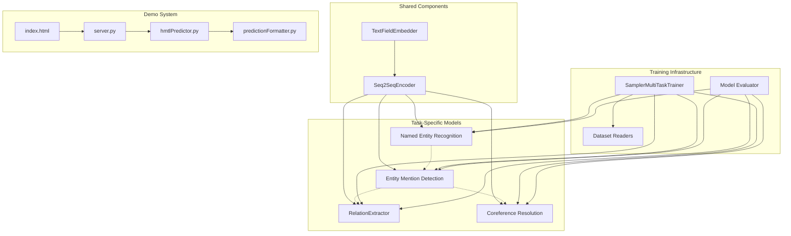
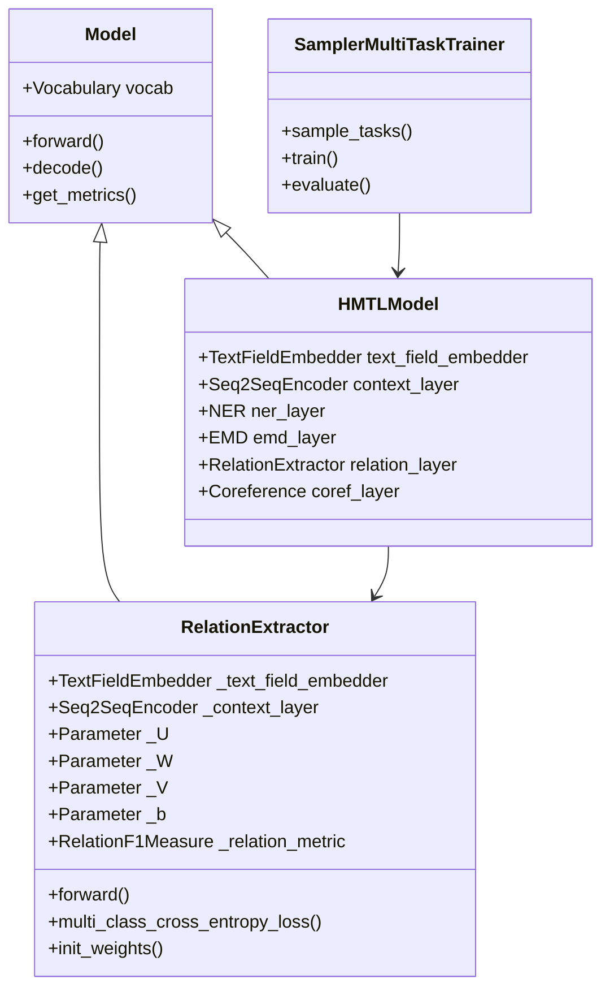

<!-- source: DeepWiki mcp.deepwiki.com · repo huggingface/hmtl · page 1 Overview · fetched 2026-10-26 -->

# Overview

Relevant source files

The following files were used as context for generating this wiki page:

- [README.md](README.md)
- [hmtl/models/relation_extraction.py](hmtl/models/relation_extraction.py)

This document provides a comprehensive overview of the HMTL (Hierarchical Multi-Task Learning) repository, which implements a state-of-the-art multi-task learning system for natural language processing. The system performs four semantic NLP tasks in a hierarchical manner: Named Entity Recognition, Entity Mention Detection, Relation Extraction, and Coreference Resolution.

For detailed information about setting up the environment and dependencies, see [Getting Started](#2). For in-depth technical details about the core model architecture, see [Core HMTL Model](#3). For information about the training infrastructure, see [Training System](#4).

## System Purpose and Capabilities

HMTL is designed to learn semantic representations by combining multiple NLP tasks in a hierarchical structure. The system achieves state-of-the-art results on Named Entity Recognition, Entity Mention Detection, and Relation Extraction tasks. The hierarchical approach allows lower-level tasks to inform higher-level tasks, enabling the model to learn increasingly complex semantic representations as it progresses through the task hierarchy.

The repository provides a complete ecosystem including:
- Multi-task model training and evaluation infrastructure
- Web-based demonstration interface
- Pre-trained model weights and embeddings
- Dataset readers for standard NLP corpora
- Fine-tuning capabilities for custom datasets

## Core Architecture Overview

The HMTL system follows a hierarchical multi-task learning approach where four NLP tasks are arranged in a dependency hierarchy. The model uses shared representations at lower levels while maintaining task-specific components at higher levels.

**HMTL Task Hierarchy and Code Structure**

Sources: [README.md:1-74](), [hmtl/models/relation_extraction.py:32-89]()

## Technology Stack and Dependencies

The HMTL system is built on a modern Python-based NLP stack:

| Component | Technology | Purpose |
|-----------|------------|---------|
| **Core Framework** | AllenNLP | Model architecture and training infrastructure |
| **Deep Learning** | PyTorch | Neural network implementation and optimization |
| **Language** | Python 3.6+ | Primary development language |
| **Embeddings** | ELMo, GloVe | Pre-trained word representations |
| **Evaluation** | SentEval | Semantic representation evaluation |
| **Web Demo** | Flask, JavaScript | Interactive demonstration interface |
| **Development** | Grunt, LESS | Frontend development workflow |

Sources: [README.md:24-33]()

## Key Model Components

**HMTL Model Class Structure**

Sources: [hmtl/models/relation_extraction.py:32-89]()

### Relation Extraction Component

The `RelationExtractor` class exemplifies the task-specific model architecture used in HMTL. It implements a multi-head selection approach for relation extraction:

- **Scoring Mechanism**: Uses learnable parameters `_U`, `_W`, `_V`, and `_b` to compute relation scores between token pairs
- **Loss Function**: Employs `BCEWithLogitsLoss` for multi-class relation classification
- **Evaluation**: Integrates `RelationF1Measure` for precision, recall, and F1 score computation
- **Task Integration**: Inherits from AllenNLP's `Model` class for seamless integration with the training framework

The model processes input text through shared embeddings and encoding layers, then computes pairwise relation scores using bilinear transformations [hmtl/models/relation_extraction.py:160-182]().

Sources: [hmtl/models/relation_extraction.py:32-89](), [hmtl/models/relation_extraction.py:160-182]()

## Training and Evaluation Infrastructure

The system provides comprehensive training capabilities through:

- **Multi-Task Training**: `SamplerMultiTaskTrainer` handles task sampling and joint optimization
- **Configuration-Driven**: JSON configuration files define model architecture and hyperparameters
- **Evaluation Metrics**: Task-specific metrics for each NLP task
- **Tensorboard Integration**: Real-time training monitoring and visualization
- **SentEval Integration**: Evaluation of learned semantic representations

The training process is initiated using the command: `python train.py --config_file_path configs/hmtl_coref_conll.json --serialization_dir my_first_training` [README.md:43-45]().

Sources: [README.md:35-52]()

## Demo Application

The repository includes a complete web-based demonstration system consisting of:

- **Frontend**: Interactive web interface for text input and visualization
- **API Backend**: Flask server exposing model predictions via REST endpoints
- **Prediction Processing**: Formatters for converting model outputs to human-readable visualizations
- **Deployment**: Pre-trained model weights available through Git LFS

The demo is accessible online and provides real-time visualization of all four NLP tasks on user-provided text input [README.md:3-8]().

Sources: [README.md:3-8]()

## Dataset Support

HMTL supports standard NLP datasets through specialized readers:

- **OntoNotes 5.0**: Named Entity Recognition tasks
- **CoNLL 2003**: Named Entity Recognition benchmarking
- **ACE 2005**: Entity Mention Detection, Relation Extraction, and Coreference Resolution

The system includes custom dataset readers that handle the specific formats and annotation schemes of each corpus [README.md:57-62]().

Sources: [README.md:57-62]()

---

