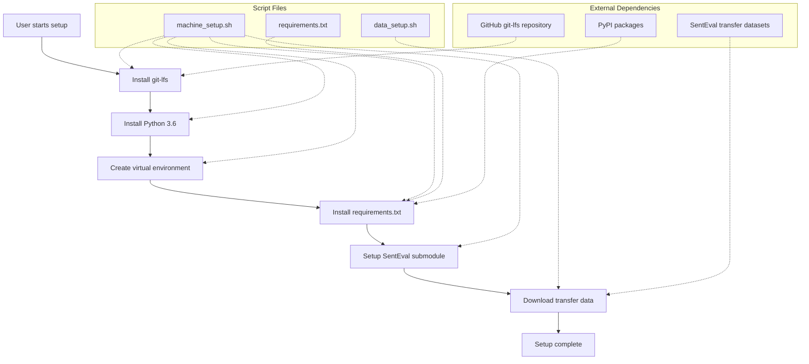
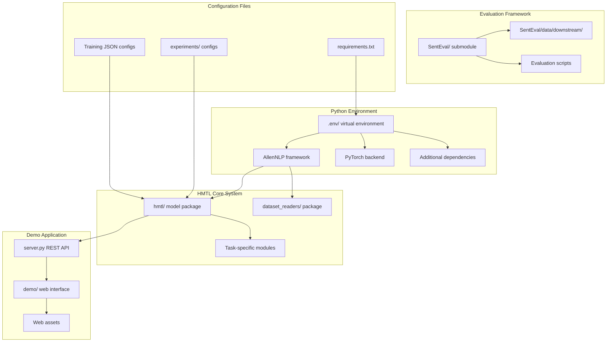

<!-- source: DeepWiki mcp.deepwiki.com · repo huggingface/hmtl · page 2 Getting Started · fetched 2026-10-26 -->

# Getting Started

<details>
<summary>Relevant source files</summary>

The following files were used as context for generating this wiki page:

- [demo/HMTL_demo.png](demo/HMTL_demo.png)
- [scripts/machine_setup.sh](scripts/machine_setup.sh)

</details>


This page provides a comprehensive guide to setting up the HMTL (Hierarchical Multi-Task Learning) system on your local machine. It covers environment preparation, dependency installation, and initial configuration required to run the multi-task NLP model and demo application.

The setup process establishes a Python 3.6 environment with AllenNLP framework, downloads pre-trained models, and configures the SentEval evaluation suite. For detailed environment configuration, see [Environment Setup](#2.1). For data and model acquisition, see [Data Acquisition](#2.2). For dependency details, see [Dependencies](#2.3).

## Setup Overview

The HMTL setup process involves several interconnected components that must be configured in sequence. The following diagram shows how the setup scripts and configuration files work together:

### Setup Workflow



Sources: [scripts/machine_setup.sh:1-36]()

## Prerequisites

Before beginning the setup process, ensure your system meets the following requirements:

| Requirement | Description | Verification Command |
|-------------|-------------|---------------------|
| **Ubuntu/Debian Linux** | The setup scripts are designed for apt-based systems | `lsb_release -a` |
| **sudo privileges** | Required for system package installation | `sudo -v` |
| **Internet connection** | Needed for downloading packages and models | `ping google.com` |
| **Git** | For cloning repository and managing submodules | `git --version` |
| **curl** | Used by installation scripts | `curl --version` |

## Quick Start Guide

### 1. Clone Repository

```bash
git clone https://github.com/huggingface/hmtl.git
cd hmtl
```

### 2. Run Machine Setup

Execute the main setup script to configure your environment:

```bash
chmod +x scripts/machine_setup.sh
./scripts/machine_setup.sh
```

This script performs the following operations from [scripts/machine_setup.sh:1-36]():

- **Git LFS Installation** [scripts/machine_setup.sh:3-6](): Configures Git Large File Storage for downloading pre-trained models
- **Python 3.6 Setup** [scripts/machine_setup.sh:9-16](): Installs Python 3.6 and pip, creates symbolic links
- **Virtual Environment** [scripts/machine_setup.sh:19-22](): Creates isolated Python environment in `.env/` directory
- **Dependencies** [scripts/machine_setup.sh:25-26](): Installs all required Python packages
- **SentEval Configuration** [scripts/machine_setup.sh:29-35](): Initializes evaluation submodule and downloads transfer datasets

### 3. Activate Environment

After setup completion, always activate the virtual environment before using HMTL:

```bash
source .env/bin/activate
```

## System Architecture After Setup

Once setup is complete, your HMTL installation will have the following structure:

### Component Dependencies



Sources: [scripts/machine_setup.sh:19-35]()

## Setup Verification

### Verify Python Environment

Check that Python 3.6 is properly installed and accessible:

```bash
python3 --version  # Should show Python 3.6.x
which python3      # Should point to /usr/local/bin/python3
```

### Verify Virtual Environment

Ensure the virtual environment is active and configured:

```bash
which python       # Should show ./env/bin/python
python --version   # Should show Python 3.6.x
```

### Verify Key Dependencies

Test that critical packages are installed:

```bash
python -c "import allennlp; print('AllenNLP:', allennlp.__version__)"
python -c "import torch; print('PyTorch:', torch.__version__)"
python -c "import numpy; print('NumPy:', numpy.__version__)"
```

### Verify SentEval Setup

Check that the evaluation framework is properly configured:

```bash
ls SentEval/data/downstream/  # Should show downloaded datasets
python -c "import sys; sys.path.append('SentEval'); import senteval"
```

## Common Setup Issues

| Issue | Symptoms | Solution |
|-------|----------|----------|
| **Git LFS not working** | Large files not downloading | Run `git lfs pull` after setup |
| **Python 3.6 conflicts** | Version mismatch errors | Ensure symbolic links point to correct Python |
| **Virtual env activation** | Wrong Python version active | Always run `source .env/bin/activate` |
| **Permission errors** | sudo command failures | Ensure user has sudo privileges |
| **Network timeouts** | Download failures | Check internet connection and retry |

## Next Steps

After successful setup, you can:

1. **Train Models**: Follow [Multi-Task Training](#4.1) to train HMTL models
2. **Run Demo**: See [Web Interface](#5.1) to start the interactive demo
3. **Evaluate Models**: Use [Model Evaluation](#4.2) for performance testing
4. **Load Data**: Configure [Dataset Readers](#6) for your datasets

The environment is now ready for HMTL model training, evaluation, and deployment.

Sources: [scripts/machine_setup.sh:1-36]()

---

