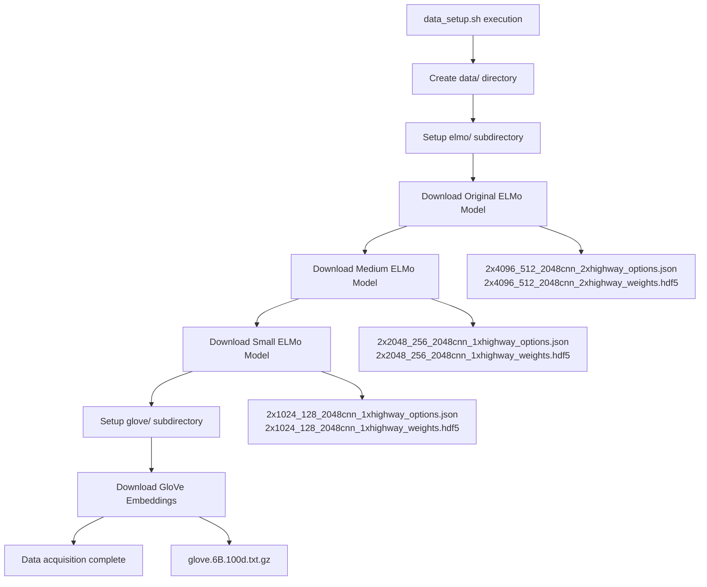
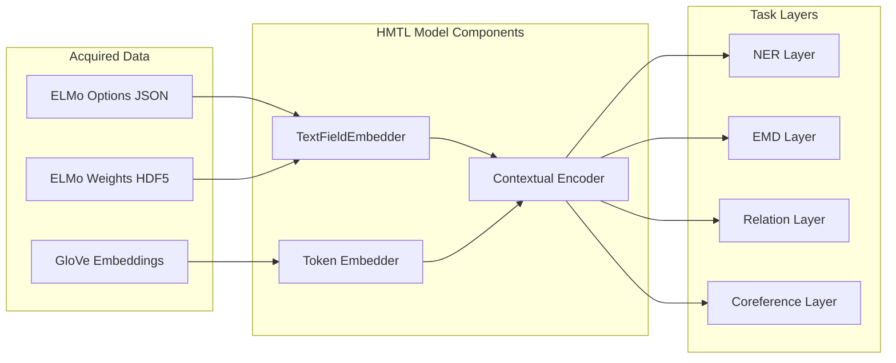

<!-- source: DeepWiki mcp.deepwiki.com · repo huggingface/hmtl · page 2.2 Data Acquisition · fetched 2026-10-26 -->

# Data Acquisition

<details>
<summary>Relevant source files</summary>

The following files were used as context for generating this wiki page:

- [scripts/data_setup.sh](scripts/data_setup.sh)

</details>


## Purpose and Scope

This document covers the data acquisition process for the HMTL system, specifically the automated downloading of pre-trained models and embeddings required for training and inference. The data acquisition system downloads ELMo contextual embeddings and GloVe word embeddings from external sources and organizes them in a standardized directory structure.

For information about environment setup and dependencies, see [Environment Setup](#2.1) and [Dependencies](#2.3).

## Overview

The data acquisition process is automated through the `data_setup.sh` script, which downloads essential pre-trained components needed by the HMTL model. These components provide the foundation for text representation and contextual understanding across all four NLP tasks.

### Data Acquisition Workflow



Sources: [scripts/data_setup.sh:1-34]()

## Directory Structure

The data acquisition process creates a structured directory layout for organizing pre-trained models and embeddings:

```
data/
├── elmo/
│   ├── 2x4096_512_2048cnn_2xhighway_options.json
│   ├── 2x4096_512_2048cnn_2xhighway_weights.hdf5
│   ├── 2x2048_256_2048cnn_1xhighway_options.json
│   ├── 2x2048_256_2048cnn_1xhighway_weights.hdf5
│   ├── 2x1024_128_2048cnn_1xhighway_options.json
│   └── 2x1024_128_2048cnn_1xhighway_weights.hdf5
└── glove/
    └── glove.6B.100d.txt.gz
```

Sources: [scripts/data_setup.sh:4-5](), [scripts/data_setup.sh:8-9](), [scripts/data_setup.sh:31-32]()

## ELMo Model Acquisition

The system downloads three different sizes of ELMo (Embeddings from Language Models) contextual embeddings from AllenNLP's S3 repository. Each model consists of two files: a configuration JSON file and an HDF5 weights file.

### ELMo Model Variants

| Model Type | Configuration File | Weights File | Architecture |
|------------|-------------------|-------------|--------------|
| Original (Full) | `2x4096_512_2048cnn_2xhighway_options.json` | `2x4096_512_2048cnn_2xhighway_weights.hdf5` | 2 layers, 4096 hidden units |
| Medium | `2x2048_256_2048cnn_1xhighway_options.json` | `2x2048_256_2048cnn_1xhighway_weights.hdf5` | 2 layers, 2048 hidden units |
| Small | `2x1024_128_2048cnn_1xhighway_options.json` | `2x1024_128_2048cnn_1xhighway_weights.hdf5` | 2 layers, 1024 hidden units |

### Original/Full Size ELMo Model

The full-size ELMo model provides the highest quality contextual representations but requires more computational resources.

Sources: [scripts/data_setup.sh:11-15]()

### Medium Size ELMo Model  

The medium-size model offers a balance between representation quality and computational efficiency.

Sources: [scripts/data_setup.sh:17-21]()

### Small Size ELMo Model

The small-size model provides faster inference with reduced memory requirements, suitable for resource-constrained environments.

Sources: [scripts/data_setup.sh:23-27]()

## GloVe Embeddings

The system downloads pre-trained GloVe (Global Vectors for Word Representation) embeddings to provide static word representations. The specific variant is GloVe 6B with 100-dimensional vectors, compressed in gzip format.

Sources: [scripts/data_setup.sh:29-33]()

## Integration with HMTL System

The acquired data integrates with various components of the HMTL system to provide text representation capabilities:



Sources: [scripts/data_setup.sh:1-34]()

## Execution

To run the data acquisition process:

```bash
bash scripts/data_setup.sh
```

This script must be executed from the repository root directory and requires internet connectivity to download files from the AllenNLP S3 bucket. The total download size is approximately several gigabytes depending on which ELMo models are needed.

Sources: [scripts/data_setup.sh:1-34]()

---

