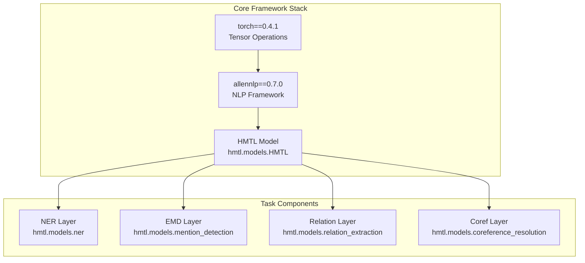
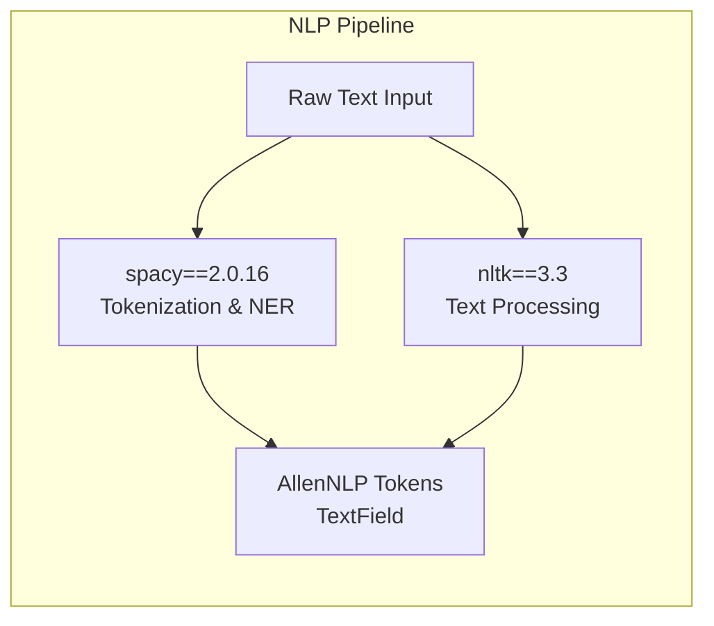
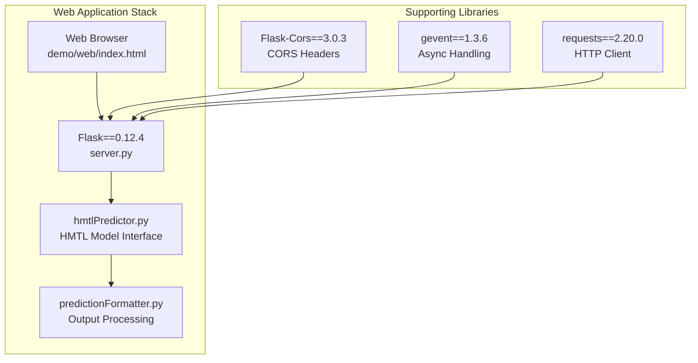
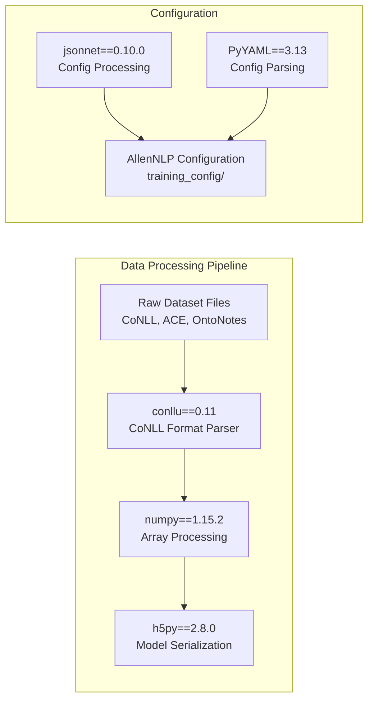
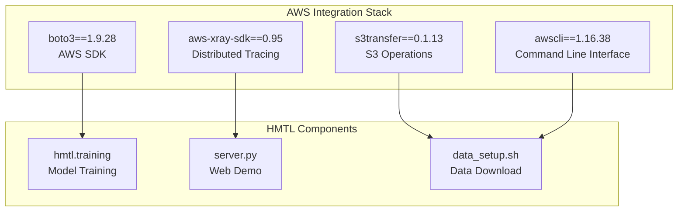

<!-- source: DeepWiki mcp.deepwiki.com · repo huggingface/hmtl · page 2.3 Dependencies · fetched 2026-10-26 -->

# Dependencies

Relevant source files

The following files were used as context for generating this wiki page:

- [requirements.txt](requirements.txt)

This document provides a comprehensive overview of the Python dependencies required for the HMTL (Hierarchical Multi-Task Learning) system. It covers the external libraries and frameworks that support the core model, training infrastructure, web demo, and development workflow. For information about environment setup procedures, see [Environment Setup](#2.1). For data acquisition requirements, see [Data Acquisition](#2.2).

## Core Framework Dependencies

The HMTL system is built on top of several foundational frameworks that provide the core machine learning and deep learning capabilities.

### AllenNLP Framework

The primary dependency is `allennlp==0.7.0`, which serves as the backbone for the multi-task learning architecture. AllenNLP provides the model abstractions, training loops, and dataset readers that HMTL extends.

| Component | AllenNLP Class | HMTL Implementation |
|-----------|----------------|---------------------|
| Model Base | `allennlp.models.Model` | `hmtl.models.HMTL` |
| Dataset Readers | `allennlp.data.DatasetReader` | `hmtl.dataset_readers.*` |
| Training | `allennlp.training.Trainer` | `hmtl.training.SamplerMultiTaskTrainer` |

### PyTorch Backend

`torch==0.4.1` provides the underlying tensor operations and automatic differentiation engine. The HMTL model components inherit from `torch.nn.Module` for neural network layers.

**Sources:** [requirements.txt:2](), [requirements.txt:93]()

## NLP and Language Processing Libraries

### SpaCy Integration

`spacy==2.0.16` and the English model `en_core_web_sm-2.0.0` provide tokenization and linguistic preprocessing capabilities. The SpaCy models are used in the web demo for text processing and visualization.

### NLTK Support

`nltk==3.3` provides additional natural language processing utilities and corpora access. This supports various text processing tasks throughout the system.

**Sources:** [requirements.txt:86](), [requirements.txt:29](), [requirements.txt:53]()

## Web Application Dependencies

The HMTL demo application requires several web framework dependencies to serve the interactive interface and REST API.

### Flask Web Framework

| Dependency | Version | Purpose |
|------------|---------|---------|
| `Flask` | 0.12.4 | Core web application framework |
| `Flask-Cors` | 3.0.3 | Cross-origin resource sharing support |
| `Werkzeug` | 0.14.1 | WSGI utility library (Flask dependency) |

### Additional Web Libraries

- `gevent==1.3.6` - Asynchronous networking library for handling concurrent requests
- `requests==2.20.0` - HTTP client library for external API calls
- `Jinja2==2.10` - Template engine for HTML rendering

**Sources:** [requirements.txt:31-32](), [requirements.txt:35](), [requirements.txt:78](), [requirements.txt:100]()

## Data Processing Dependencies

### Numerical Computing

The system relies on several libraries for numerical computations and data manipulation:

| Library | Version | Primary Use |
|---------|---------|-------------|
| `numpy` | 1.15.2 | Array operations and linear algebra |
| `scipy` | 1.1.0 | Scientific computing and optimization |
| `h5py` | 2.8.0 | HDF5 file format for model serialization |
| `scikit-learn` | 0.20.0 | Machine learning utilities and metrics |

### Data Format Handling

- `conllu==0.11` - CoNLL-U format parsing for linguistic annotations
- `jsonnet==0.10.0` - Configuration file processing for AllenNLP
- `PyYAML==3.13` - YAML configuration parsing

**Sources:** [requirements.txt:54](), [requirements.txt:83](), [requirements.txt:37](), [requirements.txt:82](), [requirements.txt:18](), [requirements.txt:44](), [requirements.txt:76]()

## Development and Testing Dependencies

### Testing Framework

The system uses `pytest==3.9.1` as the primary testing framework, along with several supporting libraries:

- `pytest-pythonpath==0.7.3` - Python path management for tests
- `flaky==3.4.0` - Retry mechanism for flaky tests  
- `mock==2.0.0` - Mock objects for unit testing
- `responses==0.10.1` - HTTP request mocking

### Documentation

- `Sphinx==1.8.1` - Documentation generation
- `numpydoc==0.8.0` - NumPy-style docstring parsing

### Containerization

`docker==3.5.1` and `docker-pycreds==0.3.0` provide Docker integration capabilities for containerized deployment.

**Sources:** [requirements.txt:71-72](), [requirements.txt:30](), [requirements.txt:47](), [requirements.txt:79](), [requirements.txt:87](), [requirements.txt:55](), [requirements.txt:24-25]()

## AWS Integration Dependencies

The system includes extensive AWS integration for cloud deployment and monitoring:

| Service | Library | Version | Usage |
|---------|---------|---------|-------|
| General AWS | `boto3` | 1.9.28 | Core AWS operations |
| Legacy AWS | `boto` | 2.49.0 | Backward compatibility |
| CLI Tools | `awscli` | 1.16.38 | Command-line access |
| Monitoring | `aws-xray-sdk` | 0.95 | Request tracing |
| Storage | `s3transfer` | 0.1.13 | S3 file operations |

**Sources:** [requirements.txt:6](), [requirements.txt:7](), [requirements.txt:10-13](), [requirements.txt:81]()

## Monitoring and Visualization

`tensorboardX==1.2` provides TensorBoard logging capabilities for training visualization and metric tracking. This integrates with the training infrastructure to log loss curves, gradient norms, and other training diagnostics.

**Sources:** [requirements.txt:90]()

---

