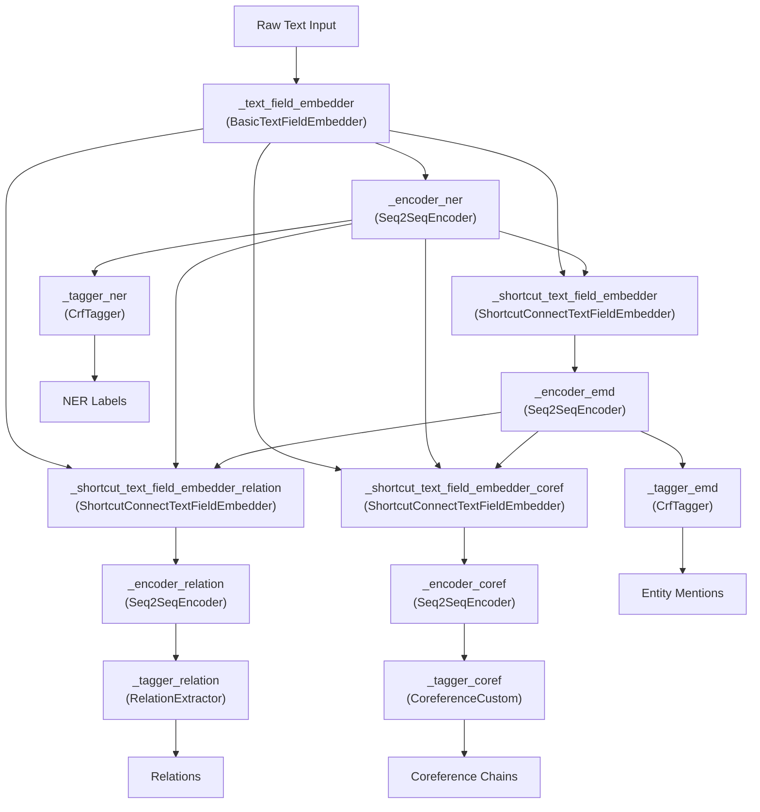
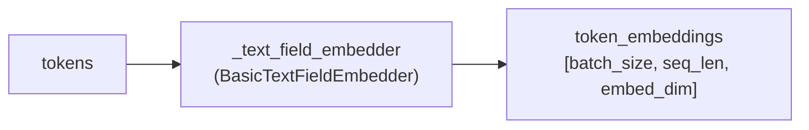
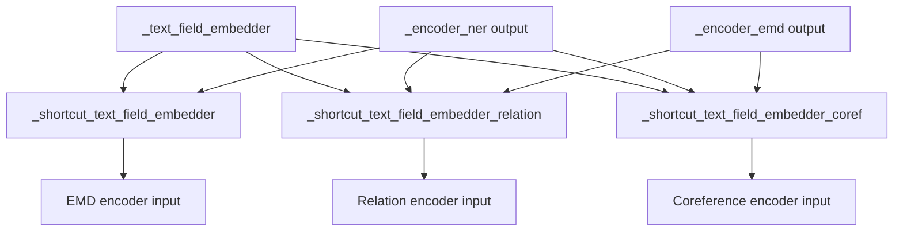
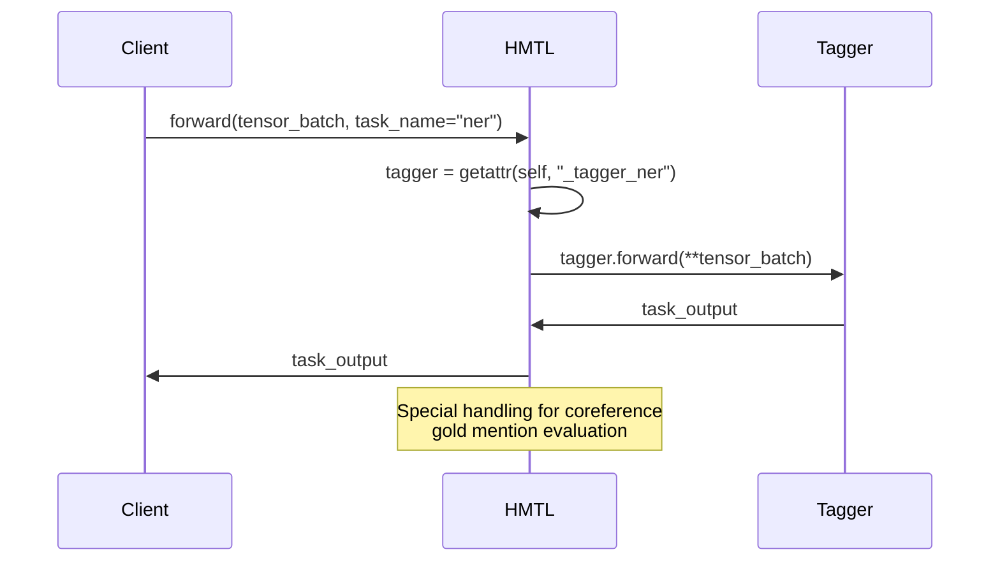

<!-- source: DeepWiki mcp.deepwiki.com · repo huggingface/hmtl · page 3 Core HMTL Model · fetched 2026-10-26 -->

# Core HMTL Model

<details>
<summary>Relevant source files</summary>

The following files were used as context for generating this wiki page:

- [hmtl/models/hmtl.py](hmtl/models/hmtl.py)

</details>


This document covers the central `HMTL` model class that implements hierarchical multi-task learning for natural language processing. The model performs four NLP tasks in a hierarchical manner: Named Entity Recognition (NER), Entity Mention Detection (EMD), Relation Extraction, and Coreference Resolution.

For information about training this model, see [Training System](#4). For details about the web-based demo interface, see [Demo Application](#5). For individual task implementations, see [Model Architecture](#3.1), [Relation Extraction Layer](#3.2), and [Coreference Resolution](#3.3).

## Overview

The `HMTL` class serves as the main orchestrator for the hierarchical multi-task learning system. It coordinates four NLP tasks with carefully designed dependencies where lower-level tasks provide enhanced representations to higher-level tasks through shortcut connections.

**Core Architecture**:
- **Shared Text Embedder**: Common text representation layer used across all tasks
- **Task Hierarchy**: NER → EMD → {Relation Extraction, Coreference Resolution}
- **Shortcut Connections**: Higher-level tasks receive concatenated outputs from previous encoders
- **Task-Specific Components**: Each task has dedicated encoder and tagger/model components

## HMTL Model Architecture

The following diagram shows the hierarchical structure and data flow within the HMTL model:



Sources: [hmtl/models/hmtl.py:28-201]()

## Component Breakdown

### Text Field Embedder

The model uses a shared `BasicTextFieldEmbedder` as the foundation for all task representations. This component converts raw text tokens into dense vector representations.



Sources: [hmtl/models/hmtl.py:47-50]()

### Task-Specific Encoders

Each task has its own `Seq2SeqEncoder` that processes the input representations:

| Task | Encoder Attribute | Purpose |
|------|------------------|---------|
| NER | `_encoder_ner` | Base contextual encoding for named entities |
| EMD | `_encoder_emd` | Entity mention detection with NER context |
| Relation | `_encoder_relation` | Relation extraction with NER+EMD context |
| Coreference | `_encoder_coref` | Coreference resolution with NER+EMD context |

Sources: [hmtl/models/hmtl.py:58-60](), [hmtl/models/hmtl.py:82-83](), [hmtl/models/hmtl.py:109-111](), [hmtl/models/hmtl.py:137-139]()

### Shortcut Connections

The hierarchical structure is implemented through `ShortcutConnectTextFieldEmbedder` instances that concatenate outputs from previous encoders:



Sources: [hmtl/models/hmtl.py:85-88](), [hmtl/models/hmtl.py:113-116](), [hmtl/models/hmtl.py:141-144]()

### Task-Specific Taggers

Each task uses a specialized model for predictions:

| Task | Tagger Attribute | Model Type | Key Parameters |
|------|------------------|------------|----------------|
| NER | `_tagger_ner` | `CrfTagger` | `label_namespace`, `constraint_type` |
| EMD | `_tagger_emd` | `CrfTagger` | `label_namespace`, `constraint_type` |
| Relation | `_tagger_relation` | `RelationExtractor` | `d`, `l`, `n_classes`, `activation` |
| Coreference | `_tagger_coref` | `CoreferenceCustom` | `max_span_width`, `spans_per_word`, `max_antecedents` |

Sources: [hmtl/models/hmtl.py:64-73](), [hmtl/models/hmtl.py:92-101](), [hmtl/models/hmtl.py:120-129](), [hmtl/models/hmtl.py:154-169]()

## Forward Pass Mechanism

The `forward` method dynamically selects which task to execute based on the `task_name` parameter:

```python
def forward(self, tensor_batch, for_training: bool = False, task_name: str = "ner") -> Dict[str, torch.Tensor]:
    tagger = getattr(self, "_tagger_%s" % task_name)
    
    if task_name == "coref" and tagger._eval_on_gold_mentions:
        if for_training:
            tagger._use_gold_mentions = False
        else:
            tagger._use_gold_mentions = True
    
    return tagger.forward(**tensor_batch)
```

The method uses Python's `getattr` to dynamically access the appropriate tagger based on the task name, enabling flexible task execution during both training and inference.

Sources: [hmtl/models/hmtl.py:176-187]()

## Task Execution Flow



## Metrics and Evaluation

The model provides task-specific metrics through the `get_metrics` method:

```python
def get_metrics(self, task_name: str, reset: bool = False, full: bool = False) -> Dict[str, float]:
    task_tagger = getattr(self, "_tagger_" + task_name)
    if full and task_name == "coref":
        return task_tagger.get_metrics(reset=reset, full=full)
    else:
        return task_tagger.get_metrics(reset)
```

The coreference task supports additional detailed metrics when `full=True` is specified.

Sources: [hmtl/models/hmtl.py:190-196]()

## Model Registration

The HMTL model is registered with AllenNLP using the `@Model.register("hmtl")` decorator, enabling it to be instantiated from configuration files during training and inference.

Sources: [hmtl/models/hmtl.py:28]()

---

