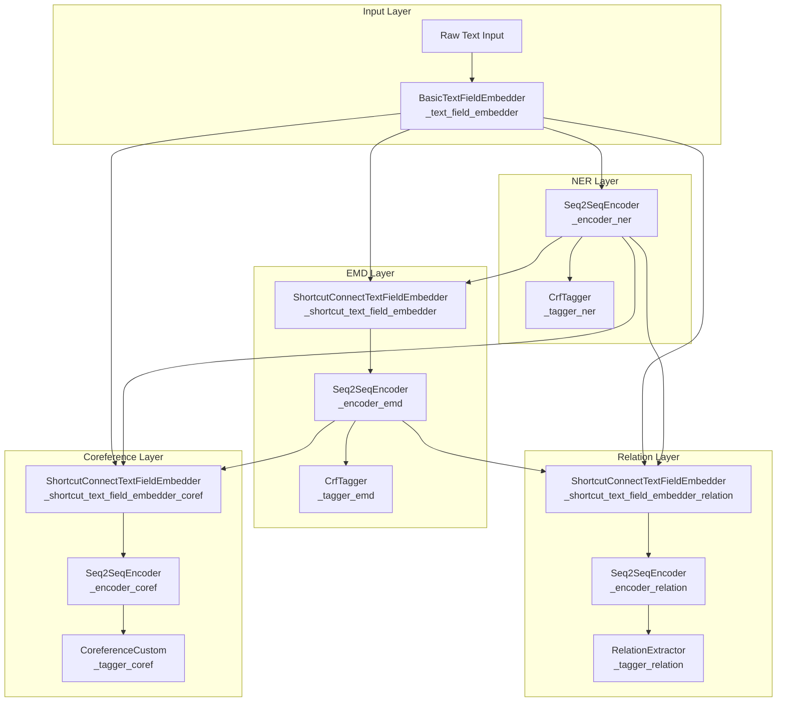
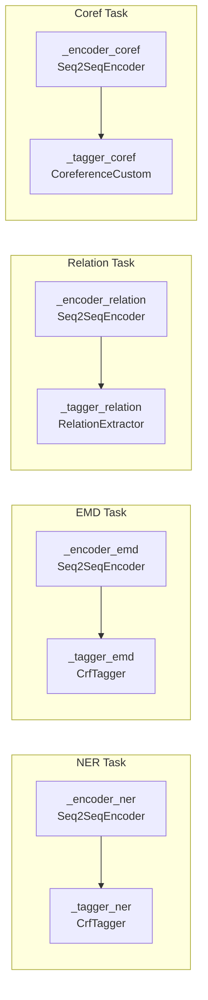
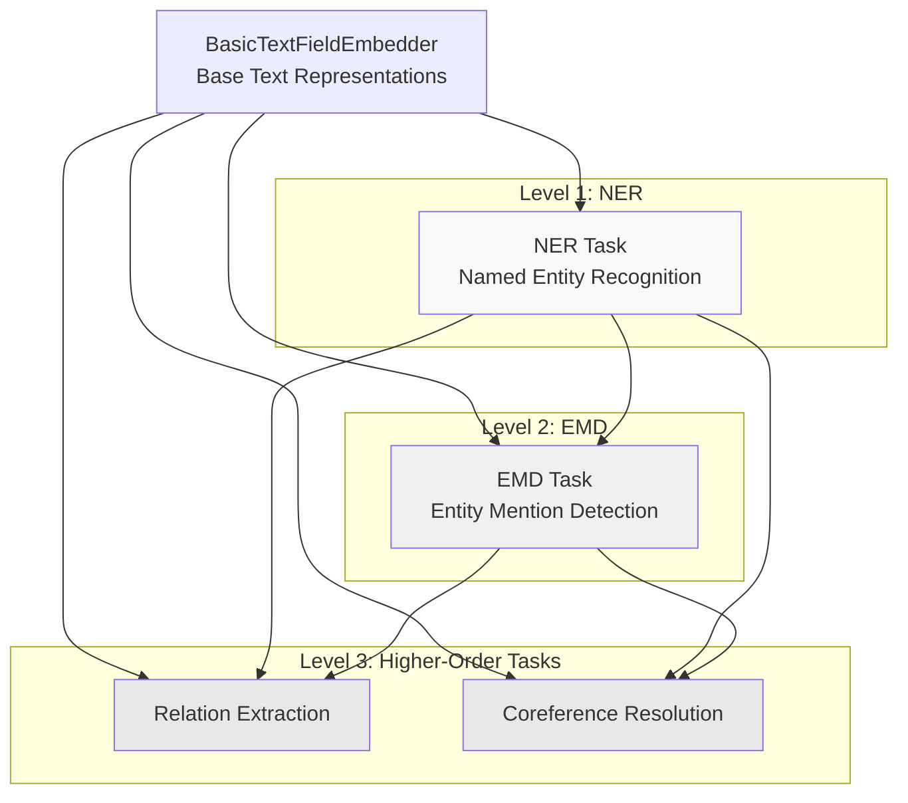
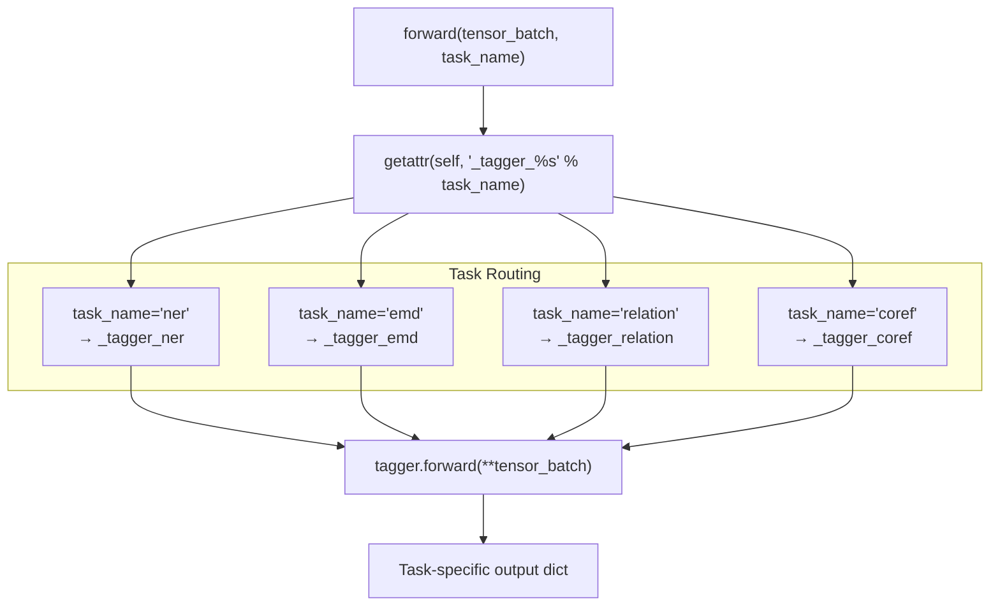

<!-- source: DeepWiki mcp.deepwiki.com · repo huggingface/hmtl · page 3.1 Model Architecture · fetched 2026-10-26 -->

# Model Architecture

<details>
<summary>Relevant source files</summary>

The following files were used as context for generating this wiki page:

- [hmtl/models/__init__.py](hmtl/models/__init__.py)
- [hmtl/models/hmtl.py](hmtl/models/hmtl.py)

</details>


This document describes the architecture of the HMTL (Hierarchical Multi-Task Learning) model, which is the core component of the system. The HMTL model performs four NLP tasks in a hierarchical manner: Named Entity Recognition (NER), Entity Mention Detection (EMD), Relation Extraction, and Coreference Resolution.

For information about training the HMTL model, see [Multi-Task Training](#4.1). For details about individual task components like relation extraction specifics, see [Relation Extraction Layer](#3.2) and [Coreference Resolution](#3.3).

## Overall Model Architecture

The HMTL model implements a hierarchical multi-task learning approach where tasks build upon each other through shared representations and shortcut connections. The model is implemented in the `HMTL` class which orchestrates all task-specific components.

### HMTL Model Structure



Sources: [hmtl/models/hmtl.py:28-201]()

## Shared Components

The HMTL model uses several shared components that provide foundational representations used across all tasks.

### Base Text Field Embedder

The `_text_field_embedder` is a `BasicTextFieldEmbedder` that converts input tokens into dense vector representations. This component is shared across all tasks and provides the foundational text embeddings.

```python
# Initialization in __init__ method
text_field_embedder_params = params.pop("text_field_embedder")
text_field_embedder = BasicTextFieldEmbedder.from_params(vocab=vocab, params=text_field_embedder_params)
self._text_field_embedder = text_field_embedder
```

### Shortcut Connection Architecture

The model implements shortcut connections through `ShortcutConnectTextFieldEmbedder` instances that combine the base embedder with outputs from previous encoders:

| Component | Previous Encoders | Usage |
|-----------|------------------|-------|
| `_shortcut_text_field_embedder` | `[_encoder_ner]` | EMD task input |
| `_shortcut_text_field_embedder_relation` | `[_encoder_ner, _encoder_emd]` | Relation extraction input |
| `_shortcut_text_field_embedder_coref` | `[_encoder_ner, _encoder_emd]` | Coreference resolution input |

Sources: [hmtl/models/hmtl.py:48-50](), [hmtl/models/hmtl.py:85-88](), [hmtl/models/hmtl.py:113-116](), [hmtl/models/hmtl.py:141-144]()

## Task-Specific Components

Each NLP task has dedicated encoder and tagger components that process task-specific representations.

### Task Encoder-Tagger Pattern



### Task-Specific Tagger Types

| Task | Tagger Class | Key Parameters |
|------|-------------|----------------|
| NER | `CrfTagger` | `label_namespace`, `constraint_type` |
| EMD | `CrfTagger` | `label_namespace`, `constraint_type` |
| Relation | `RelationExtractor` | `d`, `l`, `n_classes`, `activation` |
| Coreference | `CoreferenceCustom` | `mention_feedforward`, `antecedent_feedforward`, `max_span_width` |

Sources: [hmtl/models/hmtl.py:62-73](), [hmtl/models/hmtl.py:90-101](), [hmtl/models/hmtl.py:118-129](), [hmtl/models/hmtl.py:154-169]()

## Hierarchical Task Dependencies

The HMTL model implements hierarchical dependencies where later tasks benefit from the representations learned by earlier tasks.

### Dependency Flow



The hierarchical structure is implemented through the shortcut connections:
- EMD receives NER encoder output
- Relation extraction receives both NER and EMD encoder outputs  
- Coreference resolution receives both NER and EMD encoder outputs

Sources: [hmtl/models/hmtl.py:85-88](), [hmtl/models/hmtl.py:113-116](), [hmtl/models/hmtl.py:141-144]()

## Forward Pass Flow

The HMTL model's `forward` method dynamically routes input to the appropriate task-specific tagger based on the `task_name` parameter.

### Dynamic Task Dispatching



### Special Handling for Coreference

The coreference task has special logic for handling gold mentions during evaluation:

```python
if task_name == "coref" and tagger._eval_on_gold_mentions:
    if for_training:
        tagger._use_gold_mentions = False
    else:
        tagger._use_gold_mentions = True
```

Sources: [hmtl/models/hmtl.py:175-187]()

## Model Registry and Instantiation

The HMTL model is registered with AllenNLP's model registry using the `@Model.register("hmtl")` decorator, allowing it to be instantiated from configuration files.

### Available Model Variants

The model system supports various combinations of tasks through different layer classes:

| Model Class | Tasks Supported |
|-------------|----------------|
| `LayerNer` | NER only |
| `LayerRelation` | Relation extraction only |  
| `LayerCoref` | Coreference only |
| `LayerNerEmd` | NER + EMD |
| `LayerEmdRelation` | EMD + Relation |
| `LayerEmdCoref` | EMD + Coreference |
| `LayerNerEmdCoref` | NER + EMD + Coreference |
| `LayerNerEmdRelation` | NER + EMD + Relation |
| `HMTL` | All four tasks |

Sources: [hmtl/models/__init__.py:1-22](), [hmtl/models/hmtl.py:28-29](), [hmtl/models/hmtl.py:198-201]()

---

