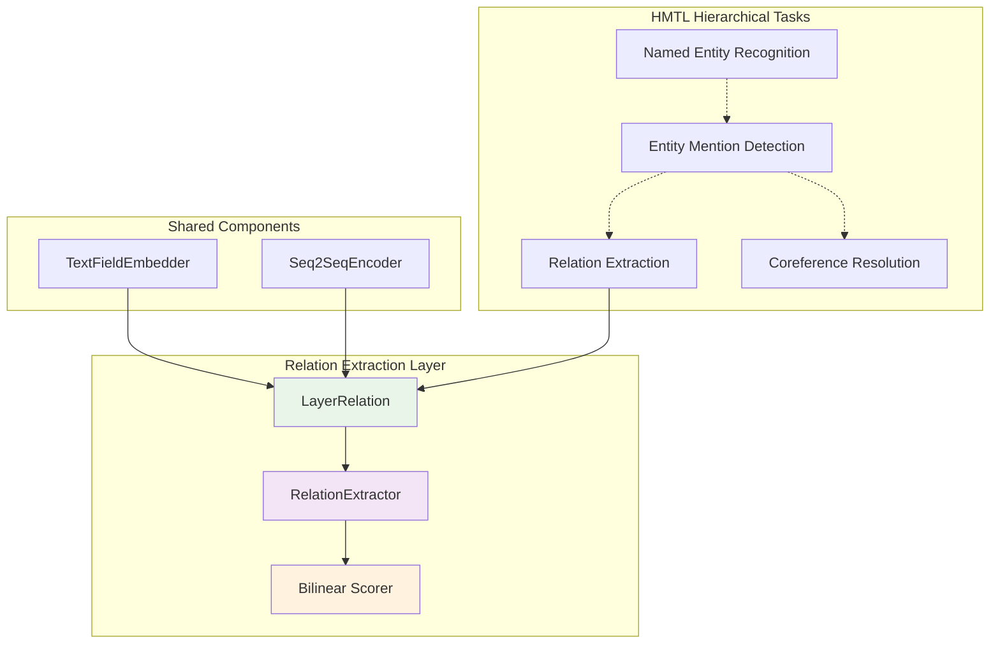
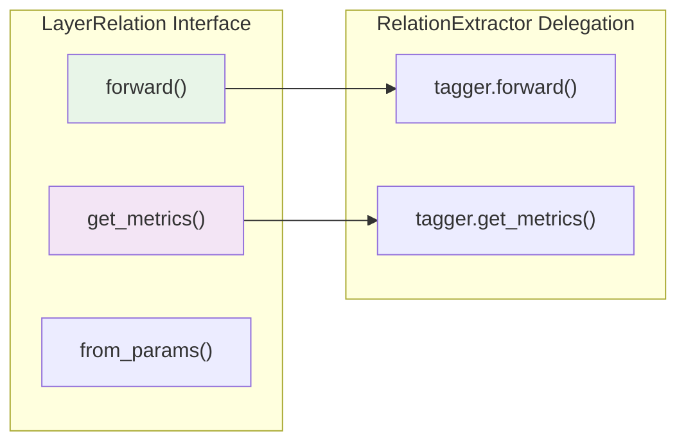
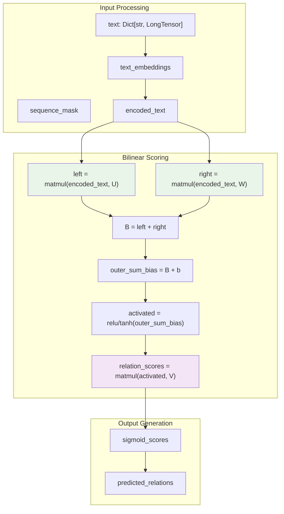
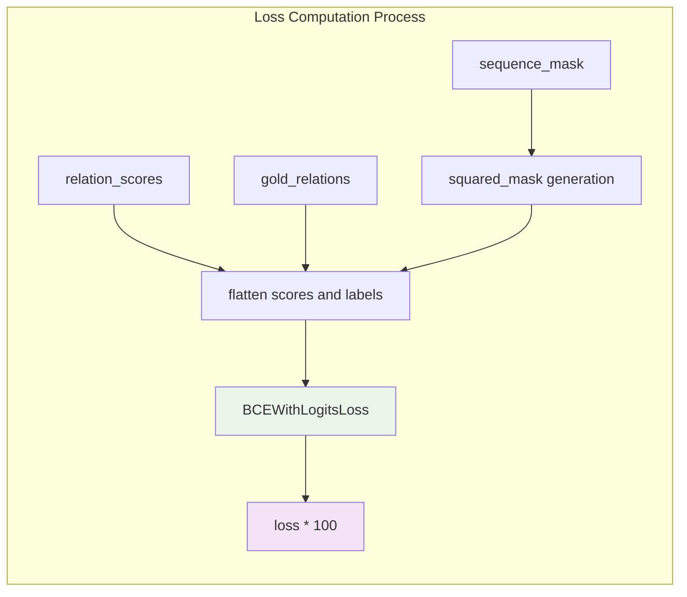

<!-- source: DeepWiki mcp.deepwiki.com · repo huggingface/hmtl · page 3.2 Relation Extraction Layer · fetched 2026-10-26 -->

# Relation Extraction Layer

<details>
<summary>Relevant source files</summary>

The following files were used as context for generating this wiki page:

- [README.md](README.md)
- [hmtl/models/layerRelation.py](hmtl/models/layerRelation.py)
- [hmtl/models/relation_extraction.py](hmtl/models/relation_extraction.py)

</details>


This document covers the relation extraction component of the HMTL model, which identifies semantic relationships between entity mentions in text. The relation extraction layer is one of four hierarchical tasks in HMTL, positioned to leverage entity mention information from lower layers while providing relationship understanding for the overall multi-task architecture.

For information about the complete HMTL model structure, see [Model Architecture](#3.1). For training the relation extraction layer, see [Multi-Task Training](#4.1).

## Architecture Overview

The relation extraction layer consists of two main components: a task-specific wrapper (`LayerRelation`) and the core extraction model (`RelationExtractor`). The layer integrates with HMTL's hierarchical structure by sharing text embeddings and contextual encoders while maintaining task-specific parameters for relation scoring.

### HMTL Integration Architecture



Sources: [hmtl/models/layerRelation.py:1-88](), [hmtl/models/relation_extraction.py:1-275]()

## LayerRelation Wrapper

The `LayerRelation` class serves as the task-specific interface within HMTL's multi-task framework. It manages the integration of shared components with relation-specific parameters and provides the standardized interface expected by the HMTL training system.

### Component Configuration

| Component | Purpose | Configuration Source |
|-----------|---------|---------------------|
| `text_field_embedder` | Shared text embedding | `BasicTextFieldEmbedder.from_params()` |
| `encoder_relation` | Contextual sequence encoder | `Seq2SeqEncoder.from_params()` |
| `tagger_relation` | Core relation extractor | `RelationExtractor` instance |

The wrapper initializes these components from configuration parameters and delegates forward passes to the underlying `RelationExtractor`.

### Task Interface Methods



Sources: [hmtl/models/layerRelation.py:72-87]()

## RelationExtractor Core Model

The `RelationExtractor` implements a bilinear scoring mechanism based on Bekoulis et al.'s multi-head selection approach. It processes contextualized token representations to predict relations between all token pairs in a document.

### Model Parameters

The core scoring mechanism uses four learned parameter matrices:

| Parameter | Dimensions | Purpose |
|-----------|------------|---------|
| `_U` | `(2*d, l)` | Left argument transformation |
| `_W` | `(2*d, l)` | Right argument transformation |  
| `_V` | `(l, n_classes)` | Final classification layer |
| `_b` | `(l,)` | Bias term |

Where `d` is half the encoder output dimension, `l` is the relation embedding dimension, and `n_classes` is the number of relation types.

### Relation Type Mapping

The model uses ACE2005 relation types with a predefined mapping:

```python
rel_type_2_idx = {"ORG-AFF": 0, "PHYS": 1, "ART": 2, "PER-SOC": 3, "PART-WHOLE": 4, "GEN-AFF": 5}
```

Sources: [hmtl/models/relation_extraction.py:28-29](), [hmtl/models/relation_extraction.py:73-77]()

## Bilinear Scoring Mechanism

The relation extraction scoring follows a bilinear approach that computes relation probabilities for all token pairs simultaneously. This allows the model to identify multiple relations within a single document in one forward pass.

### Scoring Computation Flow



The scoring mechanism computes a 4D tensor of shape `(batch_size, seq_len, seq_len, n_classes)` where each element represents the probability of a specific relation type between two tokens.

Sources: [hmtl/models/relation_extraction.py:160-182]()

## Training and Loss Computation

The model uses binary cross-entropy loss with logits, treating relation extraction as a multi-label classification problem where multiple relations can exist simultaneously in a document.

### Loss Function Implementation

The `multi_class_cross_entropy_loss` method handles several key aspects:

1. **Mask Application**: Converts sequence-level masks to relation-level masks
2. **Label Formatting**: Transforms sparse relation labels to dense tensor format  
3. **Loss Amplification**: Applies a 100x multiplier to the base loss for training stability



Sources: [hmtl/models/relation_extraction.py:102-133]()

## Output Format and Decoding

The relation extraction layer produces structured outputs suitable for both training and inference scenarios.

### Forward Pass Outputs

| Output Key | Type | Description |
|------------|------|-------------|
| `relation_sigmoid_scores` | `torch.Tensor` | Sigmoid-normalized relation probabilities |
| `predicted_relations` | `torch.Tensor` | Binary predictions (rounded sigmoid scores) |
| `mask` | `torch.Tensor` | Sequence mask for valid tokens |
| `loss` | `torch.Tensor` | Training loss (when gold labels provided) |

### Decoded Predictions Format

The `decode` method transforms tensor predictions into human-readable format:

```python
# Example decoded relation:
# ["ARG1_PHYS", "*", "*", "ARG2_PHYS", "*"]
# Indicates PHYS relation between tokens 0 and 3
```

Each decoded relation is represented as a list where non-wildcard entries indicate argument positions and relation types.

Sources: [hmtl/models/relation_extraction.py:195-199](), [hmtl/models/relation_extraction.py:244-265]()

## Metrics and Evaluation

The relation extraction layer uses `RelationF1Measure` to compute precision, recall, and F1 scores. A relation prediction is considered correct only when both argument positions and the relation type are correctly identified.

### Evaluation Criteria

The model evaluates relations based on:
- Correct identification of ARG1 position (last word of first argument)
- Correct identification of ARG2 position (last word of second argument)  
- Correct relation type classification

The `get_metrics` method filters results to return only overall performance metrics, excluding per-class breakdowns for cleaner reporting.

Sources: [hmtl/models/relation_extraction.py:267-274](), [hmtl/models/relation_extraction.py:88]()

---

