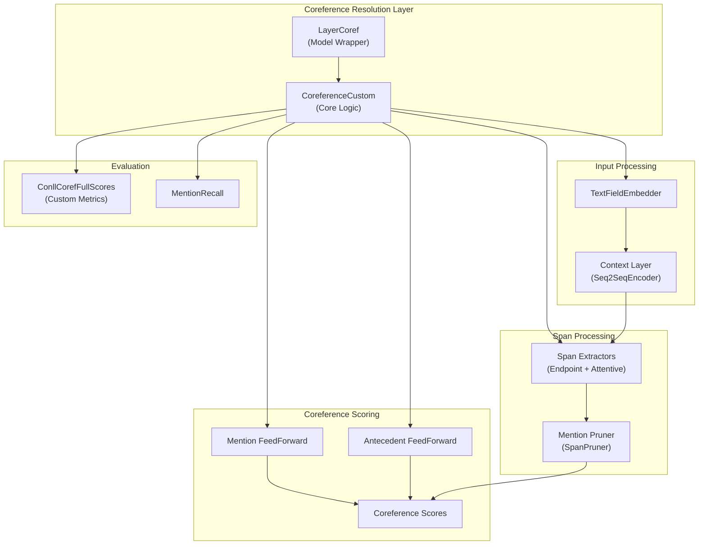
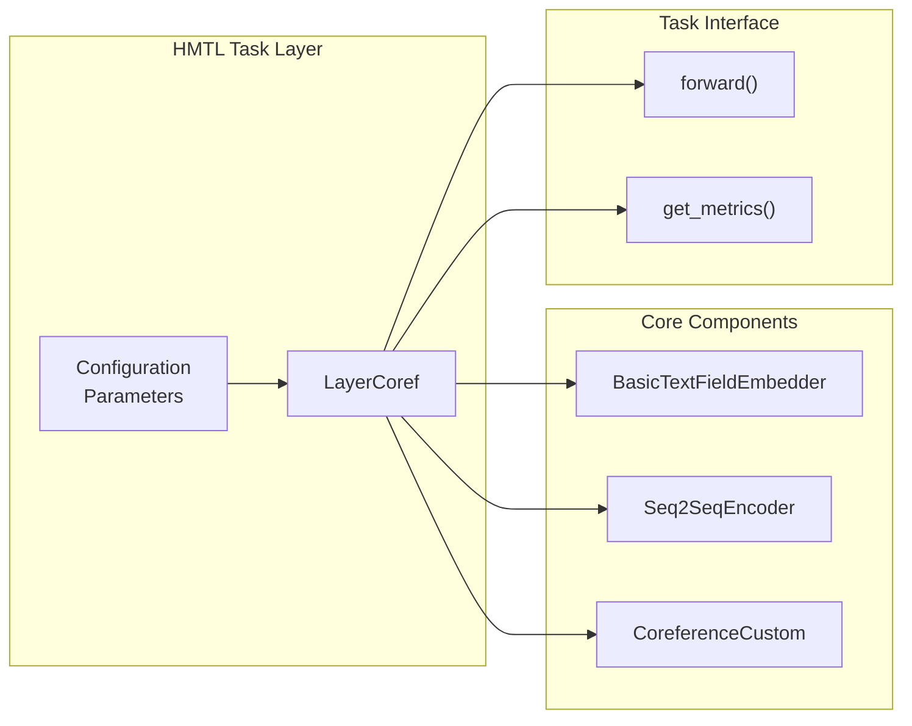
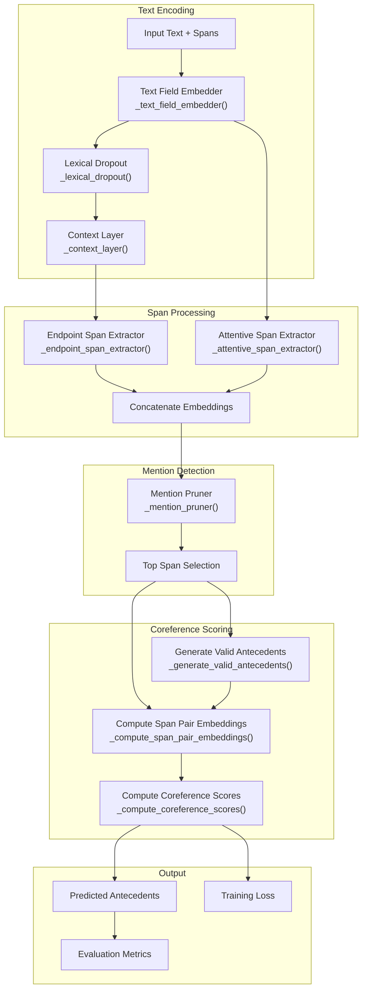
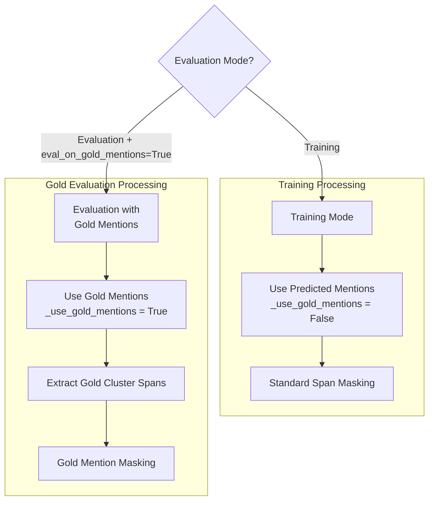
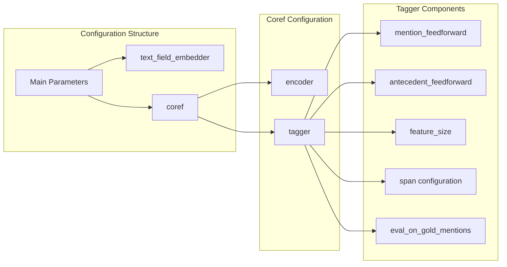

<!-- source: DeepWiki mcp.deepwiki.com · repo huggingface/hmtl · page 3.3 Coreference Resolution · fetched 2026-10-26 -->

# Coreference Resolution

Relevant source files

The following files were used as context for generating this wiki page:

- [hmtl/models/coref_custom.py](hmtl/models/coref_custom.py)
- [hmtl/models/layerCoref.py](hmtl/models/layerCoref.py)

This document covers the coreference resolution component of the HMTL system, which identifies and groups mentions that refer to the same entity across a document. The implementation extends AllenNLP's coreference resolver with custom modifications for multi-task learning integration and enhanced evaluation capabilities.

For information about other NLP tasks in the HMTL system, see [Relation Extraction Layer](#3.2). For overall model architecture, see [Model Architecture](#3.1).

## Overview

The coreference resolution system implements a neural coreference model based on Lee et al. 2017, with two key modifications:

1. **Enhanced Metrics**: Uses detailed CoNLL coreference evaluation metrics (B3, MUC, CEAFE) instead of only their average
2. **Gold Mentions Evaluation**: Supports evaluation using gold mention boundaries during testing while training on predicted mentions

The system consists of two main components: `CoreferenceCustom` for the core coreference logic and `LayerCoref` for HMTL integration.

## Architecture Overview

**Sources:** [hmtl/models/coref_custom.py:24-35](), [hmtl/models/layerCoref.py:28-29]()

## Core Components

### CoreferenceCustom Class

The `CoreferenceCustom` class extends AllenNLP's `CoreferenceResolver` with HMTL-specific modifications:

| Component | Purpose | Implementation |
|-----------|---------|----------------|
| **Text Processing** | Embed and contextualize input text | Uses `TextFieldEmbedder` and `Seq2SeqEncoder` |
| **Span Extraction** | Extract candidate mention spans | `EndpointSpanExtractor` + `SelfAttentiveSpanExtractor` |
| **Mention Scoring** | Score potential mentions | `FeedForward` network for mention classification |
| **Antecedent Scoring** | Score coreference links | `FeedForward` network for pairwise scoring |
| **Evaluation** | Compute detailed metrics | `ConllCorefFullScores` for B3, MUC, CEAFE |

**Key Parameters:**
- `max_span_width`: Maximum width of candidate spans
- `spans_per_word`: Ratio of spans to consider per word
- `max_antecedents`: Maximum antecedents per mention
- `eval_on_gold_mentions`: Whether to use gold mentions in evaluation

**Sources:** [hmtl/models/coref_custom.py:37-75]()

### LayerCoref Integration

The `LayerCoref` class serves as the HMTL integration wrapper:

**Sources:** [hmtl/models/layerCoref.py:43-89]()

## Processing Pipeline

The coreference resolution follows this processing workflow:

**Sources:** [hmtl/models/coref_custom.py:85-214]()

## Key Features

### Gold Mentions Evaluation

The system supports switching between predicted and gold mentions during evaluation:

The gold mentions logic is implemented in the forward method:

**Sources:** [hmtl/models/coref_custom.py:103-123](), [hmtl/models/layerCoref.py:97-102]()

### Enhanced Metrics

The system uses `ConllCorefFullScores` instead of the standard AllenNLP metrics to provide detailed evaluation:

| Metric | Purpose |
|--------|---------|
| **B3** | Precision/Recall/F1 for mention-based evaluation |
| **MUC** | Link-based coreference evaluation |
| **CEAFE** | Entity-based coreference evaluation |
| **Average** | Average of the three metrics |
| **Mention Recall** | Recall for mention detection |

**Sources:** [hmtl/models/coref_custom.py:68-82]()

## Configuration Integration

The coreference layer integrates with HMTL through parameter configuration:

The `LayerCoref` class is registered as `"coref_custom"` for AllenNLP model instantiation.

**Sources:** [hmtl/models/layerCoref.py:43-89](), [hmtl/models/layerCoref.py:28]()

---

