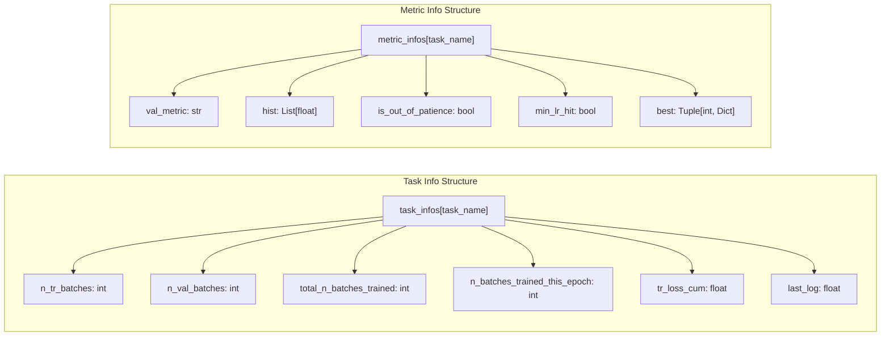
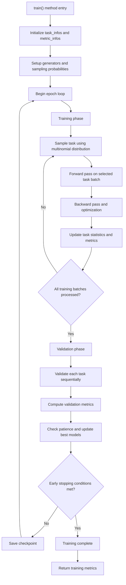
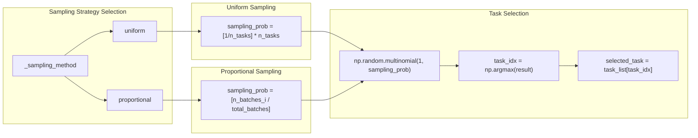

<!-- source: DeepWiki mcp.deepwiki.com · repo huggingface/hmtl · page 4 Training System · fetched 2026-10-26 -->

# Training System

Relevant source files

The following files were used as context for generating this wiki page:

- [LICENSE](LICENSE)
- [hmtl/training/sampler_multi_task_trainer.py](hmtl/training/sampler_multi_task_trainer.py)

This document covers the multi-task training infrastructure in HMTL, which enables simultaneous training of multiple NLP tasks with shared parameters and hierarchical dependencies. The training system handles task sampling, optimization coordination, metrics tracking, and model checkpointing across all supported tasks.

For detailed information about specific training components, see [Multi-Task Training](#4.1), [Model Evaluation](#4.2), and [Fine-tuning](#4.3).

## Architecture Overview

The HMTL training system is built around the `SamplerMultiTaskTrainer` class, which extends AllenNLP's training framework to support multi-task learning scenarios. The system coordinates training across multiple tasks while maintaining shared model parameters and task-specific optimization strategies.

### Core Training Architecture

```mermaid
graph TB
    subgraph "Training Controller"
        SMT["SamplerMultiTaskTrainer"]
        MT["MultiTaskTrainer (base)"]
        SMT --> MT
    end
    
    subgraph "Task Management"
        TL["task_list: List[Task]"]
        TI["_task_infos: Dict"]
        MI["_metric_infos: Dict"]
        
        SMT --> TL
        SMT --> TI
        SMT --> MI
    end
    
    subgraph "Training Components"
        OPT["_optimizers: Dict[str, Optimizer]"]
        SCH["_schedulers: Dict[str, LRScheduler]"]
        TRG["_tr_generators: Dict[str, Iterator]"]
        
        SMT --> OPT
        SMT --> SCH
        SMT --> TRG
    end
    
    subgraph "Sampling Strategy"
        SP["sampling_prob: List[float]"]
        SM["_sampling_method: str"]
        
        SMT --> SP
        SMT --> SM
    end
    
    subgraph "Logging & Persistence"
        TB["_tensorboard: TensorboardWriter"]
        CP["_save_checkpoint()"]
        
        SMT --> TB
        SMT --> CP
    end
```

Sources: [hmtl/training/sampler_multi_task_trainer.py:40-83]()

## Core Components

### SamplerMultiTaskTrainer Class

The `SamplerMultiTaskTrainer` is the primary training coordinator that manages multi-task learning through strategic task sampling. It inherits from `MultiTaskTrainer` and adds sampling-based task selection capabilities.

| Component | Type | Purpose |
|-----------|------|---------|
| `_sampling_method` | `str` | Controls task selection strategy ("uniform" or "proportional") |
| `_task_infos` | `Dict` | Tracks training statistics per task |
| `_metric_infos` | `Dict` | Manages validation metrics and early stopping |
| `_tr_generators` | `Dict` | Maintains data iterators for each task |

### Task Information Tracking

The trainer maintains detailed statistics for each task throughout training:

Sources: [hmtl/training/sampler_multi_task_trainer.py:142-171]()

## Training Process Flow

The training process follows a structured epoch-based approach with task sampling and comprehensive validation:

### Main Training Loop

### Task Sampling Implementation

The trainer implements two sampling strategies for selecting which task to train on each iteration:

Sources: [hmtl/training/sampler_multi_task_trainer.py:188-193](), [hmtl/training/sampler_multi_task_trainer.py:224-227]()

## Task Sampling Strategies

### Uniform Sampling
- Each task has equal probability of selection: `1/n_tasks`
- Provides balanced training across all tasks regardless of dataset size
- Implementation: [hmtl/training/sampler_multi_task_trainer.py:189-190]()

### Proportional Sampling  
- Task selection probability proportional to training dataset size
- Larger datasets get more training iterations
- Formula: `P(task_i) = n_batches_i / total_n_batches`
- Implementation: [hmtl/training/sampler_multi_task_trainer.py:191-192]()

## Metrics and Validation

### Validation Process
The trainer performs comprehensive validation after each training epoch:

1. **Sequential Task Validation**: Each task is validated independently using its validation dataset
2. **Metric Computation**: Task-specific metrics are computed and aggregated  
3. **Best Model Tracking**: Best performing epoch is tracked for each task based on validation metric
4. **Early Stopping**: Training stops when all tasks reach patience limits or minimum learning rate

### Metric Tracking Structure

| Metric Category | Storage Location | Purpose |
|----------------|------------------|---------|
| Training Metrics | `all_tr_metrics[task_name]` | Current epoch training performance |
| Validation Metrics | `all_val_metrics[task_name]` | Current epoch validation performance |
| Metric History | `metric_infos[task_name]["hist"]` | Historical validation scores for patience checking |
| Best Performance | `metric_infos[task_name]["best"]` | Best epoch and corresponding metrics |

Sources: [hmtl/training/sampler_multi_task_trainer.py:328-396]()

## Checkpointing and Recovery

The training system implements comprehensive checkpointing for training recovery and model persistence:

### Checkpoint Components
- Model state dictionary
- Optimizer states for all tasks  
- Learning rate scheduler states
- Training metrics and task statistics
- Current epoch and global step counters

### Recovery Process
Training can be recovered from checkpoints using the `recover=True` parameter in the `train()` method. The system automatically restores all training state and continues from the last saved epoch.

Sources: [hmtl/training/sampler_multi_task_trainer.py:128-140](), [hmtl/training/sampler_multi_task_trainer.py:435]()

---

