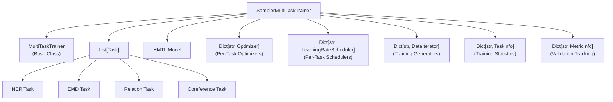
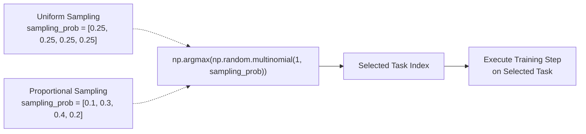
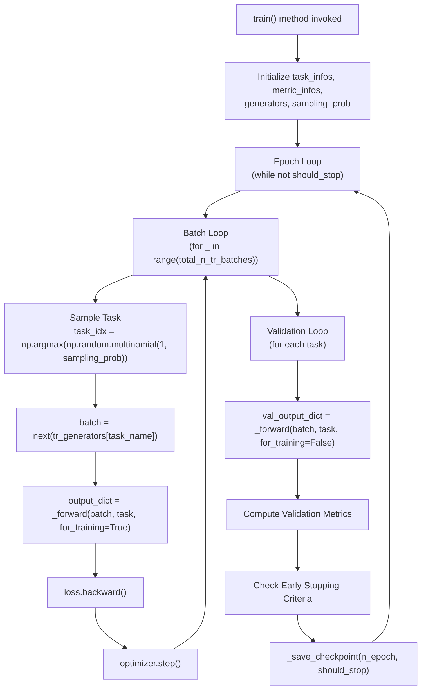
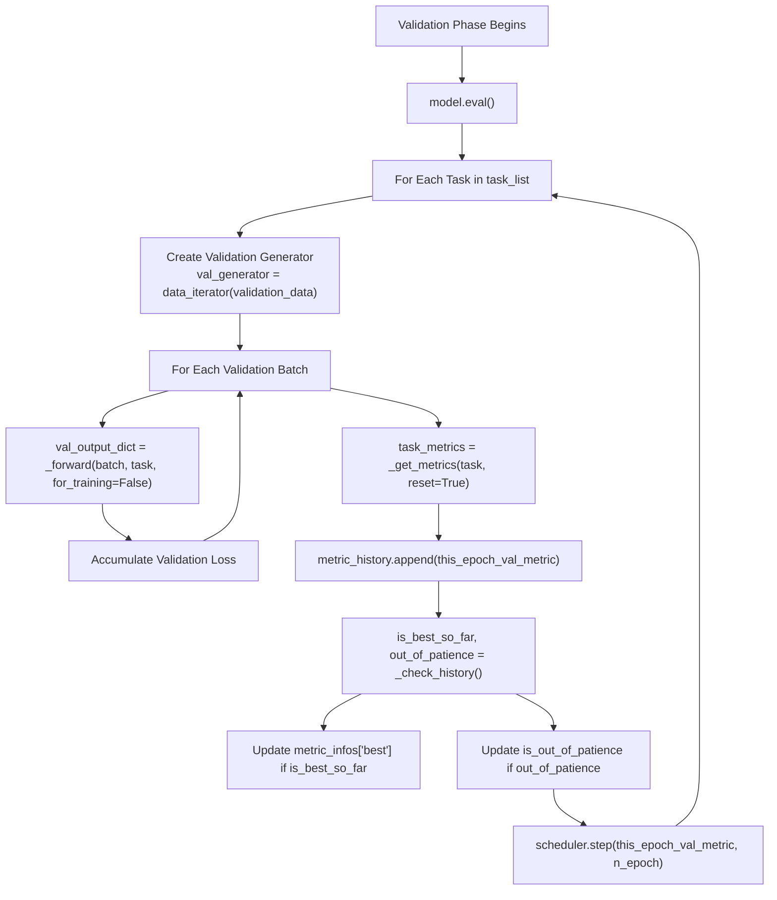
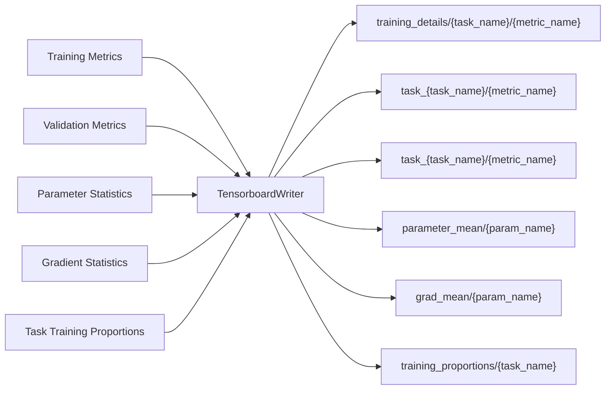

<!-- source: DeepWiki mcp.deepwiki.com · repo huggingface/hmtl · page 4.1 Multi-Task Training · fetched 2026-10-26 -->

# Multi-Task Training

Relevant source files

The following files were used as context for generating this wiki page:

- [LICENSE](LICENSE)
- [hmtl/training/sampler_multi_task_trainer.py](hmtl/training/sampler_multi_task_trainer.py)

This document covers the multi-task training system in HMTL, specifically focusing on the sampler-based approach for training hierarchical multi-task models across multiple NLP tasks simultaneously. The training system coordinates task sampling, optimization, and validation across different tasks while managing shared model parameters.

For information about model evaluation after training, see [Model Evaluation](#4.2). For fine-tuning pre-trained models, see [Fine-tuning](#4.3).

## Architecture Overview

The multi-task training system is built around the `SamplerMultiTaskTrainer` class, which orchestrates training across multiple tasks using a sampling-based approach.

### Core Training Components

**Sources:** [hmtl/training/sampler_multi_task_trainer.py:40-83]()

### Task Sampling Architecture

The trainer implements two sampling strategies for selecting which task to train on at each step:

| Sampling Method | Description | Implementation |
|----------------|-------------|----------------|
| `uniform` | Equal probability for each task | `1/n_tasks` for each task |
| `proportional` | Probability proportional to training data size | `n_batches_task / total_n_batches` |

**Sources:** [hmtl/training/sampler_multi_task_trainer.py:188-193](), [hmtl/training/sampler_multi_task_trainer.py:224-226]()

## Training Loop Implementation

### Main Training Process

The training loop follows a structured approach with task sampling, forward/backward passes, and validation:

**Sources:** [hmtl/training/sampler_multi_task_trainer.py:85-463](), [hmtl/training/sampler_multi_task_trainer.py:223-295]()

### Task Information Tracking

Each task maintains detailed training statistics through the `task_infos` dictionary:

| Field | Type | Purpose |
|-------|------|---------|
| `n_tr_batches` | `int` | Total training batches for task |
| `n_val_batches` | `int` | Total validation batches for task |
| `total_n_batches_trained` | `int` | Cumulative batches trained |
| `n_batches_trained_this_epoch` | `int` | Batches trained in current epoch |
| `tr_loss_cum` | `float` | Cumulative training loss |
| `last_log` | `float` | Timestamp of last logging |

**Sources:** [hmtl/training/sampler_multi_task_trainer.py:141-158](), [hmtl/training/sampler_multi_task_trainer.py:216-220]()

## Validation and Early Stopping

### Multi-Task Validation Process

The validation system evaluates each task independently and maintains separate early stopping criteria:

**Sources:** [hmtl/training/sampler_multi_task_trainer.py:326-396](), [hmtl/training/sampler_multi_task_trainer.py:374-394]()

### Early Stopping Criteria

Training stops when **all** tasks meet stopping conditions:

| Stopping Condition | Check Method | Implementation |
|-------------------|--------------|----------------|
| Learning Rate Minimum | `lr < min_lr` | Per-task optimizer learning rate |
| Validation Patience | `out_of_patience` | Per-task validation metric history |
| Maximum Epochs | `n_epoch >= num_epochs - 1` | Global epoch counter |

**Sources:** [hmtl/training/sampler_multi_task_trainer.py:413-433]()

## Logging and Monitoring

### TensorBoard Integration

The trainer provides comprehensive logging through TensorBoard with multiple metric categories:

**Sources:** [hmtl/training/sampler_multi_task_trainer.py:260-295](), [hmtl/training/sampler_multi_task_trainer.py:313-322](), [hmtl/training/sampler_multi_task_trainer.py:368-372]()

### Metric Information Structure

The `metric_infos` dictionary tracks validation performance for each task:

| Field | Type | Description |
|-------|------|-------------|
| `val_metric` | `str` | Name of validation metric to track |
| `hist` | `List[float]` | History of validation metric values |
| `is_out_of_patience` | `bool` | Whether task has exceeded patience |
| `min_lr_hit` | `bool` | Whether minimum learning rate reached |
| `best` | `Tuple[int, Dict]` | Best epoch and corresponding metrics |

**Sources:** [hmtl/training/sampler_multi_task_trainer.py:160-171]()

## Configuration and Parameters

### Trainer Configuration

The `SamplerMultiTaskTrainer` accepts the following key parameters:

| Parameter | Type | Default | Description |
|-----------|------|---------|-------------|
| `sampling_method` | `str` | `"proportional"` | Task sampling strategy |
| `num_epochs` | `int` | `20` | Maximum training epochs |
| `patience` | `int` | `2` | Validation patience for early stopping |
| `grad_norm` | `float` | `None` | Gradient norm for rescaling |
| `grad_clipping` | `float` | `None` | Gradient clipping threshold |
| `min_lr` | `float` | `0.00001` | Minimum learning rate |
| `summary_interval` | `int` | `50` | TensorBoard logging frequency |

**Sources:** [hmtl/training/sampler_multi_task_trainer.py:42-60](), [hmtl/training/sampler_multi_task_trainer.py:466-503]()

### Integration with AllenNLP

The trainer extends AllenNLP's training infrastructure and integrates with:

- `Model` - The HMTL multi-task model
- `DataIterator` - Per-task data iteration  
- `Optimizer` - Per-task optimization (Adam, SGD, etc.)
- `LearningRateScheduler` - Per-task learning rate scheduling
- `TensorboardWriter` - Metrics logging and visualization

**Sources:** [hmtl/training/sampler_multi_task_trainer.py:23-34]()

---

