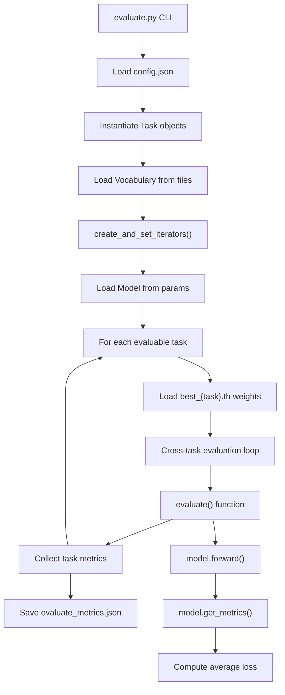
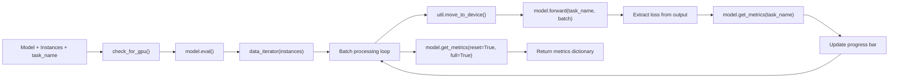
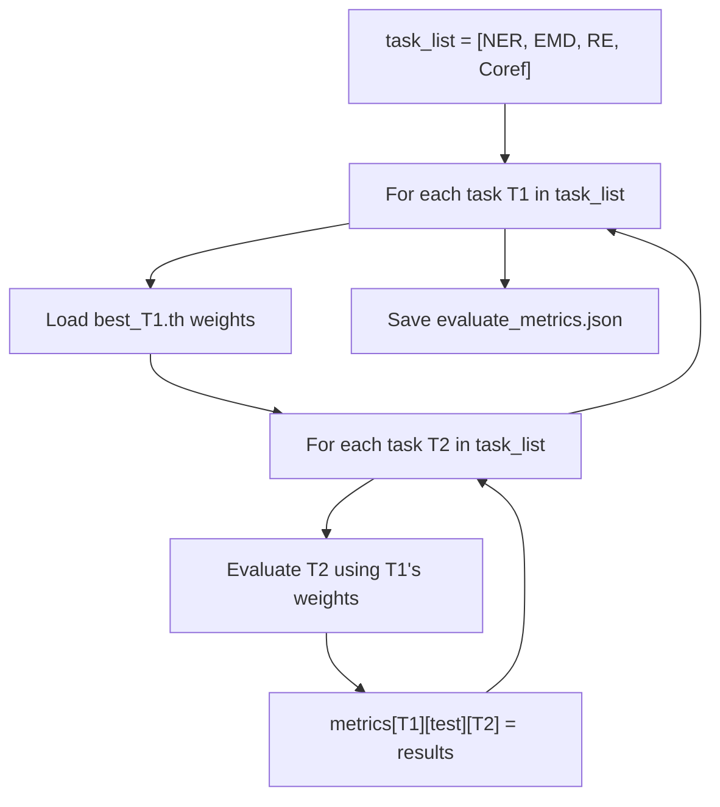
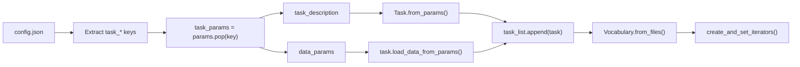
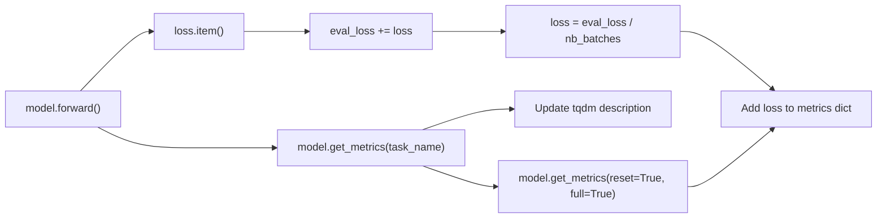

<!-- source: DeepWiki mcp.deepwiki.com · repo huggingface/hmtl · page 4.2 Model Evaluation · fetched 2026-10-26 -->

# Model Evaluation

<details>
<summary>Relevant source files</summary>

The following files were used as context for generating this wiki page:

- [evaluate.py](evaluate.py)

</details>


The model evaluation system provides comprehensive performance assessment of trained HMTL models across all four NLP tasks (Named Entity Recognition, Entity Mention Detection, Relation Extraction, and Coreference Resolution). This system enables both single-task evaluation and cross-task evaluation to measure the impact of multi-task learning on individual task performance.

For information about the training process that produces the models being evaluated, see [Multi-Task Training](#4.1). For details about the core HMTL model architecture, see [Model Architecture](#3.1).

## Evaluation Pipeline Overview

The evaluation system follows a structured pipeline that loads trained models, processes test datasets, and computes comprehensive metrics across all tasks.



Sources: [evaluate.py:104-199]()

## Core Evaluation Function

The `evaluate()` function performs the fundamental evaluation logic for a single task using a specific model configuration.



The function signature and key parameters:

| Parameter | Type | Description |
|-----------|------|-------------|
| `model` | `allennlp.models.model.Model` | The trained HMTL model to evaluate |
| `instances` | `Iterable[Instance]` | Test dataset instances for evaluation |
| `task_name` | `str` | Name of the specific task being evaluated |
| `data_iterator` | `DataIterator` | AllenNLP data iterator for batch processing |
| `cuda_device` | `int` | GPU device identifier (-1 for CPU) |

Sources: [evaluate.py:52-102]()

## Command-Line Interface

The evaluation script provides a command-line interface with the following arguments:

| Argument | Required | Description |
|----------|----------|-------------|
| `-s, --serialization_dir` | Yes | Directory containing the trained model and configuration |
| `-g, --gold_mentions` | No | Enable gold mention evaluation for coreference resolution |

### Usage Example

```bash
python evaluate.py -s /path/to/model/directory -g
```

The serialization directory must contain:
- `config.json` - Training configuration file
- `vocabulary/` - Vocabulary files
- `best_{task_name}.th` - Best model weights for each task

Sources: [evaluate.py:104-120]()

## Cross-Task Evaluation Strategy

The evaluation system implements a comprehensive cross-task evaluation approach where each task's best model weights are used to evaluate performance on all tasks.



This cross-evaluation strategy reveals:
- How task-specific optimization affects other tasks
- The stability of multi-task representations
- Task interdependencies in the hierarchical architecture

Sources: [evaluate.py:156-193]()

## Task Configuration and Data Loading

The evaluation system dynamically instantiates tasks based on the training configuration, following the same pattern used during training.



Key attributes checked for each task:
- `task._evaluate_on_test` - Whether to include in evaluation
- `task._test_data` - Test dataset instances  
- `task._data_iterator` - Configured data iterator
- `task._name` - Task identifier for metrics organization

Sources: [evaluate.py:124-144]()

## Metrics Output Structure

The evaluation system produces a structured JSON output containing comprehensive metrics for each task combination.

### Output Schema

```json
{
  "task_name_1": {
    "test": {
      "task_name_1": {"metric1": value, "metric2": value, "loss": value},
      "task_name_2": {"metric1": value, "metric2": value, "loss": value},
      "task_name_3": {"metric1": value, "metric2": value, "loss": value},
      "task_name_4": {"metric1": value, "metric2": value, "loss": value}
    }
  },
  "task_name_2": {
    "test": { /* similar structure */ }
  }
}
```

### Metrics Collection Process



The final metrics are saved to `evaluate_metrics.json` in the serialization directory and logged to the console.

Sources: [evaluate.py:84-101](), [evaluate.py:188-199]()

## GPU and Memory Management

The evaluation system includes proper GPU handling and memory management for efficient processing of large test datasets.

| Feature | Implementation | Purpose |
|---------|----------------|---------|
| GPU Detection | `check_for_gpu(cuda_device)` | Validate GPU availability |
| Memory Context | `torch.no_grad()` | Disable gradient computation |
| Device Movement | `util.move_to_device(batch, cuda_device)` | Move tensors to GPU |
| Model Mode | `model.eval()` | Set model to evaluation mode |

The evaluation runs with gradients disabled to reduce memory usage and improve performance, since no backpropagation is required during evaluation.

Sources: [evaluate.py:76-88]()

---

