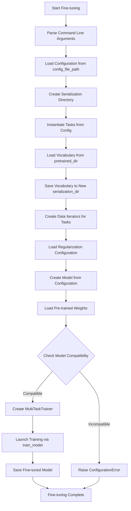
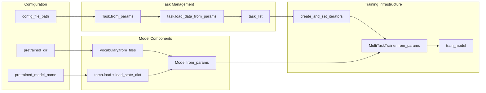

<!-- source: DeepWiki mcp.deepwiki.com · repo huggingface/hmtl · page 4.3 Fine-tuning · fetched 2026-10-26 -->

# Fine-tuning

<details>
<summary>Relevant source files</summary>

The following files were used as context for generating this wiki page:

- [fine_tune.py](fine_tune.py)

</details>


## Purpose and Scope

This document covers the fine-tuning capabilities of the HMTL system, which allows continuing training of pre-trained HMTL models on new datasets. Fine-tuning enables adaptation of existing models to different data distributions while leveraging previously learned representations.

For information about the initial multi-task training process, see [Multi-Task Training](#4.1). For evaluating fine-tuned models, see [Model Evaluation](#4.2).

## Overview

The HMTL fine-tuning system allows you to take a pre-trained multi-task model and continue training it on new datasets. This is particularly useful for domain adaptation or when you want to adapt a general-purpose model to specific data distributions.

The fine-tuning process maintains the hierarchical multi-task learning architecture while allowing the model to adapt its learned representations to the new training data. The system assumes vocabulary compatibility between the pre-trained model and the fine-tuning datasets.

## Command Line Interface

The fine-tuning process is executed via the `fine_tune.py` script with the following required arguments:

| Argument | Description |
|----------|-------------|
| `-s, --serialization_dir` | Directory to save the fine-tuned model and logs |
| `-c, --config_file_path` | Path to configuration file for the fine-tuning setup |
| `-p, --pretrained_dir` | Directory containing the pre-trained model |
| `-m, --pretrained_model_name` | Filename of the pre-trained model weights |

**Example Usage:**
```bash
python fine_tune.py -s ./fine_tuned_model \
                   -c ./configs/fine_tune_config.json \
                   -p ./pretrained_model \
                   -m best.th
```

Sources: [fine_tune.py:10-26]()

## Fine-tuning Workflow

The fine-tuning process follows a structured workflow that prepares the new training environment while preserving the pre-trained model's learned representations.

### Fine-tuning Process Flow



Sources: [fine_tune.py:59-150]()

### Key Components Integration



Sources: [fine_tune.py:92-147]()

## Configuration Requirements

### Task Configuration Structure

The fine-tuning configuration file must define tasks using the pattern `task_*` where each task contains:

- `task_description`: Parameters for `Task.from_params()`
- `data_params`: Parameters for `task.load_data_from_params()`

The system dynamically discovers task configurations by searching for keys matching the pattern `^task_`:

```python
task_keys = [key for key in params.keys() if re.search("^task_", key)]
```

Sources: [fine_tune.py:94-105]()

### Model Architecture Compatibility

The fine-tuning process requires strict compatibility between the pre-trained model and the target model architecture. The system performs state dictionary loading with error handling:

```python
try:
    pretrained_model_state = torch.load(pretrained_model_state_path)
    model.load_state_dict(state_dict=pretrained_model_state)
except:
    raise ConfigurationError(
        "It appears that the configuration of the pretrained model and "
        "the model to fine-tune are not compatible."
    )
```

Sources: [fine_tune.py:128-138]()

## Vocabulary Management

### Vocabulary Compatibility Assumption

The fine-tuning system operates under the critical assumption that the vocabulary remains consistent between pre-training and fine-tuning datasets. This has important implications:

- Label specifications must be exactly the same between datasets
- Token vocabularies should be compatible
- Task-specific label mappings must align

The vocabulary is loaded from the pre-trained model directory and copied to the new serialization directory:

```python
vocab = Vocabulary.from_files(os.path.join(args.pretrained_dir, "vocabulary"))
vocab.save_to_files(os.path.join(serialization_dir, "vocabulary"))
```

Sources: [fine_tune.py:107-115]()

### Data Iterator Setup

After vocabulary loading, the system creates and configures data iterators for all tasks using the shared vocabulary:

```python
task_list = create_and_set_iterators(params=params, task_list=task_list, vocab=vocab)
```

This ensures that all tasks operate with consistent token and label mappings.

Sources: [fine_tune.py:118]()

## Training Execution

### MultiTaskTrainer Integration

The fine-tuning process leverages the same `MultiTaskTrainer` infrastructure used for initial training, ensuring consistency in the training loop and task sampling strategies:

```python
multi_task_trainer_params = params.pop("multi_task_trainer")
trainer = MultiTaskTrainer.from_params(
    model=model, task_list=task_list, serialization_dir=serialization_dir, params=multi_task_trainer_params
)
```

Sources: [fine_tune.py:141-144]()

### Training Launch and Completion

The actual training execution uses the same `train_model` function as the initial training process:

```python
metrics = train_model(multi_task_trainer=trainer, recover=False)
```

The `recover=False` parameter indicates this is a fresh fine-tuning session rather than recovery from interruption.

Sources: [fine_tune.py:147-149]()

## Key Limitations and Considerations

### Vocabulary Constraints

The most significant limitation is the vocabulary compatibility requirement. This means:

- New labels cannot be introduced during fine-tuning
- Task specifications must match the pre-trained model exactly
- Domain-specific vocabularies may not transfer well

### Model Architecture Rigidity

The fine-tuning process requires exact architectural compatibility:
- Encoder configurations must match
- Task-specific layer structures must be identical
- Embedding dimensions and hidden layer sizes must align

### Configuration Validation

The system provides limited configuration validation, relying on PyTorch's state dictionary loading to catch incompatibilities. More sophisticated validation could prevent runtime errors.

Sources: [fine_tune.py:108-138]()

---

