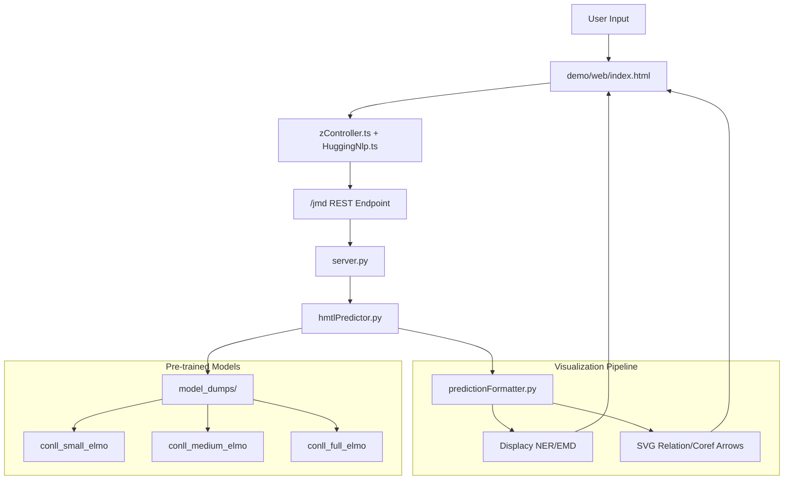
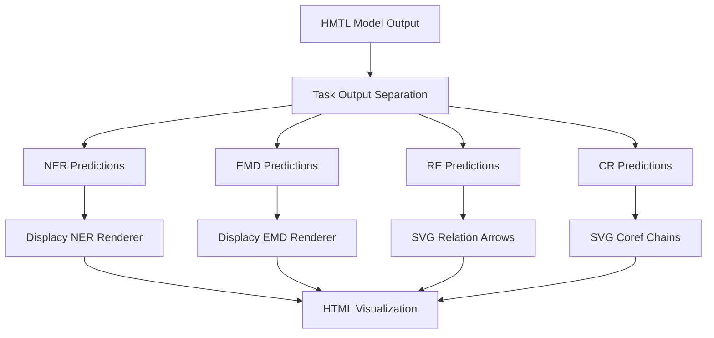

<!-- source: DeepWiki mcp.deepwiki.com · repo huggingface/hmtl · page 5 Demo Application · fetched 2026-10-26 -->

# Demo Application

<details>
<summary>Relevant source files</summary>

The following files were used as context for generating this wiki page:

- [demo/README.md](demo/README.md)

</details>


This document covers the web-based demonstration system for the HMTL (Hierarchical Multi-Task Learning) model. The demo application provides an interactive web interface for visualizing the outputs of four NLP tasks: Named Entity Recognition, Entity Mention Detection, Relation Extraction, and Coreference Resolution.

For information about the core HMTL model architecture, see [Core HMTL Model](#3). For details about the training system, see [Training System](#4). For specifics about the web interface implementation, see [Web Interface](#5.1), and for the API backend details, see [API Backend](#5.2).

## System Overview

The demo application consists of a web-based frontend that communicates with a REST API backend to process text through the HMTL model and visualize the results. The system serves as both an interactive demonstration tool and a deployable API server for integration with other applications.

### Demo Architecture



Sources: [demo/README.md:1-89]()

## REST API Backend

The demo application exposes the HMTL model through a REST API built with Flask and Gunicorn. The primary endpoint accepts text input and returns structured predictions for all four NLP tasks.

### API Request Flow

```mermaid
graph LR
    HTTPRequest["HTTP GET /jmd/?text=..."] --> GunicornServer["gunicorn server"]
    GunicornServer --> FlaskApp["Flask app in server.py"]
    FlaskApp --> BuildApp["build_app(model_name)"]
    BuildApp --> HMTLPredictor["HMTLPredictor.predict()"]
    HMTLPredictor --> AllenNLPModel["AllenNLP Model"]
    AllenNLPModel --> TaskOutputs["NER, EMD, RE, CR outputs"]
    TaskOutputs --> PredFormatter["PredictionFormatter"]
    PredFormatter --> JSONResponse["JSON Response"]
```



The server can be launched with different pre-trained models using the `build_app()` function. The default configuration uses the full ELMo model for optimal performance, while smaller models are available for faster inference.

| Server Command | Model Used | Description |
|----------------|------------|-------------|
| `gunicorn -b:8000 'server:build_app()'` | conll_full_elmo | Default full ELMo model |
| `gunicorn -b:8000 'server:build_app(model_name="conll_small_elmo")'` | conll_small_elmo | Lightweight model |
| `gunicorn -b:8000 'server:build_app(model_name="conll_medium_elmo")'` | conll_medium_elmo | Balanced model |

Sources: [demo/README.md:73-89]()

## Pre-trained Model Performance

The demo application supports three pre-trained HMTL models that differ in ELMo embedding size and computational requirements. Each model provides different performance-speed trade-offs.

| Model Name | NER (F1) | EMD (F1) | RE (F1) | CR (F1) | ELMo Version |
|------------|----------|----------|---------|---------|--------------|
| conll_small_elmo | 85.73 | 83.51 | 58.40 | 62.85 | Small |
| conll_medium_elmo | 86.41 | 84.02 | 58.78 | 61.62 | Medium |
| conll_full_elmo | 86.40 | 85.59 | 61.37 | 62.26 | Original |

The models are stored in the `model_dumps/` directory and require Git LFS for download. The full ELMo model serves as the default due to its superior performance across most tasks, particularly for Relation Extraction and Entity Mention Detection.

Sources: [demo/README.md:20-28]()

## Task Visualization

The demo application provides distinct visualization approaches for each of the four NLP tasks, using web-standard technologies to render interactive displays.

### Task Output Processing



### Task Categories

The demo processes four distinct task types with different entity recognition scopes:

**Named Entity Recognition (NER)**: Identifies 18 OntoNotes entity types including `PERSON`, `NORP`, `FAC`, `ORG`, `GPE`, `LOC` for proper named entities.

**Entity Mention Detection (EMD)**: Detects 7 ACE mention types including `PER`, `GPE`, `ORG`, `FAC`, `LOC`, `WEA`, `VEH` for both named and common noun entities.

**Relation Extraction (RE)**: Extracts 6 semantic relation categories: `ART` (Artifact), `GEN-AFF` (Gen-Affiliation), `ORG-AFF` (Org-Affiliation), `PART-WHOLE`, `PER-SOC` (Person-Social), `PHYS` (Physical).

**Coreference Resolution (CR)**: Groups coreferent spans into clusters representing the same real-world entities.

Sources: [demo/README.md:30-72]()

## Usage Examples

The REST API accepts URL-encoded text parameters and returns JSON-structured predictions. The endpoint supports both programmatic access and web browser requests.

### API Request Format

```bash
curl http://localhost:8000/jmd/?text=Barack%20Obama%20is%20the%20former%20president.
```

The server processes the input text through the complete HMTL pipeline, generating predictions for all four tasks simultaneously. The hierarchical architecture ensures that lower-level tasks (NER, EMD) inform higher-level tasks (RE, CR) through shared representations.

### Integration Scenarios

The demo server can be integrated into larger NLP pipelines as a microservice, providing multi-task predictions for downstream applications. The JSON response format enables easy consumption by other systems requiring structured entity and relation information.

Sources: [demo/README.md:88-89]()

---

