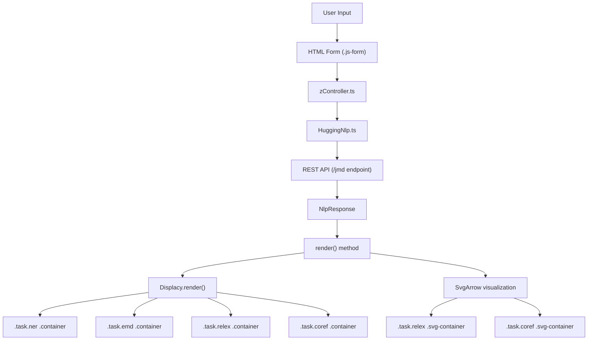
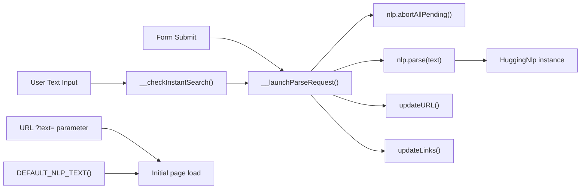
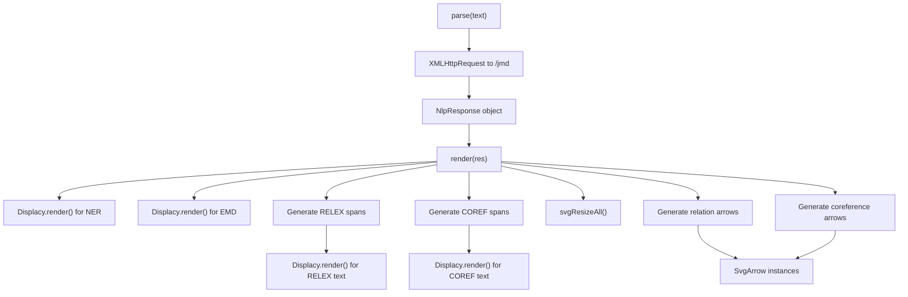
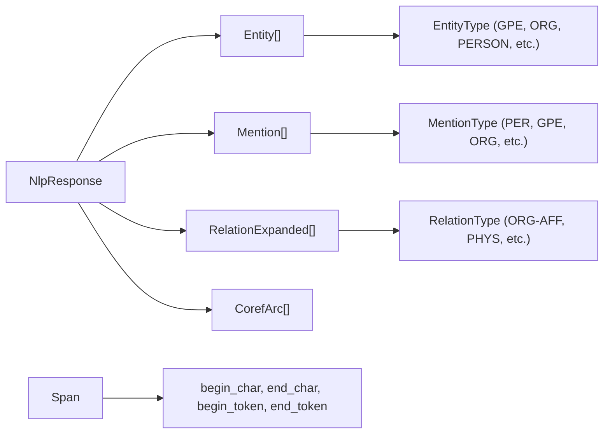
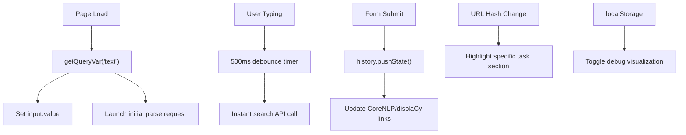

<!-- source: DeepWiki mcp.deepwiki.com · repo huggingface/hmtl · page 5.1 Web Interface · fetched 2026-10-26 -->

# Web Interface

Relevant source files

The following files were used as context for generating this wiki page:

- [demo/web/assets/thumbnail-hmtl.png](demo/web/assets/thumbnail-hmtl.png)
- [demo/web/index.html](demo/web/index.html)
- [demo/web/js-src/HuggingNlp.ts](demo/web/js-src/HuggingNlp.ts)
- [demo/web/js-src/zController.ts](demo/web/js-src/zController.ts)

The web interface provides an interactive frontend demo for the HMTL multi-task NLP model. Users can input text through a web form and view real-time visualizations of the four NLP tasks: Named Entity Recognition, Entity Mention Detection, Relation Extraction, and Coreference Resolution.

For information about the backend API that serves the web interface, see [API Backend](#5.2). For details about the web development workflow and build process, see [Web Development Setup](#5.3).

## Overview

The web interface consists of a single-page application built with TypeScript that communicates with the HMTL model via REST API calls. The interface renders task results using the Displacy visualization library for entity highlighting and custom SVG arrows for relation and coreference visualization.

### User Interface Components

The main interface elements are defined in the HTML structure:

| Component | Element | Purpose |
|-----------|---------|---------|
| Input Form | `.js-form` | Text input and submission |
| Task Containers | `.task.ner`, `.task.emd`, `.task.relex`, `.task.coref` | Display areas for each NLP task |
| SVG Overlays | `.svg-container` | Render relation arrows and coreference links |
| Navigation Links | Social sharing and external comparison tools |

## Interface Architecture

**Interface Request Flow**

Sources: [demo/web/js-src/zController.ts:1-168](), [demo/web/js-src/HuggingNlp.ts:1-235](), [demo/web/index.html:1-156]()

## Controller System

The `zController.ts` handles all user interactions and application state management:

**Controller Functions and Responsibilities**

Sources: [demo/web/js-src/zController.ts:74-168]()

### Input Handling

The controller implements several input management features:

- **Debounced Input**: Text changes trigger API calls after 500ms delay to prevent excessive requests [demo/web/js-src/zController.ts:102-115]()
- **URL State Management**: Browser URL updates with current text query for shareable links [demo/web/js-src/zController.ts:53-55]()
- **Default Text Selection**: Random example sentences provided when no input specified [demo/web/js-src/zController.ts:6-19]()

### External Integration

The interface integrates with external NLP tools for comparison:

| Service | Purpose | URL Template |
|---------|---------|--------------|
| CoreNLP | Alternative NLP processing | `corenlp.run/#text=` |
| spaCy displaCy | Entity recognition comparison | `explosion.ai/demos/displacy-ent` |

Sources: [demo/web/js-src/zController.ts:57-72](), [demo/web/index.html:116-117]()

## Visualization System

The `HuggingNlp` class manages API communication and result rendering:

**Visualization Data Flow**

Sources: [demo/web/js-src/HuggingNlp.ts:140-234]()

### Task-Specific Rendering

Each NLP task uses different visualization approaches:

**Named Entity Recognition & Entity Mention Detection**
- Direct `Displacy.render()` calls with entity spans
- Highlighted text with colored backgrounds
- Entity type labels displayed as tooltips

**Relation Extraction**
- Text highlighting for argument spans (SUBJ/OBJ)
- SVG arrow overlays connecting related entities
- Relation type labels on arrows

**Coreference Resolution**
- Cluster-based span highlighting with dots
- SVG curves connecting coreferent mentions
- Color-coded clusters for visual grouping

Sources: [demo/web/js-src/HuggingNlp.ts:167-193](), [demo/web/js-src/HuggingNlp.ts:195-232]()

## Data Types and Interfaces

The TypeScript interfaces define the structure of API responses and visualization data:

**Core Interface Definitions**

The system defines several key TypeScript interfaces for type safety:

- `Entity`, `Mention`: Extend `Span` with task-specific type fields
- `Relation`, `RelationExpanded`: Define argument positions and relation types  
- `CorefArc`: Connects two mention spans in coreference chains
- `NlpResponse`: Complete API response structure with all task results

Sources: [demo/web/js-src/HuggingNlp.ts:1-94]()

## State Management

**State Persistence Features**

Sources: [demo/web/js-src/zController.ts:92-100](), [demo/web/js-src/zController.ts:127-134](), [demo/web/js-src/zController.ts:141-165]()

The interface maintains state through:
- URL query parameters for shareable text queries
- Browser history management for back/forward navigation  
- Hash-based task highlighting for direct section links
- Local storage for debug mode preferences
- Request abortion to prevent race conditions during rapid typing

Sources: [demo/web/js-src/zController.ts:1-168](), [demo/web/js-src/HuggingNlp.ts:100-235](), [demo/web/index.html:1-156]()

---

