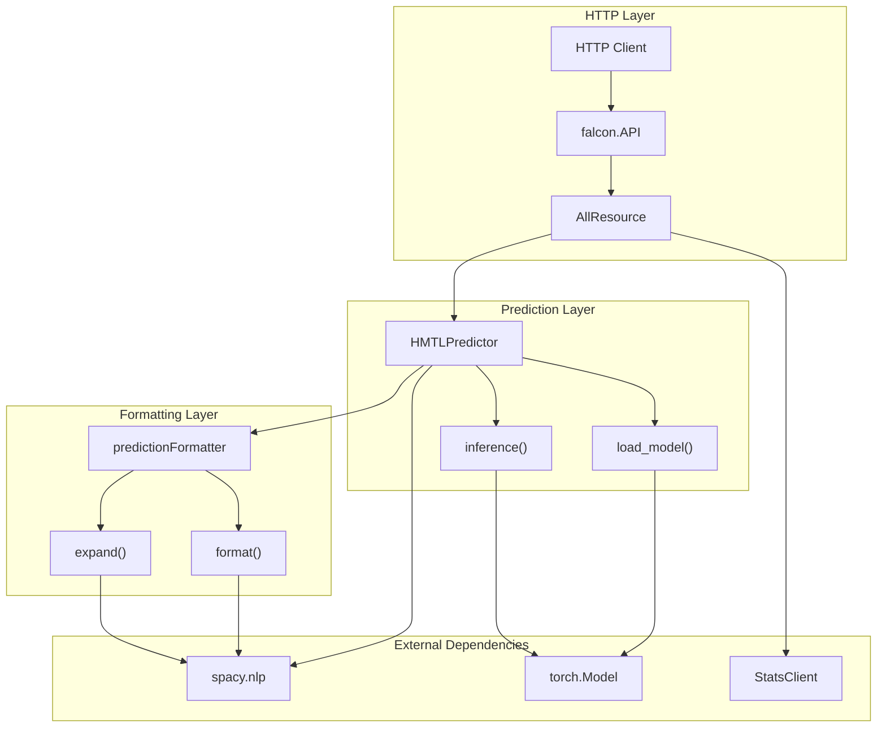
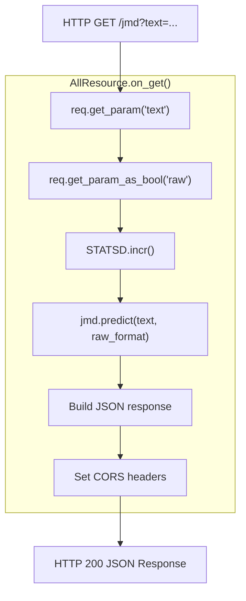
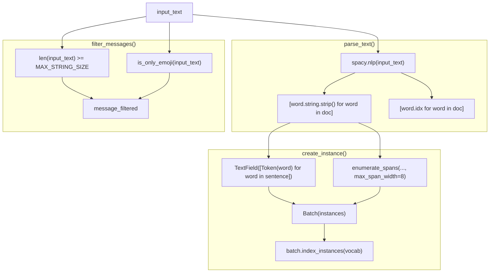
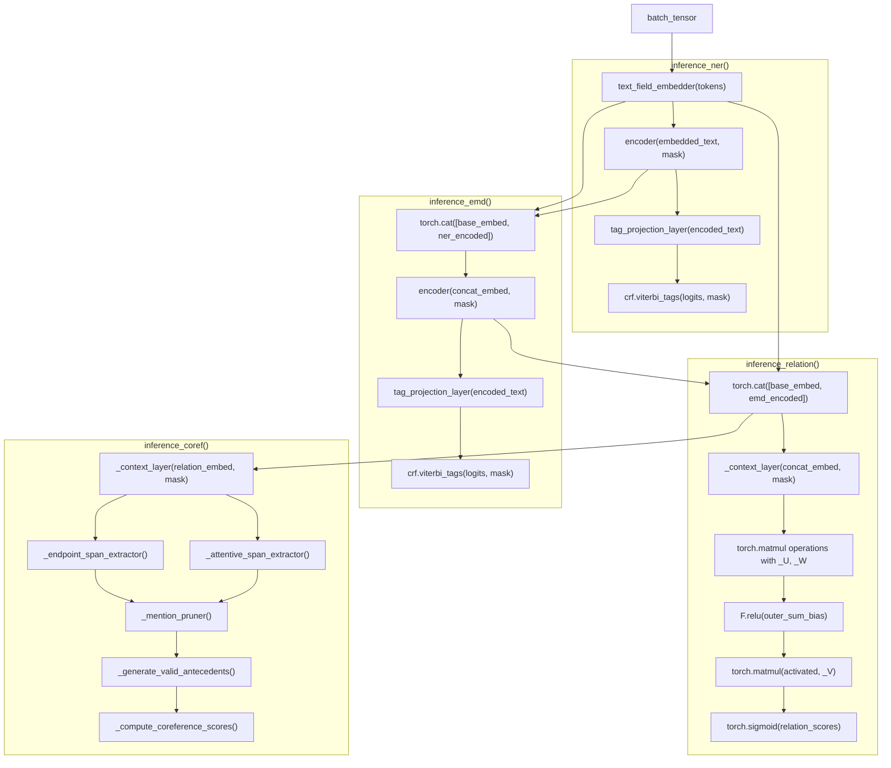
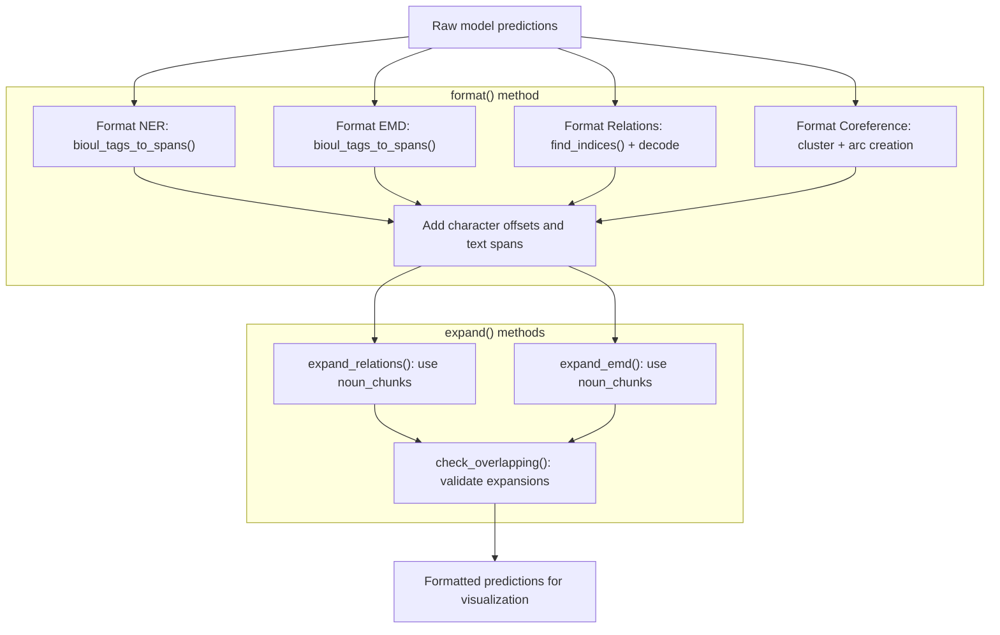

<!-- source: DeepWiki mcp.deepwiki.com · repo huggingface/hmtl · page 5.2 API Backend · fetched 2026-10-26 -->

# API Backend

Relevant source files

The following files were used as context for generating this wiki page:

- [demo/hmtlPredictor.py](demo/hmtlPredictor.py)
- [demo/predictionFormatter.py](demo/predictionFormatter.py)
- [demo/server.py](demo/server.py)

This page documents the REST API backend system that provides HTTP access to HMTL model predictions. The API backend serves as the bridge between the web interface and the core HMTL model, handling HTTP requests, running model inference, and formatting responses for visualization.

For information about the web frontend that consumes this API, see [Web Interface](#5.1). For details about the core HMTL model architecture, see [Core HMTL Model](#3).

## System Architecture

The API backend consists of three main components that work together to process text and return structured NLP predictions.

### API Backend Architecture

Sources: [demo/server.py:1-54](), [demo/hmtlPredictor.py:1-383](), [demo/predictionFormatter.py:1-237]()

## REST API Server

The REST API server is implemented using the Falcon web framework and provides a single endpoint for processing text through the HMTL model.

### Server Implementation

| Component | File | Purpose |
|-----------|------|---------|
| `AllResource` | [demo/server.py:13-46]() | Handles HTTP requests and responses |
| `build_app()` | [demo/server.py:48-54]() | Creates and configures Falcon application |
| StatsD metrics | [demo/server.py:10,23,31,38,40]() | Tracks API usage and performance |

The server exposes a single `/jmd` endpoint that accepts GET requests with a `text` parameter and optional `raw` parameter for controlling output formatting.

### Request Processing Flow

Sources: [demo/server.py:20-45]()

## HMTL Predictor

The `HMTLPredictor` class serves as the main interface for loading HMTL models and generating predictions. It handles model initialization, text preprocessing, and coordinated inference across multiple NLP tasks.

### Model Loading and Initialization

The predictor loads pre-trained HMTL models using AllenNLP's serialization system:

| Component | Purpose |
|-----------|---------|
| `load_model()` | Loads vocabulary, token indexers, and model weights |
| `Vocabulary.from_files()` | Reconstructs vocabulary from serialized files |
| `Model.from_params()` | Creates model instance from configuration |
| `torch.load()` | Loads pre-trained weights |

Models are loaded from the `model_dumps/{model_name}` directory structure, supporting three variants: `conll_small_elmo`, `conll_medium_elmo`, and `conll_full_elmo`.

Sources: [demo/hmtlPredictor.py:90-121]()

### Text Processing Pipeline

Sources: [demo/hmtlPredictor.py:346-353](), [demo/hmtlPredictor.py:54-66](), [demo/hmtlPredictor.py:69-87]()

### Multi-Task Inference Engine

The predictor implements a fast inference pipeline that processes all four NLP tasks in hierarchical order:

Sources: [demo/hmtlPredictor.py:182-213](), [demo/hmtlPredictor.py:215-232](), [demo/hmtlPredictor.py:234-249](), [demo/hmtlPredictor.py:251-280](), [demo/hmtlPredictor.py:282-337]()

## Prediction Formatting

The `predictionFormatter` class transforms raw model outputs into structured, human-readable formats suitable for web visualization.

### Core Formatting Operations

| Task | Input Format | Output Format | Key Operations |
|------|-------------|---------------|----------------|
| NER/EMD | BIOUL tags | Entity spans | `bioul_tags_to_spans()` |
| Relation | Token matrices | Relation arcs | `find_indices()` for ARG1/ARG2 |
| Coreference | Span clusters | Cluster chains and arcs | Sequential mention pairing |

### Data Transformation Pipeline

Sources: [demo/predictionFormatter.py:61-174](), [demo/predictionFormatter.py:176-198](), [demo/predictionFormatter.py:200-227](), [demo/predictionFormatter.py:229-236]()

### Entity and Relation Expansion

The formatter includes heuristic expansion capabilities that use spaCy's dependency parsing to extend predictions from head tokens to full noun phrases:

- **Relation Expansion**: Extends relation arguments from head tokens to complete noun chunks using `expand_arg()` 
- **EMD Expansion**: Expands entity mention boundaries using spaCy's `noun_chunks`
- **Overlap Detection**: `check_overlapping()` prevents invalid expansions that would create overlapping spans

Sources: [demo/predictionFormatter.py:14-31](), [demo/predictionFormatter.py:33-50](), [demo/predictionFormatter.py:176-198](), [demo/predictionFormatter.py:200-227]()

## Configuration and Error Handling

### Model Configuration

The system supports three pre-trained model variants with different ELMo configurations:

- `conll_small_elmo`: Lightweight model for faster inference
- `conll_medium_elmo`: Balanced performance and accuracy  
- `conll_full_elmo`: Full-scale model for maximum accuracy

Models are loaded from `model_dumps/{model_name}/` directories containing `config.json`, `vocabulary/`, and `weights.th` files.

### Input Filtering and Fallbacks

The system implements several safety mechanisms:

| Filter | Condition | Action |
|--------|-----------|--------|
| Length filter | `len(input_text) >= 500` | Return fallback response |
| Emoji filter | `is_only_emoji(input_text)` | Return fallback response |
| Short sentence | `len(tokens) < 3` | Skip coreference task |

Filtered messages receive a `fallback_prediction()` with empty task results but maintain API response structure.

Sources: [demo/hmtlPredictor.py:54-66](), [demo/hmtlPredictor.py:355-367](), [demo/hmtlPredictor.py:148-169]()

---

