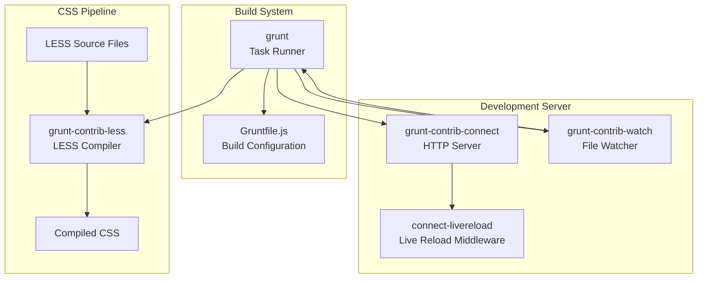
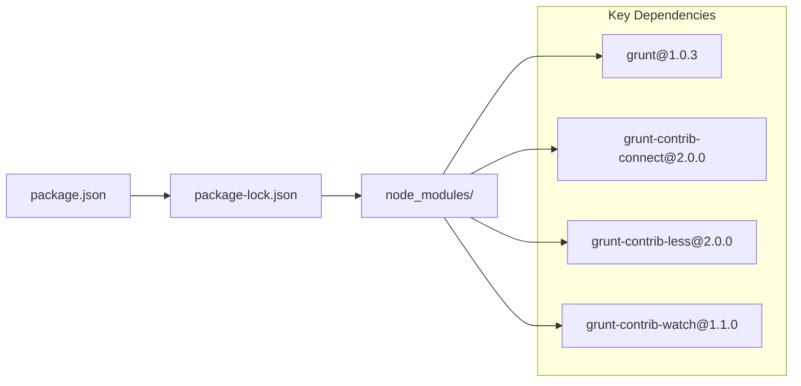
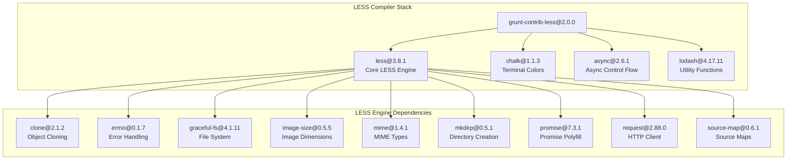
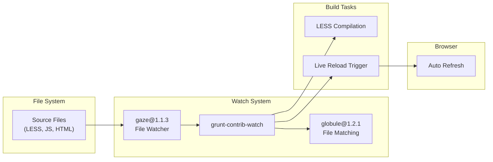
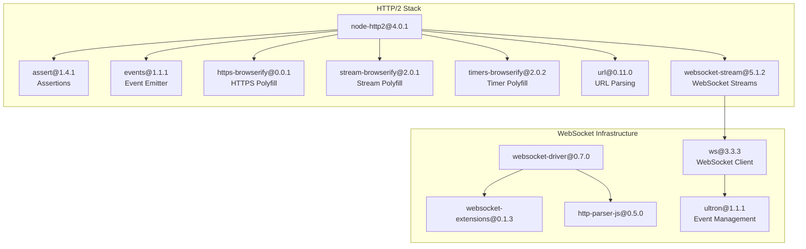

<!-- source: DeepWiki mcp.deepwiki.com · repo huggingface/hmtl · page 5.3 Web Development Setup · fetched 2026-10-26 -->

# Web Development Setup

Relevant source files

The following files were used as context for generating this wiki page:

- [demo/web/package-lock.json](demo/web/package-lock.json)
- [demo/web/package.json](demo/web/package.json)

This document covers the frontend development workflow and build system for the HMTL demo application. It focuses on the Node.js-based toolchain used for CSS preprocessing, development server setup, and live reloading during development.

For information about the web interface components and UI structure, see [Web Interface](#5.1). For details about the backend API that serves the web application, see [API Backend](#5.2).

## Development Stack Overview

The web development setup uses a Node.js-based build system centered around Grunt as the task runner. The primary development workflow involves LESS preprocessing for CSS, a local development server, and live reload functionality for rapid iteration.

**Core Development Stack:**

Sources: [demo/web/package.json:1-18]()

## Package Dependencies

The development setup is configured through npm with specific Grunt plugins handling different aspects of the build process.

| Package | Version | Purpose |
|---------|---------|---------|
| `grunt` | ^1.0.3 | Core task runner and build orchestration |
| `grunt-contrib-connect` | ^2.0.0 | Local HTTP server for development |
| `grunt-contrib-less` | ^2.0.0 | LESS to CSS compilation |
| `grunt-contrib-watch` | ^1.1.0 | File watching and automatic task execution |

**Dependency Resolution Flow:**

Sources: [demo/web/package.json:11-16](), [demo/web/package-lock.json:632-654]()

## LESS CSS Preprocessing

The `grunt-contrib-less` plugin handles compilation of LESS stylesheets to CSS. This plugin provides CSS preprocessing capabilities including variables, mixins, and nested rules.

**LESS Compilation Dependencies:**

Sources: [demo/web/package-lock.json:695-714](), [demo/web/package-lock.json:1023-1037]()

## Development Server and Live Reload

The development server setup combines `grunt-contrib-connect` for serving static files with live reload functionality for automatic browser refresh during development.

**Development Server Architecture:**

```mermaid
graph TB
    subgraph "HTTP Server Stack"
        gruntconnect["grunt-contrib-connect@2.0.0"]
        connect249["connect@3.6.6<br/>HTTP Server Framework"]
        connectlr275["connect-livereload@0.6.0<br/>Live Reload Middleware"]
        morgan1143["morgan@1.9.1<br/>HTTP Logger"]
        serveindex1562["serve-index@1.9.1<br/>Directory Listings"]
        servestatic1591["serve-static@1.13.2<br/>Static File Server"]
    end
    
    subgraph "Live Reload System"
        gruntwatch716["grunt-contrib-watch@1.1.0"]
        gaze562["gaze@1.1.3<br/>File Watching"]
        tinylr1739["tiny-lr@1.1.1<br/>Live Reload Server"]
        livereloadjs1039["livereload-js@2.4.0<br/>Client Script"]
        fayewebsocket467["faye-websocket@0.10.0<br/>WebSocket Support"]
    end
    
    subgraph "Support Libraries"
        async686["async@2.6.1<br/>Control Flow"]
        lodash1056["lodash@4.17.11<br/>Utilities"]
        portscanner1319["portscanner@2.2.0<br/>Port Detection"]
        opn1251["opn@5.4.0<br/>Browser Opening"]
    end
    
    gruntconnect --> connect249
    gruntconnect --> connectlr275
    gruntconnect --> morgan1143
    gruntconnect --> serveindex1562
    gruntconnect --> servestatic1591
    gruntconnect --> async686
    gruntconnect --> portscanner1319
    gruntconnect --> opn1251
    
    gruntwatch --> gaze562
    gruntwatch --> async686
    gruntwatch --> lodash1056
    gruntwatch --> tinylr1739
    
    tinylr1739 --> livereloadjs1039
    tinylr1739 --> fayewebsocket467
```

Sources: [demo/web/package-lock.json:669-693](), [demo/web/package-lock.json:716-735](), [demo/web/package-lock.json:1739-1750]()

## File Watching and Task Automation

The `grunt-contrib-watch` plugin monitors file changes and triggers appropriate build tasks automatically. It integrates with the `gaze` library for efficient file system watching and `tiny-lr` for live reload functionality.

**File Watching Flow:**

Sources: [demo/web/package-lock.json:562-568](), [demo/web/package-lock.json:602-625]()

## HTTP/2 and WebSocket Support

The development server includes HTTP/2 support through `node-http2` and WebSocket capabilities for live reload functionality.

**Network Protocol Support:**

Sources: [demo/web/package-lock.json:1180-1193](), [demo/web/package-lock.json:1885-1892](), [demo/web/package-lock.json:1925-1933]()

---

