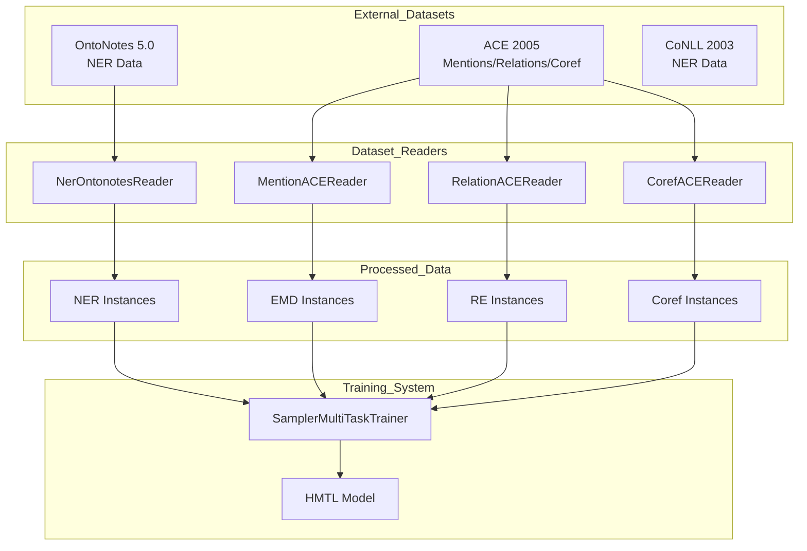
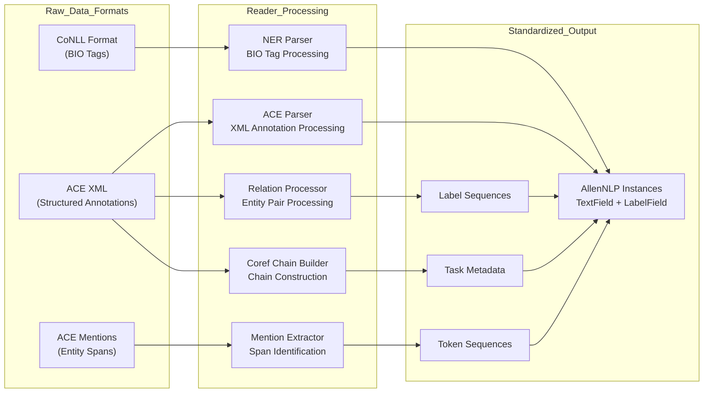

<!-- source: DeepWiki mcp.deepwiki.com · repo huggingface/hmtl · page 6 Dataset Readers · fetched 2026-10-26 -->

# Dataset Readers

Relevant source files

The following files were used as context for generating this wiki page:

- [hmtl/dataset_readers/__init__.py](hmtl/dataset_readers/__init__.py)

## Purpose and Scope

The Dataset Readers module provides the data loading and preprocessing infrastructure for the HMTL multi-task learning system. This module handles the conversion of various NLP datasets into a standardized format that can be consumed by the HMTL model for training and evaluation. The readers support four primary NLP tasks: Named Entity Recognition (NER), Entity Mention Detection (EMD), Relation Extraction (RE), and Coreference Resolution.

For detailed implementation of specific dataset readers, see [ACE Dataset Readers](#6.1) and [OntoNotes Readers](#6.2). For core parsing utilities, see [Dataset Utilities](#6.3). For information about how these readers integrate with the training system, see [Multi-Task Training](#4.1).

## Dataset Reader Architecture

The dataset readers form a crucial component of the HMTL training pipeline, serving as the bridge between raw dataset files and the model's input format. Each reader is specialized for a specific dataset format and NLP task combination.

**Dataset Reader System Overview**

Sources: [hmtl/dataset_readers/__init__.py:1-7]()

## Core Dataset Readers

The HMTL system includes four primary dataset readers, each designed to handle specific NLP tasks and dataset formats:

| Reader Class | Dataset | Task | Purpose |
|--------------|---------|------|---------|
| `NerOntonotesReader` | OntoNotes 5.0 | Named Entity Recognition | Processes CoNLL-formatted NER annotations |
| `MentionACEReader` | ACE 2005 | Entity Mention Detection | Extracts entity mentions from ACE corpus |
| `RelationACEReader` | ACE 2005 | Relation Extraction | Processes entity relations from ACE data |
| `CorefACEReader` | ACE 2005 | Coreference Resolution | Handles coreference chain annotations |

### Task-Specific Processing

Each dataset reader implements task-specific preprocessing logic to convert raw annotations into standardized instances that the HMTL model can process:

**Data Processing Pipeline**

Sources: [hmtl/dataset_readers/__init__.py:3-6]()

## Integration with Multi-Task Training

The dataset readers are designed to integrate seamlessly with the `SamplerMultiTaskTrainer`, which coordinates training across multiple tasks. Each reader produces instances that are compatible with the HMTL model's hierarchical architecture:

### Data Flow in Training

1. **Dataset Loading**: Each reader loads and parses its respective dataset format
2. **Instance Creation**: Raw data is converted to AllenNLP `Instance` objects with appropriate fields
3. **Task Sampling**: The multi-task trainer samples from different readers based on the configured sampling strategy
4. **Batch Formation**: Instances from different tasks are batched together for multi-task training
5. **Model Input**: Batched instances are fed to the HMTL model for hierarchical processing

### Reader Registration

All dataset readers are registered in the module's `__init__.py` file, making them available for configuration-driven instantiation during training setup. This registration pattern allows the training system to dynamically load the appropriate readers based on the training configuration.

Sources: [hmtl/dataset_readers/__init__.py:1-7]()

## Dataset Reader Interface

Each dataset reader follows the AllenNLP `DatasetReader` interface pattern, implementing standardized methods for data loading and processing:

- **File Reading**: Methods to parse dataset files in various formats (CoNLL, XML, etc.)
- **Instance Generation**: Conversion of raw annotations to structured AllenNLP instances
- **Field Creation**: Construction of appropriate field types (`TextField`, `LabelField`, etc.)
- **Metadata Handling**: Preservation of task-specific metadata for evaluation and analysis

The modular design allows for easy extension to support additional datasets and tasks while maintaining compatibility with the existing multi-task training infrastructure.

Sources: [hmtl/dataset_readers/__init__.py:3-6]()

---

