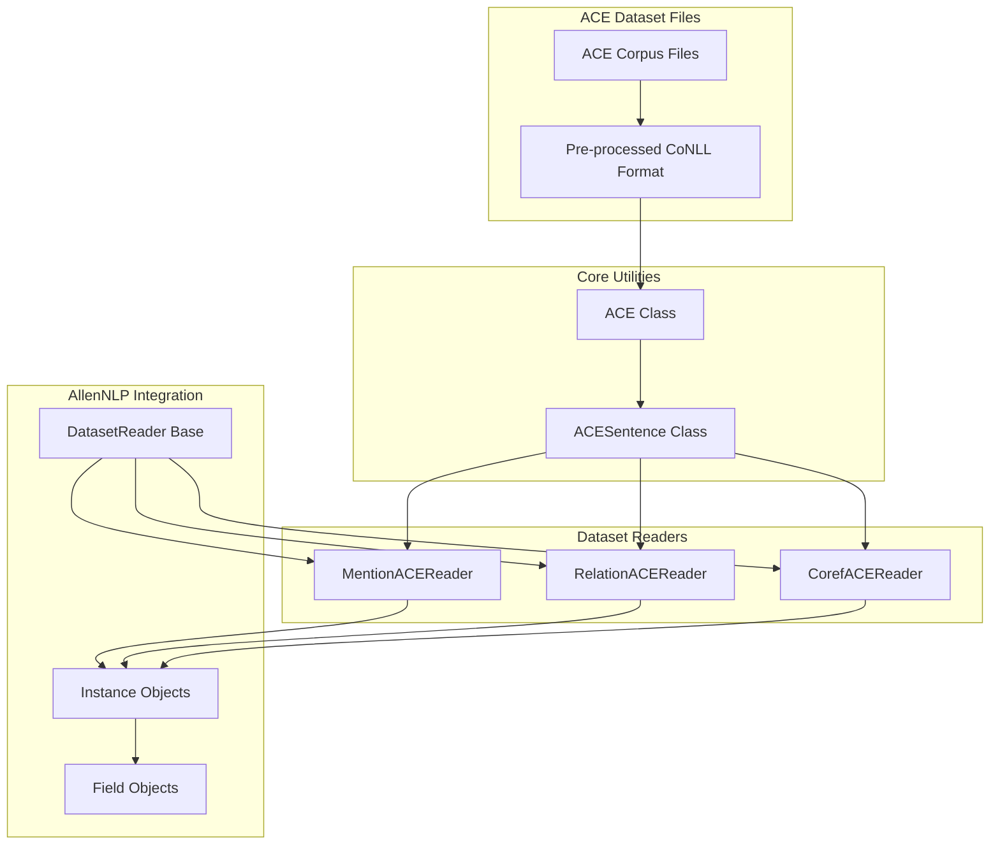
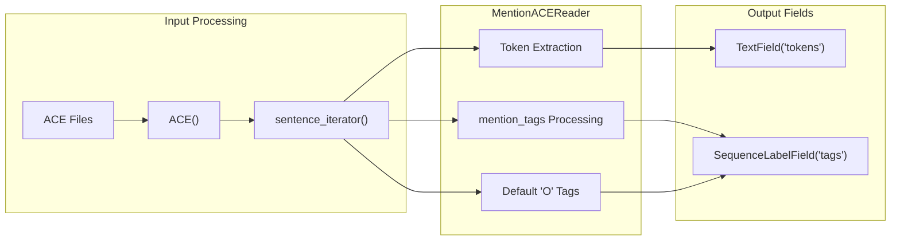
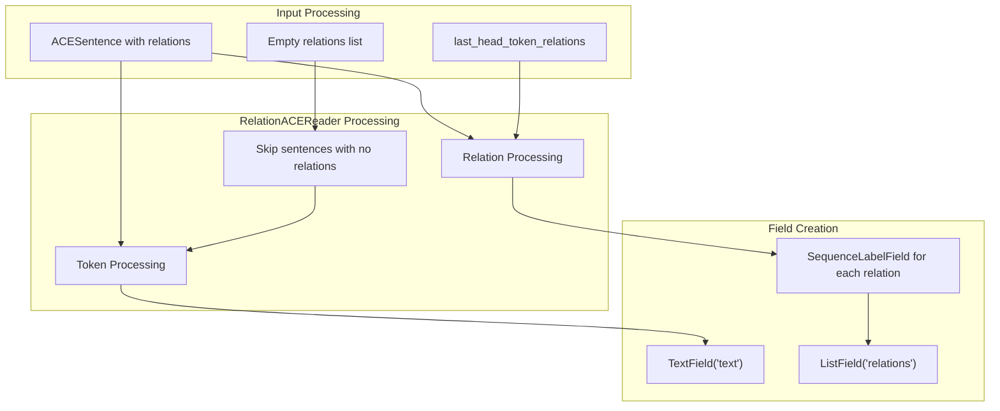
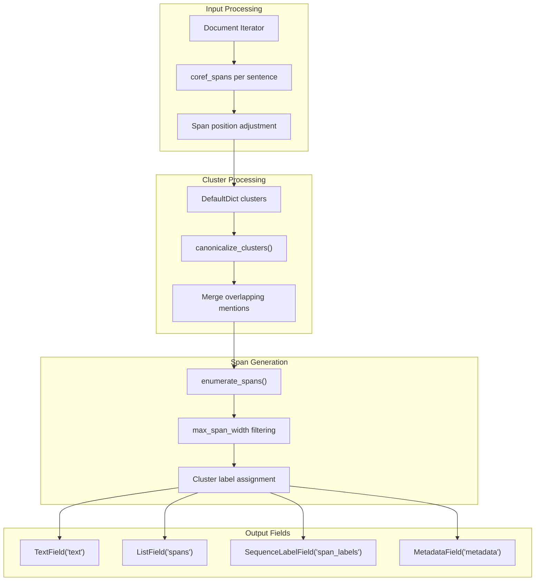
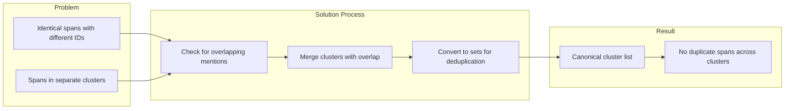

<!-- source: DeepWiki mcp.deepwiki.com · repo huggingface/hmtl · page 6.1 ACE Dataset Readers · fetched 2026-10-26 -->

# ACE Dataset Readers

Relevant source files

The following files were used as context for generating this wiki page:

- [hmtl/dataset_readers/coref_ace.py](hmtl/dataset_readers/coref_ace.py)
- [hmtl/dataset_readers/mention_ace.py](hmtl/dataset_readers/mention_ace.py)
- [hmtl/dataset_readers/relation_ace.py](hmtl/dataset_readers/relation_ace.py)

This document covers the three specialized dataset readers for processing ACE (Automatic Content Extraction) corpus data within the HMTL system. These readers handle entity mention detection, relation extraction, and coreference resolution tasks by converting ACE-formatted data into AllenNLP instances.

For general dataset utilities and CoNLL parsing, see [Dataset Utilities](#6.3). For OntoNotes-specific readers, see [OntoNotes Readers](#6.2).

## Overview

The ACE dataset readers provide task-specific data loading for three of the four NLP tasks in the HMTL pipeline. Each reader processes ACE corpus data that has been pre-processed into CoNLL-style formats while maintaining the original ACE annotation structure.

### Reader Architecture

**Sources:** [hmtl/dataset_readers/mention_ace.py:1-72](), [hmtl/dataset_readers/relation_ace.py:1-80](), [hmtl/dataset_readers/coref_ace.py:1-172]()

### Reader Registration

Each reader is registered with AllenNLP using the `@DatasetReader.register()` decoration:

| Reader Class | Registration Name | Task | Input Format |
|--------------|------------------|------|--------------|
| `MentionACEReader` | `"mention_ace"` | Entity Mention Detection | CoNLL-NER format |
| `RelationACEReader` | `"relation_ace"` | Relation Extraction | CoNLL-SRL format |
| `CorefACEReader` | `"coref_ace"` | Coreference Resolution | CoNLL-coreference format |

**Sources:** [hmtl/dataset_readers/mention_ace.py:25](), [hmtl/dataset_readers/relation_ace.py:27](), [hmtl/dataset_readers/coref_ace.py:55]()

## Entity Mention Detection Reader

### MentionACEReader Class

The `MentionACEReader` processes entity mention annotations from ACE data converted to CoNLL-NER format. It creates simple token-tag pairs for sequence labeling.

**Sources:** [hmtl/dataset_readers/mention_ace.py:25-72]()

### Key Implementation Details

The reader implements these core methods:

- `_sentence_iterate()`: Static method that yields `ACESentence` objects from ACE files [hmtl/dataset_readers/mention_ace.py:43-46]()
- `_read()`: Main reading method that processes each sentence and yields instances [hmtl/dataset_readers/mention_ace.py:48-61]()
- `text_to_instance()`: Converts tokens and tags into AllenNLP `Instance` objects [hmtl/dataset_readers/mention_ace.py:62-71]()

For sentences without mention annotations, the reader defaults to "O" (Outside) tags for all tokens [hmtl/dataset_readers/mention_ace.py:55-58]().

**Sources:** [hmtl/dataset_readers/mention_ace.py:43-71]()

## Relation Extraction Reader

### RelationACEReader Class

The `RelationACEReader` processes relation annotations from ACE data converted to CoNLL-SRL format. It handles multiple relation types per sentence using `ListField` containers.

**Sources:** [hmtl/dataset_readers/relation_ace.py:27-80]()

### Relation Processing Logic

The reader implements specific logic for handling multiple relations:

1. **Sentence filtering**: Sentences with empty `relations` lists are skipped [hmtl/dataset_readers/relation_ace.py:58-63]()
2. **Multi-relation handling**: Uses `last_head_token_relations` attribute from `ACESentence` [hmtl/dataset_readers/relation_ace.py:62]()
3. **Field structure**: Creates a `ListField` containing multiple `SequenceLabelField` objects, one per relation [hmtl/dataset_readers/relation_ace.py:71-78]()

**Sources:** [hmtl/dataset_readers/relation_ace.py:55-79]()

## Coreference Resolution Reader

### CorefACEReader Class

The `CorefACEReader` is the most complex ACE reader, processing coreference clusters and generating candidate spans for coreference resolution.

**Sources:** [hmtl/dataset_readers/coref_ace.py:55-172]()

### Cluster Canonicalization

The `canonicalize_clusters()` function handles a key data quality issue in coreference annotations:

**Sources:** [hmtl/dataset_readers/coref_ace.py:23-53]()

### Span Processing Details

The coreference reader implements sophisticated span processing:

1. **Multi-sentence coordination**: Adjusts span positions across sentence boundaries [hmtl/dataset_readers/coref_ace.py:88-94]()
2. **Candidate span generation**: Uses `enumerate_spans()` with `max_span_width` constraint [hmtl/dataset_readers/coref_ace.py:147]()
3. **Label assignment**: Maps spans to cluster IDs or -1 for non-coreferent spans [hmtl/dataset_readers/coref_ace.py:148-152]()
4. **Text normalization**: Handles special punctuation cases like "/." and "/?" [hmtl/dataset_readers/coref_ace.py:167-171]()

**Sources:** [hmtl/dataset_readers/coref_ace.py:88-171]()

## Common Patterns and Utilities

### Shared Dependencies

All ACE readers share common dependencies and patterns:

| Component | Usage | Import |
|-----------|--------|---------|
| `ACE` class | Core ACE data parsing | `from hmtl.dataset_readers.dataset_utils import ACE` |
| `ACESentence` | Sentence-level data structure | `from hmtl.dataset_readers.dataset_utils import ACE, ACESentence` |
| `cached_path` | URL/path handling | `from allennlp.common.file_utils import cached_path` |
| `DatasetReader` | Base class and registration | `from allennlp.data.dataset_readers.dataset_reader import DatasetReader` |

**Sources:** [hmtl/dataset_readers/mention_ace.py:18-20](), [hmtl/dataset_readers/relation_ace.py:18-20](), [hmtl/dataset_readers/coref_ace.py:18]()

### Configuration Parameters

Each reader accepts standard AllenNLP configuration parameters:

- `token_indexers`: Dictionary mapping indexer names to `TokenIndexer` instances
- `lazy`: Boolean flag for lazy loading (default: `False`)
- `label_namespace`: Custom namespace for labels (mention and relation readers only)
- `max_span_width`: Maximum candidate span width (coreference reader only)

**Sources:** [hmtl/dataset_readers/mention_ace.py:32-40](), [hmtl/dataset_readers/relation_ace.py:34-42](), [hmtl/dataset_readers/coref_ace.py:72-75]()

---

