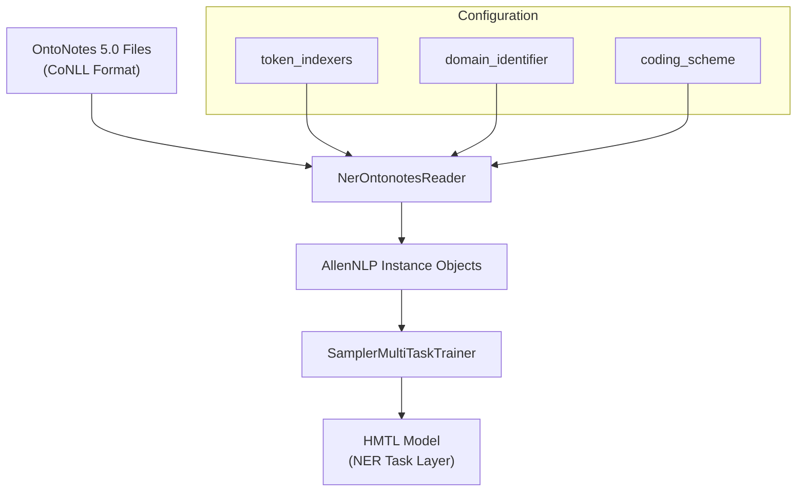
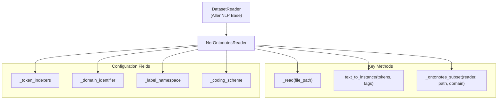
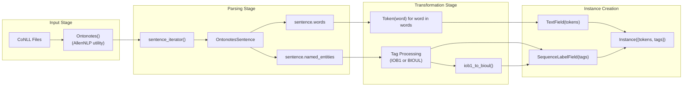

<!-- source: DeepWiki mcp.deepwiki.com · repo huggingface/hmtl · page 6.2 OntoNotes Readers · fetched 2026-10-26 -->

# OntoNotes Readers

Relevant source files

The following files were used as context for generating this wiki page:

- [hmtl/dataset_readers/ner_ontonotes.py](hmtl/dataset_readers/ner_ontonotes.py)

This document covers the OntoNotes dataset reader implementation in the HMTL system, specifically designed for processing named entity recognition (NER) annotations from the OntoNotes 5.0 corpus. The reader converts CoNLL-formatted OntoNotes data into AllenNLP `Instance` objects for training and evaluation of the NER task component.

For information about other dataset readers in the system, see [ACE Dataset Readers](#6.1) and [Dataset Utilities](#6.3).

## System Architecture

The OntoNotes reader integrates with the broader HMTL training pipeline as a specialized data loader for the NER task. It serves as the bridge between raw OntoNotes corpus files and the multi-task learning framework.

Sources: [hmtl/dataset_readers/ner_ontonotes.py:1-107]()

## NerOntonotesReader Class

The `NerOntonotesReader` class is registered as `"ner_ontonotes"` in the AllenNLP dataset reader registry and extends the base `DatasetReader` class. It implements the standard AllenNLP dataset reader interface for processing OntoNotes NER data.

### Class Structure

Sources: [hmtl/dataset_readers/ner_ontonotes.py:23-68]()

### Configuration Parameters

| Parameter | Type | Default | Description |
|-----------|------|---------|-------------|
| `token_indexers` | `Dict[str, TokenIndexer]` | `{"tokens": SingleIdTokenIndexer()}` | Defines input text representation mapping |
| `domain_identifier` | `str` | `None` | Optional subdomain filter (e.g., "nw" for newswire) |
| `label_namespace` | `str` | `"ontonotes_ner_labels"` | Namespace for NER tag vocabulary |
| `lazy` | `bool` | `False` | Whether to load dataset lazily |
| `coding_scheme` | `str` | `"IOB1"` | Tag encoding scheme (`IOB1` or `BIOUL`) |

Sources: [hmtl/dataset_readers/ner_ontonotes.py:34-52]()

## Data Processing Flow

The reader processes OntoNotes data through a multi-stage pipeline that converts raw CoNLL files into structured AllenNLP instances.

### Processing Pipeline

Sources: [hmtl/dataset_readers/ner_ontonotes.py:70-88](), [hmtl/dataset_readers/ner_ontonotes.py:97-106]()

### Core Processing Methods

The `_read` method implements the main processing logic:

1. **File Path Resolution**: Uses `cached_path()` to handle both local files and URLs [hmtl/dataset_readers/ner_ontonotes.py:72]()
2. **OntoNotes Reader Initialization**: Creates `Ontonotes()` instance for parsing [hmtl/dataset_readers/ner_ontonotes.py:73]()
3. **Sentence Iteration**: Processes each sentence through `_ontonotes_subset()` [hmtl/dataset_readers/ner_ontonotes.py:78]()
4. **Token and Tag Extraction**: Converts words to `Token` objects and extracts NER tags [hmtl/dataset_readers/ner_ontonotes.py:79-83]()
5. **Coding Scheme Conversion**: Optionally converts IOB1 to BIOUL format [hmtl/dataset_readers/ner_ontonotes.py:85-86]()
6. **Instance Generation**: Creates AllenNLP instances via `text_to_instance()` [hmtl/dataset_readers/ner_ontonotes.py:88]()

The `text_to_instance` method creates the final structured representation:
- **TextField**: Contains tokenized text with specified indexers [hmtl/dataset_readers/ner_ontonotes.py:100-101]()
- **SequenceLabelField**: Contains NER tags aligned with tokens [hmtl/dataset_readers/ner_ontonotes.py:103-105]()

Sources: [hmtl/dataset_readers/ner_ontonotes.py:70-88](), [hmtl/dataset_readers/ner_ontonotes.py:97-106]()

## Tag Encoding Support

The reader supports two standard BIO tag encoding schemes for named entity recognition:

### IOB1 Scheme (Default)
- **I**: Token inside a named entity span
- **O**: Token outside any named entity span  
- **B**: Beginning of a span immediately following another span of the same type

### BIOUL Scheme
- **B**: Beginning of entity
- **I**: Inside entity (continuation)
- **O**: Outside entity
- **U**: Unit entity (single token)
- **L**: Last token of entity

The conversion from IOB1 to BIOUL is handled by AllenNLP's `iob1_to_bioul()` utility function when `coding_scheme="BIOUL"` is specified.

Sources: [hmtl/dataset_readers/ner_ontonotes.py:45-51](), [hmtl/dataset_readers/ner_ontonotes.py:85-86]()

## Domain Filtering

The reader supports optional domain-specific filtering through the `domain_identifier` parameter. When specified, only OntoNotes files containing the domain identifier in their path are processed. This enables training on specific text genres such as:

- Newswire (`"nw"`)
- Broadcast news (`"bn"`)
- Broadcast conversation (`"bc"`)
- Telephone conversation (`"tc"`)
- Web blogs (`"wb"`)
- Magazine (`"mz"`)

The filtering is implemented in the `_ontonotes_subset` static method which iterates through all CoNLL files and yields sentences from matching domains.

Sources: [hmtl/dataset_readers/ner_ontonotes.py:37-38](), [hmtl/dataset_readers/ner_ontonotes.py:75-76](), [hmtl/dataset_readers/ner_ontonotes.py:90-95]()

## Integration with HMTL Training

The OntoNotes reader integrates with the broader HMTL system through the multi-task training framework. It is typically configured in training configuration files and used by the `SamplerMultiTaskTrainer` to provide NER training data alongside other task-specific readers.

The reader's output instances are compatible with the NER task layer in the HMTL model, providing the necessary `"tokens"` and `"tags"` fields for sequence labeling training and evaluation.

Sources: [hmtl/dataset_readers/ner_ontonotes.py:23]()

---

