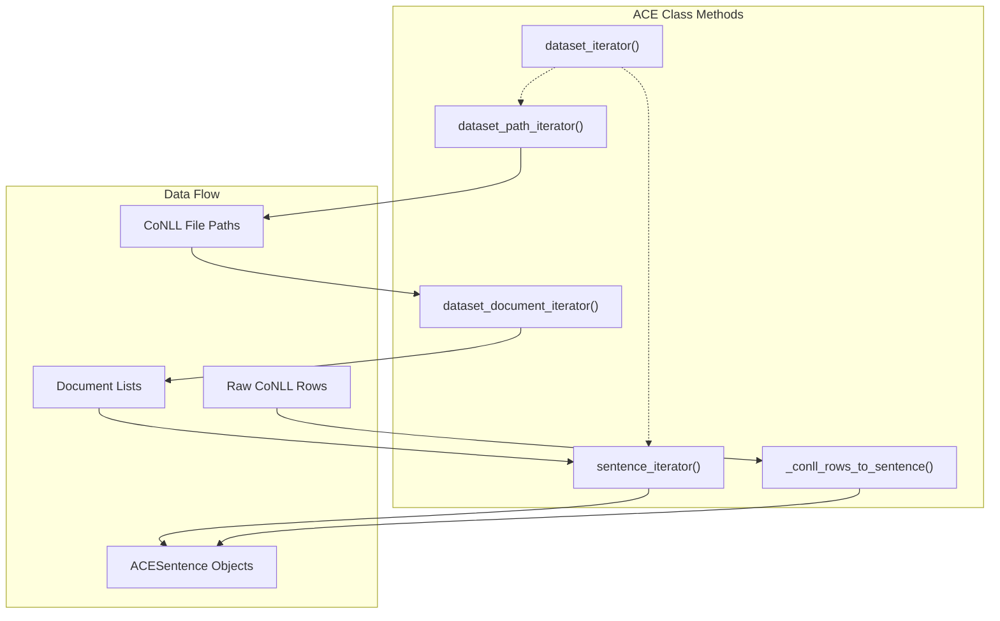
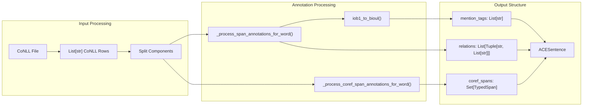

<!-- source: DeepWiki mcp.deepwiki.com · repo huggingface/hmtl · page 6.3 Dataset Utilities · fetched 2026-10-26 -->

# Dataset Utilities

<details>
<summary>Relevant source files</summary>

The following files were used as context for generating this wiki page:

- [hmtl/dataset_readers/dataset_utils/__init__.py](hmtl/dataset_readers/dataset_utils/__init__.py)
- [hmtl/dataset_readers/dataset_utils/ace.py](hmtl/dataset_readers/dataset_utils/ace.py)

</details>


This page documents the core utilities for parsing CoNLL-formatted data and managing dataset iterations in the HMTL system. These utilities provide the foundational data structures and parsing logic that underlie the ACE dataset readers.

For information about the higher-level dataset readers that use these utilities, see [ACE Dataset Readers](#6.1) and [OntoNotes Readers](#6.2).

## Purpose and Scope

The dataset utilities module provides low-level parsing and iteration functionality for ACE corpus data formatted in CoNLL-style files. The primary components are:

- `ACESentence` class for representing structured sentence annotations
- `ACE` class for parsing CoNLL files and providing various iteration methods
- Parsing logic for entity mentions, relations, and coreference chains

## Core Data Structures

### ACESentence Class

The `ACESentence` class represents all annotations available for a single sentence in ACE CoNLL format. It encapsulates five types of linguistic annotations:

| Field | Type | Description |
|-------|------|-------------|
| `words` | `List[str]` | Tokenized words from the sentence |
| `mention_tags` | `List[str]` | BIO tags for Entity Mention Detection |
| `relations` | `List[Tuple[str, List[str]]]` | Relation tags for Relation Extraction |
| `last_head_token_relations` | `List[Tuple[str, List[str]]]` | Relation tags between last tokens of ARG1/ARG2 heads |
| `coref_spans` | `Set[TypedSpan]` | Spans for coreference resolution with cluster IDs |

The coreference spans use `TypedSpan` tuples in the format `(cluster_id, (start_index, end_index))` where indices are inclusive.

Sources: [hmtl/dataset_readers/dataset_utils/ace.py:19-52]()

### ACE Class

The `ACE` class provides the main interface for reading and parsing ACE dataset files. It implements multiple iteration patterns to support different access needs:



**ACE Class Iterator Methods and Data Processing Flow**

Sources: [hmtl/dataset_readers/dataset_utils/ace.py:54-114]()

## Data Processing Pipeline

The parsing pipeline transforms raw CoNLL-formatted text into structured `ACESentence` objects through several processing stages:



**CoNLL Parsing Pipeline with Processing Methods**

Sources: [hmtl/dataset_readers/dataset_utils/ace.py:115-169]()

## Iterator Methods

The `ACE` class provides four iterator methods for different access patterns:

### Dataset Iterator
`dataset_iterator(file_path: str) -> Iterator[ACESentence]` provides a complete iteration over all sentences in a dataset directory. It combines path iteration with sentence iteration.

### Path Iterator  
`dataset_path_iterator(file_path: str) -> Iterator[str]` walks through directory structure and yields paths to files ending with `"like_conll"` suffix.

### Document Iterator
`dataset_document_iterator(file_path: str) -> Iterator[List[ACESentence]]` processes individual files and yields complete documents as lists of sentences. Documents are delimited by `"#end document"` markers.

### Sentence Iterator
`sentence_iterator(file_path: str) -> Iterator[ACESentence]` flattens document structure to yield individual sentences from a single file.

Sources: [hmtl/dataset_readers/dataset_utils/ace.py:61-113]()

## Annotation Processing

### Span Annotation Processing

The `_process_span_annotations_for_word()` method converts CoNLL-style bracketed annotations into BIO tags. It maintains state across words using `current_span_labels` to track open spans:

- `"("` indicates span beginning → generates `"B-"` tag
- Continuation within span → generates `"I-"` tag  
- `")"` indicates span end → resets current span
- Outside spans → generates `"O"` tag

### Coreference Processing

The `_process_coref_span_annotations_for_word()` method handles nested and overlapping coreference spans using cluster stacks:

- `coref_stacks` tracks open spans for each cluster ID
- `clusters` stores completed spans as `(start_index, end_index)` tuples
- Supports single-word spans: `"(ID)"` format
- Supports multi-word spans: `"(ID"` to start, `"ID)"` to end
- Pipe-separated segments handle overlapping spans

### Relation Processing

Relations are processed in two formats:
1. **Standard BIOUL format**: Full BIO tag sequences for relation extraction
2. **Last head token format**: Only the final token of entity heads marked with relation labels, with intermediate tokens marked as `"*"`

The last head token format follows the paper's approach of modeling relations between the final tokens of entity mention heads.

Sources: [hmtl/dataset_readers/dataset_utils/ace.py:171-283]()

## Module Interface

The module exports two main classes through its `__init__.py`:

```python
from hmtl.dataset_readers.dataset_utils.ace import ACE, ACESentence
```

This provides a clean interface for higher-level dataset readers to import the core parsing functionality.

Sources: [hmtl/dataset_readers/dataset_utils/__init__.py:1-4]()

---

