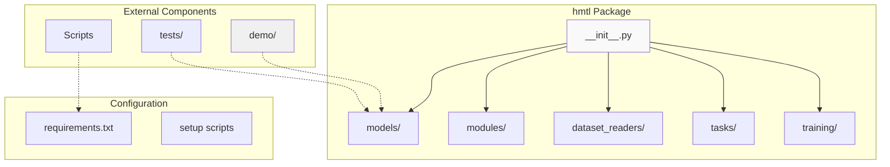
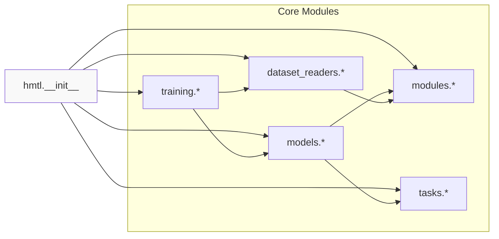
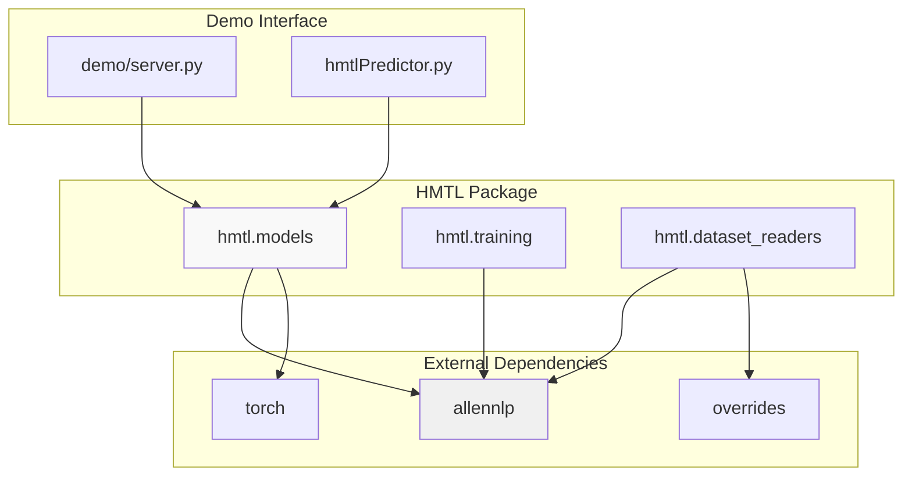

<!-- source: DeepWiki mcp.deepwiki.com · repo huggingface/hmtl · page 7 Package Structure · fetched 2026-10-26 -->

# Package Structure

Relevant source files

The following files were used as context for generating this wiki page:

- [hmtl/__init__.py](hmtl/__init__.py)

This document provides an overview of the HMTL codebase organization and module interfaces. It covers the main Python package structure, how the different modules relate to each other, and the primary interfaces for accessing HMTL functionality.

For detailed information about specific components, see [Core HMTL Model](#3) for model architecture, [Training System](#4) for the multi-task training infrastructure, [Dataset Readers](#6) for data loading components, and [Demo Application](#5) for the web interface.

## Package Organization Overview

The HMTL codebase is organized into a main Python package `hmtl` with several core modules, plus external components for demonstration and setup.

**High-Level Package Structure**

Sources: [hmtl/__init__.py:1-8]()

## Core Module Structure

The main `hmtl` package exposes five primary modules through its initialization file, each serving distinct roles in the hierarchical multi-task learning system.

| Module | Purpose | Key Components |
|--------|---------|----------------|
| `models` | Core HMTL model implementations | Multi-task model, task-specific layers |
| `modules` | Shared neural network components | Embedders, encoders, utilities |
| `dataset_readers` | Data loading and preprocessing | ACE readers, OntoNotes readers, CoNLL parsers |
| `tasks` | Task definitions and configurations | NER, EMD, RE, coreference task specs |
| `training` | Multi-task training infrastructure | Sampler trainer, evaluation, optimization |

**Module Import Dependencies**

Sources: [hmtl/__init__.py:3-7]()

## Module Interface Patterns

Each module follows consistent interface patterns for integration within the HMTL system:

### Models Module Interface
The `models` module provides the main `HMTL` class and task-specific model components:
- **HMTL**: Main hierarchical multi-task model
- **RelationExtractor**: Relation extraction layer  
- **CorefScorer**: Coreference resolution scoring

### Training Module Interface  
The `training` module exposes training infrastructure:
- **SamplerMultiTaskTrainer**: Main multi-task training orchestrator
- Task sampling strategies and evaluation loops

### Dataset Readers Module Interface
The `dataset_readers` module provides data loading capabilities:
- **ACE** readers for mention detection, relation extraction, coreference
- **OntoNotes** readers for named entity recognition
- **CoNLL** format parsing utilities

**External Package Integration**

Sources: [hmtl/__init__.py:1-8]()

## Import Strategy

The package uses a star import strategy in its `__init__.py`, making all public interfaces from each module directly accessible at the package level. This design allows users to import components as:

- `from hmtl.models import HMTL`
- `from hmtl.training import SamplerMultiTaskTrainer`  
- `from hmtl.dataset_readers import ACEMentionDatasetReader`

The star imports facilitate easy access to core functionality while maintaining module organization for development and maintenance.

Sources: [hmtl/__init__.py:3-7]()

---

