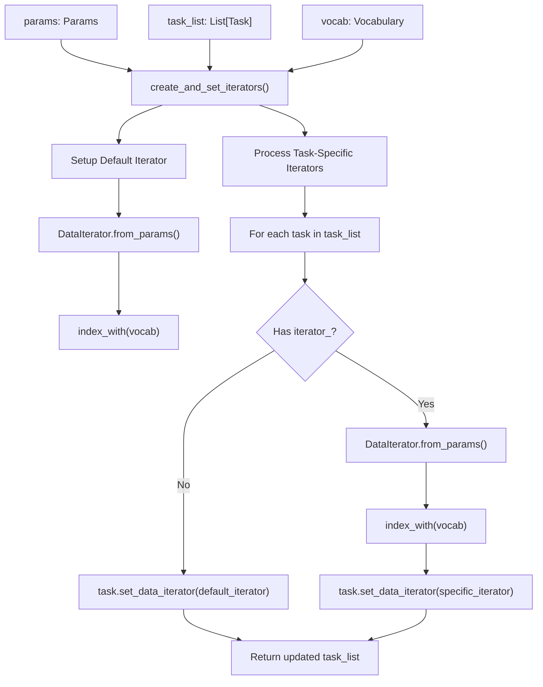
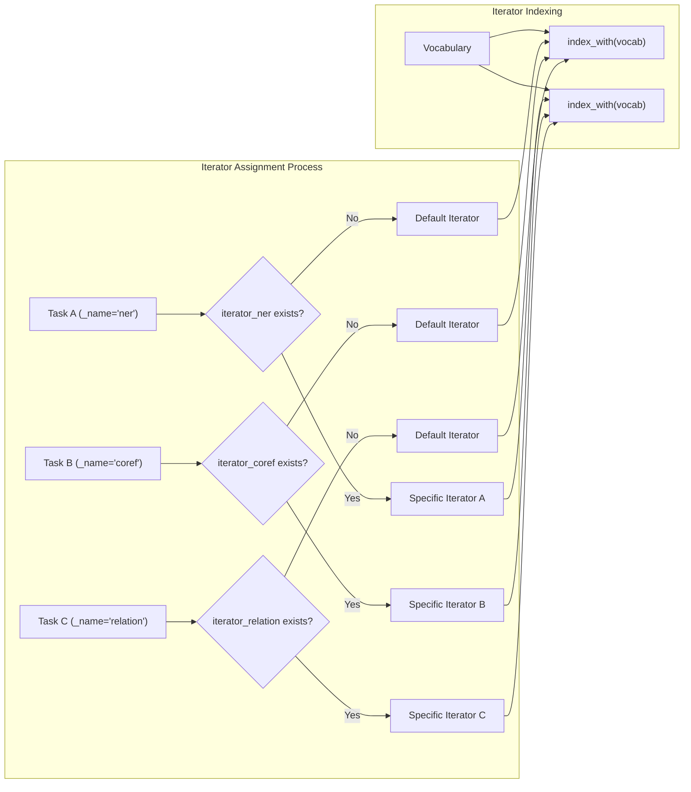

<!-- source: DeepWiki mcp.deepwiki.com · repo huggingface/hmtl · page 7.1 Common Utilities · fetched 2026-10-26 -->

# Common Utilities

Relevant source files

The following files were used as context for generating this wiki page:

- [hmtl/common/__init__.py](hmtl/common/__init__.py)
- [hmtl/common/util.py](hmtl/common/util.py)

This document covers the shared utility functions and helper modules that provide common functionality across the HMTL system. The utilities focus primarily on iterator management and configuration handling for multi-task learning scenarios.

For information about dataset-specific utilities and parsing functions, see [Dataset Utilities](#6.3). For training infrastructure that uses these utilities, see [Multi-Task Training](#4.1).

## Purpose and Scope

The `hmtl.common` module provides essential utilities that don't belong to any specific task or component but are needed across the HMTL system. Currently, this module focuses on iterator management for multi-task learning, allowing different tasks to use either shared or task-specific data iterators.

## Iterator Management

The core utility in this module is the `create_and_set_iterators` function, which handles the configuration and assignment of data iterators to tasks in a multi-task learning setup.

### Function Overview

The `create_and_set_iterators` function enables flexible iterator configuration where:
- A default iterator can be shared across all tasks
- Individual tasks can override with task-specific iterators
- All iterators are properly indexed with the vocabulary

Sources: [hmtl/common/util.py:16-50]()

### Configuration Pattern

The iterator configuration follows a hierarchical pattern in the experiment parameters:

| Parameter Key | Purpose | Required |
|---------------|---------|----------|
| `iterators.iterator` | Default iterator configuration | Yes |
| `iterators.iterator_<task_name>` | Task-specific iterator override | No |

### Task Integration

Each task in the task list receives an iterator through the `set_data_iterator` method. The function processes tasks sequentially, checking for task-specific configurations using the pattern `iterator_` + `task._name`.

Sources: [hmtl/common/util.py:41-48]()

## System Integration

The iterator management utility integrates into the broader HMTL training pipeline by providing the data iteration layer that feeds the multi-task trainer.

### Training Pipeline Integration

```mermaid
graph TB
    subgraph "Configuration Phase"
        ExperimentConfig["Experiment Config (Params)"] --> ExtractIterators["Extract iterators section"]
        TaskDefinitions["Task Definitions"] --> TaskList["List[Task]"]
        VocabBuilder["Vocabulary Builder"] --> Vocab["Vocabulary"]
    end
    
    subgraph "Iterator Setup Phase"
        ExtractIterators --> create_and_set_iterators["create_and_set_iterators()"]
        TaskList --> create_and_set_iterators
        Vocab --> create_and_set_iterators
        
        create_and_set_iterators --> ConfiguredTasks["Tasks with Iterators"]
    end
    
    subgraph "Training Phase"
        ConfiguredTasks --> SamplerTrainer["SamplerMultiTaskTrainer"]
        SamplerTrainer --> TaskSampling["Task Sampling Logic"]
        TaskSampling --> IteratorExecution["Iterator.get_batches()"]
    end
```

Sources: [hmtl/common/util.py:16-50](), [hmtl/common/__init__.py:3]()

## Implementation Details

### Type Signatures

The utility function uses precise type annotations for clarity:

- **Parameters**: `Params` (AllenNLP configuration object)
- **Task List**: `List[Task]` (HMTL task objects)  
- **Vocabulary**: `Vocabulary` (AllenNLP vocabulary)
- **Return**: `List[Task]` (updated tasks with iterators)

### Parameter Handling

The function uses AllenNLP's `Params.pop()` method to extract configuration sections, which removes the consumed parameters from the params object. This prevents parameter conflicts during model initialization.

### Iterator Indexing

All iterators (both default and task-specific) are indexed with the provided vocabulary using `index_with(vocab)`. This ensures that the iterators can properly convert tokens to indices during training.

### Error Handling

The function uses `Params.pop()` with a default value of `None` for task-specific iterators, allowing graceful fallback to the default iterator when no specific configuration exists.

Sources: [hmtl/common/util.py:34-48]()