# Page: Overview

# Overview

<details>
<summary>Relevant source files</summary>

The following files were used as context for generating this wiki page:

- [README.md](README.md)
- [hmtl/models/relation_extraction.py](hmtl/models/relation_extraction.py)

</details>


This document provides a comprehensive overview of the HMTL (Hierarchical Multi-Task Learning) repository, which implements a state-of-the-art multi-task learning system for natural language processing. The system performs four semantic NLP tasks in a hierarchical manner: Named Entity Recognition, Entity Mention Detection, Relation Extraction, and Coreference Resolution.

For detailed information about setting up the environment and dependencies, see [Getting Started](#2). For in-depth technical details about the core model architecture, see [Core HMTL Model](#3). For information about the training infrastructure, see [Training System](#4).

## System Purpose and Capabilities

HMTL is designed to learn semantic representations by combining multiple NLP tasks in a hierarchical structure. The system achieves state-of-the-art results on Named Entity Recognition, Entity Mention Detection, and Relation Extraction tasks. The hierarchical approach allows lower-level tasks to inform higher-level tasks, enabling the model to learn increasingly complex semantic representations as it progresses through the task hierarchy.

The repository provides a complete ecosystem including:
- Multi-task model training and evaluation infrastructure
- Web-based demonstration interface
- Pre-trained model weights and embeddings
- Dataset readers for standard NLP corpora
- Fine-tuning capabilities for custom datasets

## Core Architecture Overview

The HMTL system follows a hierarchical multi-task learning approach where four NLP tasks are arranged in a dependency hierarchy. The model uses shared representations at lower levels while maintaining task-specific components at higher levels.

**HMTL Task Hierarchy and Code Structure**

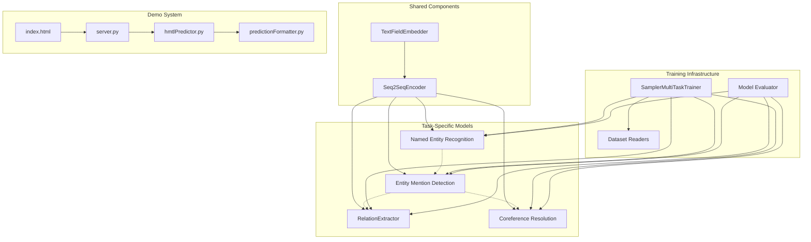

Sources: [README.md:1-74](), [hmtl/models/relation_extraction.py:32-89]()

## Technology Stack and Dependencies

The HMTL system is built on a modern Python-based NLP stack:

| Component | Technology | Purpose |
|-----------|------------|---------|
| **Core Framework** | AllenNLP | Model architecture and training infrastructure |
| **Deep Learning** | PyTorch | Neural network implementation and optimization |
| **Language** | Python 3.6+ | Primary development language |
| **Embeddings** | ELMo, GloVe | Pre-trained word representations |
| **Evaluation** | SentEval | Semantic representation evaluation |
| **Web Demo** | Flask, JavaScript | Interactive demonstration interface |
| **Development** | Grunt, LESS | Frontend development workflow |

Sources: [README.md:24-33]()

## Key Model Components

**HMTL Model Class Structure**

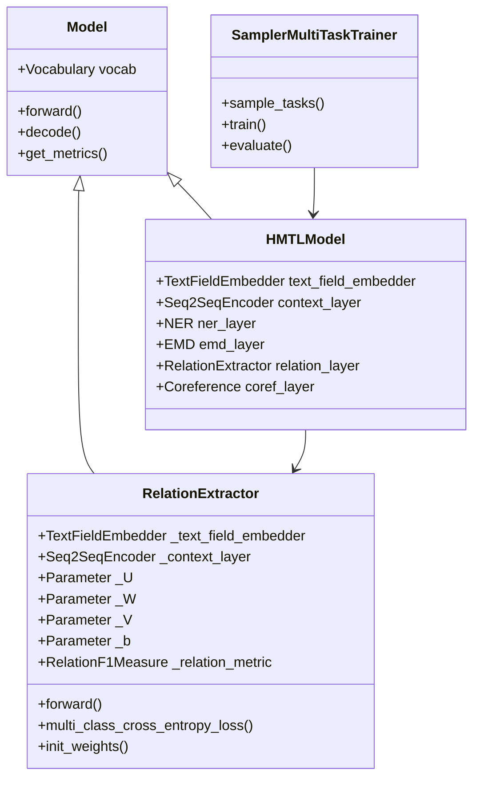

Sources: [hmtl/models/relation_extraction.py:32-89]()

### Relation Extraction Component

The `RelationExtractor` class exemplifies the task-specific model architecture used in HMTL. It implements a multi-head selection approach for relation extraction:

- **Scoring Mechanism**: Uses learnable parameters `_U`, `_W`, `_V`, and `_b` to compute relation scores between token pairs
- **Loss Function**: Employs `BCEWithLogitsLoss` for multi-class relation classification
- **Evaluation**: Integrates `RelationF1Measure` for precision, recall, and F1 score computation
- **Task Integration**: Inherits from AllenNLP's `Model` class for seamless integration with the training framework

The model processes input text through shared embeddings and encoding layers, then computes pairwise relation scores using bilinear transformations [hmtl/models/relation_extraction.py:160-182]().

Sources: [hmtl/models/relation_extraction.py:32-89](), [hmtl/models/relation_extraction.py:160-182]()

## Training and Evaluation Infrastructure

The system provides comprehensive training capabilities through:

- **Multi-Task Training**: `SamplerMultiTaskTrainer` handles task sampling and joint optimization
- **Configuration-Driven**: JSON configuration files define model architecture and hyperparameters
- **Evaluation Metrics**: Task-specific metrics for each NLP task
- **Tensorboard Integration**: Real-time training monitoring and visualization
- **SentEval Integration**: Evaluation of learned semantic representations

The training process is initiated using the command: `python train.py --config_file_path configs/hmtl_coref_conll.json --serialization_dir my_first_training` [README.md:43-45]().

Sources: [README.md:35-52]()

## Demo Application

The repository includes a complete web-based demonstration system consisting of:

- **Frontend**: Interactive web interface for text input and visualization
- **API Backend**: Flask server exposing model predictions via REST endpoints
- **Prediction Processing**: Formatters for converting model outputs to human-readable visualizations
- **Deployment**: Pre-trained model weights available through Git LFS

The demo is accessible online and provides real-time visualization of all four NLP tasks on user-provided text input [README.md:3-8]().

Sources: [README.md:3-8]()

## Dataset Support

HMTL supports standard NLP datasets through specialized readers:

- **OntoNotes 5.0**: Named Entity Recognition tasks
- **CoNLL 2003**: Named Entity Recognition benchmarking
- **ACE 2005**: Entity Mention Detection, Relation Extraction, and Coreference Resolution

The system includes custom dataset readers that handle the specific formats and annotation schemes of each corpus [README.md:57-62]().

Sources: [README.md:57-62]()

---

# Page: Getting Started

# Getting Started

<details>
<summary>Relevant source files</summary>

The following files were used as context for generating this wiki page:

- [demo/HMTL_demo.png](demo/HMTL_demo.png)
- [scripts/machine_setup.sh](scripts/machine_setup.sh)

</details>


This page provides a comprehensive guide to setting up the HMTL (Hierarchical Multi-Task Learning) system on your local machine. It covers environment preparation, dependency installation, and initial configuration required to run the multi-task NLP model and demo application.

The setup process establishes a Python 3.6 environment with AllenNLP framework, downloads pre-trained models, and configures the SentEval evaluation suite. For detailed environment configuration, see [Environment Setup](#2.1). For data and model acquisition, see [Data Acquisition](#2.2). For dependency details, see [Dependencies](#2.3).

## Setup Overview

The HMTL setup process involves several interconnected components that must be configured in sequence. The following diagram shows how the setup scripts and configuration files work together:

### Setup Workflow

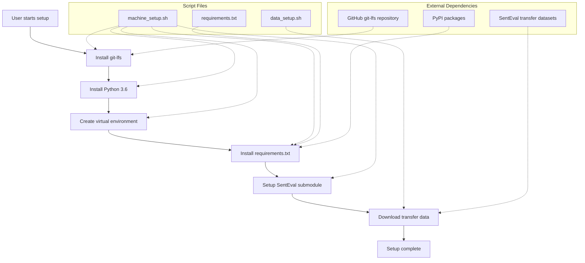

Sources: [scripts/machine_setup.sh:1-36]()

## Prerequisites

Before beginning the setup process, ensure your system meets the following requirements:

| Requirement | Description | Verification Command |
|-------------|-------------|---------------------|
| **Ubuntu/Debian Linux** | The setup scripts are designed for apt-based systems | `lsb_release -a` |
| **sudo privileges** | Required for system package installation | `sudo -v` |
| **Internet connection** | Needed for downloading packages and models | `ping google.com` |
| **Git** | For cloning repository and managing submodules | `git --version` |
| **curl** | Used by installation scripts | `curl --version` |

## Quick Start Guide

### 1. Clone Repository

```bash
git clone https://github.com/huggingface/hmtl.git
cd hmtl
```

### 2. Run Machine Setup

Execute the main setup script to configure your environment:

```bash
chmod +x scripts/machine_setup.sh
./scripts/machine_setup.sh
```

This script performs the following operations from [scripts/machine_setup.sh:1-36]():

- **Git LFS Installation** [scripts/machine_setup.sh:3-6](): Configures Git Large File Storage for downloading pre-trained models
- **Python 3.6 Setup** [scripts/machine_setup.sh:9-16](): Installs Python 3.6 and pip, creates symbolic links
- **Virtual Environment** [scripts/machine_setup.sh:19-22](): Creates isolated Python environment in `.env/` directory
- **Dependencies** [scripts/machine_setup.sh:25-26](): Installs all required Python packages
- **SentEval Configuration** [scripts/machine_setup.sh:29-35](): Initializes evaluation submodule and downloads transfer datasets

### 3. Activate Environment

After setup completion, always activate the virtual environment before using HMTL:

```bash
source .env/bin/activate
```

## System Architecture After Setup

Once setup is complete, your HMTL installation will have the following structure:

### Component Dependencies

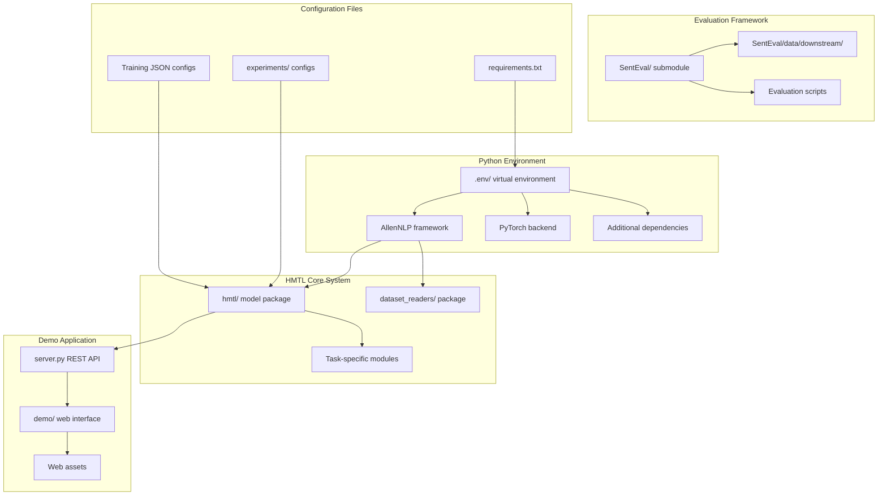

Sources: [scripts/machine_setup.sh:19-35]()

## Setup Verification

### Verify Python Environment

Check that Python 3.6 is properly installed and accessible:

```bash
python3 --version  # Should show Python 3.6.x
which python3      # Should point to /usr/local/bin/python3
```

### Verify Virtual Environment

Ensure the virtual environment is active and configured:

```bash
which python       # Should show ./env/bin/python
python --version   # Should show Python 3.6.x
```

### Verify Key Dependencies

Test that critical packages are installed:

```bash
python -c "import allennlp; print('AllenNLP:', allennlp.__version__)"
python -c "import torch; print('PyTorch:', torch.__version__)"
python -c "import numpy; print('NumPy:', numpy.__version__)"
```

### Verify SentEval Setup

Check that the evaluation framework is properly configured:

```bash
ls SentEval/data/downstream/  # Should show downloaded datasets
python -c "import sys; sys.path.append('SentEval'); import senteval"
```

## Common Setup Issues

| Issue | Symptoms | Solution |
|-------|----------|----------|
| **Git LFS not working** | Large files not downloading | Run `git lfs pull` after setup |
| **Python 3.6 conflicts** | Version mismatch errors | Ensure symbolic links point to correct Python |
| **Virtual env activation** | Wrong Python version active | Always run `source .env/bin/activate` |
| **Permission errors** | sudo command failures | Ensure user has sudo privileges |
| **Network timeouts** | Download failures | Check internet connection and retry |

## Next Steps

After successful setup, you can:

1. **Train Models**: Follow [Multi-Task Training](#4.1) to train HMTL models
2. **Run Demo**: See [Web Interface](#5.1) to start the interactive demo
3. **Evaluate Models**: Use [Model Evaluation](#4.2) for performance testing
4. **Load Data**: Configure [Dataset Readers](#6) for your datasets

The environment is now ready for HMTL model training, evaluation, and deployment.

Sources: [scripts/machine_setup.sh:1-36]()

---

# Page: Environment Setup

# Environment Setup

<details>
<summary>Relevant source files</summary>

The following files were used as context for generating this wiki page:

- [demo/HMTL_demo.png](demo/HMTL_demo.png)
- [scripts/machine_setup.sh](scripts/machine_setup.sh)

</details>


This document provides detailed instructions for setting up the development environment required for the HMTL (Hierarchical Multi-Task Learning) system. This includes configuring Python 3.6, Git LFS for model downloads, virtual environment creation, and SentEval submodule initialization.

For information about downloading pre-trained models and datasets after environment setup, see [Data Acquisition](#2.2). For details about the Python package dependencies being installed, see [Dependencies](#2.3).

## Setup Process Overview

The environment setup follows an automated process defined in the `machine_setup.sh` script, which handles all required system dependencies and configurations.

**Environment Setup Flow**
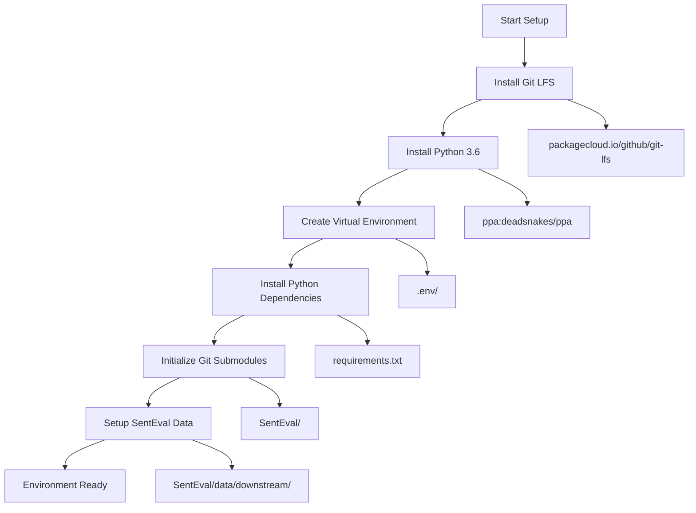

Sources: [scripts/machine_setup.sh:1-36]()

## Environment Components

The setup process installs and configures several key components that work together to support HMTL development and execution.

**Installed Components Architecture**
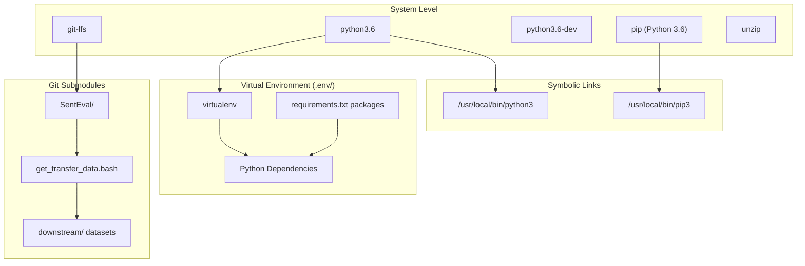

Sources: [scripts/machine_setup.sh:3-36]()

## Automated Setup Process

### Git LFS Installation

Git LFS (Large File Storage) is required for downloading pre-trained models that exceed standard Git file size limits.

The setup process installs Git LFS from the official GitHub repository:

```bash
curl -s https://packagecloud.io/install/repositories/github/git-lfs/script.deb.sh | sudo bash
sudo apt-get install git-lfs
git lfs install
```

Sources: [scripts/machine_setup.sh:3-6]()

### Python 3.6 Installation

HMTL requires Python 3.6 specifically. The setup installs this version from the `deadsnakes` PPA repository and configures pip:

| Component | Installation Command | Purpose |
|-----------|---------------------|---------|
| Repository | `sudo add-apt-repository ppa:deadsnakes/ppa` | Adds Python 3.6 package source |
| Python 3.6 | `sudo apt-get install python3.6 python3.6-dev` | Installs Python runtime and development headers |
| Pip | `wget https://bootstrap.pypa.io/get-pip.py && sudo python3.6 get-pip.py` | Installs package manager for Python 3.6 |
| Symbolic Links | `sudo ln -s /usr/bin/python3.6 /usr/local/bin/python3` | Creates system-wide Python 3 alias |

Sources: [scripts/machine_setup.sh:9-16]()

### Virtual Environment Creation

A clean Python environment is created using `virtualenv` to isolate HMTL dependencies:

```bash
sudo pip3 install virtualenv
virtualenv -p /usr/bin/python3.6 .env
source ./.env/bin/activate
```

The virtual environment is created in the `.env/` directory at the repository root.

Sources: [scripts/machine_setup.sh:19-22]()

### Dependency Installation

Python dependencies are installed from the `requirements.txt` file within the activated virtual environment:

```bash
pip install -r requirements.txt
```

Sources: [scripts/machine_setup.sh:25-26]()

### SentEval Submodule Setup

The SentEval evaluation framework is included as a Git submodule and requires additional data downloads:

```bash
git submodule init
git submodule update
```

After initializing the submodule, transfer learning datasets are downloaded:

```bash
sudo apt-get install unzip
cd SentEval/data/downstream/
./get_transfer_data.bash
```

Sources: [scripts/machine_setup.sh:29-35]()

## Manual Setup Alternative

If automated setup is not suitable, the environment can be configured manually by following each step in the `machine_setup.sh` script sequentially. Ensure all dependencies are installed in the correct order, as later steps depend on earlier installations.

## Environment Verification

After running the setup script, verify the environment by checking:

- Python version: `python3 --version` should return Python 3.6.x
- Virtual environment activation: `source .env/bin/activate`
- Package installation: `pip list` should show installed dependencies
- SentEval submodule: `ls SentEval/` should show submodule contents
- Git LFS: `git lfs version` should return version information

Sources: [scripts/machine_setup.sh:1-36]()

---

# Page: Data Acquisition

# Data Acquisition

<details>
<summary>Relevant source files</summary>

The following files were used as context for generating this wiki page:

- [scripts/data_setup.sh](scripts/data_setup.sh)

</details>


## Purpose and Scope

This document covers the data acquisition process for the HMTL system, specifically the automated downloading of pre-trained models and embeddings required for training and inference. The data acquisition system downloads ELMo contextual embeddings and GloVe word embeddings from external sources and organizes them in a standardized directory structure.

For information about environment setup and dependencies, see [Environment Setup](#2.1) and [Dependencies](#2.3).

## Overview

The data acquisition process is automated through the `data_setup.sh` script, which downloads essential pre-trained components needed by the HMTL model. These components provide the foundation for text representation and contextual understanding across all four NLP tasks.

### Data Acquisition Workflow

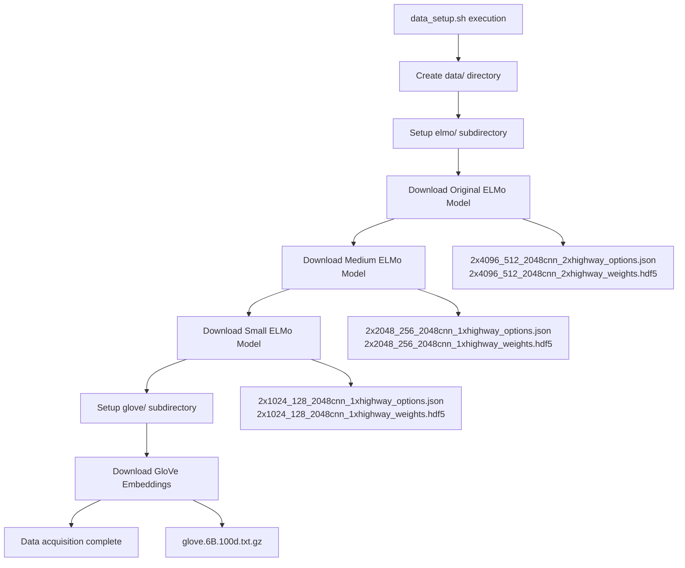

Sources: [scripts/data_setup.sh:1-34]()

## Directory Structure

The data acquisition process creates a structured directory layout for organizing pre-trained models and embeddings:

```
data/
├── elmo/
│   ├── 2x4096_512_2048cnn_2xhighway_options.json
│   ├── 2x4096_512_2048cnn_2xhighway_weights.hdf5
│   ├── 2x2048_256_2048cnn_1xhighway_options.json
│   ├── 2x2048_256_2048cnn_1xhighway_weights.hdf5
│   ├── 2x1024_128_2048cnn_1xhighway_options.json
│   └── 2x1024_128_2048cnn_1xhighway_weights.hdf5
└── glove/
    └── glove.6B.100d.txt.gz
```

Sources: [scripts/data_setup.sh:4-5](), [scripts/data_setup.sh:8-9](), [scripts/data_setup.sh:31-32]()

## ELMo Model Acquisition

The system downloads three different sizes of ELMo (Embeddings from Language Models) contextual embeddings from AllenNLP's S3 repository. Each model consists of two files: a configuration JSON file and an HDF5 weights file.

### ELMo Model Variants

| Model Type | Configuration File | Weights File | Architecture |
|------------|-------------------|-------------|--------------|
| Original (Full) | `2x4096_512_2048cnn_2xhighway_options.json` | `2x4096_512_2048cnn_2xhighway_weights.hdf5` | 2 layers, 4096 hidden units |
| Medium | `2x2048_256_2048cnn_1xhighway_options.json` | `2x2048_256_2048cnn_1xhighway_weights.hdf5` | 2 layers, 2048 hidden units |
| Small | `2x1024_128_2048cnn_1xhighway_options.json` | `2x1024_128_2048cnn_1xhighway_weights.hdf5` | 2 layers, 1024 hidden units |

### Original/Full Size ELMo Model

The full-size ELMo model provides the highest quality contextual representations but requires more computational resources.

Sources: [scripts/data_setup.sh:11-15]()

### Medium Size ELMo Model  

The medium-size model offers a balance between representation quality and computational efficiency.

Sources: [scripts/data_setup.sh:17-21]()

### Small Size ELMo Model

The small-size model provides faster inference with reduced memory requirements, suitable for resource-constrained environments.

Sources: [scripts/data_setup.sh:23-27]()

## GloVe Embeddings

The system downloads pre-trained GloVe (Global Vectors for Word Representation) embeddings to provide static word representations. The specific variant is GloVe 6B with 100-dimensional vectors, compressed in gzip format.

Sources: [scripts/data_setup.sh:29-33]()

## Integration with HMTL System

The acquired data integrates with various components of the HMTL system to provide text representation capabilities:

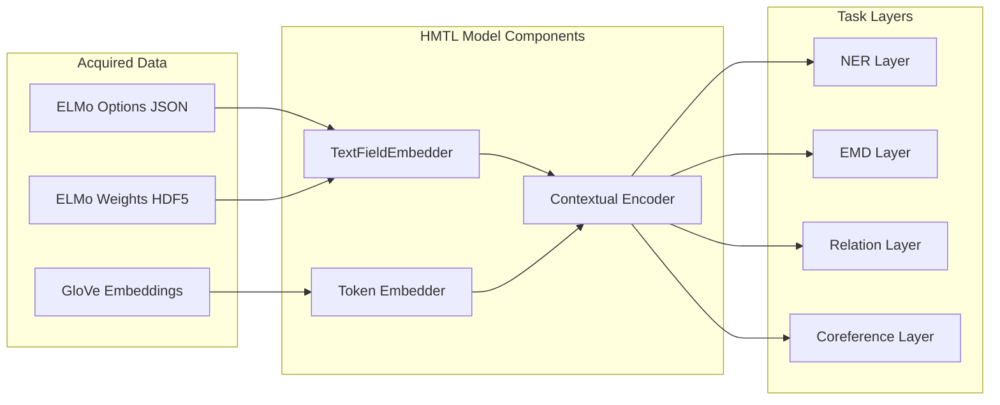

Sources: [scripts/data_setup.sh:1-34]()

## Execution

To run the data acquisition process:

```bash
bash scripts/data_setup.sh
```

This script must be executed from the repository root directory and requires internet connectivity to download files from the AllenNLP S3 bucket. The total download size is approximately several gigabytes depending on which ELMo models are needed.

Sources: [scripts/data_setup.sh:1-34]()

---

# Page: Dependencies

# Dependencies

<details>
<summary>Relevant source files</summary>

The following files were used as context for generating this wiki page:

- [requirements.txt](requirements.txt)

</details>


This document provides a comprehensive overview of the Python dependencies required for the HMTL (Hierarchical Multi-Task Learning) system. It covers the external libraries and frameworks that support the core model, training infrastructure, web demo, and development workflow. For information about environment setup procedures, see [Environment Setup](#2.1). For data acquisition requirements, see [Data Acquisition](#2.2).

## Core Framework Dependencies

The HMTL system is built on top of several foundational frameworks that provide the core machine learning and deep learning capabilities.

### AllenNLP Framework

The primary dependency is `allennlp==0.7.0`, which serves as the backbone for the multi-task learning architecture. AllenNLP provides the model abstractions, training loops, and dataset readers that HMTL extends.

| Component | AllenNLP Class | HMTL Implementation |
|-----------|----------------|---------------------|
| Model Base | `allennlp.models.Model` | `hmtl.models.HMTL` |
| Dataset Readers | `allennlp.data.DatasetReader` | `hmtl.dataset_readers.*` |
| Training | `allennlp.training.Trainer` | `hmtl.training.SamplerMultiTaskTrainer` |

### PyTorch Backend

`torch==0.4.1` provides the underlying tensor operations and automatic differentiation engine. The HMTL model components inherit from `torch.nn.Module` for neural network layers.

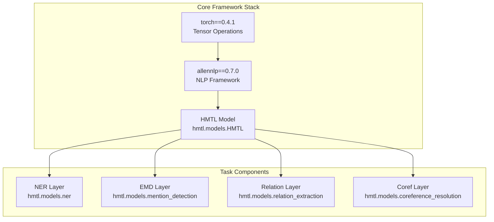

**Sources:** [requirements.txt:2](), [requirements.txt:93]()

## NLP and Language Processing Libraries

### SpaCy Integration

`spacy==2.0.16` and the English model `en_core_web_sm-2.0.0` provide tokenization and linguistic preprocessing capabilities. The SpaCy models are used in the web demo for text processing and visualization.

### NLTK Support

`nltk==3.3` provides additional natural language processing utilities and corpora access. This supports various text processing tasks throughout the system.

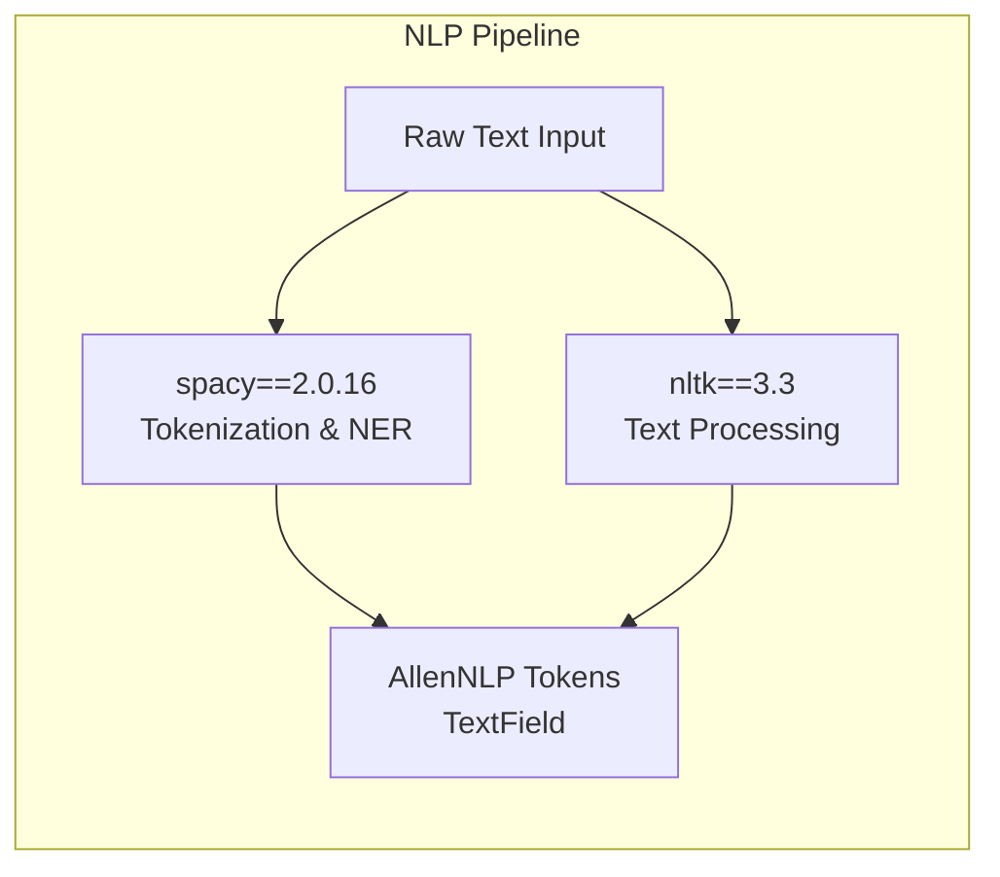

**Sources:** [requirements.txt:86](), [requirements.txt:29](), [requirements.txt:53]()

## Web Application Dependencies

The HMTL demo application requires several web framework dependencies to serve the interactive interface and REST API.

### Flask Web Framework

| Dependency | Version | Purpose |
|------------|---------|---------|
| `Flask` | 0.12.4 | Core web application framework |
| `Flask-Cors` | 3.0.3 | Cross-origin resource sharing support |
| `Werkzeug` | 0.14.1 | WSGI utility library (Flask dependency) |

### Additional Web Libraries

- `gevent==1.3.6` - Asynchronous networking library for handling concurrent requests
- `requests==2.20.0` - HTTP client library for external API calls
- `Jinja2==2.10` - Template engine for HTML rendering

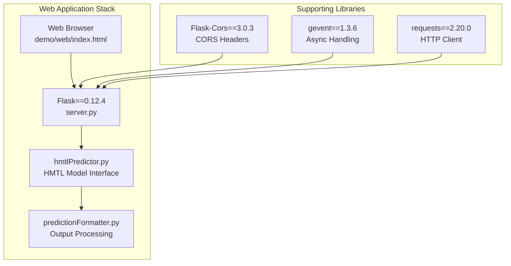

**Sources:** [requirements.txt:31-32](), [requirements.txt:35](), [requirements.txt:78](), [requirements.txt:100]()

## Data Processing Dependencies

### Numerical Computing

The system relies on several libraries for numerical computations and data manipulation:

| Library | Version | Primary Use |
|---------|---------|-------------|
| `numpy` | 1.15.2 | Array operations and linear algebra |
| `scipy` | 1.1.0 | Scientific computing and optimization |
| `h5py` | 2.8.0 | HDF5 file format for model serialization |
| `scikit-learn` | 0.20.0 | Machine learning utilities and metrics |

### Data Format Handling

- `conllu==0.11` - CoNLL-U format parsing for linguistic annotations
- `jsonnet==0.10.0` - Configuration file processing for AllenNLP
- `PyYAML==3.13` - YAML configuration parsing

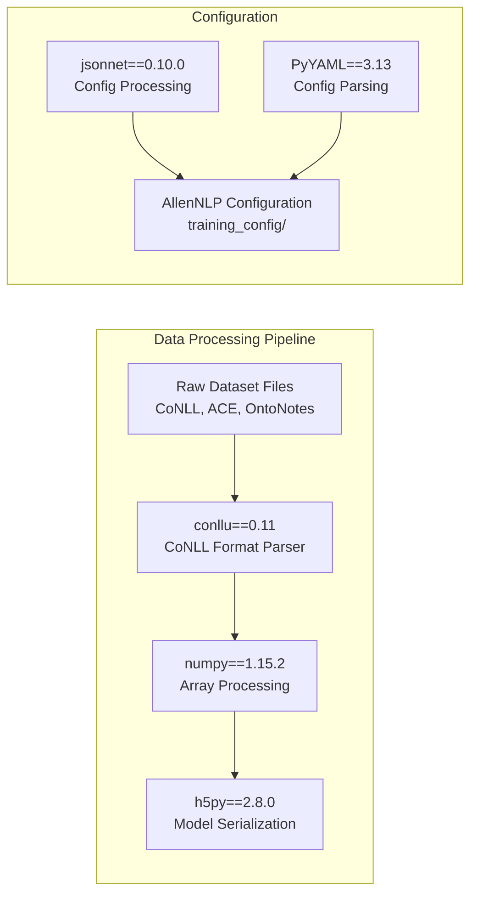

**Sources:** [requirements.txt:54](), [requirements.txt:83](), [requirements.txt:37](), [requirements.txt:82](), [requirements.txt:18](), [requirements.txt:44](), [requirements.txt:76]()

## Development and Testing Dependencies

### Testing Framework

The system uses `pytest==3.9.1` as the primary testing framework, along with several supporting libraries:

- `pytest-pythonpath==0.7.3` - Python path management for tests
- `flaky==3.4.0` - Retry mechanism for flaky tests  
- `mock==2.0.0` - Mock objects for unit testing
- `responses==0.10.1` - HTTP request mocking

### Documentation

- `Sphinx==1.8.1` - Documentation generation
- `numpydoc==0.8.0` - NumPy-style docstring parsing

### Containerization

`docker==3.5.1` and `docker-pycreds==0.3.0` provide Docker integration capabilities for containerized deployment.

**Sources:** [requirements.txt:71-72](), [requirements.txt:30](), [requirements.txt:47](), [requirements.txt:79](), [requirements.txt:87](), [requirements.txt:55](), [requirements.txt:24-25]()

## AWS Integration Dependencies

The system includes extensive AWS integration for cloud deployment and monitoring:

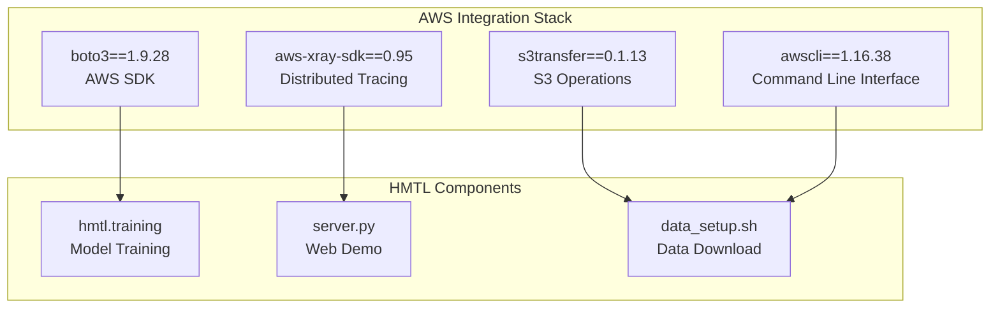

| Service | Library | Version | Usage |
|---------|---------|---------|-------|
| General AWS | `boto3` | 1.9.28 | Core AWS operations |
| Legacy AWS | `boto` | 2.49.0 | Backward compatibility |
| CLI Tools | `awscli` | 1.16.38 | Command-line access |
| Monitoring | `aws-xray-sdk` | 0.95 | Request tracing |
| Storage | `s3transfer` | 0.1.13 | S3 file operations |

**Sources:** [requirements.txt:6](), [requirements.txt:7](), [requirements.txt:10-13](), [requirements.txt:81]()

## Monitoring and Visualization

`tensorboardX==1.2` provides TensorBoard logging capabilities for training visualization and metric tracking. This integrates with the training infrastructure to log loss curves, gradient norms, and other training diagnostics.

**Sources:** [requirements.txt:90]()

---

# Page: Core HMTL Model

# Core HMTL Model

<details>
<summary>Relevant source files</summary>

The following files were used as context for generating this wiki page:

- [hmtl/models/hmtl.py](hmtl/models/hmtl.py)

</details>


This document covers the central `HMTL` model class that implements hierarchical multi-task learning for natural language processing. The model performs four NLP tasks in a hierarchical manner: Named Entity Recognition (NER), Entity Mention Detection (EMD), Relation Extraction, and Coreference Resolution.

For information about training this model, see [Training System](#4). For details about the web-based demo interface, see [Demo Application](#5). For individual task implementations, see [Model Architecture](#3.1), [Relation Extraction Layer](#3.2), and [Coreference Resolution](#3.3).

## Overview

The `HMTL` class serves as the main orchestrator for the hierarchical multi-task learning system. It coordinates four NLP tasks with carefully designed dependencies where lower-level tasks provide enhanced representations to higher-level tasks through shortcut connections.

**Core Architecture**:
- **Shared Text Embedder**: Common text representation layer used across all tasks
- **Task Hierarchy**: NER → EMD → {Relation Extraction, Coreference Resolution}
- **Shortcut Connections**: Higher-level tasks receive concatenated outputs from previous encoders
- **Task-Specific Components**: Each task has dedicated encoder and tagger/model components

## HMTL Model Architecture

The following diagram shows the hierarchical structure and data flow within the HMTL model:

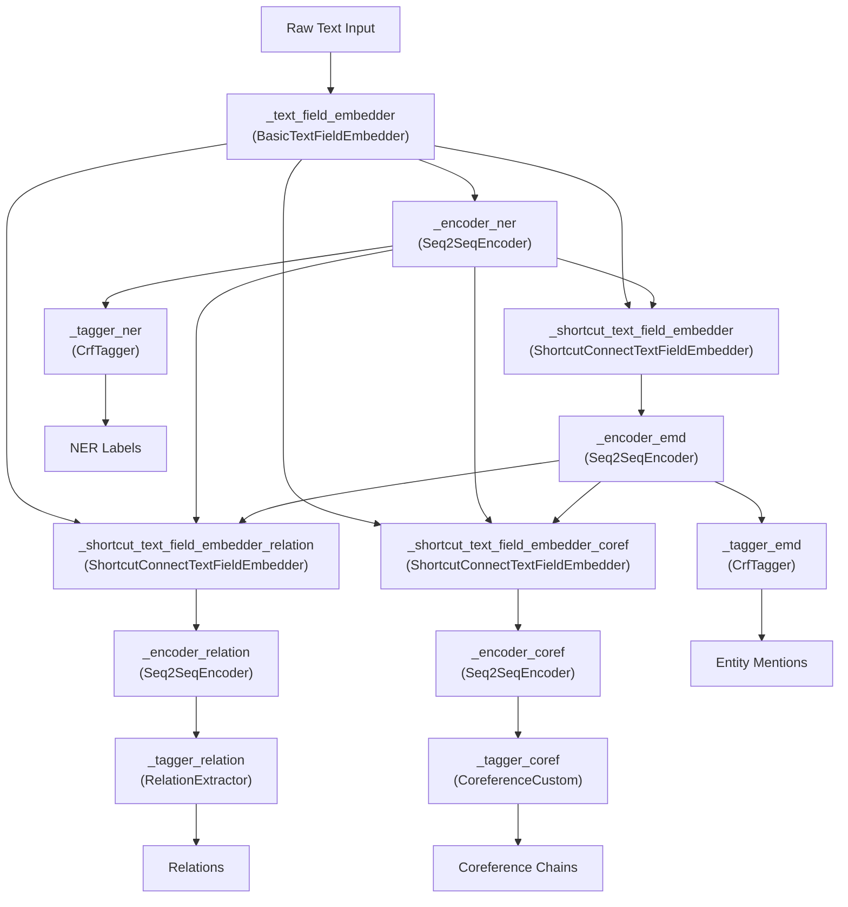

Sources: [hmtl/models/hmtl.py:28-201]()

## Component Breakdown

### Text Field Embedder

The model uses a shared `BasicTextFieldEmbedder` as the foundation for all task representations. This component converts raw text tokens into dense vector representations.

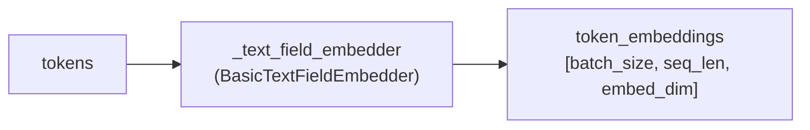

Sources: [hmtl/models/hmtl.py:47-50]()

### Task-Specific Encoders

Each task has its own `Seq2SeqEncoder` that processes the input representations:

| Task | Encoder Attribute | Purpose |
|------|------------------|---------|
| NER | `_encoder_ner` | Base contextual encoding for named entities |
| EMD | `_encoder_emd` | Entity mention detection with NER context |
| Relation | `_encoder_relation` | Relation extraction with NER+EMD context |
| Coreference | `_encoder_coref` | Coreference resolution with NER+EMD context |

Sources: [hmtl/models/hmtl.py:58-60](), [hmtl/models/hmtl.py:82-83](), [hmtl/models/hmtl.py:109-111](), [hmtl/models/hmtl.py:137-139]()

### Shortcut Connections

The hierarchical structure is implemented through `ShortcutConnectTextFieldEmbedder` instances that concatenate outputs from previous encoders:

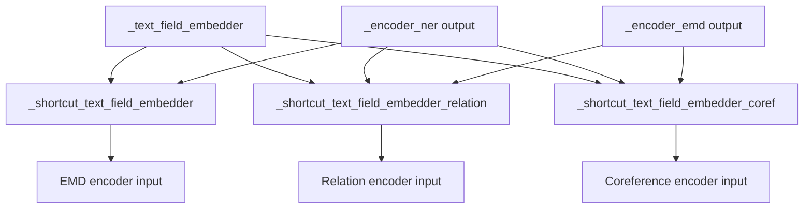

Sources: [hmtl/models/hmtl.py:85-88](), [hmtl/models/hmtl.py:113-116](), [hmtl/models/hmtl.py:141-144]()

### Task-Specific Taggers

Each task uses a specialized model for predictions:

| Task | Tagger Attribute | Model Type | Key Parameters |
|------|------------------|------------|----------------|
| NER | `_tagger_ner` | `CrfTagger` | `label_namespace`, `constraint_type` |
| EMD | `_tagger_emd` | `CrfTagger` | `label_namespace`, `constraint_type` |
| Relation | `_tagger_relation` | `RelationExtractor` | `d`, `l`, `n_classes`, `activation` |
| Coreference | `_tagger_coref` | `CoreferenceCustom` | `max_span_width`, `spans_per_word`, `max_antecedents` |

Sources: [hmtl/models/hmtl.py:64-73](), [hmtl/models/hmtl.py:92-101](), [hmtl/models/hmtl.py:120-129](), [hmtl/models/hmtl.py:154-169]()

## Forward Pass Mechanism

The `forward` method dynamically selects which task to execute based on the `task_name` parameter:

```python
def forward(self, tensor_batch, for_training: bool = False, task_name: str = "ner") -> Dict[str, torch.Tensor]:
    tagger = getattr(self, "_tagger_%s" % task_name)
    
    if task_name == "coref" and tagger._eval_on_gold_mentions:
        if for_training:
            tagger._use_gold_mentions = False
        else:
            tagger._use_gold_mentions = True
    
    return tagger.forward(**tensor_batch)
```

The method uses Python's `getattr` to dynamically access the appropriate tagger based on the task name, enabling flexible task execution during both training and inference.

Sources: [hmtl/models/hmtl.py:176-187]()

## Task Execution Flow

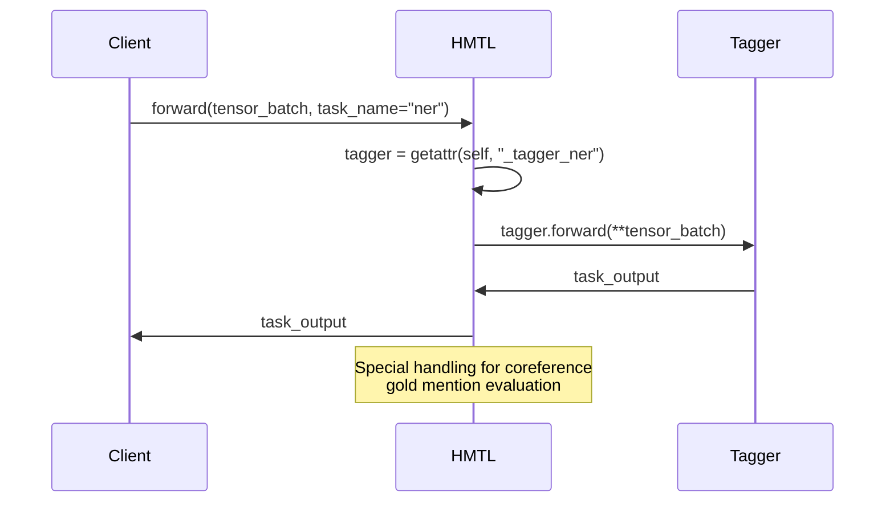

## Metrics and Evaluation

The model provides task-specific metrics through the `get_metrics` method:

```python
def get_metrics(self, task_name: str, reset: bool = False, full: bool = False) -> Dict[str, float]:
    task_tagger = getattr(self, "_tagger_" + task_name)
    if full and task_name == "coref":
        return task_tagger.get_metrics(reset=reset, full=full)
    else:
        return task_tagger.get_metrics(reset)
```

The coreference task supports additional detailed metrics when `full=True` is specified.

Sources: [hmtl/models/hmtl.py:190-196]()

## Model Registration

The HMTL model is registered with AllenNLP using the `@Model.register("hmtl")` decorator, enabling it to be instantiated from configuration files during training and inference.

Sources: [hmtl/models/hmtl.py:28]()

---

# Page: Model Architecture

# Model Architecture

<details>
<summary>Relevant source files</summary>

The following files were used as context for generating this wiki page:

- [hmtl/models/__init__.py](hmtl/models/__init__.py)
- [hmtl/models/hmtl.py](hmtl/models/hmtl.py)

</details>


This document describes the architecture of the HMTL (Hierarchical Multi-Task Learning) model, which is the core component of the system. The HMTL model performs four NLP tasks in a hierarchical manner: Named Entity Recognition (NER), Entity Mention Detection (EMD), Relation Extraction, and Coreference Resolution.

For information about training the HMTL model, see [Multi-Task Training](#4.1). For details about individual task components like relation extraction specifics, see [Relation Extraction Layer](#3.2) and [Coreference Resolution](#3.3).

## Overall Model Architecture

The HMTL model implements a hierarchical multi-task learning approach where tasks build upon each other through shared representations and shortcut connections. The model is implemented in the `HMTL` class which orchestrates all task-specific components.

### HMTL Model Structure

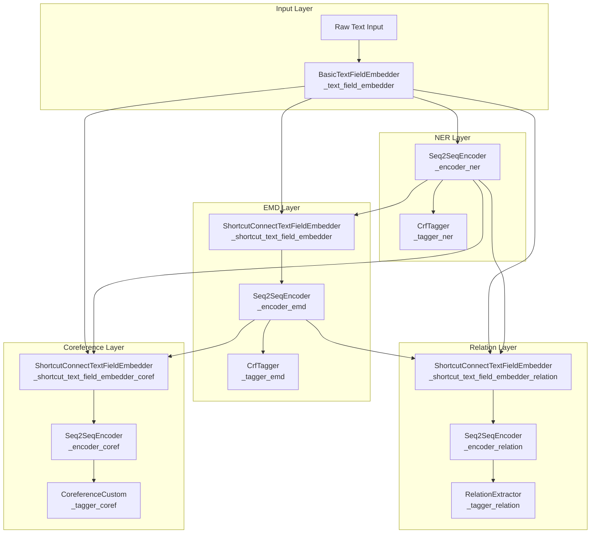

Sources: [hmtl/models/hmtl.py:28-201]()

## Shared Components

The HMTL model uses several shared components that provide foundational representations used across all tasks.

### Base Text Field Embedder

The `_text_field_embedder` is a `BasicTextFieldEmbedder` that converts input tokens into dense vector representations. This component is shared across all tasks and provides the foundational text embeddings.

```python
# Initialization in __init__ method
text_field_embedder_params = params.pop("text_field_embedder")
text_field_embedder = BasicTextFieldEmbedder.from_params(vocab=vocab, params=text_field_embedder_params)
self._text_field_embedder = text_field_embedder
```

### Shortcut Connection Architecture

The model implements shortcut connections through `ShortcutConnectTextFieldEmbedder` instances that combine the base embedder with outputs from previous encoders:

| Component | Previous Encoders | Usage |
|-----------|------------------|-------|
| `_shortcut_text_field_embedder` | `[_encoder_ner]` | EMD task input |
| `_shortcut_text_field_embedder_relation` | `[_encoder_ner, _encoder_emd]` | Relation extraction input |
| `_shortcut_text_field_embedder_coref` | `[_encoder_ner, _encoder_emd]` | Coreference resolution input |

Sources: [hmtl/models/hmtl.py:48-50](), [hmtl/models/hmtl.py:85-88](), [hmtl/models/hmtl.py:113-116](), [hmtl/models/hmtl.py:141-144]()

## Task-Specific Components

Each NLP task has dedicated encoder and tagger components that process task-specific representations.

### Task Encoder-Tagger Pattern

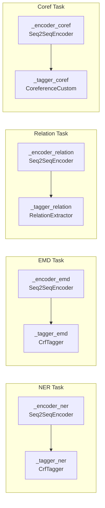

### Task-Specific Tagger Types

| Task | Tagger Class | Key Parameters |
|------|-------------|----------------|
| NER | `CrfTagger` | `label_namespace`, `constraint_type` |
| EMD | `CrfTagger` | `label_namespace`, `constraint_type` |
| Relation | `RelationExtractor` | `d`, `l`, `n_classes`, `activation` |
| Coreference | `CoreferenceCustom` | `mention_feedforward`, `antecedent_feedforward`, `max_span_width` |

Sources: [hmtl/models/hmtl.py:62-73](), [hmtl/models/hmtl.py:90-101](), [hmtl/models/hmtl.py:118-129](), [hmtl/models/hmtl.py:154-169]()

## Hierarchical Task Dependencies

The HMTL model implements hierarchical dependencies where later tasks benefit from the representations learned by earlier tasks.

### Dependency Flow

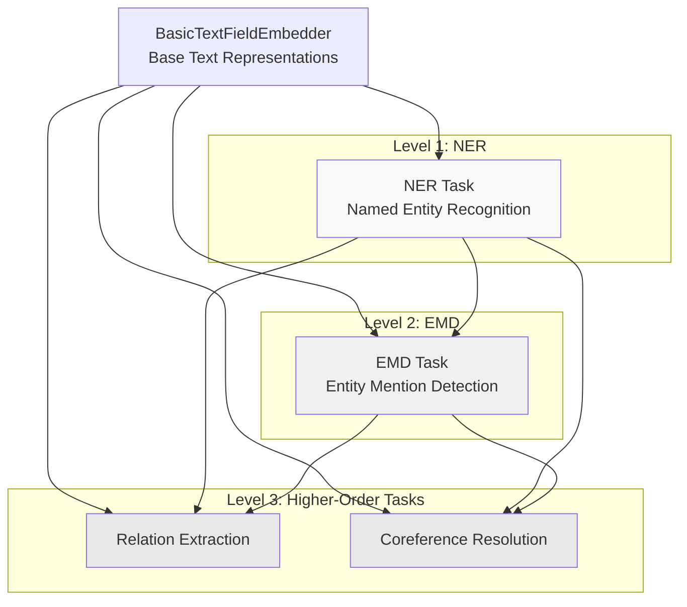

The hierarchical structure is implemented through the shortcut connections:
- EMD receives NER encoder output
- Relation extraction receives both NER and EMD encoder outputs  
- Coreference resolution receives both NER and EMD encoder outputs

Sources: [hmtl/models/hmtl.py:85-88](), [hmtl/models/hmtl.py:113-116](), [hmtl/models/hmtl.py:141-144]()

## Forward Pass Flow

The HMTL model's `forward` method dynamically routes input to the appropriate task-specific tagger based on the `task_name` parameter.

### Dynamic Task Dispatching

```mermaid
graph TD
    ForwardMethod["forward(tensor_batch, task_name)"]
    TaskDispatch["getattr(self, '_tagger_%s' % task_name)"]
    
    subgraph "Task Routing"
        NERPath["task_name='ner'<br/>→ _tagger_ner"]
        EMDPath["task_name='emd'<br/>→ _tagger_emd"] 
        RelationPath["task_name='relation'<br/>→ _tagger_relation"]
        CorefPath["task_name='coref'<br/>→ _tagger_coref"]
    end
    
    TaggerForward["tagger.forward(**tensor_batch)"]
    Output["Task-specific output dict"]
    
    ForwardMethod --> TaskDispatch
    TaskDispatch --> NERPath
    TaskDispatch --> EMDPath
    TaskDispatch --> RelationPath
    TaskDispatch --> CorefPath
    
    NERPath --> TaggerForward
    EMDPath --> TaggerForward
    RelationPath --> TaggerForward
    CorefPath --> TaggerForward
    
    TaggerForward --> Output
```

### Special Handling for Coreference

The coreference task has special logic for handling gold mentions during evaluation:

```python
if task_name == "coref" and tagger._eval_on_gold_mentions:
    if for_training:
        tagger._use_gold_mentions = False
    else:
        tagger._use_gold_mentions = True
```

Sources: [hmtl/models/hmtl.py:175-187]()

## Model Registry and Instantiation

The HMTL model is registered with AllenNLP's model registry using the `@Model.register("hmtl")` decorator, allowing it to be instantiated from configuration files.

### Available Model Variants

The model system supports various combinations of tasks through different layer classes:

| Model Class | Tasks Supported |
|-------------|----------------|
| `LayerNer` | NER only |
| `LayerRelation` | Relation extraction only |  
| `LayerCoref` | Coreference only |
| `LayerNerEmd` | NER + EMD |
| `LayerEmdRelation` | EMD + Relation |
| `LayerEmdCoref` | EMD + Coreference |
| `LayerNerEmdCoref` | NER + EMD + Coreference |
| `LayerNerEmdRelation` | NER + EMD + Relation |
| `HMTL` | All four tasks |

Sources: [hmtl/models/__init__.py:1-22](), [hmtl/models/hmtl.py:28-29](), [hmtl/models/hmtl.py:198-201]()

---

# Page: Relation Extraction Layer

# Relation Extraction Layer

<details>
<summary>Relevant source files</summary>

The following files were used as context for generating this wiki page:

- [README.md](README.md)
- [hmtl/models/layerRelation.py](hmtl/models/layerRelation.py)
- [hmtl/models/relation_extraction.py](hmtl/models/relation_extraction.py)

</details>


This document covers the relation extraction component of the HMTL model, which identifies semantic relationships between entity mentions in text. The relation extraction layer is one of four hierarchical tasks in HMTL, positioned to leverage entity mention information from lower layers while providing relationship understanding for the overall multi-task architecture.

For information about the complete HMTL model structure, see [Model Architecture](#3.1). For training the relation extraction layer, see [Multi-Task Training](#4.1).

## Architecture Overview

The relation extraction layer consists of two main components: a task-specific wrapper (`LayerRelation`) and the core extraction model (`RelationExtractor`). The layer integrates with HMTL's hierarchical structure by sharing text embeddings and contextual encoders while maintaining task-specific parameters for relation scoring.

### HMTL Integration Architecture

```mermaid
graph TB
    subgraph "HMTL_Hierarchy" ["HMTL Hierarchical Tasks"]
        NER["Named Entity Recognition"]
        EMD["Entity Mention Detection"] 
        RE["Relation Extraction"]
        COREF["Coreference Resolution"]
    end
    
    subgraph "Shared_Components" ["Shared Components"]
        TextEmbedder["TextFieldEmbedder"]
        ContextEncoder["Seq2SeqEncoder"]
    end
    
    subgraph "RelationLayer" ["Relation Extraction Layer"]
        LayerRelation["LayerRelation"]
        RelationExtractor["RelationExtractor"]
        ScoringMatrix["Bilinear Scorer"]
    end
    
    TextEmbedder --> LayerRelation
    ContextEncoder --> LayerRelation
    LayerRelation --> RelationExtractor
    RelationExtractor --> ScoringMatrix
    
    NER -.-> EMD
    EMD -.-> RE
    EMD -.-> COREF
    
    RE --> LayerRelation
    
    style LayerRelation fill:#e8f5e8
    style RelationExtractor fill:#f3e5f5
    style ScoringMatrix fill:#fff3e0
```

Sources: [hmtl/models/layerRelation.py:1-88](), [hmtl/models/relation_extraction.py:1-275]()

## LayerRelation Wrapper

The `LayerRelation` class serves as the task-specific interface within HMTL's multi-task framework. It manages the integration of shared components with relation-specific parameters and provides the standardized interface expected by the HMTL training system.

### Component Configuration

| Component | Purpose | Configuration Source |
|-----------|---------|---------------------|
| `text_field_embedder` | Shared text embedding | `BasicTextFieldEmbedder.from_params()` |
| `encoder_relation` | Contextual sequence encoder | `Seq2SeqEncoder.from_params()` |
| `tagger_relation` | Core relation extractor | `RelationExtractor` instance |

The wrapper initializes these components from configuration parameters and delegates forward passes to the underlying `RelationExtractor`.

### Task Interface Methods

```mermaid
graph LR
    subgraph "LayerRelation_Interface" ["LayerRelation Interface"]
        forward["forward()"]
        get_metrics["get_metrics()"]
        from_params["from_params()"]
    end
    
    subgraph "RelationExtractor_Delegation" ["RelationExtractor Delegation"]
        extractor_forward["tagger.forward()"]
        extractor_metrics["tagger.get_metrics()"]
    end
    
    forward --> extractor_forward
    get_metrics --> extractor_metrics
    
    style forward fill:#e8f5e8
    style get_metrics fill:#f3e5f5
```

Sources: [hmtl/models/layerRelation.py:72-87]()

## RelationExtractor Core Model

The `RelationExtractor` implements a bilinear scoring mechanism based on Bekoulis et al.'s multi-head selection approach. It processes contextualized token representations to predict relations between all token pairs in a document.

### Model Parameters

The core scoring mechanism uses four learned parameter matrices:

| Parameter | Dimensions | Purpose |
|-----------|------------|---------|
| `_U` | `(2*d, l)` | Left argument transformation |
| `_W` | `(2*d, l)` | Right argument transformation |  
| `_V` | `(l, n_classes)` | Final classification layer |
| `_b` | `(l,)` | Bias term |

Where `d` is half the encoder output dimension, `l` is the relation embedding dimension, and `n_classes` is the number of relation types.

### Relation Type Mapping

The model uses ACE2005 relation types with a predefined mapping:

```python
rel_type_2_idx = {"ORG-AFF": 0, "PHYS": 1, "ART": 2, "PER-SOC": 3, "PART-WHOLE": 4, "GEN-AFF": 5}
```

Sources: [hmtl/models/relation_extraction.py:28-29](), [hmtl/models/relation_extraction.py:73-77]()

## Bilinear Scoring Mechanism

The relation extraction scoring follows a bilinear approach that computes relation probabilities for all token pairs simultaneously. This allows the model to identify multiple relations within a single document in one forward pass.

### Scoring Computation Flow

```mermaid
graph TB
    subgraph "Input_Processing" ["Input Processing"]
        text_input["text: Dict[str, LongTensor]"]
        embeddings["text_embeddings"]
        mask["sequence_mask"]
        encoded["encoded_text"]
    end
    
    subgraph "Bilinear_Scoring" ["Bilinear Scoring"]
        left_proj["left = matmul(encoded_text, U)"]
        right_proj["right = matmul(encoded_text, W)"]
        outer_sum["B = left + right"]
        bias_add["outer_sum_bias = B + b"]
        activation["activated = relu/tanh(outer_sum_bias)"]
        final_scores["relation_scores = matmul(activated, V)"]
    end
    
    subgraph "Output_Generation" ["Output Generation"]
        sigmoid["sigmoid_scores"]
        predictions["predicted_relations"]
    end
    
    text_input --> embeddings
    embeddings --> encoded
    encoded --> left_proj
    encoded --> right_proj
    left_proj --> outer_sum
    right_proj --> outer_sum
    outer_sum --> bias_add
    bias_add --> activation
    activation --> final_scores
    final_scores --> sigmoid
    sigmoid --> predictions
    
    style left_proj fill:#e8f5e8
    style right_proj fill:#e8f5e8
    style final_scores fill:#f3e5f5
```

The scoring mechanism computes a 4D tensor of shape `(batch_size, seq_len, seq_len, n_classes)` where each element represents the probability of a specific relation type between two tokens.

Sources: [hmtl/models/relation_extraction.py:160-182]()

## Training and Loss Computation

The model uses binary cross-entropy loss with logits, treating relation extraction as a multi-label classification problem where multiple relations can exist simultaneously in a document.

### Loss Function Implementation

The `multi_class_cross_entropy_loss` method handles several key aspects:

1. **Mask Application**: Converts sequence-level masks to relation-level masks
2. **Label Formatting**: Transforms sparse relation labels to dense tensor format  
3. **Loss Amplification**: Applies a 100x multiplier to the base loss for training stability

```mermaid
graph LR
    subgraph "Loss_Computation" ["Loss Computation Process"]
        scores_input["relation_scores"]
        labels_input["gold_relations"]
        mask_input["sequence_mask"]
        
        mask_transform["squared_mask generation"]
        tensor_flatten["flatten scores and labels"]
        bce_loss["BCEWithLogitsLoss"]
        amplify["loss * 100"]
    end
    
    scores_input --> tensor_flatten
    labels_input --> tensor_flatten
    mask_input --> mask_transform
    mask_transform --> tensor_flatten
    tensor_flatten --> bce_loss
    bce_loss --> amplify
    
    style bce_loss fill:#e8f5e8
    style amplify fill:#f3e5f5
```

Sources: [hmtl/models/relation_extraction.py:102-133]()

## Output Format and Decoding

The relation extraction layer produces structured outputs suitable for both training and inference scenarios.

### Forward Pass Outputs

| Output Key | Type | Description |
|------------|------|-------------|
| `relation_sigmoid_scores` | `torch.Tensor` | Sigmoid-normalized relation probabilities |
| `predicted_relations` | `torch.Tensor` | Binary predictions (rounded sigmoid scores) |
| `mask` | `torch.Tensor` | Sequence mask for valid tokens |
| `loss` | `torch.Tensor` | Training loss (when gold labels provided) |

### Decoded Predictions Format

The `decode` method transforms tensor predictions into human-readable format:

```python
# Example decoded relation:
# ["ARG1_PHYS", "*", "*", "ARG2_PHYS", "*"]
# Indicates PHYS relation between tokens 0 and 3
```

Each decoded relation is represented as a list where non-wildcard entries indicate argument positions and relation types.

Sources: [hmtl/models/relation_extraction.py:195-199](), [hmtl/models/relation_extraction.py:244-265]()

## Metrics and Evaluation

The relation extraction layer uses `RelationF1Measure` to compute precision, recall, and F1 scores. A relation prediction is considered correct only when both argument positions and the relation type are correctly identified.

### Evaluation Criteria

The model evaluates relations based on:
- Correct identification of ARG1 position (last word of first argument)
- Correct identification of ARG2 position (last word of second argument)  
- Correct relation type classification

The `get_metrics` method filters results to return only overall performance metrics, excluding per-class breakdowns for cleaner reporting.

Sources: [hmtl/models/relation_extraction.py:267-274](), [hmtl/models/relation_extraction.py:88]()

---

# Page: Coreference Resolution

# Coreference Resolution

<details>
<summary>Relevant source files</summary>

The following files were used as context for generating this wiki page:

- [hmtl/models/coref_custom.py](hmtl/models/coref_custom.py)
- [hmtl/models/layerCoref.py](hmtl/models/layerCoref.py)

</details>


This document covers the coreference resolution component of the HMTL system, which identifies and groups mentions that refer to the same entity across a document. The implementation extends AllenNLP's coreference resolver with custom modifications for multi-task learning integration and enhanced evaluation capabilities.

For information about other NLP tasks in the HMTL system, see [Relation Extraction Layer](#3.2). For overall model architecture, see [Model Architecture](#3.1).

## Overview

The coreference resolution system implements a neural coreference model based on Lee et al. 2017, with two key modifications:

1. **Enhanced Metrics**: Uses detailed CoNLL coreference evaluation metrics (B3, MUC, CEAFE) instead of only their average
2. **Gold Mentions Evaluation**: Supports evaluation using gold mention boundaries during testing while training on predicted mentions

The system consists of two main components: `CoreferenceCustom` for the core coreference logic and `LayerCoref` for HMTL integration.

## Architecture Overview

```mermaid
graph TB
    subgraph "Coreference Resolution Layer"
        LayerCoref["LayerCoref<br/>(Model Wrapper)"]
        CoreferenceCustom["CoreferenceCustom<br/>(Core Logic)"]
        
        LayerCoref --> CoreferenceCustom
    end
    
    subgraph "Input Processing"
        TextEmbedder["TextFieldEmbedder"]
        ContextEncoder["Context Layer<br/>(Seq2SeqEncoder)"]
        
        TextEmbedder --> ContextEncoder
    end
    
    subgraph "Span Processing"
        SpanExtractor["Span Extractors<br/>(Endpoint + Attentive)"]
        MentionPruner["Mention Pruner<br/>(SpanPruner)"]
        
        SpanExtractor --> MentionPruner
    end
    
    subgraph "Coreference Scoring"
        MentionFF["Mention FeedForward"]
        AntecedentFF["Antecedent FeedForward"]
        CorefScores["Coreference Scores"]
        
        MentionFF --> CorefScores
        AntecedentFF --> CorefScores
    end
    
    subgraph "Evaluation"
        ConllCorefFullScores["ConllCorefFullScores<br/>(Custom Metrics)"]
        MentionRecall["MentionRecall"]
    end
    
    CoreferenceCustom --> TextEmbedder
    CoreferenceCustom --> SpanExtractor
    CoreferenceCustom --> MentionFF
    CoreferenceCustom --> AntecedentFF
    CoreferenceCustom --> ConllCorefFullScores
    CoreferenceCustom --> MentionRecall
    
    ContextEncoder --> SpanExtractor
    MentionPruner --> CorefScores
```

**Sources:** [hmtl/models/coref_custom.py:24-35](), [hmtl/models/layerCoref.py:28-29]()

## Core Components

### CoreferenceCustom Class

The `CoreferenceCustom` class extends AllenNLP's `CoreferenceResolver` with HMTL-specific modifications:

| Component | Purpose | Implementation |
|-----------|---------|----------------|
| **Text Processing** | Embed and contextualize input text | Uses `TextFieldEmbedder` and `Seq2SeqEncoder` |
| **Span Extraction** | Extract candidate mention spans | `EndpointSpanExtractor` + `SelfAttentiveSpanExtractor` |
| **Mention Scoring** | Score potential mentions | `FeedForward` network for mention classification |
| **Antecedent Scoring** | Score coreference links | `FeedForward` network for pairwise scoring |
| **Evaluation** | Compute detailed metrics | `ConllCorefFullScores` for B3, MUC, CEAFE |

**Key Parameters:**
- `max_span_width`: Maximum width of candidate spans
- `spans_per_word`: Ratio of spans to consider per word
- `max_antecedents`: Maximum antecedents per mention
- `eval_on_gold_mentions`: Whether to use gold mentions in evaluation

**Sources:** [hmtl/models/coref_custom.py:37-75]()

### LayerCoref Integration

The `LayerCoref` class serves as the HMTL integration wrapper:

```mermaid
graph LR
    subgraph "HMTL Task Layer"
        LayerCoref["LayerCoref"]
        Config["Configuration<br/>Parameters"]
        
        Config --> LayerCoref
    end
    
    subgraph "Core Components"
        TextEmbedder["BasicTextFieldEmbedder"]
        ContextEncoder["Seq2SeqEncoder"]
        CoreferenceCustom["CoreferenceCustom"]
        
        LayerCoref --> TextEmbedder
        LayerCoref --> ContextEncoder
        LayerCoref --> CoreferenceCustom
    end
    
    subgraph "Task Interface"
        Forward["forward()"]
        GetMetrics["get_metrics()"]
        
        LayerCoref --> Forward
        LayerCoref --> GetMetrics
    end
```

**Sources:** [hmtl/models/layerCoref.py:43-89]()

## Processing Pipeline

The coreference resolution follows this processing workflow:

```mermaid
graph TD
    Input["Input Text + Spans"]
    
    subgraph "Text Encoding"
        TextEmbed["Text Field Embedder<br/>_text_field_embedder()"]
        Dropout["Lexical Dropout<br/>_lexical_dropout()"]
        Context["Context Layer<br/>_context_layer()"]
        
        Input --> TextEmbed
        TextEmbed --> Dropout
        Dropout --> Context
    end
    
    subgraph "Span Processing"
        EndpointSpan["Endpoint Span Extractor<br/>_endpoint_span_extractor()"]
        AttentiveSpan["Attentive Span Extractor<br/>_attentive_span_extractor()"]
        SpanConcat["Concatenate Embeddings"]
        
        Context --> EndpointSpan
        TextEmbed --> AttentiveSpan
        EndpointSpan --> SpanConcat
        AttentiveSpan --> SpanConcat
    end
    
    subgraph "Mention Detection"
        MentionPrune["Mention Pruner<br/>_mention_pruner()"]
        TopSpans["Top Span Selection"]
        
        SpanConcat --> MentionPrune
        MentionPrune --> TopSpans
    end
    
    subgraph "Coreference Scoring"
        ValidAntecedents["Generate Valid Antecedents<br/>_generate_valid_antecedents()"]
        SpanPairEmbed["Compute Span Pair Embeddings<br/>_compute_span_pair_embeddings()"]
        CorefScores["Compute Coreference Scores<br/>_compute_coreference_scores()"]
        
        TopSpans --> ValidAntecedents
        TopSpans --> SpanPairEmbed
        ValidAntecedents --> SpanPairEmbed
        SpanPairEmbed --> CorefScores
    end
    
    subgraph "Output"
        Predictions["Predicted Antecedents"]
        Loss["Training Loss"]
        Metrics["Evaluation Metrics"]
        
        CorefScores --> Predictions
        CorefScores --> Loss
        Predictions --> Metrics
    end
```

**Sources:** [hmtl/models/coref_custom.py:85-214]()

## Key Features

### Gold Mentions Evaluation

The system supports switching between predicted and gold mentions during evaluation:

```mermaid
graph TD
    EvalMode{"Evaluation Mode?"}
    TrainingMode["Training Mode"]
    EvalWithGold["Evaluation with<br/>Gold Mentions"]
    
    EvalMode -->|Training| TrainingMode
    EvalMode -->|Evaluation + eval_on_gold_mentions=True| EvalWithGold
    
    subgraph "Training Processing"
        PredMentions["Use Predicted Mentions<br/>_use_gold_mentions = False"]
        SpanMask1["Standard Span Masking"]
        
        TrainingMode --> PredMentions
        PredMentions --> SpanMask1
    end
    
    subgraph "Gold Evaluation Processing"
        GoldMentions["Use Gold Mentions<br/>_use_gold_mentions = True"]
        ClusterSpans["Extract Gold Cluster Spans"]
        GoldSpanMask["Gold Mention Masking"]
        
        EvalWithGold --> GoldMentions
        GoldMentions --> ClusterSpans
        ClusterSpans --> GoldSpanMask
    end
```

The gold mentions logic is implemented in the forward method:

**Sources:** [hmtl/models/coref_custom.py:103-123](), [hmtl/models/layerCoref.py:97-102]()

### Enhanced Metrics

The system uses `ConllCorefFullScores` instead of the standard AllenNLP metrics to provide detailed evaluation:

| Metric | Purpose |
|--------|---------|
| **B3** | Precision/Recall/F1 for mention-based evaluation |
| **MUC** | Link-based coreference evaluation |
| **CEAFE** | Entity-based coreference evaluation |
| **Average** | Average of the three metrics |
| **Mention Recall** | Recall for mention detection |

**Sources:** [hmtl/models/coref_custom.py:68-82]()

## Configuration Integration

The coreference layer integrates with HMTL through parameter configuration:

```mermaid
graph LR
    subgraph "Configuration Structure"
        MainParams["Main Parameters"]
        TextEmbedderParams["text_field_embedder"]
        CorefParams["coref"]
        
        MainParams --> TextEmbedderParams
        MainParams --> CorefParams
    end
    
    subgraph "Coref Configuration"
        EncoderParams["encoder"]
        TaggerParams["tagger"]
        
        CorefParams --> EncoderParams
        CorefParams --> TaggerParams
    end
    
    subgraph "Tagger Components"
        MentionFF["mention_feedforward"]
        AntecedentFF["antecedent_feedforward"]
        FeatureSize["feature_size"]
        SpanConfig["span configuration"]
        EvalGoldMentions["eval_on_gold_mentions"]
        
        TaggerParams --> MentionFF
        TaggerParams --> AntecedentFF
        TaggerParams --> FeatureSize
        TaggerParams --> SpanConfig
        TaggerParams --> EvalGoldMentions
    end
```

The `LayerCoref` class is registered as `"coref_custom"` for AllenNLP model instantiation.

**Sources:** [hmtl/models/layerCoref.py:43-89](), [hmtl/models/layerCoref.py:28]()

---

# Page: Training System

# Training System

<details>
<summary>Relevant source files</summary>

The following files were used as context for generating this wiki page:

- [LICENSE](LICENSE)
- [hmtl/training/sampler_multi_task_trainer.py](hmtl/training/sampler_multi_task_trainer.py)

</details>


This document covers the multi-task training infrastructure in HMTL, which enables simultaneous training of multiple NLP tasks with shared parameters and hierarchical dependencies. The training system handles task sampling, optimization coordination, metrics tracking, and model checkpointing across all supported tasks.

For detailed information about specific training components, see [Multi-Task Training](#4.1), [Model Evaluation](#4.2), and [Fine-tuning](#4.3).

## Architecture Overview

The HMTL training system is built around the `SamplerMultiTaskTrainer` class, which extends AllenNLP's training framework to support multi-task learning scenarios. The system coordinates training across multiple tasks while maintaining shared model parameters and task-specific optimization strategies.

### Core Training Architecture

```mermaid
graph TB
    subgraph "Training Controller"
        SMT["SamplerMultiTaskTrainer"]
        MT["MultiTaskTrainer (base)"]
        SMT --> MT
    end
    
    subgraph "Task Management"
        TL["task_list: List[Task]"]
        TI["_task_infos: Dict"]
        MI["_metric_infos: Dict"]
        
        SMT --> TL
        SMT --> TI
        SMT --> MI
    end
    
    subgraph "Training Components"
        OPT["_optimizers: Dict[str, Optimizer]"]
        SCH["_schedulers: Dict[str, LRScheduler]"]
        TRG["_tr_generators: Dict[str, Iterator]"]
        
        SMT --> OPT
        SMT --> SCH
        SMT --> TRG
    end
    
    subgraph "Sampling Strategy"
        SP["sampling_prob: List[float]"]
        SM["_sampling_method: str"]
        
        SMT --> SP
        SMT --> SM
    end
    
    subgraph "Logging & Persistence"
        TB["_tensorboard: TensorboardWriter"]
        CP["_save_checkpoint()"]
        
        SMT --> TB
        SMT --> CP
    end
```

Sources: [hmtl/training/sampler_multi_task_trainer.py:40-83]()

## Core Components

### SamplerMultiTaskTrainer Class

The `SamplerMultiTaskTrainer` is the primary training coordinator that manages multi-task learning through strategic task sampling. It inherits from `MultiTaskTrainer` and adds sampling-based task selection capabilities.

| Component | Type | Purpose |
|-----------|------|---------|
| `_sampling_method` | `str` | Controls task selection strategy ("uniform" or "proportional") |
| `_task_infos` | `Dict` | Tracks training statistics per task |
| `_metric_infos` | `Dict` | Manages validation metrics and early stopping |
| `_tr_generators` | `Dict` | Maintains data iterators for each task |

### Task Information Tracking

The trainer maintains detailed statistics for each task throughout training:

```mermaid
graph LR
    subgraph "Task Info Structure"
        TI["task_infos[task_name]"]
        NTB["n_tr_batches: int"]
        NVB["n_val_batches: int"]
        TNBT["total_n_batches_trained: int"]
        NBTE["n_batches_trained_this_epoch: int"]
        TLC["tr_loss_cum: float"]
        LL["last_log: float"]
        
        TI --> NTB
        TI --> NVB
        TI --> TNBT
        TI --> NBTE
        TI --> TLC
        TI --> LL
    end
    
    subgraph "Metric Info Structure"
        MI["metric_infos[task_name]"]
        VM["val_metric: str"]
        HIST["hist: List[float]"]
        OOP["is_out_of_patience: bool"]
        MLR["min_lr_hit: bool"]
        BEST["best: Tuple[int, Dict]"]
        
        MI --> VM
        MI --> HIST
        MI --> OOP
        MI --> MLR
        MI --> BEST
    end
```

Sources: [hmtl/training/sampler_multi_task_trainer.py:142-171]()

## Training Process Flow

The training process follows a structured epoch-based approach with task sampling and comprehensive validation:

### Main Training Loop

```mermaid
flowchart TD
    START["train() method entry"] --> INIT["Initialize task_infos and metric_infos"]
    INIT --> SETUP["Setup generators and sampling probabilities"]
    SETUP --> EPOCH["Begin epoch loop"]
    
    EPOCH --> TRAIN["Training phase"]
    TRAIN --> SAMPLE["Sample task using multinomial distribution"]
    SAMPLE --> FORWARD["Forward pass on selected task batch"]
    FORWARD --> BACKWARD["Backward pass and optimization"]
    BACKWARD --> UPDATE["Update task statistics and metrics"]
    UPDATE --> CHECK1{"All training batches processed?"}
    CHECK1 -->|No| SAMPLE
    CHECK1 -->|Yes| VAL["Validation phase"]
    
    VAL --> VALTASK["Validate each task sequentially"]
    VALTASK --> VALMETRICS["Compute validation metrics"]
    VALMETRICS --> PATIENCE["Check patience and update best models"]
    PATIENCE --> EARLYSTOP{"Early stopping conditions met?"}
    EARLYSTOP -->|No| CHECKPOINT["Save checkpoint"]
    EARLYSTOP -->|Yes| END["Training complete"]
    CHECKPOINT --> EPOCH
    
    END --> RETURN["Return training metrics"]
```

### Task Sampling Implementation

The trainer implements two sampling strategies for selecting which task to train on each iteration:

```mermaid
graph LR
    subgraph "Sampling Strategy Selection"
        SM["_sampling_method"]
        UNI["uniform"]
        PROP["proportional"]
        
        SM --> UNI
        SM --> PROP
    end
    
    subgraph "Uniform Sampling"
        USP["sampling_prob = [1/n_tasks] * n_tasks"]
        UNI --> USP
    end
    
    subgraph "Proportional Sampling"
        PSP["sampling_prob = [n_batches_i / total_batches]"]
        PROP --> PSP
    end
    
    subgraph "Task Selection"
        MN["np.random.multinomial(1, sampling_prob)"]
        IDX["task_idx = np.argmax(result)"]
        TSK["selected_task = task_list[task_idx]"]
        
        USP --> MN
        PSP --> MN
        MN --> IDX
        IDX --> TSK
    end
```

Sources: [hmtl/training/sampler_multi_task_trainer.py:188-193](), [hmtl/training/sampler_multi_task_trainer.py:224-227]()

## Task Sampling Strategies

### Uniform Sampling
- Each task has equal probability of selection: `1/n_tasks`
- Provides balanced training across all tasks regardless of dataset size
- Implementation: [hmtl/training/sampler_multi_task_trainer.py:189-190]()

### Proportional Sampling  
- Task selection probability proportional to training dataset size
- Larger datasets get more training iterations
- Formula: `P(task_i) = n_batches_i / total_n_batches`
- Implementation: [hmtl/training/sampler_multi_task_trainer.py:191-192]()

## Metrics and Validation

### Validation Process
The trainer performs comprehensive validation after each training epoch:

1. **Sequential Task Validation**: Each task is validated independently using its validation dataset
2. **Metric Computation**: Task-specific metrics are computed and aggregated  
3. **Best Model Tracking**: Best performing epoch is tracked for each task based on validation metric
4. **Early Stopping**: Training stops when all tasks reach patience limits or minimum learning rate

### Metric Tracking Structure

| Metric Category | Storage Location | Purpose |
|----------------|------------------|---------|
| Training Metrics | `all_tr_metrics[task_name]` | Current epoch training performance |
| Validation Metrics | `all_val_metrics[task_name]` | Current epoch validation performance |
| Metric History | `metric_infos[task_name]["hist"]` | Historical validation scores for patience checking |
| Best Performance | `metric_infos[task_name]["best"]` | Best epoch and corresponding metrics |

Sources: [hmtl/training/sampler_multi_task_trainer.py:328-396]()

## Checkpointing and Recovery

The training system implements comprehensive checkpointing for training recovery and model persistence:

### Checkpoint Components
- Model state dictionary
- Optimizer states for all tasks  
- Learning rate scheduler states
- Training metrics and task statistics
- Current epoch and global step counters

### Recovery Process
Training can be recovered from checkpoints using the `recover=True` parameter in the `train()` method. The system automatically restores all training state and continues from the last saved epoch.

Sources: [hmtl/training/sampler_multi_task_trainer.py:128-140](), [hmtl/training/sampler_multi_task_trainer.py:435]()

---

# Page: Multi-Task Training

# Multi-Task Training

<details>
<summary>Relevant source files</summary>

The following files were used as context for generating this wiki page:

- [LICENSE](LICENSE)
- [hmtl/training/sampler_multi_task_trainer.py](hmtl/training/sampler_multi_task_trainer.py)

</details>


This document covers the multi-task training system in HMTL, specifically focusing on the sampler-based approach for training hierarchical multi-task models across multiple NLP tasks simultaneously. The training system coordinates task sampling, optimization, and validation across different tasks while managing shared model parameters.

For information about model evaluation after training, see [Model Evaluation](#4.2). For fine-tuning pre-trained models, see [Fine-tuning](#4.3).

## Architecture Overview

The multi-task training system is built around the `SamplerMultiTaskTrainer` class, which orchestrates training across multiple tasks using a sampling-based approach.

### Core Training Components

```mermaid
graph TB
    SamplerMultiTaskTrainer["SamplerMultiTaskTrainer"]
    MultiTaskTrainer["MultiTaskTrainer<br/>(Base Class)"]
    TaskList["List[Task]"]
    Model["HMTL Model"]
    Optimizers["Dict[str, Optimizer]<br/>(Per-Task Optimizers)"]
    Schedulers["Dict[str, LearningRateScheduler]<br/>(Per-Task Schedulers)"]
    Generators["Dict[str, DataIterator]<br/>(Training Generators)"]
    TaskInfos["Dict[str, TaskInfo]<br/>(Training Statistics)"]
    MetricInfos["Dict[str, MetricInfo]<br/>(Validation Tracking)"]
    
    SamplerMultiTaskTrainer --> MultiTaskTrainer
    SamplerMultiTaskTrainer --> TaskList
    SamplerMultiTaskTrainer --> Model
    SamplerMultiTaskTrainer --> Optimizers
    SamplerMultiTaskTrainer --> Schedulers
    SamplerMultiTaskTrainer --> Generators
    SamplerMultiTaskTrainer --> TaskInfos
    SamplerMultiTaskTrainer --> MetricInfos
    
    TaskList --> Task1["NER Task"]
    TaskList --> Task2["EMD Task"] 
    TaskList --> Task3["Relation Task"]
    TaskList --> Task4["Coreference Task"]
```

**Sources:** [hmtl/training/sampler_multi_task_trainer.py:40-83]()

### Task Sampling Architecture

The trainer implements two sampling strategies for selecting which task to train on at each step:

| Sampling Method | Description | Implementation |
|----------------|-------------|----------------|
| `uniform` | Equal probability for each task | `1/n_tasks` for each task |
| `proportional` | Probability proportional to training data size | `n_batches_task / total_n_batches` |

```mermaid
graph LR
    SamplingLogic["np.argmax(np.random.multinomial(1, sampling_prob))"]
    UniformProb["Uniform Sampling<br/>sampling_prob = [0.25, 0.25, 0.25, 0.25]"]
    PropProb["Proportional Sampling<br/>sampling_prob = [0.1, 0.3, 0.4, 0.2]"]
    
    TaskSelection["Selected Task Index"]
    TaskExecution["Execute Training Step<br/>on Selected Task"]
    
    SamplingLogic --> TaskSelection
    TaskSelection --> TaskExecution
    
    UniformProb -.-> SamplingLogic
    PropProb -.-> SamplingLogic
```

**Sources:** [hmtl/training/sampler_multi_task_trainer.py:188-193](), [hmtl/training/sampler_multi_task_trainer.py:224-226]()

## Training Loop Implementation

### Main Training Process

The training loop follows a structured approach with task sampling, forward/backward passes, and validation:

```mermaid
graph TD
    TrainStart["train() method invoked"]
    Setup["Initialize task_infos, metric_infos,<br/>generators, sampling_prob"]
    EpochLoop["Epoch Loop<br/>(while not should_stop)"]
    
    BatchLoop["Batch Loop<br/>(for _ in range(total_n_tr_batches))"]
    TaskSample["Sample Task<br/>task_idx = np.argmax(np.random.multinomial(1, sampling_prob))"]
    GetBatch["batch = next(tr_generators[task_name])"]
    Forward["output_dict = _forward(batch, task, for_training=True)"]
    Backward["loss.backward()"]
    OptimStep["optimizer.step()"]
    
    Validation["Validation Loop<br/>(for each task)"]
    ValForward["val_output_dict = _forward(batch, task, for_training=False)"]
    ValMetrics["Compute Validation Metrics"]
    EarlyStop["Check Early Stopping Criteria"]
    Checkpoint["_save_checkpoint(n_epoch, should_stop)"]
    
    TrainStart --> Setup
    Setup --> EpochLoop
    EpochLoop --> BatchLoop
    BatchLoop --> TaskSample
    TaskSample --> GetBatch
    GetBatch --> Forward
    Forward --> Backward
    Backward --> OptimStep
    OptimStep --> BatchLoop
    
    BatchLoop --> Validation
    Validation --> ValForward
    ValForward --> ValMetrics
    ValMetrics --> EarlyStop
    EarlyStop --> Checkpoint
    Checkpoint --> EpochLoop
```

**Sources:** [hmtl/training/sampler_multi_task_trainer.py:85-463](), [hmtl/training/sampler_multi_task_trainer.py:223-295]()

### Task Information Tracking

Each task maintains detailed training statistics through the `task_infos` dictionary:

| Field | Type | Purpose |
|-------|------|---------|
| `n_tr_batches` | `int` | Total training batches for task |
| `n_val_batches` | `int` | Total validation batches for task |
| `total_n_batches_trained` | `int` | Cumulative batches trained |
| `n_batches_trained_this_epoch` | `int` | Batches trained in current epoch |
| `tr_loss_cum` | `float` | Cumulative training loss |
| `last_log` | `float` | Timestamp of last logging |

**Sources:** [hmtl/training/sampler_multi_task_trainer.py:141-158](), [hmtl/training/sampler_multi_task_trainer.py:216-220]()

## Validation and Early Stopping

### Multi-Task Validation Process

The validation system evaluates each task independently and maintains separate early stopping criteria:

```mermaid
graph TD
    ValStart["Validation Phase Begins"]
    ModelEval["model.eval()"]
    TaskLoop["For Each Task in task_list"]
    
    ValGen["Create Validation Generator<br/>val_generator = data_iterator(validation_data)"]
    BatchLoop["For Each Validation Batch"]
    ValForward["val_output_dict = _forward(batch, task, for_training=False)"]
    AccumLoss["Accumulate Validation Loss"]
    
    TaskMetrics["task_metrics = _get_metrics(task, reset=True)"]
    UpdateHistory["metric_history.append(this_epoch_val_metric)"]
    CheckBest["is_best_so_far, out_of_patience = _check_history()"]
    UpdateBest["Update metric_infos['best'] if is_best_so_far"]
    UpdatePatience["Update is_out_of_patience if out_of_patience"]
    
    LRScheduler["scheduler.step(this_epoch_val_metric, n_epoch)"]
    
    ValStart --> ModelEval
    ModelEval --> TaskLoop
    TaskLoop --> ValGen
    ValGen --> BatchLoop
    BatchLoop --> ValForward
    ValForward --> AccumLoss
    AccumLoss --> BatchLoop
    
    BatchLoop --> TaskMetrics
    TaskMetrics --> UpdateHistory
    UpdateHistory --> CheckBest
    CheckBest --> UpdateBest
    CheckBest --> UpdatePatience
    UpdatePatience --> LRScheduler
    LRScheduler --> TaskLoop
```

**Sources:** [hmtl/training/sampler_multi_task_trainer.py:326-396](), [hmtl/training/sampler_multi_task_trainer.py:374-394]()

### Early Stopping Criteria

Training stops when **all** tasks meet stopping conditions:

| Stopping Condition | Check Method | Implementation |
|-------------------|--------------|----------------|
| Learning Rate Minimum | `lr < min_lr` | Per-task optimizer learning rate |
| Validation Patience | `out_of_patience` | Per-task validation metric history |
| Maximum Epochs | `n_epoch >= num_epochs - 1` | Global epoch counter |

**Sources:** [hmtl/training/sampler_multi_task_trainer.py:413-433]()

## Logging and Monitoring

### TensorBoard Integration

The trainer provides comprehensive logging through TensorBoard with multiple metric categories:

```mermaid
graph LR
    TrainingMetrics["Training Metrics"]
    ValidationMetrics["Validation Metrics"]
    ParameterStats["Parameter Statistics"]
    GradientStats["Gradient Statistics"]
    TaskProportions["Task Training Proportions"]
    
    TensorBoard["TensorboardWriter"]
    
    TrainingMetrics --> TensorBoard
    ValidationMetrics --> TensorBoard
    ParameterStats --> TensorBoard
    GradientStats --> TensorBoard
    TaskProportions --> TensorBoard
    
    DetailedTraining["training_details/{task_name}/{metric_name}"]
    TaskTraining["task_{task_name}/{metric_name}"]
    TaskValidation["task_{task_name}/{metric_name}"]
    ParamMean["parameter_mean/{param_name}"]
    GradMean["grad_mean/{param_name}"]
    Proportions["training_proportions/{task_name}"]
    
    TensorBoard --> DetailedTraining
    TensorBoard --> TaskTraining
    TensorBoard --> TaskValidation
    TensorBoard --> ParamMean
    TensorBoard --> GradMean
    TensorBoard --> Proportions
```

**Sources:** [hmtl/training/sampler_multi_task_trainer.py:260-295](), [hmtl/training/sampler_multi_task_trainer.py:313-322](), [hmtl/training/sampler_multi_task_trainer.py:368-372]()

### Metric Information Structure

The `metric_infos` dictionary tracks validation performance for each task:

| Field | Type | Description |
|-------|------|-------------|
| `val_metric` | `str` | Name of validation metric to track |
| `hist` | `List[float]` | History of validation metric values |
| `is_out_of_patience` | `bool` | Whether task has exceeded patience |
| `min_lr_hit` | `bool` | Whether minimum learning rate reached |
| `best` | `Tuple[int, Dict]` | Best epoch and corresponding metrics |

**Sources:** [hmtl/training/sampler_multi_task_trainer.py:160-171]()

## Configuration and Parameters

### Trainer Configuration

The `SamplerMultiTaskTrainer` accepts the following key parameters:

| Parameter | Type | Default | Description |
|-----------|------|---------|-------------|
| `sampling_method` | `str` | `"proportional"` | Task sampling strategy |
| `num_epochs` | `int` | `20` | Maximum training epochs |
| `patience` | `int` | `2` | Validation patience for early stopping |
| `grad_norm` | `float` | `None` | Gradient norm for rescaling |
| `grad_clipping` | `float` | `None` | Gradient clipping threshold |
| `min_lr` | `float` | `0.00001` | Minimum learning rate |
| `summary_interval` | `int` | `50` | TensorBoard logging frequency |

**Sources:** [hmtl/training/sampler_multi_task_trainer.py:42-60](), [hmtl/training/sampler_multi_task_trainer.py:466-503]()

### Integration with AllenNLP

The trainer extends AllenNLP's training infrastructure and integrates with:

- `Model` - The HMTL multi-task model
- `DataIterator` - Per-task data iteration  
- `Optimizer` - Per-task optimization (Adam, SGD, etc.)
- `LearningRateScheduler` - Per-task learning rate scheduling
- `TensorboardWriter` - Metrics logging and visualization

**Sources:** [hmtl/training/sampler_multi_task_trainer.py:23-34]()

---

# Page: Model Evaluation

# Model Evaluation

<details>
<summary>Relevant source files</summary>

The following files were used as context for generating this wiki page:

- [evaluate.py](evaluate.py)

</details>


The model evaluation system provides comprehensive performance assessment of trained HMTL models across all four NLP tasks (Named Entity Recognition, Entity Mention Detection, Relation Extraction, and Coreference Resolution). This system enables both single-task evaluation and cross-task evaluation to measure the impact of multi-task learning on individual task performance.

For information about the training process that produces the models being evaluated, see [Multi-Task Training](#4.1). For details about the core HMTL model architecture, see [Model Architecture](#3.1).

## Evaluation Pipeline Overview

The evaluation system follows a structured pipeline that loads trained models, processes test datasets, and computes comprehensive metrics across all tasks.

```mermaid
graph TD
    CLI["evaluate.py CLI"] --> ConfigLoad["Load config.json"]
    ConfigLoad --> TaskInstantiation["Instantiate Task objects"]
    TaskInstantiation --> VocabLoad["Load Vocabulary from files"]
    VocabLoad --> IteratorSetup["create_and_set_iterators()"]
    IteratorSetup --> ModelLoad["Load Model from params"]
    
    ModelLoad --> TaskLoop["For each evaluable task"]
    TaskLoop --> BestWeights["Load best_{task}.th weights"]
    BestWeights --> CrossEval["Cross-task evaluation loop"]
    CrossEval --> EvaluateFunc["evaluate() function"]
    EvaluateFunc --> MetricsCollection["Collect task metrics"]
    MetricsCollection --> TaskLoop
    
    MetricsCollection --> JSONOutput["Save evaluate_metrics.json"]
    
    EvaluateFunc --> ForwardPass["model.forward()"]
    ForwardPass --> GetMetrics["model.get_metrics()"]
    GetMetrics --> LossComputation["Compute average loss"]
```

Sources: [evaluate.py:104-199]()

## Core Evaluation Function

The `evaluate()` function performs the fundamental evaluation logic for a single task using a specific model configuration.

```mermaid
graph LR
    Input["Model + Instances + task_name"] --> GPUCheck["check_for_gpu()"]
    GPUCheck --> EvalMode["model.eval()"]
    EvalMode --> Iterator["data_iterator(instances)"]
    Iterator --> BatchLoop["Batch processing loop"]
    
    BatchLoop --> MoveDevice["util.move_to_device()"]
    MoveDevice --> ModelForward["model.forward(task_name, batch)"]
    ModelForward --> LossExtract["Extract loss from output"]
    LossExtract --> GetMetrics["model.get_metrics(task_name)"]
    GetMetrics --> TqdmUpdate["Update progress bar"]
    TqdmUpdate --> BatchLoop
    
    BatchLoop --> FinalMetrics["model.get_metrics(reset=True, full=True)"]
    FinalMetrics --> ReturnDict["Return metrics dictionary"]
```

The function signature and key parameters:

| Parameter | Type | Description |
|-----------|------|-------------|
| `model` | `allennlp.models.model.Model` | The trained HMTL model to evaluate |
| `instances` | `Iterable[Instance]` | Test dataset instances for evaluation |
| `task_name` | `str` | Name of the specific task being evaluated |
| `data_iterator` | `DataIterator` | AllenNLP data iterator for batch processing |
| `cuda_device` | `int` | GPU device identifier (-1 for CPU) |

Sources: [evaluate.py:52-102]()

## Command-Line Interface

The evaluation script provides a command-line interface with the following arguments:

| Argument | Required | Description |
|----------|----------|-------------|
| `-s, --serialization_dir` | Yes | Directory containing the trained model and configuration |
| `-g, --gold_mentions` | No | Enable gold mention evaluation for coreference resolution |

### Usage Example

```bash
python evaluate.py -s /path/to/model/directory -g
```

The serialization directory must contain:
- `config.json` - Training configuration file
- `vocabulary/` - Vocabulary files
- `best_{task_name}.th` - Best model weights for each task

Sources: [evaluate.py:104-120]()

## Cross-Task Evaluation Strategy

The evaluation system implements a comprehensive cross-task evaluation approach where each task's best model weights are used to evaluate performance on all tasks.

```mermaid
graph TD
    TaskList["task_list = [NER, EMD, RE, Coref]"] --> OuterLoop["For each task T1 in task_list"]
    OuterLoop --> LoadWeights["Load best_T1.th weights"]
    LoadWeights --> InnerLoop["For each task T2 in task_list"]
    InnerLoop --> EvalT2["Evaluate T2 using T1's weights"]
    EvalT2 --> StoreMetrics["metrics[T1][test][T2] = results"]
    StoreMetrics --> InnerLoop
    InnerLoop --> OuterLoop
    OuterLoop --> JSONSave["Save evaluate_metrics.json"]
```

This cross-evaluation strategy reveals:
- How task-specific optimization affects other tasks
- The stability of multi-task representations
- Task interdependencies in the hierarchical architecture

Sources: [evaluate.py:156-193]()

## Task Configuration and Data Loading

The evaluation system dynamically instantiates tasks based on the training configuration, following the same pattern used during training.

```mermaid
graph LR
    ConfigJSON["config.json"] --> TaskKeys["Extract task_* keys"]
    TaskKeys --> TaskParams["task_params = params.pop(key)"]
    TaskParams --> TaskDesc["task_description"]
    TaskParams --> DataParams["data_params"]
    
    TaskDesc --> TaskFromParams["Task.from_params()"]
    DataParams --> LoadData["task.load_data_from_params()"]
    TaskFromParams --> TaskList["task_list.append(task)"]
    LoadData --> TaskList
    
    TaskList --> VocabLoad["Vocabulary.from_files()"]
    VocabLoad --> SetIterators["create_and_set_iterators()"]
```

Key attributes checked for each task:
- `task._evaluate_on_test` - Whether to include in evaluation
- `task._test_data` - Test dataset instances  
- `task._data_iterator` - Configured data iterator
- `task._name` - Task identifier for metrics organization

Sources: [evaluate.py:124-144]()

## Metrics Output Structure

The evaluation system produces a structured JSON output containing comprehensive metrics for each task combination.

### Output Schema

```json
{
  "task_name_1": {
    "test": {
      "task_name_1": {"metric1": value, "metric2": value, "loss": value},
      "task_name_2": {"metric1": value, "metric2": value, "loss": value},
      "task_name_3": {"metric1": value, "metric2": value, "loss": value},
      "task_name_4": {"metric1": value, "metric2": value, "loss": value}
    }
  },
  "task_name_2": {
    "test": { /* similar structure */ }
  }
}
```

### Metrics Collection Process

```mermaid
graph LR
    ModelForward["model.forward()"] --> LossExtract["loss.item()"]
    ModelForward --> TaskMetrics["model.get_metrics(task_name)"]
    LossExtract --> RunningLoss["eval_loss += loss"]
    TaskMetrics --> ProgressBar["Update tqdm description"]
    RunningLoss --> FinalLoss["loss = eval_loss / nb_batches"]
    TaskMetrics --> FinalMetrics["model.get_metrics(reset=True, full=True)"]
    FinalLoss --> MetricsDict["Add loss to metrics dict"]
    FinalMetrics --> MetricsDict
```

The final metrics are saved to `evaluate_metrics.json` in the serialization directory and logged to the console.

Sources: [evaluate.py:84-101](), [evaluate.py:188-199]()

## GPU and Memory Management

The evaluation system includes proper GPU handling and memory management for efficient processing of large test datasets.

| Feature | Implementation | Purpose |
|---------|----------------|---------|
| GPU Detection | `check_for_gpu(cuda_device)` | Validate GPU availability |
| Memory Context | `torch.no_grad()` | Disable gradient computation |
| Device Movement | `util.move_to_device(batch, cuda_device)` | Move tensors to GPU |
| Model Mode | `model.eval()` | Set model to evaluation mode |

The evaluation runs with gradients disabled to reduce memory usage and improve performance, since no backpropagation is required during evaluation.

Sources: [evaluate.py:76-88]()

---

# Page: Fine-tuning

# Fine-tuning

<details>
<summary>Relevant source files</summary>

The following files were used as context for generating this wiki page:

- [fine_tune.py](fine_tune.py)

</details>


## Purpose and Scope

This document covers the fine-tuning capabilities of the HMTL system, which allows continuing training of pre-trained HMTL models on new datasets. Fine-tuning enables adaptation of existing models to different data distributions while leveraging previously learned representations.

For information about the initial multi-task training process, see [Multi-Task Training](#4.1). For evaluating fine-tuned models, see [Model Evaluation](#4.2).

## Overview

The HMTL fine-tuning system allows you to take a pre-trained multi-task model and continue training it on new datasets. This is particularly useful for domain adaptation or when you want to adapt a general-purpose model to specific data distributions.

The fine-tuning process maintains the hierarchical multi-task learning architecture while allowing the model to adapt its learned representations to the new training data. The system assumes vocabulary compatibility between the pre-trained model and the fine-tuning datasets.

## Command Line Interface

The fine-tuning process is executed via the `fine_tune.py` script with the following required arguments:

| Argument | Description |
|----------|-------------|
| `-s, --serialization_dir` | Directory to save the fine-tuned model and logs |
| `-c, --config_file_path` | Path to configuration file for the fine-tuning setup |
| `-p, --pretrained_dir` | Directory containing the pre-trained model |
| `-m, --pretrained_model_name` | Filename of the pre-trained model weights |

**Example Usage:**
```bash
python fine_tune.py -s ./fine_tuned_model \
                   -c ./configs/fine_tune_config.json \
                   -p ./pretrained_model \
                   -m best.th
```

Sources: [fine_tune.py:10-26]()

## Fine-tuning Workflow

The fine-tuning process follows a structured workflow that prepares the new training environment while preserving the pre-trained model's learned representations.

### Fine-tuning Process Flow

```mermaid
graph TD
    Start["Start Fine-tuning"] --> ParseArgs["Parse Command Line Arguments"]
    ParseArgs --> LoadConfig["Load Configuration from config_file_path"]
    LoadConfig --> CreateSerial["Create Serialization Directory"]
    CreateSerial --> InstantiateTasks["Instantiate Tasks from Config"]
    
    InstantiateTasks --> LoadVocab["Load Vocabulary from pretrained_dir"]
    LoadVocab --> SaveVocab["Save Vocabulary to New serialization_dir"]
    SaveVocab --> CreateIterators["Create Data Iterators for Tasks"]
    
    CreateIterators --> LoadRegularizer["Load Regularization Configuration"]
    LoadRegularizer --> CreateModel["Create Model from Configuration"]
    CreateModel --> LoadPretrained["Load Pre-trained Weights"]
    
    LoadPretrained --> CheckCompatibility{"Check Model Compatibility"}
    CheckCompatibility -->|Compatible| CreateTrainer["Create MultiTaskTrainer"]
    CheckCompatibility -->|Incompatible| RaiseError["Raise ConfigurationError"]
    
    CreateTrainer --> LaunchTraining["Launch Training via train_model"]
    LaunchTraining --> SaveResults["Save Fine-tuned Model"]
    SaveResults --> End["Fine-tuning Complete"]
    
    RaiseError --> End
```

Sources: [fine_tune.py:59-150]()

### Key Components Integration

```mermaid
graph LR
    subgraph "Configuration"
        ConfigFile["config_file_path"]
        PretrainedDir["pretrained_dir"] 
        PretrainedModel["pretrained_model_name"]
    end
    
    subgraph "Task Management"
        TaskCreation["Task.from_params"]
        TaskDataLoad["task.load_data_from_params"]
        TaskList["task_list"]
    end
    
    subgraph "Model Components"
        VocabLoad["Vocabulary.from_files"]
        ModelCreate["Model.from_params"]
        StateDict["torch.load + load_state_dict"]
    end
    
    subgraph "Training Infrastructure"
        IteratorSetup["create_and_set_iterators"]
        TrainerCreate["MultiTaskTrainer.from_params"]
        TrainLaunch["train_model"]
    end
    
    ConfigFile --> TaskCreation
    TaskCreation --> TaskDataLoad
    TaskDataLoad --> TaskList
    
    PretrainedDir --> VocabLoad
    VocabLoad --> ModelCreate
    PretrainedModel --> StateDict
    StateDict --> ModelCreate
    
    TaskList --> IteratorSetup
    IteratorSetup --> TrainerCreate
    ModelCreate --> TrainerCreate
    TrainerCreate --> TrainLaunch
```

Sources: [fine_tune.py:92-147]()

## Configuration Requirements

### Task Configuration Structure

The fine-tuning configuration file must define tasks using the pattern `task_*` where each task contains:

- `task_description`: Parameters for `Task.from_params()`
- `data_params`: Parameters for `task.load_data_from_params()`

The system dynamically discovers task configurations by searching for keys matching the pattern `^task_`:

```python
task_keys = [key for key in params.keys() if re.search("^task_", key)]
```

Sources: [fine_tune.py:94-105]()

### Model Architecture Compatibility

The fine-tuning process requires strict compatibility between the pre-trained model and the target model architecture. The system performs state dictionary loading with error handling:

```python
try:
    pretrained_model_state = torch.load(pretrained_model_state_path)
    model.load_state_dict(state_dict=pretrained_model_state)
except:
    raise ConfigurationError(
        "It appears that the configuration of the pretrained model and "
        "the model to fine-tune are not compatible."
    )
```

Sources: [fine_tune.py:128-138]()

## Vocabulary Management

### Vocabulary Compatibility Assumption

The fine-tuning system operates under the critical assumption that the vocabulary remains consistent between pre-training and fine-tuning datasets. This has important implications:

- Label specifications must be exactly the same between datasets
- Token vocabularies should be compatible
- Task-specific label mappings must align

The vocabulary is loaded from the pre-trained model directory and copied to the new serialization directory:

```python
vocab = Vocabulary.from_files(os.path.join(args.pretrained_dir, "vocabulary"))
vocab.save_to_files(os.path.join(serialization_dir, "vocabulary"))
```

Sources: [fine_tune.py:107-115]()

### Data Iterator Setup

After vocabulary loading, the system creates and configures data iterators for all tasks using the shared vocabulary:

```python
task_list = create_and_set_iterators(params=params, task_list=task_list, vocab=vocab)
```

This ensures that all tasks operate with consistent token and label mappings.

Sources: [fine_tune.py:118]()

## Training Execution

### MultiTaskTrainer Integration

The fine-tuning process leverages the same `MultiTaskTrainer` infrastructure used for initial training, ensuring consistency in the training loop and task sampling strategies:

```python
multi_task_trainer_params = params.pop("multi_task_trainer")
trainer = MultiTaskTrainer.from_params(
    model=model, task_list=task_list, serialization_dir=serialization_dir, params=multi_task_trainer_params
)
```

Sources: [fine_tune.py:141-144]()

### Training Launch and Completion

The actual training execution uses the same `train_model` function as the initial training process:

```python
metrics = train_model(multi_task_trainer=trainer, recover=False)
```

The `recover=False` parameter indicates this is a fresh fine-tuning session rather than recovery from interruption.

Sources: [fine_tune.py:147-149]()

## Key Limitations and Considerations

### Vocabulary Constraints

The most significant limitation is the vocabulary compatibility requirement. This means:

- New labels cannot be introduced during fine-tuning
- Task specifications must match the pre-trained model exactly
- Domain-specific vocabularies may not transfer well

### Model Architecture Rigidity

The fine-tuning process requires exact architectural compatibility:
- Encoder configurations must match
- Task-specific layer structures must be identical
- Embedding dimensions and hidden layer sizes must align

### Configuration Validation

The system provides limited configuration validation, relying on PyTorch's state dictionary loading to catch incompatibilities. More sophisticated validation could prevent runtime errors.

Sources: [fine_tune.py:108-138]()

---

# Page: Demo Application

# Demo Application

<details>
<summary>Relevant source files</summary>

The following files were used as context for generating this wiki page:

- [demo/README.md](demo/README.md)

</details>


This document covers the web-based demonstration system for the HMTL (Hierarchical Multi-Task Learning) model. The demo application provides an interactive web interface for visualizing the outputs of four NLP tasks: Named Entity Recognition, Entity Mention Detection, Relation Extraction, and Coreference Resolution.

For information about the core HMTL model architecture, see [Core HMTL Model](#3). For details about the training system, see [Training System](#4). For specifics about the web interface implementation, see [Web Interface](#5.1), and for the API backend details, see [API Backend](#5.2).

## System Overview

The demo application consists of a web-based frontend that communicates with a REST API backend to process text through the HMTL model and visualize the results. The system serves as both an interactive demonstration tool and a deployable API server for integration with other applications.

### Demo Architecture

```mermaid
graph TD
    User["User Input"] --> WebInterface["demo/web/index.html"]
    WebInterface --> JSController["zController.ts + HuggingNlp.ts"]
    JSController --> RestEndpoint["/jmd REST Endpoint"]
    RestEndpoint --> ServerPy["server.py"]
    ServerPy --> HMTLPredictor["hmtlPredictor.py"]
    HMTLPredictor --> PredFormatter["predictionFormatter.py"]
    HMTLPredictor --> ModelDumps["model_dumps/"]
    
    subgraph "Visualization Pipeline"
        PredFormatter --> DisplacyViz["Displacy NER/EMD"]
        PredFormatter --> SVGArrows["SVG Relation/Coref Arrows"]
    end
    
    DisplacyViz --> WebInterface
    SVGArrows --> WebInterface
    
    subgraph "Pre-trained Models"
        ModelDumps --> SmallElmo["conll_small_elmo"]
        ModelDumps --> MediumElmo["conll_medium_elmo"] 
        ModelDumps --> FullElmo["conll_full_elmo"]
    end
```

Sources: [demo/README.md:1-89]()

## REST API Backend

The demo application exposes the HMTL model through a REST API built with Flask and Gunicorn. The primary endpoint accepts text input and returns structured predictions for all four NLP tasks.

### API Request Flow

```mermaid
graph LR
    HTTPRequest["HTTP GET /jmd/?text=..."] --> GunicornServer["gunicorn server"]
    GunicornServer --> FlaskApp["Flask app in server.py"]
    FlaskApp --> BuildApp["build_app(model_name)"]
    BuildApp --> HMTLPredictor["HMTLPredictor.predict()"]
    HMTLPredictor --> AllenNLPModel["AllenNLP Model"]
    AllenNLPModel --> TaskOutputs["NER, EMD, RE, CR outputs"]
    TaskOutputs --> PredFormatter["PredictionFormatter"]
    PredFormatter --> JSONResponse["JSON Response"]
```

The server can be launched with different pre-trained models using the `build_app()` function. The default configuration uses the full ELMo model for optimal performance, while smaller models are available for faster inference.

| Server Command | Model Used | Description |
|----------------|------------|-------------|
| `gunicorn -b:8000 'server:build_app()'` | conll_full_elmo | Default full ELMo model |
| `gunicorn -b:8000 'server:build_app(model_name="conll_small_elmo")'` | conll_small_elmo | Lightweight model |
| `gunicorn -b:8000 'server:build_app(model_name="conll_medium_elmo")'` | conll_medium_elmo | Balanced model |

Sources: [demo/README.md:73-89]()

## Pre-trained Model Performance

The demo application supports three pre-trained HMTL models that differ in ELMo embedding size and computational requirements. Each model provides different performance-speed trade-offs.

| Model Name | NER (F1) | EMD (F1) | RE (F1) | CR (F1) | ELMo Version |
|------------|----------|----------|---------|---------|--------------|
| conll_small_elmo | 85.73 | 83.51 | 58.40 | 62.85 | Small |
| conll_medium_elmo | 86.41 | 84.02 | 58.78 | 61.62 | Medium |
| conll_full_elmo | 86.40 | 85.59 | 61.37 | 62.26 | Original |

The models are stored in the `model_dumps/` directory and require Git LFS for download. The full ELMo model serves as the default due to its superior performance across most tasks, particularly for Relation Extraction and Entity Mention Detection.

Sources: [demo/README.md:20-28]()

## Task Visualization

The demo application provides distinct visualization approaches for each of the four NLP tasks, using web-standard technologies to render interactive displays.

### Task Output Processing

```mermaid
graph TD
    HMTLOutput["HMTL Model Output"] --> TaskSeparator["Task Output Separation"]
    TaskSeparator --> NEROutput["NER Predictions"]
    TaskSeparator --> EMDOutput["EMD Predictions"] 
    TaskSeparator --> REOutput["RE Predictions"]
    TaskSeparator --> CROutput["CR Predictions"]
    
    NEROutput --> DisplacyNER["Displacy NER Renderer"]
    EMDOutput --> DisplacyEMD["Displacy EMD Renderer"]
    REOutput --> SVGRelations["SVG Relation Arrows"]
    CROutput --> SVGCoreference["SVG Coref Chains"]
    
    DisplacyNER --> HTMLOutput["HTML Visualization"]
    DisplacyEMD --> HTMLOutput
    SVGRelations --> HTMLOutput
    SVGCoreference --> HTMLOutput
```

### Task Categories

The demo processes four distinct task types with different entity recognition scopes:

**Named Entity Recognition (NER)**: Identifies 18 OntoNotes entity types including `PERSON`, `NORP`, `FAC`, `ORG`, `GPE`, `LOC` for proper named entities.

**Entity Mention Detection (EMD)**: Detects 7 ACE mention types including `PER`, `GPE`, `ORG`, `FAC`, `LOC`, `WEA`, `VEH` for both named and common noun entities.

**Relation Extraction (RE)**: Extracts 6 semantic relation categories: `ART` (Artifact), `GEN-AFF` (Gen-Affiliation), `ORG-AFF` (Org-Affiliation), `PART-WHOLE`, `PER-SOC` (Person-Social), `PHYS` (Physical).

**Coreference Resolution (CR)**: Groups coreferent spans into clusters representing the same real-world entities.

Sources: [demo/README.md:30-72]()

## Usage Examples

The REST API accepts URL-encoded text parameters and returns JSON-structured predictions. The endpoint supports both programmatic access and web browser requests.

### API Request Format

```bash
curl http://localhost:8000/jmd/?text=Barack%20Obama%20is%20the%20former%20president.
```

The server processes the input text through the complete HMTL pipeline, generating predictions for all four tasks simultaneously. The hierarchical architecture ensures that lower-level tasks (NER, EMD) inform higher-level tasks (RE, CR) through shared representations.

### Integration Scenarios

The demo server can be integrated into larger NLP pipelines as a microservice, providing multi-task predictions for downstream applications. The JSON response format enables easy consumption by other systems requiring structured entity and relation information.

Sources: [demo/README.md:88-89]()

---

# Page: Web Interface

# Web Interface

<details>
<summary>Relevant source files</summary>

The following files were used as context for generating this wiki page:

- [demo/web/assets/thumbnail-hmtl.png](demo/web/assets/thumbnail-hmtl.png)
- [demo/web/index.html](demo/web/index.html)
- [demo/web/js-src/HuggingNlp.ts](demo/web/js-src/HuggingNlp.ts)
- [demo/web/js-src/zController.ts](demo/web/js-src/zController.ts)

</details>


The web interface provides an interactive frontend demo for the HMTL multi-task NLP model. Users can input text through a web form and view real-time visualizations of the four NLP tasks: Named Entity Recognition, Entity Mention Detection, Relation Extraction, and Coreference Resolution.

For information about the backend API that serves the web interface, see [API Backend](#5.2). For details about the web development workflow and build process, see [Web Development Setup](#5.3).

## Overview

The web interface consists of a single-page application built with TypeScript that communicates with the HMTL model via REST API calls. The interface renders task results using the Displacy visualization library for entity highlighting and custom SVG arrows for relation and coreference visualization.

### User Interface Components

The main interface elements are defined in the HTML structure:

| Component | Element | Purpose |
|-----------|---------|---------|
| Input Form | `.js-form` | Text input and submission |
| Task Containers | `.task.ner`, `.task.emd`, `.task.relex`, `.task.coref` | Display areas for each NLP task |
| SVG Overlays | `.svg-container` | Render relation arrows and coreference links |
| Navigation Links | Social sharing and external comparison tools |

## Interface Architecture

```mermaid
graph TD
    User["User Input"] --> Form["HTML Form (.js-form)"]
    Form --> Controller["zController.ts"]
    Controller --> HuggingNlp["HuggingNlp.ts"]
    HuggingNlp --> API["REST API (/jmd endpoint)"]
    
    API --> Response["NlpResponse"]
    Response --> Renderer["render() method"]
    
    Renderer --> Displacy["Displacy.render()"]
    Renderer --> SvgArrow["SvgArrow visualization"]
    
    Displacy --> NERContainer[".task.ner .container"]
    Displacy --> EMDContainer[".task.emd .container"] 
    Displacy --> RelexText[".task.relex .container"]
    Displacy --> CorefText[".task.coref .container"]
    
    SvgArrow --> RelexSVG[".task.relex .svg-container"]
    SvgArrow --> CorefSVG[".task.coref .svg-container"]
```

**Interface Request Flow**

Sources: [demo/web/js-src/zController.ts:1-168](), [demo/web/js-src/HuggingNlp.ts:1-235](), [demo/web/index.html:1-156]()

## Controller System

The `zController.ts` handles all user interactions and application state management:

```mermaid
graph LR
    UserInput["User Text Input"] --> DebounceCheck["__checkInstantSearch()"]
    FormSubmit["Form Submit"] --> LaunchRequest["__launchParseRequest()"]
    DebounceCheck --> LaunchRequest
    
    LaunchRequest --> AbortPending["nlp.abortAllPending()"]
    LaunchRequest --> ParseCall["nlp.parse(text)"]
    LaunchRequest --> UpdateURL["updateURL()"]
    LaunchRequest --> UpdateLinks["updateLinks()"]
    
    ParseCall --> HuggingNlpClass["HuggingNlp instance"]
    
    URLParams["URL ?text= parameter"] --> InitialText["Initial page load"]
    DefaultText["DEFAULT_NLP_TEXT()"] --> InitialText
```

**Controller Functions and Responsibilities**

Sources: [demo/web/js-src/zController.ts:74-168]()

### Input Handling

The controller implements several input management features:

- **Debounced Input**: Text changes trigger API calls after 500ms delay to prevent excessive requests [demo/web/js-src/zController.ts:102-115]()
- **URL State Management**: Browser URL updates with current text query for shareable links [demo/web/js-src/zController.ts:53-55]()
- **Default Text Selection**: Random example sentences provided when no input specified [demo/web/js-src/zController.ts:6-19]()

### External Integration

The interface integrates with external NLP tools for comparison:

| Service | Purpose | URL Template |
|---------|---------|--------------|
| CoreNLP | Alternative NLP processing | `corenlp.run/#text=` |
| spaCy displaCy | Entity recognition comparison | `explosion.ai/demos/displacy-ent` |

Sources: [demo/web/js-src/zController.ts:57-72](), [demo/web/index.html:116-117]()

## Visualization System

The `HuggingNlp` class manages API communication and result rendering:

```mermaid
graph TD
    ParseMethod["parse(text)"] --> APICall["XMLHttpRequest to /jmd"]
    APICall --> Response["NlpResponse object"]
    
    Response --> RenderMethod["render(res)"]
    
    RenderMethod --> NERRender["Displacy.render() for NER"]
    RenderMethod --> EMDRender["Displacy.render() for EMD"]  
    RenderMethod --> RelexSpans["Generate RELEX spans"]
    RenderMethod --> CorefSpans["Generate COREF spans"]
    
    RelexSpans --> RelexDisplacy["Displacy.render() for RELEX text"]
    CorefSpans --> CorefDisplacy["Displacy.render() for COREF text"]
    
    RenderMethod --> SVGResize["svgResizeAll()"]
    RenderMethod --> RelexArrows["Generate relation arrows"]
    RenderMethod --> CorefArrows["Generate coreference arrows"]
    
    RelexArrows --> SvgArrowClass["SvgArrow instances"]
    CorefArrows --> SvgArrowClass
```

**Visualization Data Flow**

Sources: [demo/web/js-src/HuggingNlp.ts:140-234]()

### Task-Specific Rendering

Each NLP task uses different visualization approaches:

**Named Entity Recognition & Entity Mention Detection**
- Direct `Displacy.render()` calls with entity spans
- Highlighted text with colored backgrounds
- Entity type labels displayed as tooltips

**Relation Extraction**
- Text highlighting for argument spans (SUBJ/OBJ)
- SVG arrow overlays connecting related entities
- Relation type labels on arrows

**Coreference Resolution**
- Cluster-based span highlighting with dots
- SVG curves connecting coreferent mentions
- Color-coded clusters for visual grouping

Sources: [demo/web/js-src/HuggingNlp.ts:167-193](), [demo/web/js-src/HuggingNlp.ts:195-232]()

## Data Types and Interfaces

The TypeScript interfaces define the structure of API responses and visualization data:

```mermaid
graph LR
    NlpResponse --> EntityArray["Entity[]"]
    NlpResponse --> MentionArray["Mention[]"]
    NlpResponse --> RelationArray["RelationExpanded[]"]
    NlpResponse --> CorefArray["CorefArc[]"]
    
    EntityArray --> EntityType["EntityType (GPE, ORG, PERSON, etc.)"]
    MentionArray --> MentionType["MentionType (PER, GPE, ORG, etc.)"]
    RelationArray --> RelationType["RelationType (ORG-AFF, PHYS, etc.)"]
    
    Span --> TextPositions["begin_char, end_char, begin_token, end_token"]
```

**Core Interface Definitions**

The system defines several key TypeScript interfaces for type safety:

- `Entity`, `Mention`: Extend `Span` with task-specific type fields
- `Relation`, `RelationExpanded`: Define argument positions and relation types  
- `CorefArc`: Connects two mention spans in coreference chains
- `NlpResponse`: Complete API response structure with all task results

Sources: [demo/web/js-src/HuggingNlp.ts:1-94]()

## State Management

```mermaid
graph TD
    PageLoad["Page Load"] --> CheckURL["getQueryVar('text')"]
    CheckURL --> SetInput["Set input.value"]
    CheckURL --> LaunchRequest["Launch initial parse request"]
    
    UserTyping["User Typing"] --> DebounceTimer["500ms debounce timer"]
    DebounceTimer --> InstantSearch["Instant search API call"]
    
    FormSubmit["Form Submit"] --> UpdateHistory["history.pushState()"]
    UpdateHistory --> UpdateExternalLinks["Update CoreNLP/displaCy links"]
    
    HashChange["URL Hash Change"] --> HighlightTask["Highlight specific task section"]
    
    LocalStorage["localStorage"] --> DebugMode["Toggle debug visualization"]
```

**State Persistence Features**

Sources: [demo/web/js-src/zController.ts:92-100](), [demo/web/js-src/zController.ts:127-134](), [demo/web/js-src/zController.ts:141-165]()

The interface maintains state through:
- URL query parameters for shareable text queries
- Browser history management for back/forward navigation  
- Hash-based task highlighting for direct section links
- Local storage for debug mode preferences
- Request abortion to prevent race conditions during rapid typing

Sources: [demo/web/js-src/zController.ts:1-168](), [demo/web/js-src/HuggingNlp.ts:100-235](), [demo/web/index.html:1-156]()

---

# Page: API Backend

# API Backend

<details>
<summary>Relevant source files</summary>

The following files were used as context for generating this wiki page:

- [demo/hmtlPredictor.py](demo/hmtlPredictor.py)
- [demo/predictionFormatter.py](demo/predictionFormatter.py)
- [demo/server.py](demo/server.py)

</details>


This page documents the REST API backend system that provides HTTP access to HMTL model predictions. The API backend serves as the bridge between the web interface and the core HMTL model, handling HTTP requests, running model inference, and formatting responses for visualization.

For information about the web frontend that consumes this API, see [Web Interface](#5.1). For details about the core HMTL model architecture, see [Core HMTL Model](#3).

## System Architecture

The API backend consists of three main components that work together to process text and return structured NLP predictions.

### API Backend Architecture

```mermaid
graph TB
    subgraph "HTTP Layer"
        Client["HTTP Client"]
        FalconAPI["falcon.API"]
        AllResource["AllResource"]
    end
    
    subgraph "Prediction Layer"
        HMTLPredictor["HMTLPredictor"]
        ModelLoader["load_model()"]
        InferenceEngine["inference()"]
    end
    
    subgraph "Formatting Layer"
        PredFormatter["predictionFormatter"]
        FormatMethod["format()"]
        ExpandMethod["expand()"]
    end
    
    subgraph "External Dependencies"
        SpacyNLP["spacy.nlp"]
        TorchModel["torch.Model"]
        StatsdClient["StatsClient"]
    end
    
    Client --> FalconAPI
    FalconAPI --> AllResource
    AllResource --> HMTLPredictor
    AllResource --> StatsdClient
    
    HMTLPredictor --> ModelLoader
    HMTLPredictor --> InferenceEngine
    HMTLPredictor --> PredFormatter
    HMTLPredictor --> SpacyNLP
    
    ModelLoader --> TorchModel
    InferenceEngine --> TorchModel
    
    PredFormatter --> FormatMethod
    PredFormatter --> ExpandMethod
    FormatMethod --> SpacyNLP
    ExpandMethod --> SpacyNLP
```

Sources: [demo/server.py:1-54](), [demo/hmtlPredictor.py:1-383](), [demo/predictionFormatter.py:1-237]()

## REST API Server

The REST API server is implemented using the Falcon web framework and provides a single endpoint for processing text through the HMTL model.

### Server Implementation

| Component | File | Purpose |
|-----------|------|---------|
| `AllResource` | [demo/server.py:13-46]() | Handles HTTP requests and responses |
| `build_app()` | [demo/server.py:48-54]() | Creates and configures Falcon application |
| StatsD metrics | [demo/server.py:10,23,31,38,40]() | Tracks API usage and performance |

The server exposes a single `/jmd` endpoint that accepts GET requests with a `text` parameter and optional `raw` parameter for controlling output formatting.

### Request Processing Flow

```mermaid
graph TD
    HTTPRequest["HTTP GET /jmd?text=..."]
    
    subgraph "AllResource.on_get()"
        ExtractParams["req.get_param('text')"]
        CheckRawFormat["req.get_param_as_bool('raw')"]
        StatsIncr["STATSD.incr()"]
        CallPredictor["jmd.predict(text, raw_format)"]
        BuildResponse["Build JSON response"]
        SetHeaders["Set CORS headers"]
    end
    
    HTTPRequest --> ExtractParams
    ExtractParams --> CheckRawFormat
    CheckRawFormat --> StatsIncr
    StatsIncr --> CallPredictor
    CallPredictor --> BuildResponse
    BuildResponse --> SetHeaders
    SetHeaders --> HTTPResponse["HTTP 200 JSON Response"]
```

Sources: [demo/server.py:20-45]()

## HMTL Predictor

The `HMTLPredictor` class serves as the main interface for loading HMTL models and generating predictions. It handles model initialization, text preprocessing, and coordinated inference across multiple NLP tasks.

### Model Loading and Initialization

The predictor loads pre-trained HMTL models using AllenNLP's serialization system:

| Component | Purpose |
|-----------|---------|
| `load_model()` | Loads vocabulary, token indexers, and model weights |
| `Vocabulary.from_files()` | Reconstructs vocabulary from serialized files |
| `Model.from_params()` | Creates model instance from configuration |
| `torch.load()` | Loads pre-trained weights |

Models are loaded from the `model_dumps/{model_name}` directory structure, supporting three variants: `conll_small_elmo`, `conll_medium_elmo`, and `conll_full_elmo`.

Sources: [demo/hmtlPredictor.py:90-121]()

### Text Processing Pipeline

```mermaid
graph TB
    InputText["input_text"]
    
    subgraph "parse_text()"
        SpacyParse["spacy.nlp(input_text)"]
        ExtractTokens["[word.string.strip() for word in doc]"]
        ExtractOffsets["[word.idx for word in doc]"]
    end
    
    subgraph "filter_messages()"
        CheckLength["len(input_text) >= MAX_STRING_SIZE"]
        CheckEmoji["is_only_emoji(input_text)"]
        FilterDecision["message_filtered"]
    end
    
    subgraph "create_instance()"
        CreateTokens["TextField([Token(word) for word in sentence])"]
        CreateSpans["enumerate_spans(..., max_span_width=8)"]
        CreateBatch["Batch(instances)"]
        IndexBatch["batch.index_instances(vocab)"]
    end
    
    InputText --> SpacyParse
    SpacyParse --> ExtractTokens
    SpacyParse --> ExtractOffsets
    
    InputText --> CheckLength
    InputText --> CheckEmoji
    CheckLength --> FilterDecision
    CheckEmoji --> FilterDecision
    
    ExtractTokens --> CreateTokens
    ExtractTokens --> CreateSpans
    CreateTokens --> CreateBatch
    CreateSpans --> CreateBatch
    CreateBatch --> IndexBatch
```

Sources: [demo/hmtlPredictor.py:346-353](), [demo/hmtlPredictor.py:54-66](), [demo/hmtlPredictor.py:69-87]()

### Multi-Task Inference Engine

The predictor implements a fast inference pipeline that processes all four NLP tasks in hierarchical order:

```mermaid
graph TB
    BatchTensor["batch_tensor"]
    
    subgraph "inference_ner()"
        EmbedTextNER["text_field_embedder(tokens)"]
        EncodeNER["encoder(embedded_text, mask)"]
        ProjectNER["tag_projection_layer(encoded_text)"]
        CRFNER["crf.viterbi_tags(logits, mask)"]
    end
    
    subgraph "inference_emd()"
        ConcatEMD["torch.cat([base_embed, ner_encoded])"]
        EncodeEMD["encoder(concat_embed, mask)"]
        ProjectEMD["tag_projection_layer(encoded_text)"]
        CRFEMD["crf.viterbi_tags(logits, mask)"]
    end
    
    subgraph "inference_relation()"
        ConcatREL["torch.cat([base_embed, emd_encoded])"]
        ContextREL["_context_layer(concat_embed, mask)"]
        BilinearREL["torch.matmul operations with _U, _W"]
        ActivateREL["F.relu(outer_sum_bias)"]
        ScoreREL["torch.matmul(activated, _V)"]
        SigmoidREL["torch.sigmoid(relation_scores)"]
    end
    
    subgraph "inference_coref()"
        ContextCOREF["_context_layer(relation_embed, mask)"]
        ExtractSpans["_endpoint_span_extractor()"]
        AttentiveSpans["_attentive_span_extractor()"]
        PruneSpans["_mention_pruner()"]
        GenerateAntecedents["_generate_valid_antecedents()"]
        ComputeScores["_compute_coreference_scores()"]
    end
    
    BatchTensor --> EmbedTextNER
    EmbedTextNER --> EncodeNER
    EncodeNER --> ProjectNER
    ProjectNER --> CRFNER
    
    EmbedTextNER --> ConcatEMD
    EncodeNER --> ConcatEMD
    ConcatEMD --> EncodeEMD
    EncodeEMD --> ProjectEMD
    ProjectEMD --> CRFEMD
    
    EmbedTextNER --> ConcatREL
    EncodeEMD --> ConcatREL
    ConcatREL --> ContextREL
    ContextREL --> BilinearREL
    BilinearREL --> ActivateREL
    ActivateREL --> ScoreREL
    ScoreREL --> SigmoidREL
    
    ConcatREL --> ContextCOREF
    ContextCOREF --> ExtractSpans
    ContextCOREF --> AttentiveSpans
    ExtractSpans --> PruneSpans
    AttentiveSpans --> PruneSpans
    PruneSpans --> GenerateAntecedents
    GenerateAntecedents --> ComputeScores
```

Sources: [demo/hmtlPredictor.py:182-213](), [demo/hmtlPredictor.py:215-232](), [demo/hmtlPredictor.py:234-249](), [demo/hmtlPredictor.py:251-280](), [demo/hmtlPredictor.py:282-337]()

## Prediction Formatting

The `predictionFormatter` class transforms raw model outputs into structured, human-readable formats suitable for web visualization.

### Core Formatting Operations

| Task | Input Format | Output Format | Key Operations |
|------|-------------|---------------|----------------|
| NER/EMD | BIOUL tags | Entity spans | `bioul_tags_to_spans()` |
| Relation | Token matrices | Relation arcs | `find_indices()` for ARG1/ARG2 |
| Coreference | Span clusters | Cluster chains and arcs | Sequential mention pairing |

### Data Transformation Pipeline

```mermaid
graph TB
    RawPredictions["Raw model predictions"]
    
    subgraph "format() method"
        FormatNER["Format NER: bioul_tags_to_spans()"]
        FormatEMD["Format EMD: bioul_tags_to_spans()"]
        FormatREL["Format Relations: find_indices() + decode"]
        FormatCOREF["Format Coreference: cluster + arc creation"]
        AddCharOffsets["Add character offsets and text spans"]
    end
    
    subgraph "expand() methods"
        ExpandRelations["expand_relations(): use noun_chunks"]
        ExpandEMD["expand_emd(): use noun_chunks"]
        CheckOverlap["check_overlapping(): validate expansions"]
    end
    
    RawPredictions --> FormatNER
    RawPredictions --> FormatEMD
    RawPredictions --> FormatREL
    RawPredictions --> FormatCOREF
    
    FormatNER --> AddCharOffsets
    FormatEMD --> AddCharOffsets
    FormatREL --> AddCharOffsets
    FormatCOREF --> AddCharOffsets
    
    AddCharOffsets --> ExpandRelations
    AddCharOffsets --> ExpandEMD
    ExpandRelations --> CheckOverlap
    ExpandEMD --> CheckOverlap
    
    CheckOverlap --> FormattedOutput["Formatted predictions for visualization"]
```

Sources: [demo/predictionFormatter.py:61-174](), [demo/predictionFormatter.py:176-198](), [demo/predictionFormatter.py:200-227](), [demo/predictionFormatter.py:229-236]()

### Entity and Relation Expansion

The formatter includes heuristic expansion capabilities that use spaCy's dependency parsing to extend predictions from head tokens to full noun phrases:

- **Relation Expansion**: Extends relation arguments from head tokens to complete noun chunks using `expand_arg()` 
- **EMD Expansion**: Expands entity mention boundaries using spaCy's `noun_chunks`
- **Overlap Detection**: `check_overlapping()` prevents invalid expansions that would create overlapping spans

Sources: [demo/predictionFormatter.py:14-31](), [demo/predictionFormatter.py:33-50](), [demo/predictionFormatter.py:176-198](), [demo/predictionFormatter.py:200-227]()

## Configuration and Error Handling

### Model Configuration

The system supports three pre-trained model variants with different ELMo configurations:

- `conll_small_elmo`: Lightweight model for faster inference
- `conll_medium_elmo`: Balanced performance and accuracy  
- `conll_full_elmo`: Full-scale model for maximum accuracy

Models are loaded from `model_dumps/{model_name}/` directories containing `config.json`, `vocabulary/`, and `weights.th` files.

### Input Filtering and Fallbacks

The system implements several safety mechanisms:

| Filter | Condition | Action |
|--------|-----------|--------|
| Length filter | `len(input_text) >= 500` | Return fallback response |
| Emoji filter | `is_only_emoji(input_text)` | Return fallback response |
| Short sentence | `len(tokens) < 3` | Skip coreference task |

Filtered messages receive a `fallback_prediction()` with empty task results but maintain API response structure.

Sources: [demo/hmtlPredictor.py:54-66](), [demo/hmtlPredictor.py:355-367](), [demo/hmtlPredictor.py:148-169]()

---

# Page: Web Development Setup

# Web Development Setup

<details>
<summary>Relevant source files</summary>

The following files were used as context for generating this wiki page:

- [demo/web/package-lock.json](demo/web/package-lock.json)
- [demo/web/package.json](demo/web/package.json)

</details>


This document covers the frontend development workflow and build system for the HMTL demo application. It focuses on the Node.js-based toolchain used for CSS preprocessing, development server setup, and live reloading during development.

For information about the web interface components and UI structure, see [Web Interface](#5.1). For details about the backend API that serves the web application, see [API Backend](#5.2).

## Development Stack Overview

The web development setup uses a Node.js-based build system centered around Grunt as the task runner. The primary development workflow involves LESS preprocessing for CSS, a local development server, and live reload functionality for rapid iteration.

**Core Development Stack:**
```mermaid
graph TB
    subgraph "Build System"
        grunt["grunt<br/>Task Runner"]
        gruntfile["Gruntfile.js<br/>Build Configuration"]
    end
    
    subgraph "CSS Pipeline"
        less["LESS Source Files"]
        gruntless["grunt-contrib-less<br/>LESS Compiler"]
        css["Compiled CSS"]
    end
    
    subgraph "Development Server"
        connect["grunt-contrib-connect<br/>HTTP Server"]
        livereload["connect-livereload<br/>Live Reload Middleware"]
        watch["grunt-contrib-watch<br/>File Watcher"]
    end
    
    grunt --> gruntfile
    less --> gruntless
    gruntless --> css
    connect --> livereload
    watch --> grunt
    grunt --> gruntless
    grunt --> connect
    grunt --> watch
```

Sources: [demo/web/package.json:1-18]()

## Package Dependencies

The development setup is configured through npm with specific Grunt plugins handling different aspects of the build process.

| Package | Version | Purpose |
|---------|---------|---------|
| `grunt` | ^1.0.3 | Core task runner and build orchestration |
| `grunt-contrib-connect` | ^2.0.0 | Local HTTP server for development |
| `grunt-contrib-less` | ^2.0.0 | LESS to CSS compilation |
| `grunt-contrib-watch` | ^1.1.0 | File watching and automatic task execution |

**Dependency Resolution Flow:**
```mermaid
graph LR
    package["package.json"]
    lockfile["package-lock.json"]
    nodemodules["node_modules/"]
    
    package --> lockfile
    lockfile --> nodemodules
    
    subgraph "Key Dependencies"
        grunt632["grunt@1.0.3"]
        connect670["grunt-contrib-connect@2.0.0"]  
        less695["grunt-contrib-less@2.0.0"]
        watch716["grunt-contrib-watch@1.1.0"]
    end
    
    nodemodules --> grunt632
    nodemodules --> connect670
    nodemodules --> less695
    nodemodules --> watch716
```

Sources: [demo/web/package.json:11-16](), [demo/web/package-lock.json:632-654]()

## LESS CSS Preprocessing

The `grunt-contrib-less` plugin handles compilation of LESS stylesheets to CSS. This plugin provides CSS preprocessing capabilities including variables, mixins, and nested rules.

**LESS Compilation Dependencies:**
```mermaid
graph TB
    subgraph "LESS Compiler Stack"
        gruntless["grunt-contrib-less@2.0.0"]
        less1024["less@3.8.1<br/>Core LESS Engine"]
        chalk196["chalk@1.1.3<br/>Terminal Colors"]
        async686["async@2.6.1<br/>Async Control Flow"]
        lodash1056["lodash@4.17.11<br/>Utility Functions"]
    end
    
    subgraph "LESS Engine Dependencies"
        clone208["clone@2.1.2<br/>Object Cloning"]
        errno383["errno@0.1.7<br/>Error Handling"]
        gracefulfs627["graceful-fs@4.1.11<br/>File System"]
        imagesize890["image-size@0.5.5<br/>Image Dimensions"]
        mime1097["mime@1.4.1<br/>MIME Types"]
        mkdirp1128["mkdirp@0.5.1<br/>Directory Creation"]
        promise1343["promise@7.3.1<br/>Promise Polyfill"]
        request1453["request@2.88.0<br/>HTTP Client"]
        sourcemap1617["source-map@0.6.1<br/>Source Maps"]
    end
    
    gruntless --> less1024
    gruntless --> chalk196
    gruntless --> async686
    gruntless --> lodash1056
    
    less1024 --> clone208
    less1024 --> errno383
    less1024 --> gracefulfs627
    less1024 --> imagesize890
    less1024 --> mime1097
    less1024 --> mkdirp1128
    less1024 --> promise1343
    less1024 --> request1453
    less1024 --> sourcemap1617
```

Sources: [demo/web/package-lock.json:695-714](), [demo/web/package-lock.json:1023-1037]()

## Development Server and Live Reload

The development server setup combines `grunt-contrib-connect` for serving static files with live reload functionality for automatic browser refresh during development.

**Development Server Architecture:**
```mermaid
graph TB
    subgraph "HTTP Server Stack"
        gruntconnect["grunt-contrib-connect@2.0.0"]
        connect249["connect@3.6.6<br/>HTTP Server Framework"]
        connectlr275["connect-livereload@0.6.0<br/>Live Reload Middleware"]
        morgan1143["morgan@1.9.1<br/>HTTP Logger"]
        serveindex1562["serve-index@1.9.1<br/>Directory Listings"]
        servestatic1591["serve-static@1.13.2<br/>Static File Server"]
    end
    
    subgraph "Live Reload System"
        gruntwatch716["grunt-contrib-watch@1.1.0"]
        gaze562["gaze@1.1.3<br/>File Watching"]
        tinylr1739["tiny-lr@1.1.1<br/>Live Reload Server"]
        livereloadjs1039["livereload-js@2.4.0<br/>Client Script"]
        fayewebsocket467["faye-websocket@0.10.0<br/>WebSocket Support"]
    end
    
    subgraph "Support Libraries"
        async686["async@2.6.1<br/>Control Flow"]
        lodash1056["lodash@4.17.11<br/>Utilities"]
        portscanner1319["portscanner@2.2.0<br/>Port Detection"]
        opn1251["opn@5.4.0<br/>Browser Opening"]
    end
    
    gruntconnect --> connect249
    gruntconnect --> connectlr275
    gruntconnect --> morgan1143
    gruntconnect --> serveindex1562
    gruntconnect --> servestatic1591
    gruntconnect --> async686
    gruntconnect --> portscanner1319
    gruntconnect --> opn1251
    
    gruntwatch --> gaze562
    gruntwatch --> async686
    gruntwatch --> lodash1056
    gruntwatch --> tinylr1739
    
    tinylr1739 --> livereloadjs1039
    tinylr1739 --> fayewebsocket467
```

Sources: [demo/web/package-lock.json:669-693](), [demo/web/package-lock.json:716-735](), [demo/web/package-lock.json:1739-1750]()

## File Watching and Task Automation

The `grunt-contrib-watch` plugin monitors file changes and triggers appropriate build tasks automatically. It integrates with the `gaze` library for efficient file system watching and `tiny-lr` for live reload functionality.

**File Watching Flow:**
```mermaid
flowchart LR
    subgraph "File System"
        files["Source Files<br/>(LESS, JS, HTML)"]
    end
    
    subgraph "Watch System"
        gaze562["gaze@1.1.3<br/>File Watcher"]
        gruntwatch["grunt-contrib-watch"]
        globule602["globule@1.2.1<br/>File Matching"]
    end
    
    subgraph "Build Tasks"
        lesscompile["LESS Compilation"]
        livereload["Live Reload Trigger"]
    end
    
    subgraph "Browser"
        refresh["Auto Refresh"]
    end
    
    files --> gaze562
    gaze562 --> gruntwatch
    gruntwatch --> globule602
    gruntwatch --> lesscompile
    gruntwatch --> livereload
    livereload --> refresh
```

Sources: [demo/web/package-lock.json:562-568](), [demo/web/package-lock.json:602-625]()

## HTTP/2 and WebSocket Support

The development server includes HTTP/2 support through `node-http2` and WebSocket capabilities for live reload functionality.

**Network Protocol Support:**
```mermaid
graph TB
    subgraph "HTTP/2 Stack"
        nodehttp2["node-http2@4.0.1"]
        assert78["assert@1.4.1<br/>Assertions"]
        events434["events@1.1.1<br/>Event Emitter"]
        httpsbrowserify877["https-browserify@0.0.1<br/>HTTPS Polyfill"]
        streambrowserify1678["stream-browserify@2.0.1<br/>Stream Polyfill"]
        timersbrowserify1731["timers-browserify@2.0.2<br/>Timer Polyfill"]
        url1825["url@0.11.0<br/>URL Parsing"]
        websocketstream1899["websocket-stream@5.1.2<br/>WebSocket Streams"]
    end
    
    subgraph "WebSocket Infrastructure"
        websocketdriver1885["websocket-driver@0.7.0"]
        websocketext1894["websocket-extensions@0.1.3"]
        httpparserjs861["http-parser-js@0.5.0"]
        ws1925["ws@3.3.3<br/>WebSocket Client"]
        ultron1789["ultron@1.1.1<br/>Event Management"]
    end
    
    nodehttp2 --> assert78
    nodehttp2 --> events434
    nodehttp2 --> httpsbrowserify877
    nodehttp2 --> streambrowserify1678
    nodehttp2 --> timersbrowserify1731
    nodehttp2 --> url1825
    nodehttp2 --> websocketstream1899
    
    websocketstream1899 --> ws1925
    ws1925 --> ultron1789
    websocketdriver1885 --> httpparserjs861
    websocketdriver1885 --> websocketext1894
```

Sources: [demo/web/package-lock.json:1180-1193](), [demo/web/package-lock.json:1885-1892](), [demo/web/package-lock.json:1925-1933]()

---

# Page: Dataset Readers

# Dataset Readers

<details>
<summary>Relevant source files</summary>

The following files were used as context for generating this wiki page:

- [hmtl/dataset_readers/__init__.py](hmtl/dataset_readers/__init__.py)

</details>


## Purpose and Scope

The Dataset Readers module provides the data loading and preprocessing infrastructure for the HMTL multi-task learning system. This module handles the conversion of various NLP datasets into a standardized format that can be consumed by the HMTL model for training and evaluation. The readers support four primary NLP tasks: Named Entity Recognition (NER), Entity Mention Detection (EMD), Relation Extraction (RE), and Coreference Resolution.

For detailed implementation of specific dataset readers, see [ACE Dataset Readers](#6.1) and [OntoNotes Readers](#6.2). For core parsing utilities, see [Dataset Utilities](#6.3). For information about how these readers integrate with the training system, see [Multi-Task Training](#4.1).

## Dataset Reader Architecture

The dataset readers form a crucial component of the HMTL training pipeline, serving as the bridge between raw dataset files and the model's input format. Each reader is specialized for a specific dataset format and NLP task combination.

**Dataset Reader System Overview**
```mermaid
graph TB
    subgraph "External_Datasets"
        OntoNotes["OntoNotes 5.0<br/>NER Data"]
        ACE_2005["ACE 2005<br/>Mentions/Relations/Coref"]
        CoNLL_2003["CoNLL 2003<br/>NER Data"]
    end
    
    subgraph "Dataset_Readers"
        NerOntonotesReader["NerOntonotesReader"]
        MentionACEReader["MentionACEReader"] 
        RelationACEReader["RelationACEReader"]
        CorefACEReader["CorefACEReader"]
    end
    
    subgraph "Processed_Data"
        NER_Instances["NER Instances"]
        EMD_Instances["EMD Instances"]
        RE_Instances["RE Instances"]
        Coref_Instances["Coref Instances"]
    end
    
    subgraph "Training_System"
        SamplerTrainer["SamplerMultiTaskTrainer"]
        HMTL_Model["HMTL Model"]
    end
    
    OntoNotes --> NerOntonotesReader
    ACE_2005 --> MentionACEReader
    ACE_2005 --> RelationACEReader
    ACE_2005 --> CorefACEReader
    
    NerOntonotesReader --> NER_Instances
    MentionACEReader --> EMD_Instances
    RelationACEReader --> RE_Instances
    CorefACEReader --> Coref_Instances
    
    NER_Instances --> SamplerTrainer
    EMD_Instances --> SamplerTrainer
    RE_Instances --> SamplerTrainer
    Coref_Instances --> SamplerTrainer
    
    SamplerTrainer --> HMTL_Model
```

Sources: [hmtl/dataset_readers/__init__.py:1-7]()

## Core Dataset Readers

The HMTL system includes four primary dataset readers, each designed to handle specific NLP tasks and dataset formats:

| Reader Class | Dataset | Task | Purpose |
|--------------|---------|------|---------|
| `NerOntonotesReader` | OntoNotes 5.0 | Named Entity Recognition | Processes CoNLL-formatted NER annotations |
| `MentionACEReader` | ACE 2005 | Entity Mention Detection | Extracts entity mentions from ACE corpus |
| `RelationACEReader` | ACE 2005 | Relation Extraction | Processes entity relations from ACE data |
| `CorefACEReader` | ACE 2005 | Coreference Resolution | Handles coreference chain annotations |

### Task-Specific Processing

Each dataset reader implements task-specific preprocessing logic to convert raw annotations into standardized instances that the HMTL model can process:

**Data Processing Pipeline**
```mermaid
graph LR
    subgraph "Raw_Data_Formats"
        CoNLL_Format["CoNLL Format<br/>(BIO Tags)"]
        ACE_XML["ACE XML<br/>(Structured Annotations)"]
        ACE_Mentions["ACE Mentions<br/>(Entity Spans)"]
    end
    
    subgraph "Reader_Processing"  
        NER_Parser["NER Parser<br/>BIO Tag Processing"]
        ACE_Parser["ACE Parser<br/>XML Annotation Processing"]
        Mention_Extractor["Mention Extractor<br/>Span Identification"]
        Relation_Processor["Relation Processor<br/>Entity Pair Processing"]
        Coref_Chain_Builder["Coref Chain Builder<br/>Chain Construction"]
    end
    
    subgraph "Standardized_Output"
        AllenNLP_Instances["AllenNLP Instances<br/>TextField + LabelField"]
        Token_Sequences["Token Sequences"]
        Label_Sequences["Label Sequences"]
        Metadata["Task Metadata"]
    end
    
    CoNLL_Format --> NER_Parser
    ACE_XML --> ACE_Parser
    ACE_Mentions --> Mention_Extractor
    ACE_XML --> Relation_Processor
    ACE_XML --> Coref_Chain_Builder
    
    NER_Parser --> AllenNLP_Instances
    ACE_Parser --> AllenNLP_Instances
    Mention_Extractor --> Token_Sequences
    Relation_Processor --> Label_Sequences
    Coref_Chain_Builder --> Metadata
    
    Token_Sequences --> AllenNLP_Instances
    Label_Sequences --> AllenNLP_Instances
    Metadata --> AllenNLP_Instances
```

Sources: [hmtl/dataset_readers/__init__.py:3-6]()

## Integration with Multi-Task Training

The dataset readers are designed to integrate seamlessly with the `SamplerMultiTaskTrainer`, which coordinates training across multiple tasks. Each reader produces instances that are compatible with the HMTL model's hierarchical architecture:

### Data Flow in Training

1. **Dataset Loading**: Each reader loads and parses its respective dataset format
2. **Instance Creation**: Raw data is converted to AllenNLP `Instance` objects with appropriate fields
3. **Task Sampling**: The multi-task trainer samples from different readers based on the configured sampling strategy
4. **Batch Formation**: Instances from different tasks are batched together for multi-task training
5. **Model Input**: Batched instances are fed to the HMTL model for hierarchical processing

### Reader Registration

All dataset readers are registered in the module's `__init__.py` file, making them available for configuration-driven instantiation during training setup. This registration pattern allows the training system to dynamically load the appropriate readers based on the training configuration.

Sources: [hmtl/dataset_readers/__init__.py:1-7]()

## Dataset Reader Interface

Each dataset reader follows the AllenNLP `DatasetReader` interface pattern, implementing standardized methods for data loading and processing:

- **File Reading**: Methods to parse dataset files in various formats (CoNLL, XML, etc.)
- **Instance Generation**: Conversion of raw annotations to structured AllenNLP instances
- **Field Creation**: Construction of appropriate field types (`TextField`, `LabelField`, etc.)
- **Metadata Handling**: Preservation of task-specific metadata for evaluation and analysis

The modular design allows for easy extension to support additional datasets and tasks while maintaining compatibility with the existing multi-task training infrastructure.

Sources: [hmtl/dataset_readers/__init__.py:3-6]()

---

# Page: ACE Dataset Readers

# ACE Dataset Readers

<details>
<summary>Relevant source files</summary>

The following files were used as context for generating this wiki page:

- [hmtl/dataset_readers/coref_ace.py](hmtl/dataset_readers/coref_ace.py)
- [hmtl/dataset_readers/mention_ace.py](hmtl/dataset_readers/mention_ace.py)
- [hmtl/dataset_readers/relation_ace.py](hmtl/dataset_readers/relation_ace.py)

</details>


This document covers the three specialized dataset readers for processing ACE (Automatic Content Extraction) corpus data within the HMTL system. These readers handle entity mention detection, relation extraction, and coreference resolution tasks by converting ACE-formatted data into AllenNLP instances.

For general dataset utilities and CoNLL parsing, see [Dataset Utilities](#6.3). For OntoNotes-specific readers, see [OntoNotes Readers](#6.2).

## Overview

The ACE dataset readers provide task-specific data loading for three of the four NLP tasks in the HMTL pipeline. Each reader processes ACE corpus data that has been pre-processed into CoNLL-style formats while maintaining the original ACE annotation structure.

### Reader Architecture

```mermaid
graph TB
    subgraph "ACE Dataset Files"
        AceFiles["ACE Corpus Files"]
        PreprocessedData["Pre-processed CoNLL Format"]
    end
    
    subgraph "Core Utilities"
        ACEUtil["ACE Class"]
        ACESentence["ACESentence Class"]
    end
    
    subgraph "Dataset Readers"
        MentionReader["MentionACEReader"]
        RelationReader["RelationACEReader"] 
        CorefReader["CorefACEReader"]
    end
    
    subgraph "AllenNLP Integration"
        DatasetReader["DatasetReader Base"]
        Instance["Instance Objects"]
        Fields["Field Objects"]
    end
    
    AceFiles --> PreprocessedData
    PreprocessedData --> ACEUtil
    ACEUtil --> ACESentence
    
    ACESentence --> MentionReader
    ACESentence --> RelationReader
    ACESentence --> CorefReader
    
    DatasetReader --> MentionReader
    DatasetReader --> RelationReader
    DatasetReader --> CorefReader
    
    MentionReader --> Instance
    RelationReader --> Instance
    CorefReader --> Instance
    
    Instance --> Fields
```

**Sources:** [hmtl/dataset_readers/mention_ace.py:1-72](), [hmtl/dataset_readers/relation_ace.py:1-80](), [hmtl/dataset_readers/coref_ace.py:1-172]()

### Reader Registration

Each reader is registered with AllenNLP using the `@DatasetReader.register()` decoration:

| Reader Class | Registration Name | Task | Input Format |
|--------------|------------------|------|--------------|
| `MentionACEReader` | `"mention_ace"` | Entity Mention Detection | CoNLL-NER format |
| `RelationACEReader` | `"relation_ace"` | Relation Extraction | CoNLL-SRL format |
| `CorefACEReader` | `"coref_ace"` | Coreference Resolution | CoNLL-coreference format |

**Sources:** [hmtl/dataset_readers/mention_ace.py:25](), [hmtl/dataset_readers/relation_ace.py:27](), [hmtl/dataset_readers/coref_ace.py:55]()

## Entity Mention Detection Reader

### MentionACEReader Class

The `MentionACEReader` processes entity mention annotations from ACE data converted to CoNLL-NER format. It creates simple token-tag pairs for sequence labeling.

```mermaid
graph LR
    subgraph "Input Processing"
        AceFile["ACE Files"]
        ACEReader["ACE()"]
        SentenceIter["sentence_iterator()"]
    end
    
    subgraph "MentionACEReader"
        TokenExtract["Token Extraction"]
        TagExtract["mention_tags Processing"]
        DefaultTags["Default 'O' Tags"]
    end
    
    subgraph "Output Fields"
        TokenField["TextField('tokens')"]
        TagField["SequenceLabelField('tags')"]
    end
    
    AceFile --> ACEReader
    ACEReader --> SentenceIter
    SentenceIter --> TokenExtract
    SentenceIter --> TagExtract
    SentenceIter --> DefaultTags
    
    TokenExtract --> TokenField
    TagExtract --> TagField
    DefaultTags --> TagField
```

**Sources:** [hmtl/dataset_readers/mention_ace.py:25-72]()

### Key Implementation Details

The reader implements these core methods:

- `_sentence_iterate()`: Static method that yields `ACESentence` objects from ACE files [hmtl/dataset_readers/mention_ace.py:43-46]()
- `_read()`: Main reading method that processes each sentence and yields instances [hmtl/dataset_readers/mention_ace.py:48-61]()
- `text_to_instance()`: Converts tokens and tags into AllenNLP `Instance` objects [hmtl/dataset_readers/mention_ace.py:62-71]()

For sentences without mention annotations, the reader defaults to "O" (Outside) tags for all tokens [hmtl/dataset_readers/mention_ace.py:55-58]().

**Sources:** [hmtl/dataset_readers/mention_ace.py:43-71]()

## Relation Extraction Reader

### RelationACEReader Class

The `RelationACEReader` processes relation annotations from ACE data converted to CoNLL-SRL format. It handles multiple relation types per sentence using `ListField` containers.

```mermaid
graph TB
    subgraph "Input Processing"
        RelationSentence["ACESentence with relations"]
        LastHeadTokens["last_head_token_relations"]
        NoRelations["Empty relations list"]
    end
    
    subgraph "RelationACEReader Processing"
        TokenProc["Token Processing"]
        RelationProc["Relation Processing"]
        SkipLogic["Skip sentences with no relations"]
    end
    
    subgraph "Field Creation"
        TextField["TextField('text')"]
        RelationFields["SequenceLabelField for each relation"]
        ListFieldRel["ListField('relations')"]
    end
    
    RelationSentence --> TokenProc
    RelationSentence --> RelationProc
    LastHeadTokens --> RelationProc
    NoRelations --> SkipLogic
    
    TokenProc --> TextField
    RelationProc --> RelationFields
    RelationFields --> ListFieldRel
    SkipLogic --> TokenProc
```

**Sources:** [hmtl/dataset_readers/relation_ace.py:27-80]()

### Relation Processing Logic

The reader implements specific logic for handling multiple relations:

1. **Sentence filtering**: Sentences with empty `relations` lists are skipped [hmtl/dataset_readers/relation_ace.py:58-63]()
2. **Multi-relation handling**: Uses `last_head_token_relations` attribute from `ACESentence` [hmtl/dataset_readers/relation_ace.py:62]()
3. **Field structure**: Creates a `ListField` containing multiple `SequenceLabelField` objects, one per relation [hmtl/dataset_readers/relation_ace.py:71-78]()

**Sources:** [hmtl/dataset_readers/relation_ace.py:55-79]()

## Coreference Resolution Reader

### CorefACEReader Class

The `CorefACEReader` is the most complex ACE reader, processing coreference clusters and generating candidate spans for coreference resolution.

```mermaid
graph TB
    subgraph "Input Processing"
        Documents["Document Iterator"]
        CorefSpans["coref_spans per sentence"]
        SpanAdjustment["Span position adjustment"]
    end
    
    subgraph "Cluster Processing"
        ClusterDict["DefaultDict clusters"]
        Canonicalize["canonicalize_clusters()"]
        MergeOverlap["Merge overlapping mentions"]
    end
    
    subgraph "Span Generation"
        EnumerateSpans["enumerate_spans()"]
        MaxSpanWidth["max_span_width filtering"]
        SpanLabeling["Cluster label assignment"]
    end
    
    subgraph "Output Fields"
        TextFieldCoref["TextField('text')"]
        SpanField["ListField('spans')"]
        SpanLabels["SequenceLabelField('span_labels')"]
        MetadataField["MetadataField('metadata')"]
    end
    
    Documents --> CorefSpans
    CorefSpans --> SpanAdjustment
    SpanAdjustment --> ClusterDict
    ClusterDict --> Canonicalize
    Canonicalize --> MergeOverlap
    
    MergeOverlap --> EnumerateSpans
    EnumerateSpans --> MaxSpanWidth
    MaxSpanWidth --> SpanLabeling
    
    SpanLabeling --> TextFieldCoref
    SpanLabeling --> SpanField
    SpanLabeling --> SpanLabels
    SpanLabeling --> MetadataField
```

**Sources:** [hmtl/dataset_readers/coref_ace.py:55-172]()

### Cluster Canonicalization

The `canonicalize_clusters()` function handles a key data quality issue in coreference annotations:

```mermaid
graph LR
    subgraph "Problem"
        IdenticalSpans["Identical spans with different IDs"]
        SeparateClusters["Spans in separate clusters"]
    end
    
    subgraph "Solution Process"
        CheckOverlap["Check for overlapping mentions"]
        MergeOperation["Merge clusters with overlap"]
        SetConversion["Convert to sets for deduplication"]
    end
    
    subgraph "Result"
        CanonicalClusters["Canonical cluster list"]
        UniqueSpans["No duplicate spans across clusters"]
    end
    
    IdenticalSpans --> CheckOverlap
    SeparateClusters --> CheckOverlap
    CheckOverlap --> MergeOperation
    MergeOperation --> SetConversion
    SetConversion --> CanonicalClusters
    CanonicalClusters --> UniqueSpans
```

**Sources:** [hmtl/dataset_readers/coref_ace.py:23-53]()

### Span Processing Details

The coreference reader implements sophisticated span processing:

1. **Multi-sentence coordination**: Adjusts span positions across sentence boundaries [hmtl/dataset_readers/coref_ace.py:88-94]()
2. **Candidate span generation**: Uses `enumerate_spans()` with `max_span_width` constraint [hmtl/dataset_readers/coref_ace.py:147]()
3. **Label assignment**: Maps spans to cluster IDs or -1 for non-coreferent spans [hmtl/dataset_readers/coref_ace.py:148-152]()
4. **Text normalization**: Handles special punctuation cases like "/." and "/?" [hmtl/dataset_readers/coref_ace.py:167-171]()

**Sources:** [hmtl/dataset_readers/coref_ace.py:88-171]()

## Common Patterns and Utilities

### Shared Dependencies

All ACE readers share common dependencies and patterns:

| Component | Usage | Import |
|-----------|--------|---------|
| `ACE` class | Core ACE data parsing | `from hmtl.dataset_readers.dataset_utils import ACE` |
| `ACESentence` | Sentence-level data structure | `from hmtl.dataset_readers.dataset_utils import ACE, ACESentence` |
| `cached_path` | URL/path handling | `from allennlp.common.file_utils import cached_path` |
| `DatasetReader` | Base class and registration | `from allennlp.data.dataset_readers.dataset_reader import DatasetReader` |

**Sources:** [hmtl/dataset_readers/mention_ace.py:18-20](), [hmtl/dataset_readers/relation_ace.py:18-20](), [hmtl/dataset_readers/coref_ace.py:18]()

### Configuration Parameters

Each reader accepts standard AllenNLP configuration parameters:

- `token_indexers`: Dictionary mapping indexer names to `TokenIndexer` instances
- `lazy`: Boolean flag for lazy loading (default: `False`)
- `label_namespace`: Custom namespace for labels (mention and relation readers only)
- `max_span_width`: Maximum candidate span width (coreference reader only)

**Sources:** [hmtl/dataset_readers/mention_ace.py:32-40](), [hmtl/dataset_readers/relation_ace.py:34-42](), [hmtl/dataset_readers/coref_ace.py:72-75]()

---

# Page: OntoNotes Readers

# OntoNotes Readers

<details>
<summary>Relevant source files</summary>

The following files were used as context for generating this wiki page:

- [hmtl/dataset_readers/ner_ontonotes.py](hmtl/dataset_readers/ner_ontonotes.py)

</details>


This document covers the OntoNotes dataset reader implementation in the HMTL system, specifically designed for processing named entity recognition (NER) annotations from the OntoNotes 5.0 corpus. The reader converts CoNLL-formatted OntoNotes data into AllenNLP `Instance` objects for training and evaluation of the NER task component.

For information about other dataset readers in the system, see [ACE Dataset Readers](#6.1) and [Dataset Utilities](#6.3).

## System Architecture

The OntoNotes reader integrates with the broader HMTL training pipeline as a specialized data loader for the NER task. It serves as the bridge between raw OntoNotes corpus files and the multi-task learning framework.

```mermaid
graph TD
    OntoNotesFiles["OntoNotes 5.0 Files<br/>(CoNLL Format)"] --> NerOntonotesReader["NerOntonotesReader"]
    NerOntonotesReader --> Instances["AllenNLP Instance Objects"]
    Instances --> SamplerTrainer["SamplerMultiTaskTrainer"]
    SamplerTrainer --> HMTLModel["HMTL Model<br/>(NER Task Layer)"]
    
    subgraph "Configuration"
        TokenIndexers["token_indexers"]
        DomainFilter["domain_identifier"]
        CodingScheme["coding_scheme"]
    end
    
    TokenIndexers --> NerOntonotesReader
    DomainFilter --> NerOntonotesReader
    CodingScheme --> NerOntonotesReader
```

Sources: [hmtl/dataset_readers/ner_ontonotes.py:1-107]()

## NerOntonotesReader Class

The `NerOntonotesReader` class is registered as `"ner_ontonotes"` in the AllenNLP dataset reader registry and extends the base `DatasetReader` class. It implements the standard AllenNLP dataset reader interface for processing OntoNotes NER data.

### Class Structure

```mermaid
graph TB
    DatasetReader["DatasetReader<br/>(AllenNLP Base)"] --> NerOntonotesReader["NerOntonotesReader"]
    
    subgraph "Key Methods"
        ReadMethod["_read(file_path)"]
        TextToInstance["text_to_instance(tokens, tags)"]
        OntonotesSubset["_ontonotes_subset(reader, path, domain)"]
    end
    
    subgraph "Configuration Fields"
        TokenIndexersField["_token_indexers"]
        DomainIdentifierField["_domain_identifier"]
        LabelNamespaceField["_label_namespace"]
        CodingSchemeField["_coding_scheme"]
    end
    
    NerOntonotesReader --> ReadMethod
    NerOntonotesReader --> TextToInstance
    NerOntonotesReader --> OntonotesSubset
    NerOntonotesReader --> TokenIndexersField
    NerOntonotesReader --> DomainIdentifierField
    NerOntonotesReader --> LabelNamespaceField
    NerOntonotesReader --> CodingSchemeField
```

Sources: [hmtl/dataset_readers/ner_ontonotes.py:23-68]()

### Configuration Parameters

| Parameter | Type | Default | Description |
|-----------|------|---------|-------------|
| `token_indexers` | `Dict[str, TokenIndexer]` | `{"tokens": SingleIdTokenIndexer()}` | Defines input text representation mapping |
| `domain_identifier` | `str` | `None` | Optional subdomain filter (e.g., "nw" for newswire) |
| `label_namespace` | `str` | `"ontonotes_ner_labels"` | Namespace for NER tag vocabulary |
| `lazy` | `bool` | `False` | Whether to load dataset lazily |
| `coding_scheme` | `str` | `"IOB1"` | Tag encoding scheme (`IOB1` or `BIOUL`) |

Sources: [hmtl/dataset_readers/ner_ontonotes.py:34-52]()

## Data Processing Flow

The reader processes OntoNotes data through a multi-stage pipeline that converts raw CoNLL files into structured AllenNLP instances.

### Processing Pipeline

```mermaid
graph LR
    subgraph "Input Stage"
        CoNLLFiles["CoNLL Files"]
        OntonotesReader["Ontonotes()<br/>(AllenNLP utility)"]
    end
    
    subgraph "Parsing Stage"
        SentenceIterator["sentence_iterator()"]
        OntonotesSentence["OntonotesSentence"]
        WordsExtraction["sentence.words"]
        TagsExtraction["sentence.named_entities"]
    end
    
    subgraph "Transformation Stage"
        TokenCreation["Token(word) for word in words"]
        TagProcessing["Tag Processing<br/>(IOB1 or BIOUL)"]
        IOB1toBIOUL["iob1_to_bioul()"]
    end
    
    subgraph "Instance Creation"
        TextField["TextField(tokens)"]
        SequenceLabelField["SequenceLabelField(tags)"]
        Instance["Instance({tokens, tags})"]
    end
    
    CoNLLFiles --> OntonotesReader
    OntonotesReader --> SentenceIterator
    SentenceIterator --> OntonotesSentence
    OntonotesSentence --> WordsExtraction
    OntonotesSentence --> TagsExtraction
    WordsExtraction --> TokenCreation
    TagsExtraction --> TagProcessing
    TagProcessing --> IOB1toBIOUL
    TokenCreation --> TextField
    TagProcessing --> SequenceLabelField
    IOB1toBIOUL --> SequenceLabelField
    TextField --> Instance
    SequenceLabelField --> Instance
```

Sources: [hmtl/dataset_readers/ner_ontonotes.py:70-88](), [hmtl/dataset_readers/ner_ontonotes.py:97-106]()

### Core Processing Methods

The `_read` method implements the main processing logic:

1. **File Path Resolution**: Uses `cached_path()` to handle both local files and URLs [hmtl/dataset_readers/ner_ontonotes.py:72]()
2. **OntoNotes Reader Initialization**: Creates `Ontonotes()` instance for parsing [hmtl/dataset_readers/ner_ontonotes.py:73]()
3. **Sentence Iteration**: Processes each sentence through `_ontonotes_subset()` [hmtl/dataset_readers/ner_ontonotes.py:78]()
4. **Token and Tag Extraction**: Converts words to `Token` objects and extracts NER tags [hmtl/dataset_readers/ner_ontonotes.py:79-83]()
5. **Coding Scheme Conversion**: Optionally converts IOB1 to BIOUL format [hmtl/dataset_readers/ner_ontonotes.py:85-86]()
6. **Instance Generation**: Creates AllenNLP instances via `text_to_instance()` [hmtl/dataset_readers/ner_ontonotes.py:88]()

The `text_to_instance` method creates the final structured representation:
- **TextField**: Contains tokenized text with specified indexers [hmtl/dataset_readers/ner_ontonotes.py:100-101]()
- **SequenceLabelField**: Contains NER tags aligned with tokens [hmtl/dataset_readers/ner_ontonotes.py:103-105]()

Sources: [hmtl/dataset_readers/ner_ontonotes.py:70-88](), [hmtl/dataset_readers/ner_ontonotes.py:97-106]()

## Tag Encoding Support

The reader supports two standard BIO tag encoding schemes for named entity recognition:

### IOB1 Scheme (Default)
- **I**: Token inside a named entity span
- **O**: Token outside any named entity span  
- **B**: Beginning of a span immediately following another span of the same type

### BIOUL Scheme
- **B**: Beginning of entity
- **I**: Inside entity (continuation)
- **O**: Outside entity
- **U**: Unit entity (single token)
- **L**: Last token of entity

The conversion from IOB1 to BIOUL is handled by AllenNLP's `iob1_to_bioul()` utility function when `coding_scheme="BIOUL"` is specified.

Sources: [hmtl/dataset_readers/ner_ontonotes.py:45-51](), [hmtl/dataset_readers/ner_ontonotes.py:85-86]()

## Domain Filtering

The reader supports optional domain-specific filtering through the `domain_identifier` parameter. When specified, only OntoNotes files containing the domain identifier in their path are processed. This enables training on specific text genres such as:

- Newswire (`"nw"`)
- Broadcast news (`"bn"`)
- Broadcast conversation (`"bc"`)
- Telephone conversation (`"tc"`)
- Web blogs (`"wb"`)
- Magazine (`"mz"`)

The filtering is implemented in the `_ontonotes_subset` static method which iterates through all CoNLL files and yields sentences from matching domains.

Sources: [hmtl/dataset_readers/ner_ontonotes.py:37-38](), [hmtl/dataset_readers/ner_ontonotes.py:75-76](), [hmtl/dataset_readers/ner_ontonotes.py:90-95]()

## Integration with HMTL Training

The OntoNotes reader integrates with the broader HMTL system through the multi-task training framework. It is typically configured in training configuration files and used by the `SamplerMultiTaskTrainer` to provide NER training data alongside other task-specific readers.

The reader's output instances are compatible with the NER task layer in the HMTL model, providing the necessary `"tokens"` and `"tags"` fields for sequence labeling training and evaluation.

Sources: [hmtl/dataset_readers/ner_ontonotes.py:23]()

---

# Page: Dataset Utilities

# Dataset Utilities

<details>
<summary>Relevant source files</summary>

The following files were used as context for generating this wiki page:

- [hmtl/dataset_readers/dataset_utils/__init__.py](hmtl/dataset_readers/dataset_utils/__init__.py)
- [hmtl/dataset_readers/dataset_utils/ace.py](hmtl/dataset_readers/dataset_utils/ace.py)

</details>


This page documents the core utilities for parsing CoNLL-formatted data and managing dataset iterations in the HMTL system. These utilities provide the foundational data structures and parsing logic that underlie the ACE dataset readers.

For information about the higher-level dataset readers that use these utilities, see [ACE Dataset Readers](#6.1) and [OntoNotes Readers](#6.2).

## Purpose and Scope

The dataset utilities module provides low-level parsing and iteration functionality for ACE corpus data formatted in CoNLL-style files. The primary components are:

- `ACESentence` class for representing structured sentence annotations
- `ACE` class for parsing CoNLL files and providing various iteration methods
- Parsing logic for entity mentions, relations, and coreference chains

## Core Data Structures

### ACESentence Class

The `ACESentence` class represents all annotations available for a single sentence in ACE CoNLL format. It encapsulates five types of linguistic annotations:

| Field | Type | Description |
|-------|------|-------------|
| `words` | `List[str]` | Tokenized words from the sentence |
| `mention_tags` | `List[str]` | BIO tags for Entity Mention Detection |
| `relations` | `List[Tuple[str, List[str]]]` | Relation tags for Relation Extraction |
| `last_head_token_relations` | `List[Tuple[str, List[str]]]` | Relation tags between last tokens of ARG1/ARG2 heads |
| `coref_spans` | `Set[TypedSpan]` | Spans for coreference resolution with cluster IDs |

The coreference spans use `TypedSpan` tuples in the format `(cluster_id, (start_index, end_index))` where indices are inclusive.

Sources: [hmtl/dataset_readers/dataset_utils/ace.py:19-52]()

### ACE Class

The `ACE` class provides the main interface for reading and parsing ACE dataset files. It implements multiple iteration patterns to support different access needs:

```mermaid
graph TB
    subgraph "ACE Class Methods"
        dataset_iterator["dataset_iterator()"]
        dataset_path_iterator["dataset_path_iterator()"]
        dataset_document_iterator["dataset_document_iterator()"]
        sentence_iterator["sentence_iterator()"]
        conll_rows_to_sentence["_conll_rows_to_sentence()"]
    end
    
    subgraph "Data Flow"
        file_paths["CoNLL File Paths"]
        documents["Document Lists"]
        sentences["ACESentence Objects"]
        conll_rows["Raw CoNLL Rows"]
    end
    
    dataset_path_iterator --> file_paths
    file_paths --> dataset_document_iterator
    dataset_document_iterator --> documents
    documents --> sentence_iterator
    sentence_iterator --> sentences
    conll_rows --> conll_rows_to_sentence
    conll_rows_to_sentence --> sentences
    
    dataset_iterator -.-> dataset_path_iterator
    dataset_iterator -.-> sentence_iterator
```

**ACE Class Iterator Methods and Data Processing Flow**

Sources: [hmtl/dataset_readers/dataset_utils/ace.py:54-114]()

## Data Processing Pipeline

The parsing pipeline transforms raw CoNLL-formatted text into structured `ACESentence` objects through several processing stages:

```mermaid
graph LR
    subgraph "Input Processing"
        conll_file["CoNLL File"]
        conll_rows["List[str] CoNLL Rows"]
        components["Split Components"]
    end
    
    subgraph "Annotation Processing"
        process_span_annotations["_process_span_annotations_for_word()"]
        process_coref_annotations["_process_coref_span_annotations_for_word()"]
        iob1_to_bioul["iob1_to_bioul()"]
    end
    
    subgraph "Output Structure"
        ace_sentence["ACESentence"]
        mention_tags["mention_tags: List[str]"]
        relations["relations: List[Tuple[str, List[str]]]"]
        coref_spans["coref_spans: Set[TypedSpan]"]
    end
    
    conll_file --> conll_rows
    conll_rows --> components
    components --> process_span_annotations
    components --> process_coref_annotations
    process_span_annotations --> iob1_to_bioul
    iob1_to_bioul --> mention_tags
    process_span_annotations --> relations
    process_coref_annotations --> coref_spans
    mention_tags --> ace_sentence
    relations --> ace_sentence
    coref_spans --> ace_sentence
```

**CoNLL Parsing Pipeline with Processing Methods**

Sources: [hmtl/dataset_readers/dataset_utils/ace.py:115-169]()

## Iterator Methods

The `ACE` class provides four iterator methods for different access patterns:

### Dataset Iterator
`dataset_iterator(file_path: str) -> Iterator[ACESentence]` provides a complete iteration over all sentences in a dataset directory. It combines path iteration with sentence iteration.

### Path Iterator  
`dataset_path_iterator(file_path: str) -> Iterator[str]` walks through directory structure and yields paths to files ending with `"like_conll"` suffix.

### Document Iterator
`dataset_document_iterator(file_path: str) -> Iterator[List[ACESentence]]` processes individual files and yields complete documents as lists of sentences. Documents are delimited by `"#end document"` markers.

### Sentence Iterator
`sentence_iterator(file_path: str) -> Iterator[ACESentence]` flattens document structure to yield individual sentences from a single file.

Sources: [hmtl/dataset_readers/dataset_utils/ace.py:61-113]()

## Annotation Processing

### Span Annotation Processing

The `_process_span_annotations_for_word()` method converts CoNLL-style bracketed annotations into BIO tags. It maintains state across words using `current_span_labels` to track open spans:

- `"("` indicates span beginning → generates `"B-"` tag
- Continuation within span → generates `"I-"` tag  
- `")"` indicates span end → resets current span
- Outside spans → generates `"O"` tag

### Coreference Processing

The `_process_coref_span_annotations_for_word()` method handles nested and overlapping coreference spans using cluster stacks:

- `coref_stacks` tracks open spans for each cluster ID
- `clusters` stores completed spans as `(start_index, end_index)` tuples
- Supports single-word spans: `"(ID)"` format
- Supports multi-word spans: `"(ID"` to start, `"ID)"` to end
- Pipe-separated segments handle overlapping spans

### Relation Processing

Relations are processed in two formats:
1. **Standard BIOUL format**: Full BIO tag sequences for relation extraction
2. **Last head token format**: Only the final token of entity heads marked with relation labels, with intermediate tokens marked as `"*"`

The last head token format follows the paper's approach of modeling relations between the final tokens of entity mention heads.

Sources: [hmtl/dataset_readers/dataset_utils/ace.py:171-283]()

## Module Interface

The module exports two main classes through its `__init__.py`:

```python
from hmtl.dataset_readers.dataset_utils.ace import ACE, ACESentence
```

This provides a clean interface for higher-level dataset readers to import the core parsing functionality.

Sources: [hmtl/dataset_readers/dataset_utils/__init__.py:1-4]()

---

# Page: Package Structure

# Package Structure

<details>
<summary>Relevant source files</summary>

The following files were used as context for generating this wiki page:

- [hmtl/__init__.py](hmtl/__init__.py)

</details>


This document provides an overview of the HMTL codebase organization and module interfaces. It covers the main Python package structure, how the different modules relate to each other, and the primary interfaces for accessing HMTL functionality.

For detailed information about specific components, see [Core HMTL Model](#3) for model architecture, [Training System](#4) for the multi-task training infrastructure, [Dataset Readers](#6) for data loading components, and [Demo Application](#5) for the web interface.

## Package Organization Overview

The HMTL codebase is organized into a main Python package `hmtl` with several core modules, plus external components for demonstration and setup.

**High-Level Package Structure**
```mermaid
graph TB
    subgraph "hmtl Package"
        init["__init__.py"]
        models["models/"]
        modules["modules/"]
        dataset_readers["dataset_readers/"]
        tasks["tasks/"]
        training["training/"]
    end
    
    subgraph "External Components"
        demo["demo/"]
        scripts["Scripts"]
        tests["tests/"]
    end
    
    subgraph "Configuration"
        requirements["requirements.txt"]
        setup_scripts["setup scripts"]
    end
    
    init --> models
    init --> modules  
    init --> dataset_readers
    init --> tasks
    init --> training
    
    demo -.-> models
    scripts -.-> requirements
    tests -.-> models
    
    style init fill:#f9f9f9
    style demo fill:#f0f0f0
```

Sources: [hmtl/__init__.py:1-8]()

## Core Module Structure

The main `hmtl` package exposes five primary modules through its initialization file, each serving distinct roles in the hierarchical multi-task learning system.

| Module | Purpose | Key Components |
|--------|---------|----------------|
| `models` | Core HMTL model implementations | Multi-task model, task-specific layers |
| `modules` | Shared neural network components | Embedders, encoders, utilities |
| `dataset_readers` | Data loading and preprocessing | ACE readers, OntoNotes readers, CoNLL parsers |
| `tasks` | Task definitions and configurations | NER, EMD, RE, coreference task specs |
| `training` | Multi-task training infrastructure | Sampler trainer, evaluation, optimization |

**Module Import Dependencies**
```mermaid
graph LR
    init["hmtl.__init__"]
    
    subgraph "Core Modules"
        dataset_readers["dataset_readers.*"]
        modules["modules.*"] 
        models["models.*"]
        tasks["tasks.*"]
        training["training.*"]
    end
    
    init --> dataset_readers
    init --> modules
    init --> models  
    init --> tasks
    init --> training
    
    models --> modules
    models --> tasks
    training --> models
    training --> dataset_readers
    dataset_readers --> modules
    
    style init fill:#f9f9f9
```

Sources: [hmtl/__init__.py:3-7]()

## Module Interface Patterns

Each module follows consistent interface patterns for integration within the HMTL system:

### Models Module Interface
The `models` module provides the main `HMTL` class and task-specific model components:
- **HMTL**: Main hierarchical multi-task model
- **RelationExtractor**: Relation extraction layer  
- **CorefScorer**: Coreference resolution scoring

### Training Module Interface  
The `training` module exposes training infrastructure:
- **SamplerMultiTaskTrainer**: Main multi-task training orchestrator
- Task sampling strategies and evaluation loops

### Dataset Readers Module Interface
The `dataset_readers` module provides data loading capabilities:
- **ACE** readers for mention detection, relation extraction, coreference
- **OntoNotes** readers for named entity recognition
- **CoNLL** format parsing utilities

**External Package Integration**
```mermaid
graph TB
    subgraph "HMTL Package"
        hmtl_models["hmtl.models"]
        hmtl_training["hmtl.training"] 
        hmtl_readers["hmtl.dataset_readers"]
    end
    
    subgraph "External Dependencies"
        allennlp["allennlp"]
        torch["torch"]
        overrides["overrides"]
    end
    
    subgraph "Demo Interface"
        server["demo/server.py"]
        predictor["hmtlPredictor.py"]
    end
    
    hmtl_models --> allennlp
    hmtl_models --> torch
    hmtl_training --> allennlp
    hmtl_readers --> allennlp
    hmtl_readers --> overrides
    
    server --> hmtl_models
    predictor --> hmtl_models
    
    style hmtl_models fill:#f9f9f9
    style allennlp fill:#f0f0f0
```

Sources: [hmtl/__init__.py:1-8]()

## Import Strategy

The package uses a star import strategy in its `__init__.py`, making all public interfaces from each module directly accessible at the package level. This design allows users to import components as:

- `from hmtl.models import HMTL`
- `from hmtl.training import SamplerMultiTaskTrainer`  
- `from hmtl.dataset_readers import ACEMentionDatasetReader`

The star imports facilitate easy access to core functionality while maintaining module organization for development and maintenance.

Sources: [hmtl/__init__.py:3-7]()

---

# Page: Common Utilities

# Common Utilities

<details>
<summary>Relevant source files</summary>

The following files were used as context for generating this wiki page:

- [hmtl/common/__init__.py](hmtl/common/__init__.py)
- [hmtl/common/util.py](hmtl/common/util.py)

</details>


This document covers the shared utility functions and helper modules that provide common functionality across the HMTL system. The utilities focus primarily on iterator management and configuration handling for multi-task learning scenarios.

For information about dataset-specific utilities and parsing functions, see [Dataset Utilities](#6.3). For training infrastructure that uses these utilities, see [Multi-Task Training](#4.1).

## Purpose and Scope

The `hmtl.common` module provides essential utilities that don't belong to any specific task or component but are needed across the HMTL system. Currently, this module focuses on iterator management for multi-task learning, allowing different tasks to use either shared or task-specific data iterators.

## Iterator Management

The core utility in this module is the `create_and_set_iterators` function, which handles the configuration and assignment of data iterators to tasks in a multi-task learning setup.

### Function Overview

The `create_and_set_iterators` function enables flexible iterator configuration where:
- A default iterator can be shared across all tasks
- Individual tasks can override with task-specific iterators
- All iterators are properly indexed with the vocabulary

```mermaid
graph TD
    params["params: Params"] --> func["create_and_set_iterators()"]
    task_list["task_list: List[Task]"] --> func
    vocab["vocab: Vocabulary"] --> func
    
    func --> default_setup["Setup Default Iterator"]
    func --> task_specific["Process Task-Specific Iterators"]
    
    default_setup --> default_iter["DataIterator.from_params()"]
    default_iter --> index_default["index_with(vocab)"]
    
    task_specific --> check_task["For each task in task_list"]
    check_task --> has_specific{"Has iterator_<task_name>?"}
    
    has_specific -->|Yes| create_specific["DataIterator.from_params()"]
    has_specific -->|No| use_default["task.set_data_iterator(default_iterator)"]
    
    create_specific --> index_specific["index_with(vocab)"]
    index_specific --> set_specific["task.set_data_iterator(specific_iterator)"]
    
    use_default --> return_tasks["Return updated task_list"]
    set_specific --> return_tasks
```

Sources: [hmtl/common/util.py:16-50]()

### Configuration Pattern

The iterator configuration follows a hierarchical pattern in the experiment parameters:

| Parameter Key | Purpose | Required |
|---------------|---------|----------|
| `iterators.iterator` | Default iterator configuration | Yes |
| `iterators.iterator_<task_name>` | Task-specific iterator override | No |

### Task Integration

Each task in the task list receives an iterator through the `set_data_iterator` method. The function processes tasks sequentially, checking for task-specific configurations using the pattern `iterator_` + `task._name`.

```mermaid
graph LR
    subgraph "Iterator Assignment Process"
        TaskA["Task A (_name='ner')"] --> CheckA{"iterator_ner exists?"}
        TaskB["Task B (_name='coref')"] --> CheckB{"iterator_coref exists?"}
        TaskC["Task C (_name='relation')"] --> CheckC{"iterator_relation exists?"}
        
        CheckA -->|Yes| SpecificA["Specific Iterator A"]
        CheckA -->|No| DefaultA["Default Iterator"]
        
        CheckB -->|Yes| SpecificB["Specific Iterator B"]
        CheckB -->|No| DefaultB["Default Iterator"]
        
        CheckC -->|Yes| SpecificC["Specific Iterator C"]
        CheckC -->|No| DefaultC["Default Iterator"]
    end
    
    subgraph "Iterator Indexing"
        Vocab["Vocabulary"] --> IndexDefault["index_with(vocab)"]
        Vocab --> IndexSpecific["index_with(vocab)"]
    end
    
    DefaultA --> IndexDefault
    DefaultB --> IndexDefault
    DefaultC --> IndexDefault
    SpecificA --> IndexSpecific
    SpecificB --> IndexSpecific
    SpecificC --> IndexSpecific
```

Sources: [hmtl/common/util.py:41-48]()

## System Integration

The iterator management utility integrates into the broader HMTL training pipeline by providing the data iteration layer that feeds the multi-task trainer.

### Training Pipeline Integration

```mermaid
graph TB
    subgraph "Configuration Phase"
        ExperimentConfig["Experiment Config (Params)"] --> ExtractIterators["Extract iterators section"]
        TaskDefinitions["Task Definitions"] --> TaskList["List[Task]"]
        VocabBuilder["Vocabulary Builder"] --> Vocab["Vocabulary"]
    end
    
    subgraph "Iterator Setup Phase"
        ExtractIterators --> create_and_set_iterators["create_and_set_iterators()"]
        TaskList --> create_and_set_iterators
        Vocab --> create_and_set_iterators
        
        create_and_set_iterators --> ConfiguredTasks["Tasks with Iterators"]
    end
    
    subgraph "Training Phase"
        ConfiguredTasks --> SamplerTrainer["SamplerMultiTaskTrainer"]
        SamplerTrainer --> TaskSampling["Task Sampling Logic"]
        TaskSampling --> IteratorExecution["Iterator.get_batches()"]
    end
```

Sources: [hmtl/common/util.py:16-50](), [hmtl/common/__init__.py:3]()

## Implementation Details

### Type Signatures

The utility function uses precise type annotations for clarity:

- **Parameters**: `Params` (AllenNLP configuration object)
- **Task List**: `List[Task]` (HMTL task objects)  
- **Vocabulary**: `Vocabulary` (AllenNLP vocabulary)
- **Return**: `List[Task]` (updated tasks with iterators)

### Parameter Handling

The function uses AllenNLP's `Params.pop()` method to extract configuration sections, which removes the consumed parameters from the params object. This prevents parameter conflicts during model initialization.

### Iterator Indexing

All iterators (both default and task-specific) are indexed with the provided vocabulary using `index_with(vocab)`. This ensures that the iterators can properly convert tokens to indices during training.

### Error Handling

The function uses `Params.pop()` with a default value of `None` for task-specific iterators, allowing graceful fallback to the default iterator when no specific configuration exists.

Sources: [hmtl/common/util.py:34-48]()