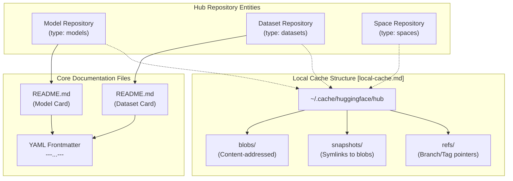
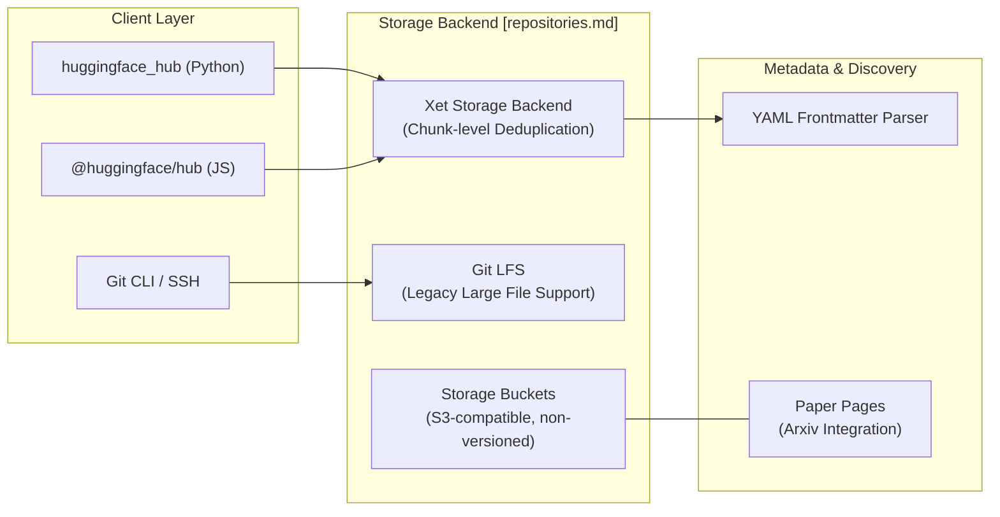

<!-- source: DeepWiki mcp.deepwiki.com · repo huggingface/hub-docs · page 1 Hugging Face Hub Overview · fetched 2026-10-26 -->

# Hugging Face Hub Overview

Relevant source files

The following files were used as context for generating this wiki page:

- [datasetcard.md](datasetcard.md)
- [docs/hub/_toctree.yml](docs/hub/_toctree.yml)
- [docs/hub/datasets-cards.md](docs/hub/datasets-cards.md)
- [docs/hub/index.md](docs/hub/index.md)
- [docs/hub/local-cache.md](docs/hub/local-cache.md)
- [docs/hub/model-cards.md](docs/hub/model-cards.md)
- [docs/hub/paper-pages.md](docs/hub/paper-pages.md)
- [docs/hub/repositories-licenses.md](docs/hub/repositories-licenses.md)
- [docs/hub/repositories.md](docs/hub/repositories.md)
- [modelcard.md](modelcard.md)

## Purpose and Scope

This document provides a comprehensive overview of the Hugging Face Hub ecosystem, covering its core components, architecture, and key features. It serves as the entry point for understanding how the Hub functions as a platform for hosting machine learning models, datasets, and interactive applications.

For details on specific repository fundamentals and local caching, see [Getting Started and Repository Basics](#1.1). For details on the underlying large-file storage architecture, see [Xet Storage Backend](#1.2).

## What is the Hugging Face Hub

The Hugging Face Hub is the reference AI platform for open ML, hosting over 2M models, 1.5M datasets, and 1.5M AI apps (Spaces) [docs/hub/index.md:1-3](). It serves as a central collaboration platform where the machine learning community can share, explore, discover, and experiment with open-source ML resources.

The platform is built on Git-based repositories, providing version control, commit history, and branches [docs/hub/repositories.md:1-3](). While standard Git is used for code, the Hub utilizes specialized backends like **Xet** and **Git LFS** to handle large binary files such as model weights and Parquet datasets [docs/hub/repositories.md:8-10]().

Sources: [docs/hub/index.md:1-3](), [docs/hub/repositories.md:1-10]()

## Core Components

The Hub ecosystem is organized into three primary repository types, unified by a common metadata and documentation system.

### Repository Types and Code Entities

The following diagram bridges the conceptual repository types to the specific files and structures that define them in the codebase and on-disk cache.

Sources: [docs/hub/model-cards.md:6-25](), [docs/hub/datasets-cards.md:1-12](), [docs/hub/local-cache.md:26-110]()

### Models
Model repositories host machine learning weights and configurations. They use **Model Cards** (`README.md`) to store metadata such as `library_name`, `base_model`, and `license` [docs/hub/model-cards.md:61-109](). Valid licenses are validated against a central registry [docs/hub/repositories-licenses.md:11-68]().

### Datasets
Dataset repositories provide structured data storage. They include **Dataset Cards** that define `task_categories` and `size_categories` [docs/hub/datasets-cards.md:11-26](). The Hub automatically detects modalities (audio, image, etc.) but allows overrides via tags in the metadata [docs/hub/datasets-cards.md:62-72]().

### Spaces
Spaces host interactive ML applications. They support SDKs like Gradio, Streamlit, and Docker [docs/hub/index.md:124-130](). Spaces can also serve as Model Context Protocol (MCP) servers for AI agents.

## Overall Architecture

### Storage and Versioning Architecture

The Hub distinguishes between Git-backed versioned storage and non-versioned object storage.

Sources: [docs/hub/repositories.md:5-10](), [docs/hub/local-cache.md:9-16](), [docs/hub/paper-pages.md:1-15]()

### Metadata and Discovery
The Hub's discovery engine relies on the YAML frontmatter in `README.md` files. 
- **Licenses**: The Hub enforces valid license identifiers (e.g., `apache-2.0`, `mit`) to enable filtering [docs/hub/repositories-licenses.md:11-15]().
- **Paper Integration**: Arxiv IDs linked in cards are extracted to create **Paper Pages**, linking models and datasets to academic research [docs/hub/paper-pages.md:10-20]().
- **Local Caching**: The `huggingface_hub` library manages a content-addressed local cache at `~/.cache/huggingface/hub`, using symlinks in `snapshots/` to point to content in `blobs/` [docs/hub/local-cache.md:28-73]().

## Next Steps

For further technical details, please refer to the following child pages:

*   **[Getting Started and Repository Basics](#1.1)**: Covers Git operations, PRs, Discussions, and the technical layout of the `local-cache`.
*   **[Xet Storage Backend](#1.2)**: Details the deduplication and chunking logic that enables Terabyte-scale repository hosting.

Sources: [docs/hub/_toctree.yml:46-64](), [docs/hub/repositories.md:18-32]()

---

