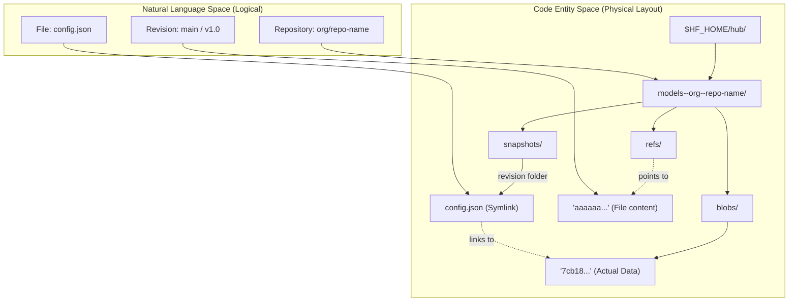
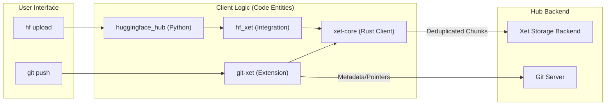

<!-- source: DeepWiki mcp.deepwiki.com · repo huggingface/hub-docs · page 1.1 Getting Started and Repository Basics · fetched 2026-10-26 -->

# Getting Started and Repository Basics

Relevant source files

The following files were used as context for generating this wiki page:

- [docs/hub/_toctree.yml](docs/hub/_toctree.yml)
- [docs/hub/index.md](docs/hub/index.md)
- [docs/hub/local-cache.md](docs/hub/local-cache.md)
- [docs/hub/moderation.md](docs/hub/moderation.md)
- [docs/hub/repositories-getting-started.md](docs/hub/repositories-getting-started.md)
- [docs/hub/repositories-next-steps.md](docs/hub/repositories-next-steps.md)
- [docs/hub/repositories-pull-requests-discussions.md](docs/hub/repositories-pull-requests-discussions.md)
- [docs/hub/repositories-settings.md](docs/hub/repositories-settings.md)
- [docs/hub/repositories.md](docs/hub/repositories.md)
- [docs/hub/sample-factory.md](docs/hub/sample-factory.md)
- [docs/hub/security-git-ssh.md](docs/hub/security-git-ssh.md)
- [docs/hub/spaces-custom-domain.md](docs/hub/spaces-custom-domain.md)
- [docs/hub/spaces-embed.md](docs/hub/spaces-embed.md)
- [docs/hub/spaces-more-ways-to-create.md](docs/hub/spaces-more-ways-to-create.md)
- [docs/hub/xet/index.md](docs/hub/xet/index.md)
- [docs/hub/xet/legacy-git-lfs.md](docs/hub/xet/legacy-git-lfs.md)
- [docs/hub/xet/overview.md](docs/hub/xet/overview.md)
- [docs/hub/xet/security.md](docs/hub/xet/security.md)
- [docs/hub/xet/using-xet-storage.md](docs/hub/xet/using-xet-storage.md)

The Hugging Face Hub is a central platform for hosting and collaborating on Machine Learning assets. It supports three primary repository types: **Models**, **Datasets**, and **Spaces** [docs/hub/index.md:3-3](). All repositories are backed by Git-based versioning, but utilize a specialized storage backend called **Xet** to handle large-scale binary data like model weights and Parquet files [docs/hub/repositories.md:3-9]().

## Repository Fundamentals

A repository (or "repo") on the Hub serves as a version-controlled container for code, metadata, and large assets [docs/hub/repositories.md:3-3]().

### Versioning and Branches
The Hub implements a simplified Git workflow to accommodate ML-specific needs.
*   **Branches**: Used to isolate "work in progress" from "production-ready" code. They allow multiple contributors to work on a project without frequent conflicts [docs/hub/repositories-next-steps.md:15-17]().
*   **Tags**: Used to mark specific commits as milestones (e.g., `v1.0`). Tags are useful for A/B testing and pinning specific model versions in downstream applications [docs/hub/repositories-next-steps.md:21-25]().
*   **Refs**: Human-readable references (branches, tags, PRs) are stored in the `refs/` directory of the local cache, mapping these names to 40-character hexadecimal commit hashes [docs/hub/local-cache.md:129-134]().

### Pull Requests and Discussions
Unlike standard Git hosts like GitHub, the Hub does not require forks for community contributions [docs/hub/repositories-pull-requests-discussions:5-6]().
*   **Special Refs**: Contributors push changes directly to a special `ref` branch on the source repository (e.g., `refs/pr/42`) [docs/hub/repositories-pull-requests-discussions:6-6](), [docs/hub/repositories-pull-requests-discussions:113-122]().
*   **Unified Interface**: Discussions and Pull Requests (PRs) are displayed in a single list under the **Community** tab [docs/hub/repositories-pull-requests-discussions:7-7](), [docs/hub/repositories-pull-requests-discussions:14-14]().
*   **Draft Mode**: PRs can be opened in "Draft" status to indicate ongoing work, preventing accidental merges until the "Publish" button is clicked [docs/hub/repositories-pull-requests-discussions:124-126]().

### Repository Settings and Visibility
Repository owners can manage visibility and administrative tasks via the **Settings** tab [docs/hub/repositories-settings:6-6]().
*   **Visibility**: Options include `public` and `private` (for models/datasets), while Spaces add a `protected` tier [docs/hub/repositories-settings:8-10]().
*   **Renaming/Transferring**: Owners can rename repos or transfer ownership to organizations. The Hub automatically redirects old URLs and preserves metadata like download counts [docs/hub/repositories-settings:18-20]().
*   **Feature Toggles**: Discussions and PRs can be disabled entirely if the owner wishes to restrict community contributions [docs/hub/repositories-settings:36-38]().

**Sources:** [docs/hub/repositories.md:3-9](), [docs/hub/repositories-next-steps.md:15-25](), [docs/hub/repositories-pull-requests-discussions.md:5-126](), [docs/hub/repositories-settings.md:6-38](), [docs/hub/local-cache.md:129-134]()

---

## Local Cache Layout

The `huggingface_hub` library and integrated tools (like `transformers` and `llama.cpp`) use a specific on-disk layout to manage downloaded assets efficiently [docs/hub/local-cache.md:1-25]().

### Cache Structure Diagram
This diagram bridges the **Logical Repository** concept to the **Physical File System** entities.

### Key Components
1.  **Location**: Defaults to `~/.cache/huggingface/hub`, but can be overridden by `HF_HUB_CACHE` or `HF_HOME` [docs/hub/local-cache.md:28-37]().
2.  **`blobs/`**: Content-addressed storage. Files are named by their **SHA-1** (Git-tracked) or **SHA-256** (LFS/Xet) hashes. This ensures that identical files across different revisions or repositories are stored only once [docs/hub/local-cache.md:113-120]().
3.  **`snapshots/`**: Contains subdirectories named after commit hashes. Each subdirectory contains symlinks pointing to the relevant files in `../../blobs/` [docs/hub/local-cache.md:146-158]().
4.  **`.locks/`**: Contains lock files to ensure thread-safety during concurrent downloads [docs/hub/local-cache.md:42-42]().

**Sources:** [docs/hub/local-cache.md:1-158]()

---

## Getting Started: Upload and Download

Users can interact with the Hub through the Web UI, the `hf` CLI, or standard Git clients enhanced with `git-xet` [docs/hub/repositories-getting-started:7-12]().

### Workflow Comparison

| Action | Web UI | `hf` CLI | Git + Xet |
| :--- | :--- | :--- | :--- |
| **Creation** | [huggingface.co/new](http://huggingface.co/new) | N/A | N/A |
| **Upload** | "Add file" button in Files tab | `hf upload {repo} {path}` | `git push` |
| **Download** | "Download" button on file | `hf download {repo} {file}` | `git clone {url}` |
| **Auth** | Browser Login | `hf auth login` | SSH Keys or HTTPS Creds |

### Integration Diagram: CLI and Storage
This diagram shows how user commands translate to the underlying `hf_xet` and `xet-core` entities.

### Implementation Details
*   **Xet Protocol**: Invoked automatically for large files. It uses chunk-level deduplication to increase upload speeds by only sending changed data segments [docs/hub/xet/using-xet-storage.md:89-89]().
*   **Adaptive Concurrency**: The `hf_xet` package (integrated into `huggingface_hub` >= 0.32.0) dynamically adjusts parallel transfer streams based on network conditions [docs/hub/xet/using-xet-storage.md:11-13](), [docs/hub/xet/using-xet-storage.md:126-126]().
*   **Authentication**: The `hf auth login` command manages tokens locally for the CLI and Python libraries [docs/hub/repositories-getting-started:14-22]().

**Sources:** [docs/hub/repositories-getting-started.md:7-100](), [docs/hub/xet/using-xet-storage.md:5-127]()

---

