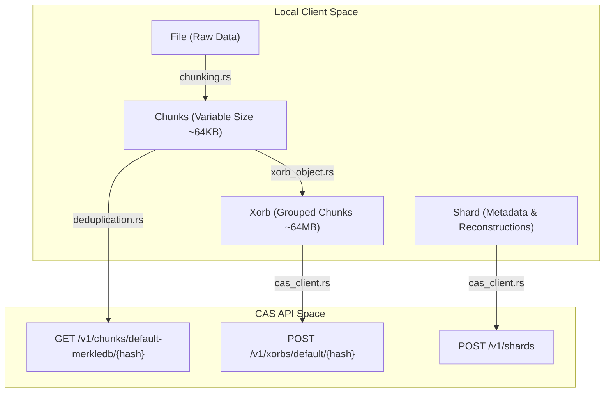
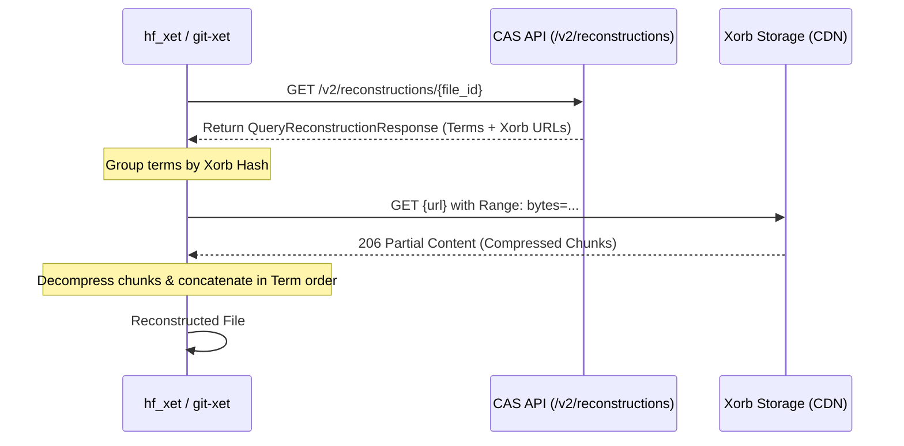

<!-- source: DeepWiki mcp.deepwiki.com · repo huggingface/hub-docs · page 1.2 Xet Storage Backend · fetched 2026-10-26 -->

# Xet Storage Backend

Relevant source files

The following files were used as context for generating this wiki page:

- [docs/hub/datasets-ingesting.md](docs/hub/datasets-ingesting.md)
- [docs/hub/repositories-getting-started.md](docs/hub/repositories-getting-started.md)
- [docs/hub/xet/deduplication.md](docs/hub/xet/deduplication.md)
- [docs/hub/xet/index.md](docs/hub/xet/index.md)
- [docs/hub/xet/legacy-git-lfs.md](docs/hub/xet/legacy-git-lfs.md)
- [docs/hub/xet/overview.md](docs/hub/xet/overview.md)
- [docs/hub/xet/security.md](docs/hub/xet/security.md)
- [docs/hub/xet/using-xet-storage.md](docs/hub/xet/using-xet-storage.md)
- [docs/xet/api.md](docs/xet/api.md)
- [docs/xet/chunking.md](docs/xet/chunking.md)
- [docs/xet/deduplication.md](docs/xet/deduplication.md)
- [docs/xet/download-protocol.md](docs/xet/download-protocol.md)
- [docs/xet/hashing.md](docs/xet/hashing.md)
- [docs/xet/index.md](docs/xet/index.md)
- [docs/xet/shard.md](docs/xet/shard.md)
- [docs/xet/upload-protocol.md](docs/xet/upload-protocol.md)
- [docs/xet/xorb.md](docs/xet/xorb.md)

The Xet storage backend is a content-addressed storage (CAS) system designed to optimize the hosting of large files on the Hugging Face Hub. It replaces traditional Git LFS with a more efficient architecture based on **Content-Defined Chunking (CDC)** and **global deduplication**. By breaking files into variable-sized chunks (~64KB), Xet allows for incremental updates, faster transfers, and instant server-side copies between repositories and storage buckets [docs/hub/xet/deduplication.md:3-6]().

## System Architecture and Data Flow

The Xet ecosystem consists of several layers, from high-level client libraries to the low-level CAS protocol. The primary reference implementation is `xet-core`, written in Rust, which provides the underlying logic for both Python and Git interfaces [docs/xet/index.md:31-43]().

### High-Level Components

| Component | Description |
| :--- | :--- |
| **hf_xet** | Python bindings for `huggingface_hub` to enable Xet-based uploads/downloads [docs/hub/xet/using-xet-storage.md:11-13](). |
| **git-xet** | A Git extension that acts as a custom transfer agent, allowing standard `git push/pull` workflows to use the Xet protocol [docs/hub/xet/using-xet-storage.md:32-33](). |
| **CAS Server** | The remote Content Addressable Storage that stores chunks, xorbs, and shards [docs/xet/api.md:1-3](). |

### Logical Data Flow (Upload)

The following diagram illustrates how a file is transformed from a byte stream into stored entities in the CAS.

**Title: File to CAS Entity Mapping**

Sources: [docs/xet/upload-protocol.md:58-114](), [docs/xet/index.md:35-43](), [docs/hub/xet/deduplication.md:55-62]()

## Core Technology: Content-Defined Chunking (CDC)

Unlike fixed-size chunking used in traditional storage, Xet uses **Gearhash-based CDC**. This ensures **boundary stability**: if data is inserted at the beginning of a file, only the modified chunk changes, while all subsequent chunks retain the same boundaries and hashes [docs/xet/chunking.md:92-114]().

### Algorithm Implementation
1. **Rolling Hash**: A 64-bit hash `h` is updated per byte: `h = (h << 1) + TABLE[b]` [docs/xet/chunking.md:27-33]().
2. **Constraints**:
   - **Min Size**: 8 KiB (no boundaries allowed before this) [docs/xet/chunking.md:17-17]().
   - **Max Size**: 128 KiB (boundary forced if no content match found) [docs/xet/chunking.md:18-18]().
   - **Mask**: `0xFFFF000000000000`. A boundary is set when `(h & MASK) == 0`, occurring statistically every 64 KiB [docs/xet/chunking.md:19-19](), [docs/xet/chunking.md:84-84]().

Sources: [docs/xet/chunking.md:12-50]()

## Data Formats: Xorbs and Shards

Xet does not store individual 64KB chunks as separate files to avoid metadata overhead. Instead, it aggregates them into larger structures.

### Xorb (Xet Orb)
A Xorb is a sequence of compressed chunks, capped at 64 MiB [docs/xet/xorb.md:13-15]().
- **Structure**: Each chunk in a Xorb has a header (1 byte version, 3 bytes compressed size, 1 byte compression type, 3 bytes uncompressed size) followed by the data [docs/xet/xorb.md:45-53]().
- **Compression**: Supports `None`, `LZ4`, and `ByteGrouping4LZ4` (optimized for structured data like floating-point tensors) [docs/xet/xorb.md:72-78]().

### Shard
Shards are the "connective tissue" of the system. They contain:
1. **File Information**: The "recipe" (File Reconstruction) to rebuild a file from specific chunk ranges in various Xorbs [docs/xet/upload-protocol.md:35-39]().
2. **CAS Information**: Metadata about which chunks are contained in which Xorbs, used for deduplication [docs/xet/upload-protocol.md:45-47]().

Sources: [docs/xet/xorb.md:3-33](), [docs/xet/upload-protocol.md:33-51]()

## Protocols and API

### Upload Protocol
The upload process is highly concurrent but strictly ordered regarding finalization [docs/xet/upload-protocol.md:5-6]():
1. **Chunking & Hashing**: Split file and compute `MerkleHash` for each chunk [docs/xet/upload-protocol.md:58-61]().
2. **Deduplication**: Check local cache and then the **Global Deduplication API** (`GET /v1/chunks/...`) to see if chunks already exist [docs/xet/upload-protocol.md:64-71]().
3. **Xorb Upload**: Group new chunks and upload via `POST /v1/xorbs/...` [docs/xet/upload-protocol.md:84-87]().
4. **Shard Upload**: Upload the file reconstruction and Xorb metadata via `POST /v1/shards`. All referenced Xorbs **MUST** be uploaded before the shard [docs/xet/upload-protocol.md:110-116]().

### Download Protocol
Downloading involves a two-stage process to reassemble the file from distributed chunks [docs/xet/download-protocol.md:7-10]().

**Title: Xet Download & Reconstruction Sequence**

Sources: [docs/xet/download-protocol.md:12-102](), [docs/xet/api.md:37-43]()

## Hashing and Integrity
Xet uses `Blake3` keyed hashes for all identifiers [docs/xet/hashing.md:10-14]():
- **Chunk Hash**: Keyed with `DATA_KEY` [docs/xet/hashing.md:14-16]().
- **Xorb/File Hash**: Computed as the root of a Merkle Tree where leaves are chunk hashes. Internal nodes are formatted as a string list of `hash : size` before hashing with `INTERNAL_NODE_KEY` [docs/xet/hashing.md:28-40]().
- **Verification Hash**: Used in shards to prove the uploader possesses the file data, keyed with `VERIFICATION_KEY` [docs/xet/hashing.md:100-110]().

### Hash-to-String Conversion
To ensure consistency, hashes are converted to hex strings using a specific little-endian 64-bit region reversal [docs/xet/api.md:13-19](). For example, a hash starting `[0, 1, 2, 3, 4, 5, 6, 7]` becomes `0706050403020100...` in API paths [docs/xet/api.md:26-33]().

Sources: [docs/xet/hashing.md:1-120](), [docs/xet/api.md:9-34]()

---

