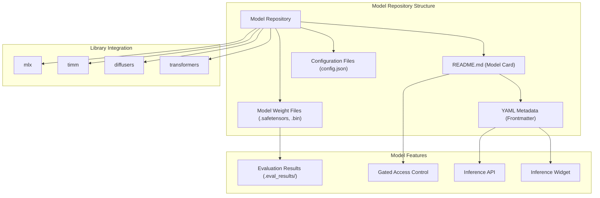
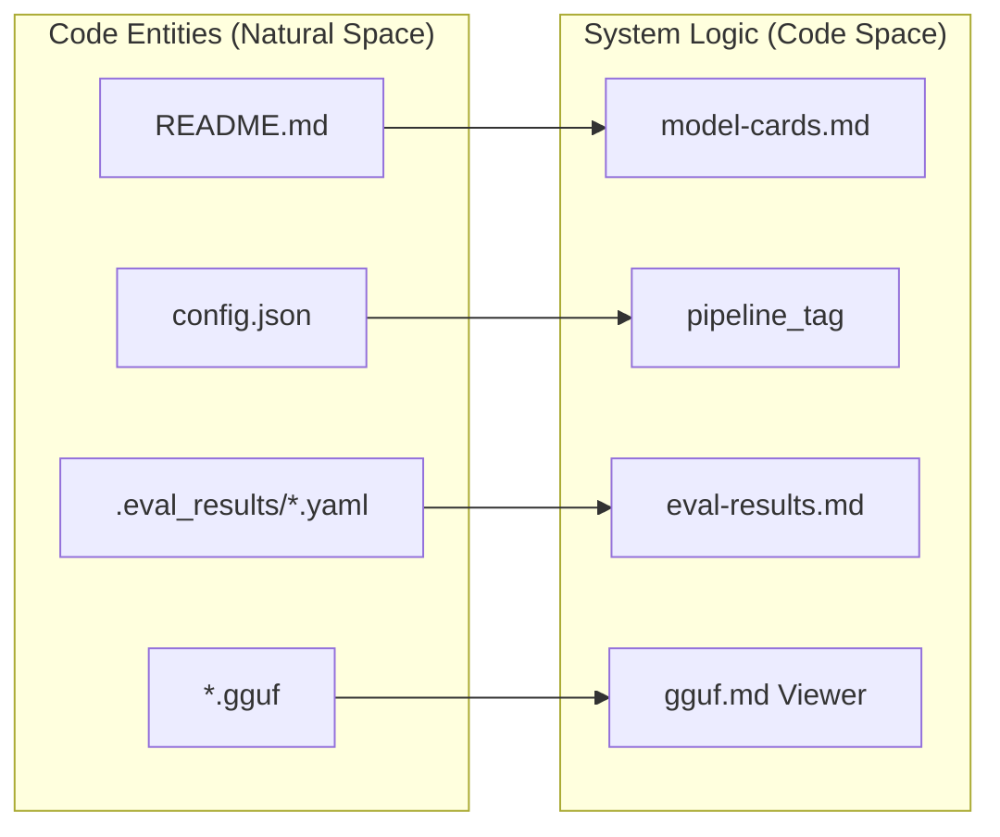
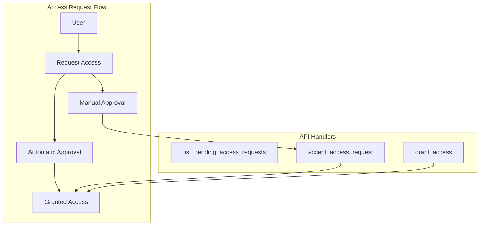

<!-- source: DeepWiki mcp.deepwiki.com · repo huggingface/hub-docs · page 2.1 Models · fetched 2026-10-26 -->

# Models

<details>
<summary>Relevant source files</summary>

The following files were used as context for generating this wiki page:

- [docs/hub/_config.py](docs/hub/_config.py)
- [docs/hub/blog-articles.md](docs/hub/blog-articles.md)
- [docs/hub/collections.md](docs/hub/collections.md)
- [docs/hub/datasets-download-stats.md](docs/hub/datasets-download-stats.md)
- [docs/hub/datasets-downloading.md](docs/hub/datasets-downloading.md)
- [docs/hub/datasets-gated.md](docs/hub/datasets-gated.md)
- [docs/hub/datasets-spark.md](docs/hub/datasets-spark.md)
- [docs/hub/dduf.md](docs/hub/dduf.md)
- [docs/hub/enterprise-advanced-security.md](docs/hub/enterprise-advanced-security.md)
- [docs/hub/enterprise-blog-articles.md](docs/hub/enterprise-blog-articles.md)
- [docs/hub/enterprise-datasets.md](docs/hub/enterprise-datasets.md)
- [docs/hub/eval-results.md](docs/hub/eval-results.md)
- [docs/hub/gguf-gpt4all.md](docs/hub/gguf-gpt4all.md)
- [docs/hub/gguf-llamacpp.md](docs/hub/gguf-llamacpp.md)
- [docs/hub/gguf.md](docs/hub/gguf.md)
- [docs/hub/lmstudio.md](docs/hub/lmstudio.md)
- [docs/hub/local-apps.md](docs/hub/local-apps.md)
- [docs/hub/mlx.md](docs/hub/mlx.md)
- [docs/hub/model-card-annotated.md](docs/hub/model-card-annotated.md)
- [docs/hub/model-card-appendix.md](docs/hub/model-card-appendix.md)
- [docs/hub/model-card-guidebook.md](docs/hub/model-card-guidebook.md)
- [docs/hub/model-card-landscape-analysis.md](docs/hub/model-card-landscape-analysis.md)
- [docs/hub/model-cards-co2.md](docs/hub/model-cards-co2.md)
- [docs/hub/model-cards-user-studies.md](docs/hub/model-cards-user-studies.md)
- [docs/hub/model-release-checklist.md](docs/hub/model-release-checklist.md)
- [docs/hub/models-adding-libraries.md](docs/hub/models-adding-libraries.md)
- [docs/hub/models-advanced.md](docs/hub/models-advanced.md)
- [docs/hub/models-download-stats.md](docs/hub/models-download-stats.md)
- [docs/hub/models-downloading.md](docs/hub/models-downloading.md)
- [docs/hub/models-faq.md](docs/hub/models-faq.md)
- [docs/hub/models-gated.md](docs/hub/models-gated.md)
- [docs/hub/models-inference.md](docs/hub/models-inference.md)
- [docs/hub/models-libraries.md](docs/hub/models-libraries.md)
- [docs/hub/models-tasks.md](docs/hub/models-tasks.md)
- [docs/hub/models-the-hub.md](docs/hub/models-the-hub.md)
- [docs/hub/models-uploading.md](docs/hub/models-uploading.md)
- [docs/hub/models-widgets-examples.md](docs/hub/models-widgets-examples.md)
- [docs/hub/models-widgets.md](docs/hub/models-widgets.md)
- [docs/hub/models.md](docs/hub/models.md)
- [docs/hub/paddlenlp.md](docs/hub/paddlenlp.md)
- [docs/hub/publisher-analytics.md](docs/hub/publisher-analytics.md)
- [docs/hub/setfit.md](docs/hub/setfit.md)
- [docs/hub/timm.md](docs/hub/timm.md)
- [eval_results.yaml](eval_results.yaml)

</details>


This document covers the model repository system within the Hugging Face Hub, including model cards, metadata management, access control, inference capabilities, and library integrations. Models are one of the three primary repository types on the Hub alongside datasets and Spaces.

For information about dataset repositories, see [Datasets](#2.2). For information about Space repositories and application hosting, see [Spaces](#2.3). For programmatic access to models via APIs, see [Hub API and Programmatic Access](#3).

## Model Repository Architecture

Model repositories are Git-based repositories that store machine learning models, their metadata, and associated files. The Hub provides specialized features for model discovery, inference, and integration with ML libraries.



**Model Repository Components Mapping:**


Sources: [docs/hub/models.md:1-21](), [docs/hub/models-the-hub.md:1-11](), [docs/hub/eval-results.md:16-23](), [docs/hub/gguf.md:27-29]()

## Model Cards and Metadata

Model cards serve as the documentation and metadata container for model repositories. They are implemented as `README.md` files with YAML frontmatter containing structured metadata.

### Model Card Structure

Model cards contain both structured metadata and human-readable documentation:

| Component | Purpose | Location |
|-----------|---------|----------|
| YAML Metadata | Structured data for Hub features (task, library, license) | Top of `README.md` |
| Model Description | Human-readable documentation of architecture and intent | Body of `README.md` |
| Evaluation Results | Standardized performance metrics | `.eval_results/` folder |
| Usage Examples | Copy-and-run code snippets | Markdown content |

### Key Metadata Fields

The model card metadata supports numerous fields that enable Hub functionality:

```yaml
---
language: 
- en
license: apache-2.0
library_name: transformers
pipeline_tag: text-generation
tags:
- deepseek
- v3
datasets:
- username/dataset
base_model: username/base-model
widget:
  - text: "The capital of France is"
    example_title: "Geography Completion"
---
```

### Evaluation Results Integration
The Hub provides a decentralized system for tracking results. Evaluation scores are stored in model repos as YAML files in the `.eval_results/` folder [docs/hub/eval-results.md:16-23](). These results are aggregated into benchmark dataset leaderboards if they reference a registered benchmark ID [docs/hub/eval-results.md:31-33]().

Sources: [docs/hub/model-cards.md:1-303](), [docs/hub/model-release-checklist.md:25-41](), [docs/hub/eval-results.md:1-43]()

## Model Access and Security

The Hub provides multiple layers of access control, including gated models for sensitive research or early releases.

### Gated Models

Gated models require users to share contact information and potentially agree to terms before access is granted [docs/hub/models-gated.md:3-4]().



### Access Management API
Model authors can automate approval via the `huggingface_hub` Python client or REST API:

| Method | Endpoint | Python Function |
|----------|---------|---------|
| `GET` | `/api/models/{repo_id}/user-access-request/pending` | `list_pending_access_requests` |
| `POST` | `/api/models/{repo_id}/user-access-request/handle` | `accept_access_request` |
| `POST` | `/api/models/{repo_id}/user-access-request/grant` | `grant_access` |

Sources: [docs/hub/models-gated.md:52-65](), [docs/hub/datasets-gated.md:52-65]()

## Model Inference and Widgets

The Hub provides interactive widgets and inference APIs for model execution, powered by Inference Providers [docs/hub/models-widgets.md:5-6]().

### Widget Determination
The type of widget displayed (e.g., `text-generation`, `text-to-image`) is inferred from the model's `pipeline_tag` [docs/hub/models-widgets.md:17-20](). For `transformers` models, this can be automatically determined from the architecture in `config.json` [docs/hub/models-widgets.md:22-23]().

### Widget Configuration
Authors can specify example inputs in the model card metadata to guide users:
```yaml
widget:
  - text: "This new restaurant has amazing food!"
    example_title: "Positive Review"
  - src: sample1.flac
    example_title: "Audio Sample"
```
Sources: [docs/hub/models-widgets.md:30-42](), [docs/hub/models-widgets.md:85-88]()

## Library Integration

The Hub supports dozens of libraries, enabling users to download and upload models directly from their favorite frameworks [docs/hub/models-libraries.md:3-5]().

### Integration Status Table (Partial)
| Library | Inference Providers | Widgets | Download | Push |
|---------|---------------------|---------|----------|------|
| [Transformers](./transformers) | ✅ | ✅ | ✅ | ✅ |
| [Diffusers](./diffusers) | ✅ | ✅ | ✅ | ✅ |
| [MLX](./mlx) | ❌ | ❌ | ✅ | ✅ |
| [PEFT](./peft) | ✅ | ✅ | ✅ | ✅ |

Sources: [docs/hub/models-libraries.md:7-45]()

### Implementation Guide
To integrate a new library, authors use the `huggingface_hub` Python library to implement `from_pretrained` and `push_to_hub` methods [docs/hub/models-adding-libraries.md:20-22]().
- **Download**: Use `hf_hub_download` for single files or `snapshot_download` for full repos [docs/hub/models-adding-libraries.md:62-75]().
- **Upload**: Use `upload_file` or `upload_folder` [docs/hub/models-adding-libraries.md:90-91]().

## Specialized Formats: GGUF

The Hub has built-in features for the **GGUF format**, a binary format optimized for quick loading and efficient inference, particularly with `llama.cpp` [docs/hub/gguf.md:3-4]().

### GGUF Features
- **Metadata Viewer**: The Hub provides a specialized viewer for GGUF files to check metadata and tensor info (name, shape, precision) [docs/hub/gguf.md:27-29]().
- **Quantization Support**: Supports various types like `Q4_K`, `Q8_0`, and `IQ4_XS` [docs/hub/gguf.md:75-83]().
- **Parsing**: A Javascript parser `@huggingface/gguf` is available for remote file inspection [docs/hub/gguf.md:51-60]().

Sources: [docs/hub/gguf.md:1-85](), [docs/hub/gguf-llamacpp.md:1-44]()

## Model Release Checklist

To ensure a successful model release, authors should follow these essential steps:
1. **Weights**: Use `safetensors` over `pickle` for safety and speed [docs/hub/model-release-checklist.md:18-19]().
2. **Repositories**: Use separate repositories for different model variants (e.g., different quantizations or sizes) and group them into **Collections** [docs/hub/model-release-checklist.md:15-16]().
3. **Metadata**: Ensure `pipeline_tag`, `library_name`, and `license` are correctly set in the YAML frontmatter [docs/hub/model-release-checklist.md:25-41]().
4. **Discoverability**: Cite research papers to enable automatic cross-linking [docs/hub/model-release-checklist.md:113-114]().

Sources: [docs/hub/model-release-checklist.md:1-124]()

---

