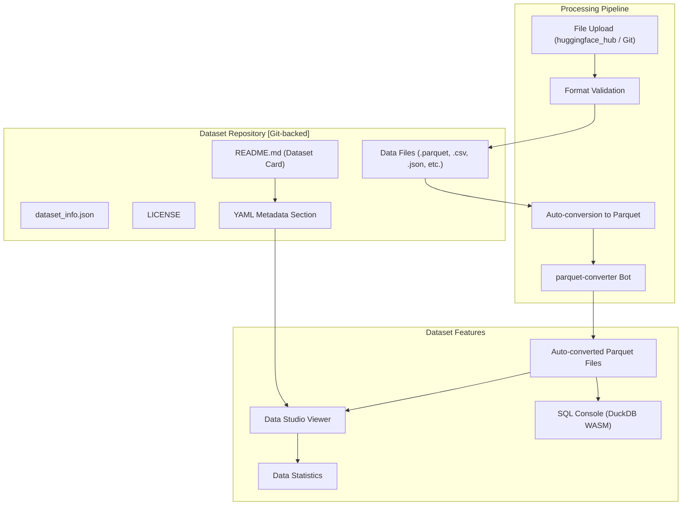
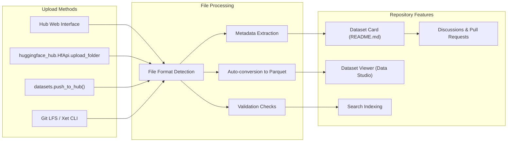
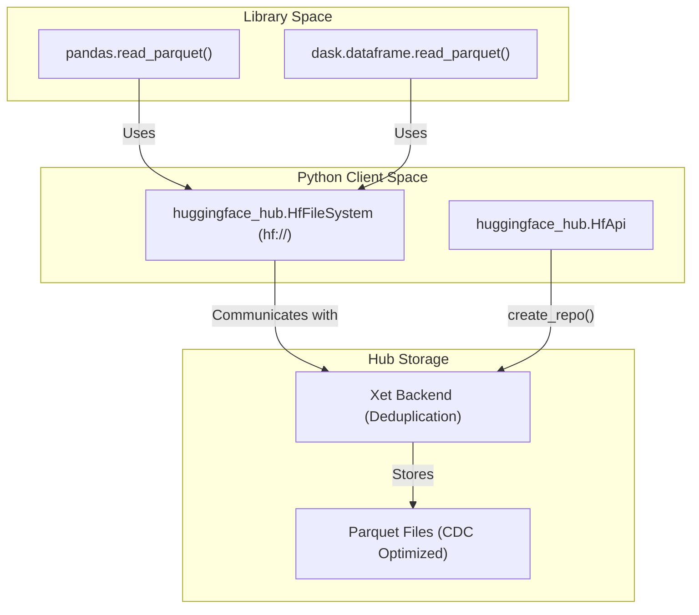

<!-- source: DeepWiki mcp.deepwiki.com · repo huggingface/hub-docs · page 2.2 Datasets · fetched 2026-10-26 -->

# Datasets

<details>
<summary>Relevant source files</summary>

The following files were used as context for generating this wiki page:

- [docs/hub/academia-hub.md](docs/hub/academia-hub.md)
- [docs/hub/api.md](docs/hub/api.md)
- [docs/hub/collections.md](docs/hub/collections.md)
- [docs/hub/data-studio.md](docs/hub/data-studio.md)
- [docs/hub/datasets-adding.md](docs/hub/datasets-adding.md)
- [docs/hub/datasets-argilla.md](docs/hub/datasets-argilla.md)
- [docs/hub/datasets-audio.md](docs/hub/datasets-audio.md)
- [docs/hub/datasets-dask.md](docs/hub/datasets-dask.md)
- [docs/hub/datasets-data-files-configuration.md](docs/hub/datasets-data-files-configuration.md)
- [docs/hub/datasets-distilabel.md](docs/hub/datasets-distilabel.md)
- [docs/hub/datasets-duckdb-auth.md](docs/hub/datasets-duckdb-auth.md)
- [docs/hub/datasets-duckdb.md](docs/hub/datasets-duckdb.md)
- [docs/hub/datasets-editing.md](docs/hub/datasets-editing.md)
- [docs/hub/datasets-fiftyone.md](docs/hub/datasets-fiftyone.md)
- [docs/hub/datasets-file-names-and-splits.md](docs/hub/datasets-file-names-and-splits.md)
- [docs/hub/datasets-gated.md](docs/hub/datasets-gated.md)
- [docs/hub/datasets-image.md](docs/hub/datasets-image.md)
- [docs/hub/datasets-libraries.md](docs/hub/datasets-libraries.md)
- [docs/hub/datasets-manual-configuration.md](docs/hub/datasets-manual-configuration.md)
- [docs/hub/datasets-overview.md](docs/hub/datasets-overview.md)
- [docs/hub/datasets-pandas.md](docs/hub/datasets-pandas.md)
- [docs/hub/datasets-polars-auth.md](docs/hub/datasets-polars-auth.md)
- [docs/hub/datasets-polars-file-formats.md](docs/hub/datasets-polars-file-formats.md)
- [docs/hub/datasets-polars-operations.md](docs/hub/datasets-polars-operations.md)
- [docs/hub/datasets-polars-optimizations.md](docs/hub/datasets-polars-optimizations.md)
- [docs/hub/datasets-polars.md](docs/hub/datasets-polars.md)
- [docs/hub/datasets-pyarrow.md](docs/hub/datasets-pyarrow.md)
- [docs/hub/datasets-streaming.md](docs/hub/datasets-streaming.md)
- [docs/hub/datasets-upload-guide-llm.md](docs/hub/datasets-upload-guide-llm.md)
- [docs/hub/datasets-usage.md](docs/hub/datasets-usage.md)
- [docs/hub/datasets-video.md](docs/hub/datasets-video.md)
- [docs/hub/datasets-viewer-configure.md](docs/hub/datasets-viewer-configure.md)
- [docs/hub/datasets-viewer-embed.md](docs/hub/datasets-viewer-embed.md)
- [docs/hub/datasets-viewer-sql-console.md](docs/hub/datasets-viewer-sql-console.md)
- [docs/hub/datasets-webdataset.md](docs/hub/datasets-webdataset.md)
- [docs/hub/models-gated.md](docs/hub/models-gated.md)
- [docs/hub/spacy.md](docs/hub/spacy.md)
- [docs/hub/storage-limits.md](docs/hub/storage-limits.md)

</details>


This document covers dataset repositories on the Hugging Face Hub, including uploading datasets, dataset cards and metadata, the Dataset Viewer (Data Studio), access control, and advanced features. Dataset repositories are one of the three main content types managed by the Hub, alongside models and Spaces.

For information about model repositories, see [Models](#2.1). For information about Spaces, see [Spaces](#2.3). For programmatic access to datasets, see [Hub API and Programmatic Access](#3).

## Dataset Repository Architecture

Dataset repositories follow the Hub's Git-based repository model, with additional features specific to dataset management and visualization.

### Dataset Repository Structure



Sources: [docs/hub/datasets-adding.md:1-116](), [docs/hub/datasets-viewer.md:57-81](), [docs/hub/datasets-cards.md:1-83](), [docs/hub/datasets-data-files-configuration.md:1-72]()

### Dataset Lifecycle Management



Sources: [docs/hub/datasets-adding.md:7-76](), [docs/hub/datasets-viewer.md:67-81](), [docs/hub/repositories-pull-requests-discussions.md:1-164]()

## Upload Methods and File Formats

The Hub supports multiple methods for uploading datasets and a wide range of file formats.

### Supported File Formats

| Format Category | File Extensions | Notes |
|-----------------|----------------|-------|
| Tabular Data | `.parquet`, `.csv`, `.tsv` | **Parquet** is recommended for efficiency and streaming [docs/hub/datasets-adding.md:108-108]() |
| Structured Text | `.jsonl`, `.json` | JSON Lines preferred for nested data [docs/hub/datasets-adding.md:108-108]() |
| Streaming | `.arrow` | Arrow streaming and IPC formats [docs/hub/datasets-adding.md:90-90]() |
| Plain Text | `.txt` | Simple text files |
| Images | `.png`, `.jpg`, `.jpeg`, etc. | Raw image files [docs/hub/datasets-adding.md:92-92]() |
| Audio | `.wav`, `.mp3`, etc. | Raw audio files [docs/hub/datasets-adding.md:93-93]() |
| Video | `.mp4`, `.mov`, `.avi` | Video datasets [docs/hub/datasets-adding.md:94-94]() |
| Documents | `.pdf` | PDF documents |
| Archives | `.tar` (WebDataset) | Preferred for large-scale image/audio streaming [docs/hub/datasets-adding.md:108-108]() |
| Specialized | `.lance` | Lance open lakehouse format [docs/hub/datasets-adding.md:97-97]() |

Sources: [docs/hub/datasets-adding.md:83-101](), [docs/hub/datasets-data-files-configuration.md:47-50]()

### Storage and Repository Limits

| Characteristic | Recommended | Tips |
|----------------|-------------|------|
| Repo size | - | Upgrade plan for TBs of data [docs/hub/storage-limits.md:72-72]() |
| Files per repo | <100k | Merge data into fewer files [docs/hub/storage-limits.md:73-73]() |
| Entries per folder | <10k | Use subdirectories [docs/hub/storage-limits.md:74-74]() |
| File size | <200GB | Split into chunked files [docs/hub/storage-limits.md:75-75]() |

Sources: [docs/hub/storage-limits.md:70-78]()

## Dataset Cards and Metadata

Dataset cards serve as documentation and provide structured metadata for discovery and usage guidance.

### Metadata Implementation
Dataset cards are implemented as `README.md` files with a YAML front-matter section. Metadata includes license, language, and task categories which help in Hub discovery [docs/hub/datasets-adding.md:52-54]().

**Splits and Subsets Configuration**:
Users can manually define splits (e.g., `train`, `test`) and subsets (configurations) using YAML in the `README.md` [docs/hub/datasets-data-files-configuration.md:28-34]().

```yaml
configs:
- config_name: benchmark
  data_files:
  - split: test
    path: benchmark.csv
```
Sources: [docs/hub/datasets-data-files-configuration.md:37-43]()

## Data Studio and Dataset Viewer

The Dataset Viewer (Data Studio) provides interactive exploration of dataset contents through a web interface.

### Features and Optimization
- **Auto-conversion**: The Hub automatically converts supported formats to Parquet to power the viewer [docs/hub/datasets-viewer.md:67-81]().
- **Optimized Parquet**: Features like **Content Defined Chunking (CDC)** optimize files for the Xet storage backend, enabling faster uploads/downloads via deduplication [docs/hub/datasets-libraries.md:54-54]().
- **Page Indexing**: Including a page index (`write_page_index=True`) accelerates filters and random access in the viewer [docs/hub/datasets-libraries.md:55-55]().

### SQL Console
The SQL Console allows running SQL queries directly on dataset files using DuckDB. It supports complex operations like filtering, joining, and statistical analysis [docs/hub/datasets-viewer-sql-console.md:1-129]().

### Embedding
The viewer can be embedded via iframe:
`https://huggingface.co/datasets/<namespace>/<dataset-name>/embed/viewer` [docs/hub/datasets-viewer-embed.md:5-5]().

Sources: [docs/hub/datasets-viewer.md:1-105](), [docs/hub/datasets-libraries.md:44-61](), [docs/hub/datasets-viewer-embed.md:1-16]()

## Gated Datasets and Access Control

Gated datasets require users to request access and share contact information before downloading files [docs/hub/datasets-gated.md:3-3]().

### Management Flow
1. **Enable Access Request**: Dataset authors enable gating in settings [docs/hub/datasets-gated.md:11-11]().
2. **Approval Modes**: 
   - **Automatic**: Access granted immediately upon sharing info [docs/hub/datasets-gated.md:19-19]().
   - **Manual**: Authors must review and accept/reject requests [docs/hub/datasets-gated.md:26-26]().
3. **API Access**: Authors can manage requests via `huggingface_hub` using functions like `accept_access_request` and `list_pending_access_requests` [docs/hub/datasets-gated.md:65-65]().

### Programmatic Access Control (REST API)
| Method | URI | Description |
|--------|-----|-------------|
| `GET` | `/api/datasets/{repo_id}/user-access-request/pending` | List pending requests [docs/hub/datasets-gated.md:57-57]() |
| `POST` | `/api/datasets/{repo_id}/user-access-request/handle` | Accept/Reject a user [docs/hub/datasets-gated.md:60-60]() |
| `POST` | `/api/datasets/{repo_id}/user-access-request/grant` | Directly grant access [docs/hub/datasets-gated.md:61-61]() |

Sources: [docs/hub/datasets-gated.md:1-66](), [docs/hub/models-gated.md:1-66]()

## Library Integrations

The Datasets Hub integrates with various data processing and training libraries.

### Data Processing Libraries
| Library | Integration Level | Key Feature |
|---------|-------------------|-------------|
| **Pandas** | Read/Write | Uses `hf://` paths via `fsspec` [docs/hub/datasets-pandas.md:4-4]() |
| **Dask** | Read/Write/Parallel | Supports distributed writing and predicate pushdown [docs/hub/datasets-dask.md:31-33](), [docs/hub/datasets-dask.md:99-101]() |
| **DuckDB** | Read/Stream | SQL-based access to Hub Parquet files [docs/hub/datasets-libraries.md:19-19]() |
| **Polars** | Read/Write/Stream | High-performance DataFrame operations [docs/hub/datasets-libraries.md:25-25]() |

### Code Entity Association (Pandas/Dask)


Sources: [docs/hub/datasets-pandas.md:1-91](), [docs/hub/datasets-dask.md:1-63](), [docs/hub/datasets-libraries.md:1-30]()

---

