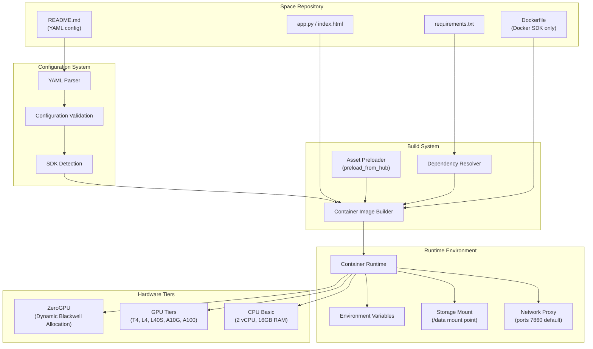
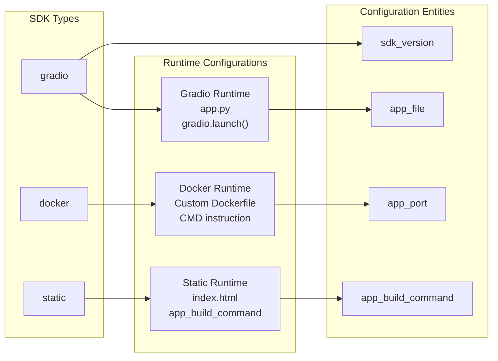
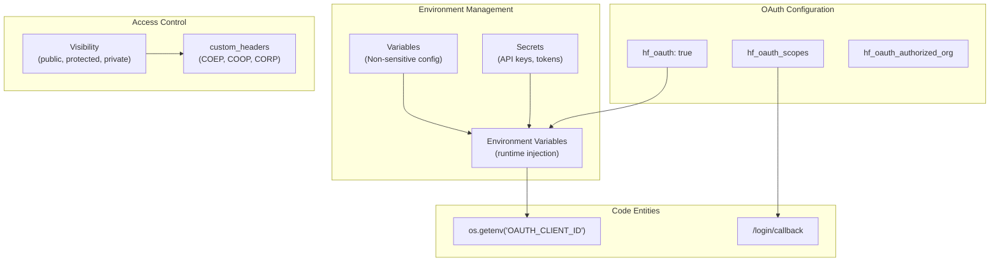

<!-- source: DeepWiki mcp.deepwiki.com · repo huggingface/hub-docs · page 2.3 Spaces · fetched 2026-10-26 -->

# Spaces

Relevant source files

The following files were used as context for generating this wiki page:

- [docs/hub/billing.md](docs/hub/billing.md)
- [docs/hub/keras.md](docs/hub/keras.md)
- [docs/hub/oauth.md](docs/hub/oauth.md)
- [docs/hub/pro.md](docs/hub/pro.md)
- [docs/hub/security-gpg.md](docs/hub/security-gpg.md)
- [docs/hub/security-secrets.md](docs/hub/security-secrets.md)
- [docs/hub/spaces-add-to-arxiv.md](docs/hub/spaces-add-to-arxiv.md)
- [docs/hub/spaces-advanced.md](docs/hub/spaces-advanced.md)
- [docs/hub/spaces-agents.md](docs/hub/spaces-agents.md)
- [docs/hub/spaces-changelog.md](docs/hub/spaces-changelog.md)
- [docs/hub/spaces-circleci.md](docs/hub/spaces-circleci.md)
- [docs/hub/spaces-config-reference.md](docs/hub/spaces-config-reference.md)
- [docs/hub/spaces-dependencies.md](docs/hub/spaces-dependencies.md)
- [docs/hub/spaces-dev-mode.md](docs/hub/spaces-dev-mode.md)
- [docs/hub/spaces-get-user-plan.md](docs/hub/spaces-get-user-plan.md)
- [docs/hub/spaces-gpus.md](docs/hub/spaces-gpus.md)
- [docs/hub/spaces-handle-url-parameters.md](docs/hub/spaces-handle-url-parameters.md)
- [docs/hub/spaces-oauth.md](docs/hub/spaces-oauth.md)
- [docs/hub/spaces-overview.md](docs/hub/spaces-overview.md)
- [docs/hub/spaces-sdks-docker-aim.md](docs/hub/spaces-sdks-docker-aim.md)
- [docs/hub/spaces-sdks-docker-argilla.md](docs/hub/spaces-sdks-docker-argilla.md)
- [docs/hub/spaces-sdks-docker-chatui.md](docs/hub/spaces-sdks-docker-chatui.md)
- [docs/hub/spaces-sdks-docker-examples.md](docs/hub/spaces-sdks-docker-examples.md)
- [docs/hub/spaces-sdks-docker-first-demo.md](docs/hub/spaces-sdks-docker-first-demo.md)
- [docs/hub/spaces-sdks-docker-giskard.md](docs/hub/spaces-sdks-docker-giskard.md)
- [docs/hub/spaces-sdks-docker-jupyter.md](docs/hub/spaces-sdks-docker-jupyter.md)
- [docs/hub/spaces-sdks-docker-label-studio.md](docs/hub/spaces-sdks-docker-label-studio.md)
- [docs/hub/spaces-sdks-docker-langfuse.md](docs/hub/spaces-sdks-docker-langfuse.md)
- [docs/hub/spaces-sdks-docker-livebook.md](docs/hub/spaces-sdks-docker-livebook.md)
- [docs/hub/spaces-sdks-docker-panel.md](docs/hub/spaces-sdks-docker-panel.md)
- [docs/hub/spaces-sdks-docker-shiny.md](docs/hub/spaces-sdks-docker-shiny.md)
- [docs/hub/spaces-sdks-docker-tabby.md](docs/hub/spaces-sdks-docker-tabby.md)
- [docs/hub/spaces-sdks-docker-zenml.md](docs/hub/spaces-sdks-docker-zenml.md)
- [docs/hub/spaces-sdks-docker.md](docs/hub/spaces-sdks-docker.md)
- [docs/hub/spaces-sdks-gradio.md](docs/hub/spaces-sdks-gradio.md)
- [docs/hub/spaces-sdks-python.md](docs/hub/spaces-sdks-python.md)
- [docs/hub/spaces-sdks-static.md](docs/hub/spaces-sdks-static.md)
- [docs/hub/spaces-sdks-streamlit.md](docs/hub/spaces-sdks-streamlit.md)
- [docs/hub/spaces-storage.md](docs/hub/spaces-storage.md)
- [docs/hub/spaces-using-opencv.md](docs/hub/spaces-using-opencv.md)
- [docs/hub/spaces-zerogpu.md](docs/hub/spaces-zerogpu.md)
- [docs/hub/spaces.md](docs/hub/spaces.md)
- [docs/hub/tf-keras.md](docs/hub/tf-keras.md)

Spaces provide a platform for hosting machine learning demo applications directly on user and organization profiles within the Hugging Face Hub ecosystem. This document covers the technical architecture, configuration systems, runtime environments, and deployment workflows for Spaces.

For information about model repositories, see [Models](#2.1). For dataset repositories, see [Datasets](#2.2). For broader Hub API access patterns, see [Hub API and Programmatic Access](#3).

## Architecture Overview

Spaces operate as specialized Git repositories with integrated runtime environments that automatically build and deploy applications when code changes are pushed [docs/hub/spaces-overview.md:21-22](). The system supports multiple Software Development Kits (SDKs) and provides scalable hardware options ranging from free CPUs to high-end NVIDIA GPUs [docs/hub/spaces-overview.md:51-68]().

### Core Spaces Runtime Architecture

Sources: [docs/hub/spaces-overview.md:21-68](), [docs/hub/spaces-config-reference.md:1-62](), [docs/hub/spaces-zerogpu.md:1-10]()

### SDK-Specific Runtime Environments

Spaces support three primary SDKs: Gradio, Docker, and Static HTML [docs/hub/spaces.md:5-6](). Note that Streamlit is now deprecated as a built-in SDK and should be deployed via Docker [docs/hub/spaces-sdks-streamlit.md:1-3]().

Sources: [docs/hub/spaces-config-reference.md:19-61](), [docs/hub/spaces-sdks-streamlit.md:1-3](), [docs/hub/spaces-sdks-static.md:1-27]()

## Configuration System

Spaces configuration is managed through YAML metadata blocks in the `README.md` file at the repository root [docs/hub/spaces-config-reference.md:3]().

### Core Configuration Parameters

| Parameter | Type | Purpose | Default / Options |
|-----------|------|---------|-------------------|
| `sdk` | string | Runtime environment | `gradio`, `docker`, `static` [docs/hub/spaces-config-reference.md:20]() |
| `python_version` | string | Python runtime version | `3.10` [docs/hub/spaces-config-reference.md:24]() |
| `app_file` | string | Entry point file path | SDK dependent [docs/hub/spaces-config-reference.md:49]() |
| `app_port` | int | Application port (Docker) | `7860` [docs/hub/spaces-config-reference.md:62]() |
| `suggested_hardware` | string | Hardware recommendation | `cpu-basic`, `t4-medium`, `a100-large`, etc. [docs/hub/spaces-config-reference.md:35-39]() |
| `preload_from_hub` | list | Build-time file preloading | Repository and file list [docs/hub/spaces-config-reference.md:127-130]() |

Sources: [docs/hub/spaces-config-reference.md:7-130]()

### OAuth and Security Configuration

Spaces can integrate Hugging Face Sign-In by setting `hf_oauth: true` in the metadata [docs/hub/spaces-oauth.md:15](). This injects `OAUTH_CLIENT_ID` and `OAUTH_CLIENT_SECRET` into the environment [docs/hub/spaces-oauth.md:50-51]().

Sources: [docs/hub/spaces-overview.md:84-85](), [docs/hub/spaces-oauth.md:29-55](), [docs/hub/spaces-config-reference.md:114-123]()

## Hardware and Infrastructure

### Hardware Specifications

| Hardware Flavor | CPU | Memory | GPU Memory | Hourly Price |
|-----------------|-----|--------|------------|--------------|
| `cpu-basic` | 2 vCPU | 16 GB | - | Free [docs/hub/spaces-gpus.md:28]() |
| `t4-small` | 4 vCPU | 15 GB | 16 GB | $0.40 [docs/hub/spaces-gpus.md:38]() |
| `l4x1` | 8 vCPU | 30 GB | 24 GB | $0.80 [docs/hub/spaces-gpus.md:40]() |
| `a10g-large` | 12 vCPU | 46 GB | 24 GB | $1.50 [docs/hub/spaces-gpus.md:46]() |
| `a100-large` | 12 vCPU | 142 GB | 80 GB | $2.50 [docs/hub/spaces-gpus.md:49]() |

Sources: [docs/hub/spaces-gpus.md:26-53](), [docs/hub/spaces-overview.md:51-68]()

### ZeroGPU: Dynamic Allocation

ZeroGPU is a shared infrastructure that dynamically allocates NVIDIA RTX Pro 6000 Blackwell GPUs (48GB/96GB VRAM) for Gradio-based Spaces [docs/hub/spaces-zerogpu.md:5-29]().

*   **Implementation**: Use the `@spaces.GPU` decorator on functions requiring acceleration [docs/hub/spaces-zerogpu.md:65]().
*   **Quotas**: Usage is subject to daily quotas (e.g., 5 mins for free accounts, 40 mins for PRO) [docs/hub/spaces-zerogpu.md:157-163]().
*   **Model Loading**: Models should be placed on `cuda` at the root module level using PyTorch CUDA emulation [docs/hub/spaces-zerogpu.md:94-99]().

Sources: [docs/hub/spaces-zerogpu.md:1-173]()

## Development and Deployment

### Space Visibility Tiers

| Tier | Source Code | App Access | Clonable |
|------|-------------|------------|----------|
| **Public** | Visible to everyone | Public | Yes |
| **Protected** | Private (Owner/Collabs) | Public (Embed/Domain) | No |
| **Private** | Private | Private | No |

Sources: [docs/hub/spaces-overview.md:34-45]()

### Deployment Lifecycle

1.  **Creation**: Initialize via Hub UI or API [docs/hub/spaces-overview.md:11]().
2.  **Dependencies**: Managed via `requirements.txt` (Python), `packages.txt` (Debian), or `Dockerfile` [docs/hub/spaces-sdks-streamlit.md:41-48](), [docs/hub/spaces-changelog.md:110-111]().
3.  **Build**: Triggered on every Git push [docs/hub/spaces-overview.md:21]().
4.  **Runtime**: Health checked against `startup_duration_timeout` (default 30m) [docs/hub/spaces-config-reference.md:110-112]().
5.  **Billing**: Usage-based by the minute for upgraded hardware; free hardware suspends after inactivity [docs/hub/spaces-gpus.md:123-130]().

### Development Mode

Dev Mode enables live editing via SSH or VS Code. It requires specific packages like `bash`, `curl`, and `git` to be available in the container [docs/hub/spaces-dev-mode.md:1-170]().

Sources: [docs/hub/spaces-overview.md:9-45](), [docs/hub/spaces-gpus.md:121-130](), [docs/hub/spaces-config-reference.md:110-112]()

---

