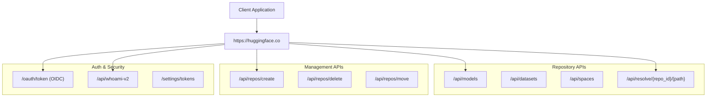
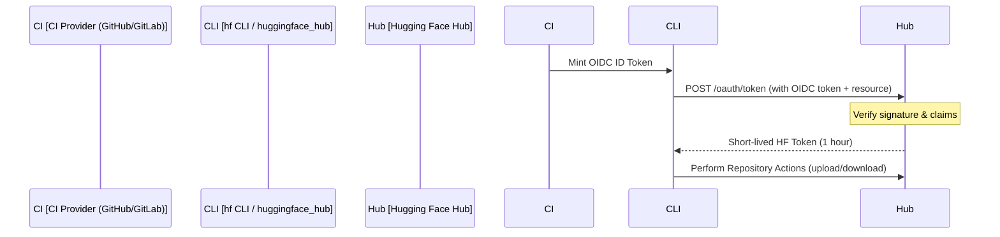

<!-- source: DeepWiki mcp.deepwiki.com · repo huggingface/hub-docs · page 3 Hub API and Programmatic Access · fetched 2026-10-26 -->

# Hub API and Programmatic Access

Relevant source files

The following files were used as context for generating this wiki page:

- [docs/hub/api.md](docs/hub/api.md)
- [docs/hub/datasets-audio.md](docs/hub/datasets-audio.md)
- [docs/hub/datasets-data-files-configuration.md](docs/hub/datasets-data-files-configuration.md)
- [docs/hub/datasets-image.md](docs/hub/datasets-image.md)
- [docs/hub/datasets-manual-configuration.md](docs/hub/datasets-manual-configuration.md)
- [docs/hub/datasets-overview.md](docs/hub/datasets-overview.md)
- [docs/hub/datasets-video.md](docs/hub/datasets-video.md)
- [docs/hub/datasets-webdataset.md](docs/hub/datasets-webdataset.md)
- [docs/hub/jobs-webhooks.md](docs/hub/jobs-webhooks.md)
- [docs/hub/rate-limits.md](docs/hub/rate-limits.md)
- [docs/hub/repositories-github-actions.md](docs/hub/repositories-github-actions.md)
- [docs/hub/search.md](docs/hub/search.md)
- [docs/hub/security-tokens.md](docs/hub/security-tokens.md)
- [docs/hub/spaces-github-actions.md](docs/hub/spaces-github-actions.md)
- [docs/hub/trusted-publishers.md](docs/hub/trusted-publishers.md)
- [docs/hub/webhooks-guide-auto-retrain.md](docs/hub/webhooks-guide-auto-retrain.md)
- [docs/hub/webhooks-guide-discussion-bot.md](docs/hub/webhooks-guide-discussion-bot.md)
- [docs/hub/webhooks-guide-metadata-review.md](docs/hub/webhooks-guide-metadata-review.md)
- [docs/hub/webhooks.md](docs/hub/webhooks.md)

This document covers the Hub's REST API endpoints and programmatic client libraries that enable automated interaction with models, datasets, and Spaces. It includes authentication mechanisms, common integration patterns, and code-based workflows for repository management.

For information about repository management through the web interface, see [Repository Management](#2). For information about setting up automated workflows and CI/CD integration, see [Webhooks and Automation](#3.2).

## REST API Overview

The Hugging Face Hub exposes a comprehensive REST API that provides programmatic access to all Hub functionality. Documentation and testing for these endpoints are available in the [OpenAPI Playground](https://huggingface.co/spaces/huggingface/openapi) [docs/hub/api.md:6-6]().

### API Architecture

Sources: [docs/hub/api.md:1-16](), [docs/hub/rate-limits.md:7-12](), [docs/hub/trusted-publishers.md:141-143]()

### Rate Limits and Tiers

The Hub enforces rate limits based on the request type and user tier. Limits are calculated over 5-minute fixed windows [docs/hub/rate-limits.md:75-76]().

| Bucket | Purpose |
| :--- | :--- |
| **Hub APIs** | Model/dataset search, repo creation, management [docs/hub/rate-limits.md:7-8](). |
| **Resolvers** | URLs containing `/resolve/` for downloading files (highest limits) [docs/hub/rate-limits.md:9-12](). |
| **Pages** | Web browsing requests (lowest limits) [docs/hub/rate-limits.md:13-15](). |

For details, see [REST API and Client Libraries](#3.1).

Sources: [docs/hub/rate-limits.md:1-72]()

## Client Libraries

Official client libraries wrap the REST API to provide high-level abstractions for common operations.

### Python Client (`huggingface_hub`)

The `huggingface_hub` Python library is the primary client for programmatic Hub interaction. It includes smart retry handling for 429 rate limit errors by parsing the `RateLimit` HTTP header [docs/hub/rate-limits.md:94-98]().

### JavaScript Client (`huggingface.js`)

The `huggingface.js` client provides access to Hub endpoints for JavaScript and TypeScript environments [docs/hub/api.md:3-3]().

Sources: [docs/hub/api.md:3-3](), [docs/hub/rate-limits.md:92-98]()

## Authentication and Security

### User Access Tokens

User Access Tokens are the preferred way to authenticate applications. They come in three primary flavors [docs/hub/security-tokens.md:12-19]():
- `fine-grained`: Scoped to specific resources (recommended for production) [docs/hub/security-tokens.md:71-71]().
- `read`: Read access to public and private repos.
- `write`: Additionally grants permission to create or modify content.

### Trusted Publishers (OIDC)

For CI/CD workflows (e.g., GitHub Actions, GitLab CI), **Trusted Publishers** allow pushing to the Hub without storing an `HF_TOKEN` secret [docs/hub/trusted-publishers.md:1-5](). The workflow exchanges a short-lived OIDC token from the CI provider for a short-lived Hub token [docs/hub/trusted-publishers.md:141-143]().

For details, see [REST API and Client Libraries](#3.1).

Sources: [docs/hub/security-tokens.md:1-106](), [docs/hub/trusted-publishers.md:1-143]()

## Automation and Webhooks

Webhooks enable MLOps workflows by listening for changes on repositories (Models, Datasets, or Spaces) [docs/hub/webhooks.md:3-5]().

### Webhook Event Scopes
- `repo`: Repository creation, deletion, or moving [docs/hub/webhooks.md:96-96]().
- `repo.content`: Commits, tags, and file updates [docs/hub/webhooks.md:97-97]().
- `discussion`: PR/Discussion creation and status updates [docs/hub/webhooks.md:99-99]().
- `discussion.comment`: New or updated comments [docs/hub/webhooks.md:100-100]().

### Use Cases
- **Auto-Retrain**: Trigger model fine-tuning when a dataset is updated [docs/hub/webhooks-guide-auto-retrain.md:6-7]().
- **Discussion Bots**: Use LLMs to reply to Hub comments automatically [docs/hub/webhooks-guide-discussion-bot.md:1-3]().
- **Metadata Review**: Automatically validate YAML metadata in `README.md` files [docs/hub/webhooks-guide-metadata-review.md:1-3]().

For details, see [Webhooks and Automation](#3.2).

Sources: [docs/hub/webhooks.md:1-105](), [docs/hub/webhooks-guide-auto-retrain.md:1-171](), [docs/hub/webhooks-guide-discussion-bot.md:1-133]()

## Hub Jobs

Hub Jobs provide a way to run compute tasks on Hugging Face infrastructure. They can be triggered manually or automatically via webhooks [docs/hub/webhooks.md:5-5]().

Common tasks for Jobs include:
- Large dataset processing and sharding [docs/hub/datasets-data-files-configuration.md:59-59]().
- Model evaluation and automated testing.
- Serving endpoints for specialized processing.

For details, see [Hub Jobs](#3.3).

Sources: [docs/hub/webhooks.md:5-5](), [docs/hub/jobs-webhooks.md:1-10]()

---

